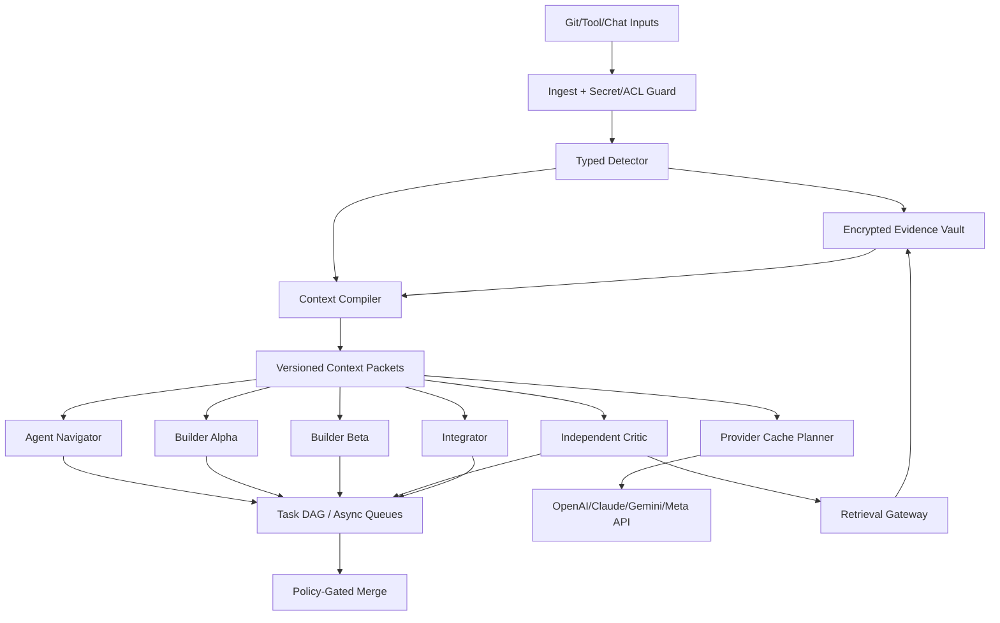

# EvoForge v3.5 — Recoverable Context Mesh / 구현 계약

> 상태: 설계안 · 실제 프로덕션 실행 및 비용 개선 실측 없음 · 2026-10-24. 로컬 모델 추론 없음. Caveman 4.x의 알고리즘/설계 참조; 라이브러리 직접 통합은 승인 전 보류.

## 1. 핵심 차별화
- **Input → Agent:** 5개 AI는 동일 원본 Evidence Vault를 공유하되 서로의 사적 대화/Provider KV Cache는 공유하지 않음.
- **Coordination:** DAG + Role Negotiation + Context Packet per role. 작업 목표는 원문 Work Contract로 고정하고, 에이전트별로 관련 문맥만 선별.
- **Handoff:** 장문의 대화 대신 Versioned Manifest + Delta + Required Evidence Ref를 전달.
- **Validation:** 최종 비작성자 리뷰는 원본 Diff·필수 검증 결과·실패 근거를 반드시 열람. 원본이 없으면 승인 불가.
- **Optimization:** Provider cache hit, cache write rate, recovery cost, compressor compute, retry/rework, human intervention을 함께 평가.

## 2. 아키텍처



모든 외부 API는 사용자가 연결·승인한 공급사만 사용한다. 외부 AI Chat은 MCP/Folder 연결 상태에 따라 간헐적으로 참여하며, Agent 상태는 WAITING/READY/ACTIVE/OFFLINE으로 나눈다.

## 3. Role-specific Context Packet
- `IMMUTABLE`: policy_hash + goal_version + TaskContract + tool schema hash.
- `VERIFIED`: 테스트 및 코드 정보의 출처/신뢰/버전/시간.
- `ARTIFACTS`: Git Blob/CI 로그/원문/압축본 content manifest.
- `DYNAMIC`: 역할별 최신 diff, task delta, unresolved questions, action budget.
- `RECOVERY`: Evidence refs + allowed selectors + expiry + retrieval endpoint.

기본 권한: Planner는 요구·정책 원문, Builder는 해당 파일·테스트 범위, Critic은 전체 평가대상 변경과 관련 Assertion, Integrator는 검증 증명서·승인 스냅샷. 고위험 리뷰는 강한 원문 접근 조건 적용.

## 4. 입력 형식별 정책
| Source | 기본 전략 | 유지 필수 요소 | Lossy 허용 |
|---|---|---|---|
| 사용자 목표·보안 정책·허용권한 | PRESERVE | 전체 승인 문서 | 아니오 |
| 테스트 실패·Assertion·stacktrace | SELECTIVE+RECOVERABLE | 모든 실패 case, line, cause | 제한적 |
| JSON/API 결과 | STRUCTURAL | 필수 키·타입·참조 | 검증 시에만 |
| 대형 Debug/Info 로그 | RECOVERABLE | ERROR/WARN + 상관관계·타임스탬프 | 예 |
| 소스 탐색 | AST STRUCTURAL | import·signature·target regions | 예, 원문 필수 접근 |
| 병합 대상 Git Diff | PRESERVE | 전체 최종 Diff | 리뷰/승인에서는 아니오 |
| HTML·테이블·검색 결과 | SELECTIVE | 표 제목, 관련 항목, 출처 | 예, 복원 필요 |
| 미지원·모호 형식 | RAW | 그대로 | 아니오 |

## 5. 안전 파이프라인 불변식
```text
1 classify → 2 check tenant policy → 3 store/encrypt original →
4 verify SHA/retention → 5 compress candidate → 6 semantic/structural checks →
7 compute net expected cost → 8 issue Context Packet OR raw fallback.
```

- 원문 저장은 **압축 결과 발행의 선행조건**이다. 단, 안전하게 원문 전달도 불가능할 때는 실패로 처리한다.
- 감사에 `context_policy_version`, `parser_name`, `parser_version`, `codec`, `blob_sha256`, `packet_hash`, `source_trust_level`을 기록한다.
- Ref는 random opaque ID; Blob SHA는 무결성에만 쓰며 타 조직 Content Discovery에 사용하지 않는다.
- 정책·보안·권한 관련 자료를 언어모델이 마음대로 버리거나 덮어쓰지 못한다.

## 6. Adaptive Strategy Decision

```text
For source S, role R, provider P, model M:
  if ACL denied or sensitive for P: BLOCK
  if safety-critical and full evidence required: PRESERVE
  options := RAW, SELECTIVE, RECOVERABLE, PROVIDER_CACHE_ONLY, CACHE_AWARE
  for option:
     estimate cost(provider input bill incl write/read + output + compute + restore + rework)
     estimate latency(queue+compile+API+retrieve+verification)
     if fidelity_eligible and token_budget_fits then choose Pareto-admissible best
  on uncertainty: SELECTIVE or RAW; never lossy without saved original
```

**중요:** 압축 자체는 KV Cache 프리픽스를 파괴할 수 있다. 모델별 캐시 API 설정/요율/최소 길이를 Capability Registry에서 주기적으로 검증하고 비용 실측으로 선택한다. OpenAI 일부 모델은 explicit prefix breakpoint, Anthropic은 cache_control, Gemini는 API/모델별 지원 범위가 달라 표준화된 하나의 옵션이라고 가정하지 않는다.

## 7. AI Chat 참여의 안전 제약
- 외부 AI Chat은 브라우저 세션 자체가 무인 실행을 보장하지 않는다.
- 폴더 파일에 JOIN_REQUEST를 기록한 것만으로 신원이 증명되지 않는다.
- 복원 도구가 없다면 간단한 제안·비민감 검토만 수행하고 고위험 비작성자 Reviewer로 지정하지 않는다.
- 호출 가능한 경우에도 `retrieve_evidence`는 언제나 조직 ACL과 요청 한도를 검사한다.

## 8. Mission Control 추가 페이지
- Context Efficiency: 월간 추정/실측 USD, cache reads/writes, compressed vs full inputs, context miss, restore success.
- Collaboration Handoff: 5개 AI 각 작업의 공통 버전, last delta, 누가 어떤 Evidence를 확인했는지.
- Decision Trail: why compressed/why raw, what was excluded, who restored, review signed source.
- User Command: '요약 말고 전체 테스트를 확인', '이 변경을 보호' → 컨텍스트 버전 생성+평가 재실행.

## 9. 생산성 검증 계약
원래 v3.4 5-Agent 평가를 유지하면서 RAW(A)/SELECTIVE(B)/RECOVERABLE(C)/PROVIDER_CACHE_ONLY(D)/CACHE_AWARE(E)를 교차 반복. 동일 작업, 모델, 검증 기준, 예산 조건에서 `quality >= baseline` 조건을 먼저 확인한다. 비용 절감이 발생해도 버그 누락/재작업 증가가 있으면 실패. 수행 시간과 비용 기준의 10배를 혼용하지 않는다.

## 10. 공급망·라이선스
2026-10-24 공개 `LICENSING.md`상 Caveman 3.0.0 이후 소스는 Apache-2.0이며 전 버전의 BSL/MIT 이력과 구분한다. Apache 버전을 가져와 쓰려면 태그/커밋을 고정하고 LICENSE/NOTICE, 취약점, 텔레메트리, 외부 네트워크 전송 여부를 검수한다. Caveman Cloud 자체 상용 서비스 코드는 저장소 라이선스 대상이 아니다. 로컬 Proxy 그대로를 멀티테넌트에 배포하지 않고 이식 후보는 네트워크 차단된 변환기 Worker 안에서만 시험한다.

## 11. 장애 전략
- Vault 쓰기 실패: 원문 전달 조건 충족하면 RAW, 아니면 BLOCK.
- Reference 유실/만료: 해당 승인 중단, 원문 재확보 후 검증 재시작.
- Provider 캐시 미적중: 정상 실행, 청구서와 비교해 다른 전략 선택.
- Codec parse 실패: 원문, 압축 성공으로 계산 금지.
- 테넌트 경계 위반: Access Denied + Incident.
- 압축으로 CI 실패 누락: 전체 타입 프로필 자동 비활성화+원문 재평가.

## 12. 최초 구현 단계
1. Evidence Vault/Context Packet/ACL + 3종 파서(JSON/로그/JUnit)
2. 5-Agent Context Packet + 원문 복원 MCP/Folder Interface
3. Provider Native Cache Planner + 실제 청구량 계측
4. 4~5개 전략 비교 실험 및 Shadow Deployment
5. 안정성 입증 후 Parser 확대 및 Research Evolution 통합
