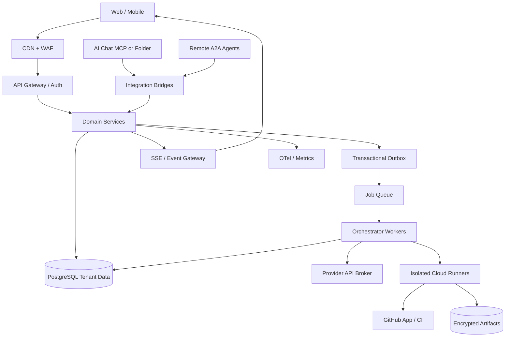

> **v3.4 최우선 개정:** 모든 5-Agent 협업은 임계경로·검증 용량·Provider 지연·비용·Git 충돌에 따라 유동 배치한다. 10X는 검증을 목표로 하는 가설이며 달성치가 아니다. 기존 v3.3 보안/공급망 결정은 유지한다.

> **2026-10-23 최신 기술 통합 · v3.3 필수 변경(이전 버전 결정에 우선):** (1) LiteLLM 공급망 사고로 기본 게이트웨이 제외 (2) MCP 2026-07-28 stateless+MRTR, deprecated 기능 금지 (3) MCP Tasks는 능력 협상된 선택 확장, 내부 작업 엔진은 별도 운영 (4) A2UI는 신뢰 가능한 컴포넌트 카탈로그만 (5) Letta Trajectory/ACE를 적용한 출처 추적 기억 (6) AHE의 사전 예측→사후 판정 계약 (7) SWE-bench Pro V2의 봉인 평가·깨끗한 환경 재채점 (8) OPA/OWASP Agentic 통제 및 SLSA/in-toto 증거 서명. 구현·성능을 검증한 것과 설계만 한 것을 구분할 것.

> **2026-10-23 개정 이력 · v3.2** — ScholarEvolve 연구(2026-09-30, arXiv:2609.40169v1)로부터 5모듈 하네스·Research Radar·방법론 탐색·변형·조합·검증·승격 통제를 추가했습니다. 기존 v3.1의 상용 API/보안/UX 요건은 유지하며, 본 문서는 **구현 전 설계안**입니다. 코드 작성·시스템 실행·성능 검증은 이루어지지 않았습니다.

# EvoForge v3.6 — Recoverable Context Mesh (정정판) & 5-Agent Efficiency (50페이지)

> **문서 목적:** 대회 발표용이 아닌, 실제 고객에게 판매·운영할 수 있는 클라우드 SaaS 제품의 구현 기준서. 기능 요구사항(FR), 비기능 요구사항(NFR), API·데이터 모델, 사용자 경험, 검증 및 출고 기준을 포함한다.
>
> **제품 원칙:** 로컬 LLM 없음 / API 및 권한 있는 외부 AI Chat 참여 / 사용자 방향 제시 / AI 간 자율 협의 / 코드 검증·병합은 정책 엔진이 최종 통제 / 모든 성과는 증거 기반 / 모든 사용자는 자기 데이터만 접근.
>
> **사실 구분:** 본 문서의 SLO, 성과 목표, 일정, 요금 구조는 **제안된 목표·가정**이다. 현재 제품에서 달성한 실측치가 아니다. 서비스에 연동된 외부 모델·클라이언트의 기능은 실제 지원 여부를 검증해야 한다.
> **v3.1 기반 통제 유지:** 핵심 변경은 무상태 MCP 전송 계약, AI Chat 비상주 참여 제약, 테넌트 복합 FK, 외부 부작용 멱등 처리, GitHub 정책 재검증, UI 이벤트 커서·재동기화, 청구 원장의 분리, 안전한 단계별 출시 기준이다. 아래 `v3.1` 표시는 개정 보완 사항이다.


> **v3.6 개정(2026-10-25) · 최우선:** v3.5 Context Mesh를 실행 가능한 계약으로 다시 맞췄다. (1) 압축 방식(`fidelity`: RAW/STRUCTURAL/RECOVERABLE/REF_ONLY)과 캐시 방식(`cache_mode`)을 별개 축으로 분리하고 모든 식별자를 `contracts/vocabulary.v3.6.json` 하나로 통일 (2) Caveman 엔진 계열은 BSL-1.1이며 멀티테넌트 SaaS 사용에 상용 라이선스가 필요함을 확인 → 코드 미사용·클린룸 재구현 (3) 비용 기준선을 캐시 없는 원가에서 **같은 캐시 조건의 RAW 실측**으로 교체, 복원 1회 = 추가 모델 턴 1회 (4) "Critic은 원문 확인"을 Review Coverage Ledger로 판정 (5) SQL의 감사·삭제·멱등성 결함 수정(PostgreSQL 16에서 39개 검사 통과) (6) 스키마·SQL·참조 구현·validator가 문서보다 우선. v3.5 절은 본문을 바로 정정했고 정정 목록은 `review/EvoForge_v3.6_Review_Report.md` 부록 A에 있다. v3.1–v3.4 절의 용어가 vocabulary와 다르면 vocabulary가 우선한다.

> **v3.5 개정(2026-10-24):** Caveman 4.x의 입력 유형별 압축·원문 복원 설계와 공급사별 Prompt Cache 정책을 참조하여 `Context Compiler + Tenant-Scoped Evidence Vault + Adaptive Cache Planner`를 추가한다. **로컬 모델 추론은 도입하지 않는다.** 압축 워커는 클라우드에서 동작할 수 있지만 API 키와 비밀정보를 보유하지 않으며, 외부 Caveman Cloud 전송은 기본 비활성화한다. 모델별 KV 상태는 공유하지 않는다. 5-Agent×10X는 검증 전 성능 목표다.

## 50페이지 목차

| 범위 | 주제 |
|---|---|
| 01–10 | 비전·시장·사용자·포지셔닝·범위·비즈니스 모델 |
| 11–20 | IA·Mission Control·목표·협업·피드백·온보딩 UX |
| 21–30 | API·MCP·폴더·A2A 연동, 인증, 메시징, 역할 협의·사용자 개입 |
| 31–40 | 워크플로 실행·Git·클라우드 격리·품질·실험·진화·효율화 |
| 41–50 | 시스템·DB·API·실시간 동기화·보안·컴플라이언스·운영·과금·로드맵·출시 기준 |

**공통 역할 표기:** Owner(조직 소유자), Admin(관리자), Operator(작업 운영자), Developer(개발자), Reviewer(독립 검토자), Viewer(열람자), Agent(API/MCP/Folder/A2A 참여자). 인간 계정과 AI 계정은 구분한다.

<!-- PAGE:01/50 -->

# 01. 제품 비전과 장기 방향성

**제품명:** EvoForge · **제품 범주:** Autonomous Software Engineering Operations Platform · **제공 방식:** Multi-tenant Cloud SaaS.

### 핵심 약속
EvoForge는 사용자의 Git 저장소를 기반으로 이종 AI 에이전트가 자율적으로 협의하고, 개선 과제를 발견하며, 후보 코드를 독립 구현한 후 테스트·성능 측정·비작성자 리뷰를 통과한 변경만 반영하는 서비스다. 사용자는 개발 작업을 상세히 지시할 수도 있고, “안정성을 높여라”처럼 장기 목표만 설정할 수도 있다. 두 방식 모두 동일한 증거 추적 체계에 기록된다.

### 제품의 정체성
- **Open:** API Key, 지원되는 Remote MCP, 클라우드 폴더/브리지, A2A를 통해 다양한 AI가 동일한 조직에 참여한다.
- **Autonomous:** 작업 협의·분업·실행 방식은 AI가 제안하고, 사전에 승인된 정책 범위 안에서 자동 실행한다.
- **Verifiable:** 실제 작업 완료와 목표 성과를 분리하고, 커밋·테스트·벤치마크·사용자 확인으로 개선을 증명한다.
- **Human-directed:** 사용자가 목표, 우선순위, 예산, 리스크 허용 범위, 실행 중단을 언제나 통제한다.

### 장기 제품 방향
개별 코드 작성기의 경쟁보다 상위 계층인 **AI 엔지니어링 운영체제**를 지향한다. 코드 변경에서 시작하여 요구사항 → 설계 → 구현 → 테스트 → 배포 → 고객 피드백 → 다음 개선까지 연결한다. 초기에는 GitHub 중심; 장기적으로 GitLab, Jira/Linear, 고객 운영 데이터와 연계한다.

**결정 D-001:** 단일 모델의 채팅 앱이 아닌, 여러 실행 주체가 참여하는 지속형 운영 시스템으로 설계한다. 모델 교체로 제품의 핵심 상태·권한·증거가 소실되어서는 안 된다.

**출시 수용 기준:** 1개 조직이 서로 다른 접속 방식의 에이전트 2개 이상으로 실제 PR을 생성하고, 검증 기록과 사용자 의견을 연결해 확인할 수 있어야 한다.

### v3.1 제품 계약 — 무엇을 자동화하고 무엇을 하지 않는가
- 최소 가치 단위는 **검증 근거가 첨부된 PR 1건**이다. 코드 작성만 성공했거나 AI가 성공이라고 주장한 상태는 제품 성과로 간주하지 않는다.
- 사용자 의도는 `ObjectiveVersion`으로 불변 기록하고, 계획 변경은 새 버전을 생성한다. 인간 명령은 **실행 정책·고객 권한·보안 정책을 우회할 수 없다**.
- 에이전트는 세 유형의 역할을 갖는다: `worker`(코드/문서 생성), `critic`(독립 검토), `observer`(결과·상태 보고). 역할은 작업별로 바뀌지만 시스템 권한은 연결 주체·조직 정책에 의해 제한된다.
- 서비스의 운영 가능 범위는 `프로젝트 연결→실행 계획→격리 패치→정책 검증→PR`부터 시작한다. 자율 배포·자율 권한 승격·외부 웹사이트 브라우징은 기본 기능으로 약속하지 않는다.


### v3.2 제품 확장 — Research-Guided Engineering Evolution
**변경 결정 D-011:** 고객 소프트웨어 개선 외에 **EvoForge 에이전트 하네스(harness) 자체를 연구 기반으로 진화**시키는 `Research Evolution Lab`을 제품의 별도 제어 영역으로 둔다. 이는 LLM 가중치 학습이 아니라 도구 인터페이스, 컨텍스트, 스킬, 메모리, 협업 워크플로의 소프트웨어 구성을 개선한다.

두 실행 루프는 분리된다. `Customer Software Loop`는 고객 저장소에서 수정 후보를 생산하고 PR을 생성한다. `Harness Research Loop`는 에이전트 실행 로그 및 외부 연구를 바탕으로 새로운 실행 전략을 연구하며, 평가에 통과한 버전만 고객에게 *선택 가능하게* 제공한다. 연구 루프가 운영 중인 고객 작업과 정책을 즉시 바꾸면 안 된다.

**고객에게 보이는 가치:** 작업 실패 원인을 연구 근거에 연결하고, 어떤 기술이 제안되었으며 어떤 통제된 실험에서 좋아졌는지를 확인할 수 있다. 변경 전/후 비용·시간·성공률을 함께 표시하고 사용자 승인/거부/롤백이 가능하다.

**중요:** ScholarEvolve의 연구 수치는 해당 논문의 AppWorld·τ²-Bench 실험 결과다. EvoForge에 적용해 동일한 개선이 나타난다는 뜻이 아니다. 원 논문: https://arxiv.org/abs/2609.40169. 원 논문에 안내된 GitHub 저장소는 2026-10-23 조회 시 빈 저장소였으므로 코드 재사용·라이선스 확정을 가정하지 않는다.

### v3.3 · 장기 제품 정체성: Verifiable Engineering OS
제품의 최종 단위는 'AI의 응답'이 아니라 `Objective → Task → Agent Run → Candidate → Test → Attestation → PR → Outcome → Feedback`의 검증 가능한 연결이다. 인간의 방향 변경과 실제 적용을 구분하여 보여준다. 북극성 KPI는 `고객이 수용한 검증 개선(Weighted Verified Improvement)`으로 유지하되, 품질 게이트를 통과하지 못한 활동량을 성과에 합산하지 않는다.
**제품 규칙:** 외부 AI Chat 참여는 능력과 세션 범위가 허락할 때만 가능하며, 로컬 LLM 및 사용자 PC 상주 요구는 없다. **검수:** API 에이전트 2개+파일/MCP AI Chat 1개의 협업이 실제 PR과 사용자 피드백까지 연결된다.

### v3.4 · 5-Agent × 10X의 제품 계약
EvoForge는 **최대 5개의 외부 API/AI Chat 참가자를 하나의 자율 협업 집합으로 운영**하는 `Adaptive Collective v1`을 제공한다. 다섯 모델이 항상 동일 시점에 실행되어야 한다는 뜻은 아니다. 단일 작업에서는 하나의 구현 AI와 독립 검증으로 축소하고, 병렬 가치가 입증되는 경우에만 최대 다섯 슬롯을 가동한다. 현재 상태는 **설계안**이며, 성능 및 비용 개선 수치는 달성 실적이 아니다.
- 공식 10X North Star: `Weighted Verified Impact / calendar-week`와 함께 `Verified Fixes / elapsed-time`을 측정한다. 성능 향상은 **동일 품질·안전 조건의 단일 AI 통제군** 대비 측정한다.
- 별도 Guardrails: `Cost per Verified Fix`, `Regression Escape Rate`, `P95 Time to Verified Fix`, `User Intervention Minutes`를 제한한다. 목표를 달성하기 위해 품질·권한·승인 정책을 완화하지 않는다.
- 처리시간 10배와 모델 비용 효율 10배를 동일한 주장으로 혼동하지 않으며, 특정 작업에 대한 결과를 다른 작업 전체로 일반화하지 않는다.

### v3.5 · 제품 핵심 계약: Shared Evidence, Independent Context
- 다섯 AI는 **원본 데이터를 공유**하되 대화 전체·모델 내부 상태를 공유하지 않는다. 동일 `Objective`, `TaskContract`, `EvidenceManifest`를 참조하고, 각자의 역할·권한·작업 변경분으로 필요한 컨텍스트만 생성한다.
- 새 핵심 모듈 `Context Compiler`, `Evidence Vault`, `Provider Cache Planner`, `Context Quality Guard`를 추가한다. UI에서는 인계 시간, 실제 공급사 토큰 비용, 원문 복원 가능 상태, 품질 영향, 주도 병목을 보여준다.
- 운영 가치 가설은 *압축률*이 아니라 `검증된 개선/시간`·`검증된 개선/원가`·`회귀 이탈률`이다. 10배 성과는 동일 기준 평가 전까지 검증되지 않은 목표로만 표기한다.


---
<!-- PAGE:02/50 -->

# 02. 핵심 문제와 구매 이유 (JTBD)

### 고객이 겪는 문제
현재 AI 코딩 도구는 개별 세션 안에서 높은 생산성을 제공하지만, 여러 모델을 함께 쓰는 경우 누가 무엇을 수행했는지, 작업 중단 이후 어떻게 이어받는지, 무엇이 실제로 좋아졌는지 파악하기 어렵다. 개발 조직에는 공통 권한 정책과 감사 기록이 필요하지만 개별 에이전트 로그를 수작업으로 조합하는 것은 비용이 크다.

### 핵심 JTBD
1. **When** 작은 개발팀이 여러 AI를 사용해 개발할 때, **I want** 작업을 자동 분배하고 검증해, **so that** AI의 생산성을 높이면서 통제를 잃지 않는다.
2. **When** 운영 중 성능·품질 문제가 발생할 때, **I want** 원인 탐색과 개선 후보 실험을 위임해, **so that** 엔지니어가 중요한 결정을 담당한다.
3. **When** 고객 요구가 바뀔 때, **I want** 목표·우선순위를 즉시 수정해, **so that** 이미 움직이는 AI 팀이 새로운 방향으로 재계획한다.
4. **When** 경영진·고객이 개발 성과를 물을 때, **I want** 측정 가능한 전후 비교와 증거를 보고, **so that** 활동량과 가치 창출을 구분한다.

### 기존 도구와의 경쟁 관계
코딩 에이전트·IDE·CI 도구를 대체하는 것이 아니라 **조정·검증·추적 레이어**로 공존한다. 고객은 기존 모델 구독·API·Git 워크플로를 유지한 채 EvoForge를 도입할 수 있다.

### 검증할 가설
- 여러 AI를 묶는 것 자체보다 오류 차단과 상태 지속성이 구매 이유가 되는가?
- 목표·피드백과 코드 결과를 한 화면에서 보는 것이 실제 관리 시간을 줄이는가?
- 외부 AI Chat 참여가 실사용에 유용한가, 아니면 소수 고급 사용자의 요구인가?

**수용 기준:** 고객 인터뷰 15건에서 가장 중요한 JTBD를 분류하고, 첫 유료 파일럿 3팀에서 최소 1개 검증 가능한 코드 개선 사이클 완료.

### v3.3 · 재정의된 구매 동기
가격보다 중요한 JTBD는 ① 성공한 변경의 증명 ② 사람의 실시간 감독 ③ 여러 AI를 혼용할 때의 안정적 상태·책임 경계 ④ 고객 코드·키 안전성이다. 첫 데모에서 10분 내 `목표→작업→후보→검증 PR→근거 조회` 경로를 재현 가능한지 계측한다. 유료 사용자는 에이전트 수보다 검증 PR 수·거절된 위험 패치·운영시간 단축을 확인해야 한다.

### v3.4 · 병목 문제 정의
다중 에이전트의 효율은 `작업 분해 가능성`, `공유 상태/수정 파일 중첩`, `API 제한`, `CI/Runner 용량`, `통합 순차구간`, `검증 실패에 따른 재작업`에 의해 결정된다. 'AI 수 증설'은 해결책이 아니라 옵션이며, 부하에 따른 대기열 증가와 오류 전파를 완화하는 구조가 필요하다.

---
<!-- PAGE:03/50 -->

# 03. 목표 고객·시장 진입 순서

### 1차 타깃
**독립 개발자 / 2~10명 규모 AI 중심 제품팀.** 여러 모델을 사용하고, GitHub를 사용하며, 테스트 자동화에 익숙하지만 전담 플랫폼 엔지니어는 없는 팀. BYOK와 월간 사용량 상한의 가치를 즉시 이해한다.

### 2차 타깃
**10~50명 개발조직 및 AI 에이전시.** 여러 프로젝트·고객 저장소를 관리하며, 승인 흐름·사용자 피드백·비용 배분·성과 보고가 필요하다. 조직별 멀티테넌시와 감사 로그가 주요 구매 요인이다.

### 후속 엔터프라이즈
민감 정보 규제 산업, 사내 Git 서버·SSO·데이터 지역성·커스텀 보존 기간이 요구되는 고객. 최초 제품에서 엔터프라이즈 전용 통제의 완전 지원을 약속하지 않는다.

### 페르소나 예시
| 사용자 | 가장 중요한 행동 | 제품 성공 판단 |
|---|---|---|
| Solo Builder | API 연결 후 첫 개선 작업 위임 | 당일 첫 검증 PR |
| Tech Lead | AI 배정·충돌·품질 게이트 확인 | 재작업 감소·감사 가능 |
| Product Owner | 목표·피드백·출시 우선순위 조정 | 의견이 실제 변경으로 연결됨 |
| Security Reviewer | 위험 작업과 권한·증거 점검 | 권한 우회 없이 출고 |

### 초기 제품 제외 고객
CI·테스트 체계가 없는 완전 비개발 고객에게 “무감독 프로덕션 배포”를 약속하지 않는다. Git·테스트·환경 권한 설정을 도울 온보딩은 제공하지만 책임 경계를 분명히 한다.

**수용 기준:** 적어도 두 페르소나(개발자·제품 담당자)가 별도 교육 없이 목표 변경과 증거 조회를 완료하도록 사용성 테스트.

### v3.3 · 단계별 상용 고객 조건
Private Alpha는 테스트가 존재하는 GitHub 저장소를 가진 2~10명 팀으로 제한하고, 인지하지 못한 데이터 외부 전송 위험을 고지한다. 10~50명 팀에는 감사 보존·승인·권한·과금 원장·BYOK 키 회수가 기본 기능이다. 규제 고객은 별도 DPA/정보처리위탁/데이터 지역·키 관리 심사 후에만 제공한다. **검수:** 잠재 고객 3곳에서 사용자 피드백이 실제 PR에 연결되는지 관찰한다.

### v3.4 · 병목 관리 공통 운영 규칙
이 페이지의 기능은 명령·이벤트·증거의 표준 계약을 사용한다. 응답 지연과 검증 상태는 분리 표시하고, 실제 검증된 결과만 성과로 기록한다.

---
<!-- PAGE:04/50 -->

# 04. 가치 제안·경쟁 차별화

### 주된 가치 제안
- **다양한 참가 방식:** API 모델은 백그라운드에서 실행되고, MCP/Folder Chat은 가능한 권한·세션 범위 안에서 협업한다.
- **실시간 조직 투명성:** 참가 AI, 역할 협의, 작업 상태, 대기·병목 및 실패 원인을 그래프로 확인한다.
- **검증 중심 자동화:** AI의 자기평가와 무관하게 테스트·정책·독립 리뷰를 통과해야 병합된다.
- **목표·피드백 연결:** North Star → Objective → Initiative → Task → PR → Evidence → User Confirmation의 추적 사슬을 제공한다.
- **비용 통제:** 사용자 보유 API 키를 사용하고, 역할별 비용과 유효 개선당 비용을 관리한다.

### 피해야 할 주장
“멀티에이전트이므로 항상 빠르다”, “아무 AI Chat이든 백그라운드 자동 참여”, “모든 버그를 스스로 고친다”, “완전 무인 배포가 기본”은 사실과 어긋나거나 위험하다. 대신 *지원 가능한 클라이언트에서의 상호운용성*과 *재현 가능한 개선*을 약속한다.

### 경쟁 지형 분류
| 비교 대상 | 주기능 | EvoForge 차별점 |
|---|---|---|
| AI IDE / 코딩 보조 | 코드 작성 | 이종 AI 운영·품질 거버넌스 |
| 단일 에이전트 | 한 모델의 작업 수행 | 비작성자 검토·다중 후보 평가 |
| CI/CD | 정형 테스트·배포 | 작업 발견·협의·피드백 연결 |
| PM 툴 | 할 일·로드맵 | 실제 커밋과 평가 지표 자동 결합 |
| Observability 툴 | 로그·Trace | 목표 달성도와 사용자 명령 제어 |

**KPI:** 첫 검증 PR까지 시간, 유효 패치/작업 비율, 차단된 회귀, 사용자의 주간 목표·피드백 열람률.


### v3.2 차별화 — Research-to-Verified-Improvement
제품 차별화 문장을 `개방형 AI 참여 + 사용자 감독 + 검증된 코드 개선 + 연구를 통한 에이전트 자체 고도화`로 정리한다. 논문 검색만 하는 연구 에이전트, 논문을 코드로 바로 복사하는 서비스와 다르다. **연구 인용 → 방법론 추출 → 모듈별 변형 → 독립 평가 → 운영 적용 결정**이 모두 실행 증거로 남아야 한다.

고객 기능 간 구분: `Research Radar`는 기술 발견/제안, `Evolution Lab`은 샌드박스 검증/조합, `Promotion Center`는 릴리스 승인/카나리/롤백, `Mission Control`은 현재 사용 중인 하네스 버전과 효과를 표시한다. 고객 코드 자체에 새 기법을 적용하는 실험과 플랫폼 하네스를 바꾸는 실험의 위험과 권한을 분리한다.

### v3.3 · 증명 가능한 경쟁 우위
Open Participation은 무제한 AI 지원을 의미하지 않는다. 등록 모델의 **Capability Matrix**(도구 호출, 파일 쓰기, 지속 실행, 비용 계량, 재연결, 승인 UX)를 제품 화면에 노출한다. 증거 및 통제 계층은 에이전트 벤더와 독립적이어야 한다. `Chat-only` 고객에게 무인 실행을 과장하여 판매하지 않는다.

### v3.4 · 검증 가능한 차별점
경쟁력은 에이전트 수가 아니라 **작업별 최적 협업 토폴로지를 선택해 검증된 결과를 빠르게 공급하는 능력**이다. 다섯 에이전트의 실제 협업과 단일/무계획 5-Agent 기준 대비 개선 결과, 비용·위험을 동일 대시보드에서 제시한다.

---
<!-- PAGE:05/50 -->

# 05. 제품 범위와 책임 경계

### 기본 제공
조직·프로젝트 관리, GitHub 연동, API 공급사 BYOK, Remote MCP 및 폴더 참여 경로, 에이전트 등록, 능력 검증, 작업 DAG, 역할 협의, 클라우드 격리 실행, Git PR 생성, 테스트·벤치마크 기록, Mission Control, 피드백 추적, 실시간 명령, 과금·감사·장애 대응.

### 단계별 출고 원칙
**GA 초기(출시 게이트 통과 시):** GitHub 중심, 공개 또는 승인된 비공개 저장소, 외부 API, 전용 Cloud Runner, 보호된 브랜치에 PR 생성. 자동 머지는 명시 승인·조건 충족 시에만 활성화. 고객 프로덕션 배포는 기본적으로 하지 않는다.

**후속:** GitLab·Bitbucket, A2A 호환 외부 서비스의 깊은 연동, IDE/ACP, 자체 배포 파이프라인, Enterprise SSO·전용 데이터 영역.

### 명시적 비범위
로컬 GPU 추론·Flare 엔진 이식, 모델 학습·파인튜닝, 모든 브라우저 채팅에 대한 무조건적 제어, 타 서비스 약관을 회피하는 브라우저 자동화, 무제한 에이전트 자기수정, 고객 승인 없는 외부 데이터 송신 및 운영 배포.

### 책임 경계
- **사용자:** 저장소·데이터·공급사 키에 대한 권한 보유와 사용 정책 설정.
- **EvoForge:** 접근 통제, 작업 실행 분리, 로그 무결성, 요금 상한, API 오류 처리, 사전 승인 정책 집행.
- **외부 모델/Chat:** 모델 가용성, 답변 품질, 해당 서비스 세션·도구 지원. 외부 장애가 EvoForge의 완전한 동작 중단으로 직결되지 않도록 재배정한다.

**검수:** 제품 문서·설정 화면·권한 요청에서 지원/비지원 기능이 동일하게 표현될 것.

### v3.1 제품 버전별 기능 매트릭스
| 기능 | Alpha 필수 | Beta 필수 | GA 필수 | 보류 |
|---|---|---|---|---|
| GitHub App·BYOK·API Agent 2개·검증 PR | ✓ | ✓ | ✓ | — |
| 목표·명령·실시간 Evidence | 최소 | 강화 | SLA 기준 | — |
| 외부 Chat MCP/폴더 | 수동 등록 검증 | 클라이언트 매트릭스 | 지원 범위 공시 | 상주 실행 보장 |
| 보호 브랜치/독립 리뷰/격리 Runner | ✓ | ✓ | ✓ | — |
| 자동 머지 | 비활성 | 제한 파일/리스크 | 고객 옵트인·검증 | 기본 무승인 배포 |
| 과금 | 측정만 | 테스트 청구 | 대사·세금·환불 | 글로벌 세무 자동화 |
- 기능 가능 여부는 배포 플랜명이 아닌 `capability_probe + 조직 정책 + 검증된 지원 조합`으로 판단한다.


### v3.2 출시 범위 재설정
`P1 유료 베타 후보`: 연구 검색·근거 정리·수동 승인된 방법론 제안, 단일 하네스 모듈 교체와 오프라인 검증, 버전 승격 이력. `P2`: 다중 모듈 조합/자동 후보 생성/주기적 연구 갱신. `P3`: 조건을 만족하는 범위의 자동 카나리와 도메인별 최적화. 초기 제품에서 **외부 논문 코드 자동 다운로드 후 고객 저장소/운영 플랫폼에 무승인 설치**는 금지한다.

고객 설정 `research_mode = OFF | SUGGEST | EVALUATE | CANARY`로 표시한다. `OFF` 기본값, `SUGGEST`는 코드 실행 없이 연구 제안만, `EVALUATE`는 격리 테스트까지, `CANARY`는 관리자 승인 및 배포 정책 충족 후 소규모 적용만 허용한다. `AUTONOMOUS_PROD_REWRITE` 모드는 제공하지 않는다.

### v3.3 · 정식 지원 범위 조정
기본 제공: BYOK 공식 공급사 SDK, GitHub App 최소 권한, API Agent, 승인된 폴더형 메시지, MCP 도구, SaaS Mission Control. 선택 제공: A2A 외부 에이전트·MCP Apps Chat 내 대시보드·A2UI 기반 안전한 UI 카드. 검토 후 제공: Temporal 도입, 다중 Git 제공자, 자동 머지, 템플릿형 Skill Marketplace. 금지: 고객 허가 없는 하네스 자기 배포, 모델 내부 상태를 공급사 사이에 공유, 검증 정책 AI 수정.

### v3.4 · 책임 및 통제 경계
자율 실행은 승인받은 프로젝트 범위 내 `Task/Plan/Role/Experiment`에 한정한다. 외부 API 장애, AI Chat 응답 중단, Git 보호 정책 변경, 고객 금지 파일 요청으로 인한 보류는 사용자에게 즉시 투명하게 노출한다. 코드 최종 병합은 Reviewer의 LLM 판단만으로 허용하지 않는다.

### v3.5 · 범위 경계: Caveman은 추론 서비스가 아니다
- 제공: 클라우드 실행 환경의 모델 입력 준비·도구 출력 가공·복구 참조·권한 관리·캐시 전략·비용 추적. 제공하지 않음: 로컬 LLM 추론, 공급사 간 KV 전송, AI Chat 세션의 임의 백그라운드 실행.
- 외부 Caveman Cloud로 고객 코드/데이터를 전송하는 경로는 포함하지 않는다. Caveman 엔진 계열 코드(engine/proxy/mcp/shrink 등, BSL-1.1)는 사용하지 않는다. 제3자 대상 호스팅·멀티테넌트 사용은 상용 라이선스 범위다(ADR-036R). 공개 문서만 참고한 **클린룸 구현**이 기본이며, MIT 경로만 커밋 고정·NOTICE·SBOM을 거쳐 쓸 수 있다. 제품 UI·마케팅에 'Caveman' 명칭을 쓰지 않는다.


---
<!-- PAGE:06/50 -->

# 06. 제품 원칙과 기본 정책

### 변경 불가능한 안전 원칙
1. **User intent first:** 사용자 목표·예산·리스크 정책이 에이전트의 자기제안보다 우선한다.
2. **Evidence over confidence:** 검증 로그가 없는 개선 주장은 “미검증”으로 표시한다.
3. **Least privilege:** API 연결/Chat/Runner 각각 필요 최소 권한만 갖는다.
4. **Fail closed:** 인증·저장소 권한·검증 결과가 불명확하면 머지·배포를 차단한다.
5. **Durable by design:** 메시지 중복·재연결·워커 종료에 대비해 상태를 저장한다.
6. **Explicit trust boundary:** 저장소 텍스트·에이전트 메시지·도구 결과는 비신뢰 입력이다.

### 고정 정책과 AI 협의 구분
| AI가 변경 제안 가능 | AI가 독자적으로 변경 금지 |
|---|---|
| 작업 역할·순서·파일 단위 분할 | 병합 필수 체크·보안 등급 |
| 복수 모델 간 작업 배정 | 조직 권한·비밀키 정책 |
| 코드 후보와 성능 가설 | 보호 브랜치·배포 승인 |
| 재시도·실험 선택 | 평가 데이터셋을 변경하여 통과 조작 |

### 세 가지 자동화 모드
**Observe:** 분석·제안만 수행. **Assisted:** 격리 실행·PR까지 자동, 머지는 승인. **Autonomous guarded:** 사전에 승인한 저장소·경로·위험 등급에 한정해 정책상 자동 병합. 모든 모드에서 강제 정지와 감사 기록은 유지한다.

**D-006:** 신규 조직의 기본값은 Assisted. 모드 승격은 명시적인 권한자 승인 및 테스트를 거친다.

### v3.1 정책 우선순위·불변식
충돌 시 우선순위는 `법·보안 강제 규칙 > 조직 관리자의 승인 정책 > 프로젝트 정책 > 사용자 실행 명령 > 에이전트 계획 > 외부 문서의 지시`이다. **위반 시 LLM에게 다시 승인받지 않고 코드에서 차단**한다.
- `policy_version`과 `policy_hash`를 모든 후보·리뷰·검증·머지에 고정한다. 정책 변경 시 진행 중 후보는 영향을 재평가한다.
- `actor != author`만으로 독립성 충족으로 보지 않는다. 운영 정책에 따라 서로 다른 연결 계정·모델 계열 또는 인간 검토를 요구한다.
- 프롬프트·README·Issue/로그 내용으로 권한을 늘리거나 정책·검증 결과를 수정하는 경로는 존재해서는 안 된다.


### v3.2 불변 정책과 실험 가능 영역
**고정된 Trust Kernel:** 조직별 인증/RLS, API 키 비밀 저장소, Sandbox/네트워크 egress, 정책 평가기, 독립 평가 데이터, 과금·승인 원장, 코드 병합 보호 규칙. 연구 후보가 이 부분을 수정하면 자동 검증 대상에서 제외하고 별도 인간 승인/독립 보안 심사를 요구한다.

**실험 가능한 하네스 모듈:** `tool_interface`, `context_management`, `skill_library`, `memory_policy`, `agent_workflow`. 각 모듈은 버전별 정형화된 입출력 계약과 권한 요구사항을 갖고 immutable artifact로 배포한다. 플랫폼 자체 정책을 낮춰 성능 상승처럼 보이는 후보는 무조건 탈락시킨다. 자동 연구 루프의 자체 중단 스위치와 시간/비용 예산을 상한으로 강제한다.

### v3.3 · Trust Boundary 4단 분리
`인간 사용자 인증` / `연동 주체 식별(Agent/Provider)` / `작업별 capability` / `코드·배포 승인권`을 독립 저장한다. AI의 협의로 작업 역할은 바뀔 수 있지만 정책·권한은 바뀔 수 없다. 추출한 연구·README·이슈 본문은 항상 Untrusted Data로 태깅한다. **정책 엔진은 LLM 밖에 둔다.**

### v3.4 · 성능 우선의 안전 불변식
- `patch.author_agent_id != independent_reviewer.agent_id`; 필요 시 동일 공급사 내 다른 모델이라도 평가 독립성·컨텍스트 격리 검사.
- CI·기준 테스트·정책·검증기를 AI가 자체적으로 우회하거나 완화할 수 없음.
- CPU/Runner 한도, 공급사 예산, 신규 작업 수락 속도를 함께 제한하는 **Backpressure** 도입.
- 사용자 명령의 접수·상태 조회는 무거운 AI 작업과 큐·자원을 물리적으로 분리.

### v3.5 · 압축·복원의 강제 불변식
1. 원문 먼저 암호화 저장→내용 해시 확인→복원 경로 검사 이후에만 비가역 압축 결과 송출.
2. 원문 저장 실패, 권한 불명확, 콘텐츠 식별 실패, 토큰 감소 없음, 검증 핵심 정보 손실 위험이면 원문 전달(`fidelity=RAW` + `raw_reason`). 단, Critic/Verifier의 승인급 증거는 원문이 Vault에 ACTIVE(저장 + read-back 검증)여야 하며, 아니면 승인을 차단한다.
3. 복원 ID는 **인증 자격이 아니다**. 조직/프로젝트/수행 역할에 따른 읽기 권한을 매 요청 검사하며 기밀 자료는 추가 차단한다.
4. Reviewer에게 증거를 요약본만 제공하고 승인받는 것을 금지한다. 최종 검토에는 완전한 Diff, 실패 Assertion, 보안 관련 변경 파일, 정책 결과의 원문 접근이 필수다.
5. 원문과 압축본은 신뢰 수준을 같이 상속한다. 원문 내 Prompt Injection은 압축 후에도 낮은 신뢰 등급으로 유지한다.

### v3.6 · 불변식 추가 (DB·스키마가 강제)
6. **결정적 codec:** 같은 입력·같은 codec 버전이면 바이트 단위로 같은 뷰. 출력이 바뀌면 버전을 올린다. P0에서 LLM 요약은 패킷에 넣지 않는다.
7. **Compress-on-insert:** 도구 결과는 이력에 들어갈 때 한 번만 변환한다. 이미 보낸 이력의 재작성은 명시적 에폭 경계에서만 허용하고 그 비용을 기록한다(캐시 Prefix 보호).
8. **계약 원문 고정:** `contract.goal/policy/acceptance`는 항상 RAW(`POLICY_REQUIRED`)이고 `trusted_contract` 등급은 계약에만 붙는다. untrusted 자료는 프롬프트 L0/L1 레이어에 들어갈 수 없다.
9. **Ref ≠ 권한 ≠ 콘텐츠 주소:** ref는 패킷×blob 단위 128-bit 무작위 grant이며 만료·폐기된다. 다른 테넌트 ref와 없는 ref는 같은 `not_found`로 응답한다.


---
<!-- PAGE:07/50 -->

# 07. 최초 사용자 여정 — 가입부터 첫 검증 PR까지

### Step 1. 조직 생성
이메일/SSO(지원 범위 확인) 가입 → 조직 생성 → 프로젝트 이름 및 데이터 처리 위치 선택 → 사용 정책·약관 동의. 개인 사용자도 1인 조직을 사용하여 팀 확장을 쉽게 만든다.

### Step 2. 저장소 연결
GitHub App을 조직/선택 저장소에 설치 → 읽기·PR·Checks 등 요청 권한 설명 → 보호 브랜치와 기존 CI 탐색 → 민감 경로/외부망 제한 자동 제안.

### Step 3. AI 연결
Meta/OpenAI/Anthropic/Google 등 지원 공급사 API 키 또는 외부 AI Chat/MCP 참여를 연결. 키 검증은 최소 API 호출로 수행하며 비용·데이터 전송 동의를 명시한다.

### Step 4. 목표 설정
자연어로 North Star와 첫 개선 목표 설정. 예: “회귀 오류를 우선적으로 줄여라.” 시스템이 검증 방법과 비용 상한을 제시하고 사용자가 승인한다.

### Step 5. Dry Run
저장소 읽기 → 개선 후보 1개 → 계획 및 역할 제안 → 격리 환경에서 샘플 테스트. 안전한 권한·예산 설정 오류를 사전 감지한다.

### Step 6. 첫 PR
사용자는 개선 후보, 변경 근거, 테스트, 비용, 제한사항을 확인한 뒤 PR을 검토한다. 설문으로 결과 유용성을 평가할 수 있다.

**퍼널 이벤트:** `signup_completed`, `repo_connected`, `provider_verified`, `goal_created`, `dry_run_passed`, `first_pr_created`, `first_verified_fix`.

**UX 수용 기준:** 새 사용자가 앱의 가이드를 따라 직접 첫 검증 PR까지 완료하며, 실패 시 다음 행동이 명확히 안내될 것.

### v3.1 연결 진단과 실패 복구 UX
GitHub App의 **최소 권한 요청**과 `설치 계정/선택 저장소/기본 브랜치/CI 준비`를 한 화면에서 점검한다. API 키는 연결 시험 결과만 저장하며 프런트엔드로 반환하지 않는다.
- 연결 실패 시 에러 코드·권한 복구 방법·재시도 가능 여부·지원 링크를 표시한다.
- **첫 실행 이전** 테스트 코드 실행에 대한 격리 환경 비용, 외부 LLM에 전달할 파일 범위, 자동 머지 기본 꺼짐을 확인받는다.
- 첫 PR 생성 이후 `작업 원인·변경 범위·검증 근거·원가·되돌리는 방법`을 한 번에 보고 종료할 수 있어야 한다.

### v3.3 · 첫 실행 전 보안 연결 진단
온보딩 필수 점검: GitHub App installation·repo scope, provider model availability, 비밀키 암호화, Runner egress 제한, 작업당 예산 상한, 최소 1개의 통과하는 테스트, 예상 외부 데이터 송신 대상. Draft/Plan 모드에서 계획만 출력하고 자동 코드 변경을 허용하지 않는다. **실패 UX:** 사용자에게 수정 가능한 원인과 권한 회수 액션을 보여준다.

### v3.4 · 5-Agent 첫 실행 UX
온보딩 중 `AI 5개 연결`이 목표가 아니다. 먼저 2개로 유효 PR을 생성하고, AI를 최대 5개까지 추가할 때마다 역할/실행 성능 측정 과제를 제공한다. 실시간 화면은 사용 가능 슬롯 5개, 실제 실행 슬롯, 유휴 사유, 각 작업의 증분 효과를 표시한다.

### v3.5 · 첫 프로젝트에서 컨텍스트 준비 절차
GitHub 설치 후 `Repository Snapshot`을 고정하고 `policy_version`, `tool_schema_hash`, `dependency_graph`, `test_manifest`, `evidence_acl`을 생성한다. 단 한 번 생성한 공유 계약을 기반으로 5개 AI마다 **역할별 읽기 범위만 다른 Context Packet**을 제공한다. 공유 메모리 인덱싱·압축은 사용자의 데이터 처리 동의 및 저장 정책을 따르며, 비밀정보는 모델 전송 전에 탐지·차단한다.


---
<!-- PAGE:08/50 -->

# 08. 서비스 블루프린트 — 사용자 경험과 백엔드 연동

| 사용자 접점 | 프런트엔드 | 도메인 서비스 | 비동기 작업 | 증거 |
|---|---|---|---|---|
| API 키 추가 | Provider Wizard | Credential Manager | 연결검증 | 검증 시각·공급사 |
| Chat 참여 신청 | Join Wizard/Inbox | Registry + Approval | 능력 probe | 승인자·권한 |
| 목표 입력 | Command Center | Objective Service | 계획 재계산 | goal version |
| AI 역할 협의 | Collective Graph | Negotiation Engine | 메시지·입찰 | 합의 이벤트 |
| 개선 실행 | Improvement Lab | Task + Runner | Sandbox / CI | diff·commit |
| 의견 제출 | Feedback Panel | Feedback Service | 분류·연결 | feedback-task 링크 |
| 성과 조회 | Evidence Dashboard | Evidence Service | Benchmark | baseline/candidate |
| 자동 병합 | Approval Panel | Merge Policy | GitHub merge | 체크·서명·SHA |

### 트랜잭션 원칙
사용자 명령을 HTTP 요청에서 직접 장시간 처리하지 않는다. 서버는 커맨드의 **접수 ACK**를 반환하고, 정본 DB 트랜잭션에서 상태·Outbox 이벤트를 저장한 뒤 워커가 실행한다. 실시간 UI는 `accepted → planned → dispatched → applied/blocked`를 구분해 표시한다.

### 실패 경험
외부 Chat이 응답하지 않을 때 화면에 “참여했지만 오프라인/수동 응답 대기”라고 표시하며, 지속 작업을 하는 것처럼 연출하지 않는다. API 공급사 요청 실패 시 재시도 조건·대체 모델·비용 위험을 보여준다.

**수용 기준:** 주요 사용자 액션 8개가 각기 이벤트 ID·상태·완료 증거까지 추적 가능할 것.

### v3.3 · 서비스 블루프린트 계약
명령은 `command_accepted` → `intent_validated` → `plan_proposed` → `policy_checked` → `operation_applied`로 분리한다. 모든 사용자 가시 상태에는 서버 이벤트 `seq`, 서버시간, 최종확인시각, Evidence ID가 포함된다. 외부 부작용(Repo 변경·요금 청구·배포)은 Outbox+Idempotency/Fencing으로 실행해 재시도 시 이중 수행을 방지한다.

### v3.4 · 서비스 블루프린트: Fast/Execution 분리
`User Command → Control API(즉시 ACK) → Durable Command → Planner/Workflow(비동기) → Agent Pool → Verification Pool → Merge Queue → Evidence/Outcome`. 프런트엔드 표시 상태는 `accepted / planned / applied / rejected / pending_safe_stop`으로 구분하고, 외부 AI API 호출과 CI 대기가 UI 명령 접수를 점유하지 않도록 한다.

---
<!-- PAGE:09/50 -->

# 09. 비즈니스 모델·요금 설계

### 기본 BM: SaaS 사용료 + 실행 자원 사용량
1. **Personal:** 개인 프로젝트 1개, 제한된 동시 작업·기록 보관, BYOK 연결. 기능 체험과 첫 PR 성공 유도.
2. **Pro:** 복수 프로젝트, AI 참여 확대, 예약 실행, 실험 비교, 장기 Evidence Timeline.
3. **Team:** 조직 RBAC, 다중 사용자 승인, 피드백·목표 통합, 팀별 비용 배분, 감사 내보내기.
4. **Enterprise(후속):** SSO/SCIM, 전용 Runner, 계약형 보존 정책, 보안 심사 지원.

### 계량 방식
월 정액은 **플랫폼 기능·좌석·프로젝트·보존기간**을 포함. 추가 사용량은 `검증 런타임(분)`, `저장량(GB-월)`, `외부 API 대행 사용량` 등 실제 원가를 반영한다. 사용자가 자체 공급사 키를 넣으면 모델 요금은 공급사와 사용자 간 계약이며 EvoForge가 중복 과금하지 않는다.

### 가격 전략
구체적 가격은 코호트 실험으로 산정한다. 원가식: `월 매출 – 클라우드 실행비 – 저장/전송 – 결제수수료 – 고객지원 – 운영 인건비 = 기여이익`. 무제한 실행은 제공하지 않는다.

### 환불·한도
월간 선결제/후결제 가능 구조를 검토하되 런타임 사용량 정산, 증빙, 환불 정책을 명확히 한다. 예산 하드캡 초과 이전에 예약 비용을 차감하고, 승인 없는 초과 실행은 차단한다.

**검수:** 계정별 사용량·예상 청구금액·BYOK 모델 비용 추정이 구분 표시되고, 청구서와 Ledger가 일치할 것.

### v3.1 과금·예산 불변식
`BYOK 모델 요금`은 플랫폼 청구액과 분리한다. 공급사 측 데이터가 누락되거나 지연될 수 있으므로 예상 비용에는 신뢰도를 붙인다.
- 외부 API 전송 전에 요청별 `cost_reservation`을 원자적으로 선점하고, 공급사 호출 결과가 불명확한 경우 곧바로 동일 호출을 반복하지 않는다(재조회 또는 사용자 확인).
- 클라우드 사용량은 단일 과금 정본인 Ledger에 `usage_key=(tenant,run,resource,attempt)`로 멱등 기록한다. 환불·조정은 음수 보정 거래로 남긴다.
- 가격표·세금 포함 여부·무료 제공량·결제 실패 시 실행 정지 정책은 결제 도입 시점에 실물 청구서를 기준으로 검증한다.


### v3.2 연구 비용의 사업/정산 규칙
연구에는 문헌 검색, 논문 본문 수집, 후보 코드 작성, 검증 Runner, 외부 모델 호출, 결과 저장 비용이 추가된다. `research_budget`와 `production_execution_budget`를 서로 분리하며, 고객별 명시적 연구 실행 허가 없이는 고객 BYOK 키를 연구용 호출에 사용하지 않는다. 플랫폼 자체 개선에 쓰는 공통 비용을 특정 고객에게 임의 배분하지 않는다. API 공급사 사용량이 조회 불가능하면 BYOK 추정치로 분리하고 실제 청구액으로 둔갑시키지 않는다.

### v3.3 · 원가·공급망 사고 반영
BYOK 모델 이용료는 고객 공급사 결제와 플랫폼 서비스 청구를 명확히 분리한다. 위험 패키지 릴리스로 인한 서비스 정지는 SLO와 Incident 예산에 포함한다. 예산 구간 `reserved/committed/refunded`를 분리하고 외부 공급사 사용량과 비동기 대사한다. 정액 요금은 무제한 실행을 약속하지 않는다.

### v3.4 · 다섯 AI의 상용 비용 구조
5-Agent 플랜에서 모델 호출 비용은 조직 BYOK 또는 고객 승인된 Managed API 예산으로 제한한다. 비교 지표는 `대상 작업별 효과/비용`과 `활성 슬롯 이용률`이며, 무조건적인 5개 모델 호출을 과금 인센티브로 설계하지 않는다. 재시도·중복 실험·취소 후 컴퓨팅 비용을 별도 표기한다.

---
<!-- PAGE:10/50 -->

# 10. 성공 지표·제품 분석 및 북극성 지표

### North Star Metric
**Weekly Verified Improvements (WVI):** 지난 7일 동안 *독립된 품질 게이트를 통과해 사용자에게 유의미한 변경으로 승인된* 개선 건수. 단순한 커밋·토큰·채팅 수는 포함하지 않는다.

### 선행 지표
- Activation: 가입 후 7일 내 연결 완료와 첫 검증 PR 생성 비율.
- Collaboration: 참여 에이전트 수가 아니라 실제 독립 검증/인계 성공 비율.
- Feedback Closure: 사용자 피드백 중 상태·처리 이유·실제 변경 링크를 가진 비율.
- User Control: 명령 접수 p95, 계획 반영 p95, 강제 정지 요청 처리 p95.
- Economics: verified improvement 1건당 실행비+API 지출(가능한 범위 측정).

### 지표 계산 원칙
분모 없는 % 표기 금지, `작업 완료`와 `제품 개선` 분리, 가상 시드 데이터 표시, 비교 실험의 기준선·환경·시각 보존. 고객 API 공급사의 비용 중 확인 불가 금액은 “추정/미확인”이라고 표시한다.

### 제안 목표(실측 아님)
초기 유료 파일럿에서 첫 검증 PR까지 시간 중앙값 1일 이내, UI Command 접수 p95 2초 이내, 미승인 프로덕션 배포 0건, 비밀정보 로그 노출 0건을 목표로 한다. 이 값은 실제 성능 검증 후 조정한다.

**대시보드:** 조직·프로젝트·기간별 WVI, 비용, 회귀 차단, 실험 성공률, 피드백 처리시간, 장애율을 드릴다운할 수 있어야 한다.

### v3.1 WVI 측정 사양
- `verified_improvement`: `PR 병합`만으로 성립하지 않는다. 원본 기준선, 비교 측정, 필수 품질 게이트, 사용자 승인 또는 명시된 정책의 자동 승인, `outcome_status=VERIFIED`가 모두 필요하다.
- 7일 집계는 프로젝트 로컬 시간대를 표시하되 백엔드는 UTC 경계로 정규화한다. **동일 개선의 후속 재검증·리트라이는 중복 계상하지 않는다.**
- `improvement_id`로 중복 제거; 취소·롤백은 이력에서 지우지 않고 별도 불리한 결과로 병기한다. WVI는 산출지표이지 무조건 제품 가치의 대리변수가 아니다.
- 대시보드에는 각 수치의 **분자·분모, 관찰 기간, 표본 수, 측정 전/후 커밋**을 드릴다운으로 제공한다.


### v3.2 Harness Evolution KPI — WVI와 별도 표시
| 지표 | 정확한 정의 | 해석상 주의 |
|---|---|---|
| Research-to-Experiment Rate | 연구 방법 중 허가된 평가 후보까지 진행한 비율 | 논문 수 많음을 성과로 보지 않음 |
| Verified Harness Gain | 동일 평가 셋·모델·도구 조건에서 후보가 기존 하네스 대비 개선한 값 | 개선 부호, 신뢰구간, 표본 표시 |
| Out-of-Sample Retention | 평가에 사용하지 않은 봉인된 데이터에서 개선 유지 여부 | 검색/학습 데이터 누수 금지 |
| Cost per Verified Gain | 승인된 성능 개선 폭당 연구/검증 총비용 | 품질 희생한 절감 제외 |
| Promotion Rollback Rate | 승격 후 후퇴하여 롤백한 비율 | 실패도 이력에 보존 |
| Evidence Coverage | 승격된 모듈 중 논문 출처·평가·코드 SHA·승인 이력이 추적되는 비율 | 누락은 `EVIDENCE_INCOMPLETE` |

대시보드에서 `고객 코드 개선량(WVI)`과 `하네스 역량 개선량(HVI; Harness Verified Improvements)`을 합산하지 않는다. 벤치마크의 절대 성공률, 관찰 구간, 반복 횟수, 비용, 기준 하네스 버전, 모델 공급자 및 해시를 함께 보인다. 실측치가 없으면 `측정 대기`로만 표시한다.

### v3.3 · 4층 성과 지표
1) 실행 활동: 작업·토큰·총 소요시간 2) 신뢰성: Verified PR, 회귀 차단, 복원율 3) 사용자 가치: 승인된 목표 대비 개선, 피드백 해결 4) 비용 효율: 유효 변경당 총 비용. 개선 효과 미계측 시 `N/A`로 표시하고, 임의의 87% 같은 예시 수치를 운영 화면에 사용하지 않는다. 소프트웨어 코드 품질과 하네스 자체 개선은 별도 KPI이다.

### v3.4 · 측정 수식과 10배 판정
- `VFI = Σ 1(validated_and_accepted_i) × impact_weight_i` (가중치는 평가 전에 고정).
- `Productivity = VFI / calendar_hour` ; `Speedup = Productivity_5Agent / Productivity_single_agent`.
- `Raw throughput = verified PR / wall_hour`를 병기해 가중치 임의 조정을 견제한다.
- 10배 목표 달성 기준: 동일한 작업분포·고정된 합격 기준·동일 시작 커밋 조건에서 최소 3회 반복 실험(실험 예시값; 표본 확대 권장) 후 유효 개선 생산성의 10× 이상. 가드레일 위반 시 실패 판정.
- 공정한 비교는 **같은 비용 한도** 비교와 **같은 시간 한도** 비교를 별도로 수행한다. 비용 5배 증가를 숨긴 속도 우위를 효율성 개선이라고 서술하지 않는다.

### v3.5 · 효율화 KPI는 품질 보정 후 비교
`provider_cached_input_tokens`, `provider_cache_write_tokens`, `uncompressed_tool_tokens`, `compressed_tool_tokens`, `retrieval_calls`, `retrieval_latency_ms`, `context_miss_rate`, `evidence_fidelity_failures`, `verified_fixes_per_hour`, `verified_fixes_per_usd` 추적. **로컬 토큰 추정과 공급사 청구 토큰을 분리**하며 캐시 쓰기 요금 및 재조회 호출 비용까지 포함한다. 정책 실패·성능 회귀가 있으면 압축 최적화는 중단한다.

### v3.6 · 효율 KPI의 기준선과 복원 턴
절감액은 **같은 공급사 캐시 조건의 `A_RAW` 실측**과 비교한다. OpenAI·Gemini는 캐시가 기본 동작이라 캐시 없는 원가를 기준선으로 쓰면 절감이 과대 표시된다(계산 예시: 0.14x로 보이지만 실제 0.44x). 복원 1회는 추가 모델 턴 1회(`call_purpose=retrieval_turn`)로 귀속하며, 같은 예시 조건에서 전체 원문 복원이 6회를 넘으면 압축이 RAW보다 비싸진다. KPI에 `retrieval_turns_per_session`, `break_even_ratio`, `review_coverage_complete_rate`를 추가한다. `estimated` receipt는 실측 KPI에서 제외한다.


---
<!-- PAGE:11/50 -->

# 11. 정보 구조(IA)·내비게이션

### 최상위 메뉴
`Mission Control`, `Strategy & Roadmap`, `Collective`, `Improvement Lab`, `Feedback`, `Evidence & Reports`, `Live Operations`, `Connections`, `Billing`, `Settings & Governance`.

### 프로젝트 전환 구조
좌측 상단 조직 선택 → 프로젝트 → 연결된 저장소/환경. 각 프로젝트는 독립 목표·에이전트 접근 범위·실험 기준선을 갖는다. 여러 저장소에 걸친 작업은 조직 정책에 의해 명시 승인되어야 한다.

### 페이지 간 연결
목표 카드 클릭 → 관련 Initiative/Task, Task 클릭 → 담당 AI·논의·Git Diff, Evidence 클릭 → 특정 검증 실행, Feedback 클릭 → 관련 변경·사용자 재평가. 동일한 `correlation_id`와 각 엔티티 ID를 전 페이지에서 공유한다.

### 헤더 공통 UI
실시간 연결 여부, 현재 Run 상태, 이번 달 예산 잔량, 긴급 정지, 알림, 사용자 프로필. 모바일에서는 전체 메뉴 대신 요약·명령·알림·승인 중심으로 간략화한다.

**UX 원칙:** (1) 프로젝트 현황 5초 내 파악, (2) 주요 상태는 2번 이내 클릭으로 근거 확인, (3) Command Center는 항상 접근 가능, (4) 차단/대기 이유를 사용자 행동으로 연결.

**수용 기준:** 직접 링크 진입·새로고침에도 동일 상태가 복원되고, 조직 전환 시 이전 조직 데이터가 남지 않을 것.


### v3.2 메뉴 및 정보 구조 추가
기존 내비게이션 아래 `Research & Evolution`을 하위 메뉴로 제공한다. 세 탭은 `Research Radar`(연구 후보/출처), `Evolution Lab`(현재 하네스와 후보·실험), `Promotion History`(버전·카나리·롤백)다. 상용 MVP에서 이 메뉴는 고객 관리자와 연구 권한을 부여받은 계정에만 보인다. 일반 사용자는 Mission Control의 읽기 전용 요약에서 **적용된 하네스 버전**과 변경 이유를 확인한다.

### v3.3 · 정보구조: 고객 운영 vs 플랫폼 연구 분리
Primary navigation은 `Mission Control / Objectives / Collective / Improvements / Feedback / Evidence / Connections / Usage`이다. Research Radar·Evolution Lab은 Advanced 기능으로 분리하고 고객의 현재 운영 실행에는 기본으로 영향을 주지 않는다. 사용자 입력창은 모든 운영 화면에서 접근 가능하되 결과를 편집하는 권한은 한정한다.

### v3.4 · 병목 관리 공통 운영 규칙
이 페이지의 기능은 명령·이벤트·증거의 표준 계약을 사용한다. 응답 지연과 검증 상태는 분리 표시하고, 실제 검증된 결과만 성과로 기록한다.

---
<!-- PAGE:12/50 -->

# 12. Mission Control — 한 화면에서 전체 이해

### 화면 레이아웃(데스크톱)
- **상단 North Star:** 프로젝트 목표·현재 개발 방침·목표 변경 이력·다음 승인 필요 사항.
- **왼쪽 Collective Map:** 참가 AI, 연결 상태, 모델/역할, 핸드오프, 작업 대기열, 병목 경고.
- **중앙 Active Improvements:** 진행 과제, 우선순위, 최신 단계, 경쟁 패치, 예상 검증 완료 시각(추정 표기).
- **오른쪽 Evidence:** 실측 기준선·패치 성능, 회귀·테스트 상태, 마지막 검증 이벤트.
- **하단 User Voice + Command:** 피드백 처리 현황, 사용자 명령 입력, 작업 중단·우선순위 수정.

### 데이터 정합성
모든 카드가 `project_state_version`을 표시. 웹소켓 또는 SSE 연결이 끊어지면 “최종 동기화 시각”을 보이고, 재연결 시 스냅샷 → 이후 이벤트 순으로 복원한다. 검증 진행 중 지표는 0%가 아니라 `pending`으로 표기한다.

### 상호작용
카드에서 바로 `왜 이 작업?`, `담당 변경`, `우선순위 상향`, `테스트 확인`, `피드백 연결` 실행. 파괴적 동작은 확인창과 영향 범위를 제시한다.

### 추천 최소 상태 카드
`Running agents`, `Waiting for human`, `Active tasks`, `Verified improvements`, `Blocked merges`, `Spent/Remaining budget`, `Unresolved feedback`.

**수용 기준:** API 에이전트가 새 작업을 받으면 지도·과제·이벤트 타임라인이 동기화되어 갱신되고, 수동 Chat이 미응답이면 Waiting으로 표시될 것.

### v3.1 정보 신뢰도와 반응성 계약
`신선도(freshness)`를 카드마다 드러낸다. 예: `방금 동기화`, `35초 전`, `연결 끊김`. 실측치가 없으면 `측정 대기`만 표시하고, 통계·가상 데이터를 실데이터와 혼합하지 않는다.
- API 202 ACK를 받으면 카드 상태를 `명령 접수`로만 갱신한다. 실제 워커 실행을 확인한 뒤에만 `적용됨`으로 전환한다.
- 그래프 기본값은 에이전트 5개 이하/진행 작업 10개 이하를 우선 배치하는 **정보 압축형**으로 설계; 모든 세부 이벤트는 드릴다운한다.
- **관찰성 역추적**: `Objective → Initiative → Task → Candidate → PR → CI/Benchmark → Outcome → Feedback` 링크 중 끊긴 간선을 '증거 부족'으로 표시한다.


### v3.2 Mission Control에 연구 진화 가시성 통합
메인 화면에 `Research Radar` 요약 카드를 추가한다. 최소 구성: `발견된 유망 방법 3개`, `검증 대기 후보`, `현재 적용 버전`, `이번 변경의 기대 효과(예측/실측 구분)`, `승인 대기`, `최근 롤백`. 각 항목에서 논문→방법→모듈→검증 결과→승인자까지 드릴다운한다.

예: `Context v4 / 비용 -12% (검증 데이터셋 기준, 실측 예시 아님)`처럼 **범위·조건**을 함께 보여 준다. 모델 운영 중 리서치 루프가 동작하더라도 `연구 중`과 `고객에게 적용됨`은 분리 표시한다. 고객 메시지로 연구 우선순위를 바꿀 때에도 확인 전까지 '조정 요청 접수'만 표시한다.

### v3.3 · Mission Control 5초 상황 인지 설계
상단에 `North Star/목표 버전/검증된 진척/현재 리스크/다음 인간 승인`을 고정한다. 가운데에는 `Agent Topology + Active Improvements + Evidence Timeline`을, 하단에는 `Feedback-to-Fix + Command Center`를 둔다. 각 수치는 클릭 시 커밋·테스트·평가 환경으로 이어지며 출처 없는 KPI는 숨긴다. 리얼타임 이벤트 누락 시 강제 Snapshot 재동기화 및 `stale` 표시.

### v3.4 · Collective Multiplier 대시보드
메인 카드: `현재 협업 모드 / 활성 AI 0~5 / 작업 임계경로 / 진행 중인 Verified Fix / 모델별 대기 / CI 대기 / 10X 목표 대비 실측치`. 숫자가 없는 때는 `측정 전`으로 표시. 각 병목 경보는 `근거(trace/queue)/조정 제안/적용 결과` 3단계를 연결한다. AI가 5개 연결되었어도 단순 작업에서 1개만 활성인 것은 정상 최적화로 표기한다.

### v3.5 · Context Efficiency 카드 / 실시간 화면
기존 Mission Control에 `Context & Handoff Efficiency` 패널 추가. 표시: 5명 중 활성/대기 AI, 인계 대기시간, 재사용 가능한 공통 계약 버전, 공급사 실제 캐시 적중 토큰, 원문 복원 가능률, 압축으로 제외된 자료의 복원 이벤트, 품질 보호 경보, '이번 전략이 절감한 **실제 청구액**' (A/B 검증 전엔 추정으로 표기). 카드 클릭→관련 작업/Agent/Artifact/승인 근거로 드릴다운한다.

### v3.6 · Context 카드의 판정 항목
카드에 (1) 복원률 대비 손익분기 비율, (2) 리뷰어별 원문 커버리지(바이트 %), (3) 자동 비활성화된 codec 프로필, (4) 캐시 미적중 원인(L0–L2 세그먼트 해시 변화·최소 길이 미달·TTL 만료)을 표시한다. 절감액은 provider_billed receipt 기반일 때만 '실측'으로 표기한다.


---
<!-- PAGE:13/50 -->

# 13. 사용자 Command Center — 즉시 반응 UX

### 지원하는 명령 분류
`ASK`(질문), `FEEDBACK`(의견), `CHANGE_GOAL`(목표 수정), `REPRIORITIZE`(우선순위), `PAUSE/RESUME`, `CANCEL`, `REQUEST_REVIEW`, `APPROVE_MERGE`, `APPROVE_DEPLOY`.

### 단계별 사용자 표시
1. `RECEIVED`: 서버가 명령 수신·중복 확인 완료.
2. `VALIDATING`: 권한·예산·영향 범위 검증.
3. `PLANNED`: 새로운 목표 버전·대상 작업 생성, 변경 예정 사항 미리보기.
4. `DISPATCHED`: 워커·에이전트에 변경 명령 발행.
5. `APPLIED`, `PARTIAL`, `BLOCKED`, `FAILED`: 실제 결과를 증거와 함께 표시.

### 즉시 개입 예시
사용자: “성능보다 보안을 우선하고 기존 패치는 병합하지 마.” → 위험 지침 감지 → 병합 게이트를 즉시 잠금 → 진행 중 실험은 현재 체크포인트에서 안전 중단 요청 → 목표·과제 우선순위 재계산 → 기존 리뷰에 재검토 요청. UI에는 **접수/검증/중지 요청/실제 중단** 상태를 구분한다.

### 권한과 확인
`APPROVE_DEPLOY`는 배포 권한과 환경 정책을 충족한 인간 승인자만 가능. 텍스트에서 “해줘”를 감지했다고 즉시 배포하지 않는다. 시스템은 구조화된 명령과 확인 UI를 생성하여 다시 승인받는다.

**제안 UX 목표:** 명령 접수 p95 2초 이내(네트워크 정상 조건), 실행 반영 시간은 작업 특성에 따라 별도 ETA 표시. 실패하면 재시도/취소/지원 요청 제공.

### v3.1 명령 계약 및 안전한 취소
`Command`는 `{id, tenant_id, project_id, expected_state_version, actor, intent, impact_preview, approval_required, status}`로 표준화한다. 명령 접수 ACK에는 변경 완료를 암시하는 표현을 넣지 않는다.
- `PAUSE`: 신규 작업 배정을 정지하고 실행 중 Runner에는 체크포인트·안전 중단을 요청한다. `CANCEL`: 신규 배정 금지, 진행 중 프로세스 종료, 결과 잔여물 정리. `STOP_ALL`: 조직 전체 Dispatch/merge 차단 스위치와 별도 관리한다.
- 자연어 명령에서 위험 변경(`권한 확대`, `배포`, `자동 병합`, `예산 증액`)이 추출되면 **구조화된 영향 미리보기 + 권한자의 별도 확정**이 필수다.
- 수동 Chat의 작업을 중지해도 해당 외부 서비스 세션 자체를 강제 종료할 수 없으므로 `request_sent`, `acknowledged`, `stopped`를 구분한다.
- **수용 테스트:** 같은 명령 20회 재전송 → 1회만 실행; 최신 상태와 다른 `expected_state_version` → 409 반환; 권한 없으면 실행 전 403.


### v3.2 Command Center 연구 명령
신규 명령 `SEARCH_RESEARCH`, `EXPLAIN_CAPABILITY_GAP`, `PROPOSE_HARNESS_EXPERIMENT`, `PAUSE_RESEARCH`, `COMPARE_HARNESS_VERSIONS`, `REQUEST_PROMOTION_REVIEW`, `ROLLBACK_HARNESS`. `SEARCH_RESEARCH`는 읽기 권한에서 이용 가능하나 실험·승격·롤백은 별도 `research:execute`/`harness:promote` 권한이 필요하다. 사용자가 “코드리뷰 품질을 높이는 최신 연구 적용해봐”라고 입력하면 즉시 적용하는 대신 **연구 제안 카드 + 예상 리스크 + 실행 예산 + 평가 계획**을 응답한다. 시간 오래 걸리는 연구는 202+status URL로 추적한다.

### v3.3 · 직접 개입 명령을 실행 상태로 매핑
사용자 `목표 변경`은 ObjectiveVersion 생성 후 미시작 Task에 즉시 적용, 실행 중 Task에는 interrupt 요청과 안전 체크포인트를 거쳐 적용한다. `긴급 중단`은 신규 대기 작업 선점 금지 → 실행 취소 → 외부 부작용 확인 → 키 격리 순으로 처리한다. UI 상태는 접수/검토/적용중/적용완료/실패로 구분하고 허위 성공 표시를 금지한다. Temporal Updates/Signals 개념은 참고하되 도입은 트래픽·신뢰성 실측 후 결정한다.

### v3.4 · 긴급 지시의 실행 경로
목표 변경·긴급 중단·예산 축소·실험 취소는 별도 `Control Fast Lane`에서 권한 확인 후 영속 저장한다. `Command Accepted`와 `Execution Applied` 이벤트를 분리하며, 안전정지 전에는 완료로 표시하지 않는다. Planner 장애 시에도 신규 Dispatch 봉쇄가 가능해야 한다.

### v3.5 · 사용자의 즉각적인 컨텍스트 제어
사용자가 “이 테스트 실패 원문을 다시 보여줘”, “요약 말고 전체 Diff로 재검토해”, “성능보다 품질 우선” 등을 입력하면 **Control Fast Lane**에서 명령을 기록하고 확인한다. 실제 실행 에이전트에는 새 `ContextPolicyVersion`과 새 평가 작업을 전달한다. 원문 복원이 완료되기 전에는 '완료'로 표시하지 않는다. 압축 정책·복원 범위 변경은 새 Task 버전으로 재검증하며, 이전 검증 증거가 유효한지 점검한다.


---
<!-- PAGE:14/50 -->

# 14. Strategy & Roadmap — 목표부터 코드까지

### 도메인 구조
`Vision → Objective → Key Result → Initiative → Task → Candidate Patch → PR → Verification → Outcome`. User Feedback는 Objective와 Task 양쪽에 연결 가능하다.

### 목표 작성 UX
사용자 자연어 목표 입력 → Meta 또는 선택된 계획 모델이 성과 측정안을 제안 → 사용자가 기준선·측정 단위·허용 범위 설정 → 버전 확정. 모호한 목표는 “측정 불가” 표시 후 KR 정의를 지원한다.

### 진행 표시 3단 분리
- **Activity progress:** 예정 Task 대비 완료 Task (계획 변경 시 분모 버전 표시).
- **Validation attainment:** 통과한 Acceptance Criteria 수/전체 필수 Criteria 수.
- **Outcome delta:** Baseline 대비 실제 성능·회귀·사용자 경험 변화; 지표별 방향과 신뢰도 표시.

### 계획 변경 시 영향 분석
우선순위 변경으로 중단될 작업, 비용 손실, 다시 검증해야 할 패치, 새롭게 선점할 파일을 예고한다. 기존 목표와 검증 기록은 영구 소실하지 않고 `goal_version`으로 보관한다.

**수용 기준:** 특정 개선 결과를 클릭하면 목적·요청자·AI 의사결정·Git SHA·CI 실행·실측 지표를 모두 찾을 수 있어야 한다.

### v3.1 목표 진척의 계산 규칙
업무 태스크의 단순 완료수와 검증된 결과를 혼합하지 않는다. `OutcomeDelta`는 `{metric, unit, baseline, candidate, direction, environment_hash, sample_count, confidence_interval, measurement_status}`를 갖는다.
- 목표의 KR은 `측정 대상·기준 기간·데이터 소스·검증 책임·성공 조건`이 없으면 확정하지 않는다.
- 개발 이후 사용자 체감이 중요하다면 배포 이후 지표를 별도 측정해 `PR 검증됨`과 `고객 효과 검증됨`을 구분한다.


### v3.2 제품 목표와 연구 개선을 같은 성과 그래프에 연결
관계: `Objective → Observed Failure/Feedback → CapabilityGap → ResearchQuestion → Paper/Method → HarnessVariant → Evaluation → Promotion → ObservedOutcome`. 단, 제품 목표 그래프에서 `연구 제안됨`은 진척 성과가 아니며 `승격` 또한 운영 성과의 선행 이벤트일 뿐이다. 실제 고객 효과는 배포 후 별도 검증하여 표시한다. 사용자 목표 변경 시 기존 연구 목표와 실험 결과는 버전·사유와 함께 보존한다.

### v3.3 · 목표와 작업의 인과 연결
`ObjectiveVersion`→`OutcomeMetric`→`Initiative`→`Task`→`Candidate`→`Evaluation`→`PR` 연결을 필수화한다. 속도 개선 가설에는 기준 응답시간, 수집 방법, 변화 기대, 허용 회귀 폭을 별도 보관한다. 실험 통과가 사용자 가치 개선을 자동 의미하지 않으므로 PR 병합 후 후속 Outcome 측정을 예약한다.

### v3.4 · 10X 성과를 목표 계층에 연결
`North Star → 10X Initiative → Task DAG → Agent Allocation → Candidate → Quality Gates → Outcome`을 근거 그래프로 연결한다. 범용 응답 생성량, 회의 발언량, 코드 라인 수는 성과 점수에 포함하지 않는다. 고객이 정의한 체감 성과 지표는 가중치와 기준을 작업 전에 고정한다.

---
<!-- PAGE:15/50 -->

# 15. Collective Graph — AI 협업 조직의 실시간 가시성

### 노드 정의
`Agent`, `Task`, `Role`, `Artifact`, `Review`, `Decision`, `User Command`. 기본 모드에서는 Agent와 Task만 그리며, 상세 모드에서 관계를 확장한다. AI 공급사 로고 대신 상태와 권한을 우선 표시한다.

### 엣지 정의
`assigned_to`, `depends_on`, `proposed_by`, `reviewed_by`, `blocked_by`, `handoff_to`, `discusses`, `produces`. 엣지를 선택하면 마지막 메시지·작업 근거·이벤트 링크를 조회한다.

### 상태와 시각화
API 에이전트: `READY/RUNNING/WAITING/FAILED`. 외부 AI Chat: `REGISTERED/CONNECTED/WAITING_FOR_RESPONSE/STALE/DISCONNECTED`. 등록되었지만 정기 실행 채널이 없는 Chat은 “수동 참여”로 명확하게 구분한다. 회색 노드는 미검증, 붉은 연결은 충돌/차단, 녹색 링크는 검증된 결과를 의미한다.

### 성능 UX
노드가 많으면 작업 단위로 묶고 50개 이상 노드는 가상화한다. 실시간 변화는 부드럽게 표시하되 애니메이션이 실제 실행 완료를 암시하지 않도록 이벤트 확정 후 상태를 바꾼다.

**수용 기준:** 한 작업에서 API 작성자 → Chat 리뷰어 → 테스트 워커 → PR로 이어지는 관계를 2클릭 안에 추적할 것.


### v3.2 연구 참여 에이전트 시각화
Collective Graph에 `Research Scout`, `Gap Auditor`, `Mechanism Curator`, `Mutation Engineer`, `Independent Evaluator`, `Release Approver` 역할을 구분하되 **역할은 모델 전용 이름이 아니며 복수 모델이 동적으로 맡는다**. 고객 코드 리뷰 담당과 하네스 승인 담당 사이에 정책적 비작성자 독립성을 유지한다. 연구 자료가 연결되지 않은 채 모델이 내린 추정은 점선 관계와 `근거 미확인` 표시를 한다.

### v3.3 · Collective Graph 신뢰 가능한 시각화
Agent 노드는 등록/인증/온라인/대기/작업중/미응답/비활성을 분리한다. 연결선은 메시지량이 아니라 `dependency / review / handoff / conflict / approval`를 구분하고 엣지는 실제 event ID에 연결한다. Chat UI 연결은 비상주임을 배지로 표시하며, Heartbeat가 끊기면 예약 작업만 TTL 만료 후 재배정한다.

### v3.4 · 협업 토폴로지 시각화
`Topology Board`는 활성 모드 `SINGLE`, `RACE`, `PARALLEL_DAG`, `PIPELINE`, `HIGH_RISK`를 보여주고, 슬롯별 역할·제안 이유·실제 수행 상태·컨텍스트·Lease·핸드오프를 표시한다. 대기 원인은 `dependency/provider/chat/ci/merge/budget`로 구분하며, 네트워크 연결선은 실제 메시지·산출물 교환에 대해서만 표시한다.

### v3.5 · 각 에이전트 노드에 Context Footprint 표시
Collective Map에는 현재 역할, Worktree SHA, 읽은 Evidence Manifest 버전, 마지막 복원 이벤트, 입력/캐시 토큰, 인계 대기시간, 차단된 복원 요청 수를 표시한다. 에이전트간 공유는 `artifact_id + evidence_version + allowed_fields`로만 수행하며 원본 모델 대화/내부 KV는 그대로 전파하지 않는다. 권한 없는 AI Chat에는 축약된 공개 범위만 제공한다.


---
<!-- PAGE:16/50 -->

# 16. Improvement Lab — 작업별 실험 운영 화면

### 핵심 탭
`Overview`, `Discussion`, `Candidates`, `Diff`, `Tests`, `Benchmarks`, `Review`, `Merge Decision`. 기본 탭은 “어떤 개선을 하고 있는가/왜?”를 보여준다.

### Overview 필드
문제 설명, 발생 근거, 목표 KR, 중요도, 예상 변경 파일, 담당 AI, 현재 상태, 장애물, 사용된 예산, 다음 의사결정 필요 사항. 새로운 로그가 들어올 때 작업 단계와 검사 결과를 자동 업데이트한다.

### Candidate 비교
A/B/C 패치를 동일 시작 SHA에서 생성하고 변경 범위·테스트·성능·보안·비용·독립 리뷰 결과를 나란히 비교한다. 겹치는 파일이 있으면 Merge Conflict 위험을 사전에 경고한다.

### 고객이 할 수 있는 행동
`다른 접근법 요청`, `재검증`, `추가 리뷰어 지정`, `결함 후보 거부`, `목표 기준 수정` 등. 검증 정책 자체를 낮추는 명령은 허용된 Admin 정책 경로로 분리한다.

**수용 기준:** 기존 코드 대비 패치의 품질 이득과 새 위험을 명확하게 설명하고, 결과가 없는 지표를 임의 숫자로 채우지 않을 것.


### v3.2 Evolution Lab 상세 화면
작업 상세에 `Research Basis`, `Capability Gap`, `Module Variant`, `Evaluation`, `Combined Harness`, `Promotion Decision` 탭을 추가한다. 비교 테이블은 `현재 Champion | 단일 모듈 개선 A | 단일 모듈 개선 B | 조합 후보` 열을 사용하고, `성능·비용·지연·보안 이슈·계약 통과·데이터셋 버전·논문 근거·실행 가능한 코드 검증`을 행으로 표시한다.

`Module diff`는 대상 하네스 코드/설정 변경만 보여 주고 고객 저장소 `Product diff`와 분리한다. 고객은 `연구 기법 더 찾아보기`, `후보 실험하기`, `채택 보류`, `이전 버전으로 되돌리기`를 권한 내에서 수행한다. 조건 미충족일 때 승격 버튼은 비활성화하고 차단 사유를 설명한다.

### v3.3 · Improvement Lab 변경 예측 계약
각 패치 후보의 비교 화면에 `prediction`(개선 목표와 예상 차이), `observation`(실측), `delta`, `failure attribution`, `confidence`, `cost`를 나란히 보여준다. 논문 AHE의 관측-예측-검증 구조를 적용하되 외부 연구에서 발표한 성능 증가를 기본값으로 채우지 않는다. Candidate별 변경 Diff, 검증 로그, 체크포인트, PR 결과를 직접 조회할 수 있다.

### v3.4 · 개선 후보 포트폴리오
작업마다 후보 개수 `k`를 기본 1로 시작해 예상 추가 유효성과 검증 부하에 따라 증가시킨다. 후보군별 `patch author`, `base SHA`, `write set`, `CPU tests`, `review score`, `benchmark`, `extra cost`, `staleness`를 표시. 저품질 후보는 초기 필터에서 제외하여 CI 풀을 보호한다.

### v3.5 · Candidate별 압축 영향도 실험
같은 Candidate에 `A_RAW`, `B_STRUCTURAL`, `C_RECOVERABLE`, `E_CACHE_AWARE` 실험 arm(fidelity × cache_mode 조합)을 별도 Run으로 시험할 수 있다. 각 후보에 테스트 통과, 오류 발견, 원문 복원 횟수, API 실제 비용·TTFV(검증 완료까지 시간)를 함께 표시한다. 보안·테스트 근거를 요약에 의존한 검증은 통과 처리하지 않는다.


---
<!-- PAGE:17/50 -->

# 17. Evidence Timeline — 검증된 진척 시각화

### 데이터 타임라인
이벤트는 `goal.created`, `task.assigned`, `patch.proposed`, `review.completed`, `test.completed`, `benchmark.completed`, `merge.blocked`, `pr.merged`, `feedback.confirmed` 순서로 모을 수 있으나 실제 발생순서는 이벤트 시각과 인과 관계를 따로 표시한다.

### 증거 카드 필수 값
타임스탬프(UTC·사용자 시간대 병기), 이벤트 주체(인간/AI/시스템), 대상 작업, PR/Commit SHA, 검증 정책 버전, CI 실행 URL, 테스트 로그 해시, 결과 및 제한사항. 카드 클릭 시 원본으로 연결되고 접근 권한은 서버에서 다시 검증한다.

### 숫자 표시 규칙
`Pending`, `Measured`, `Validated`, `Rejected`, `Insufficient evidence` 상태를 분리. 벤치마크가 한 번만 실행되면 신뢰도 경고를 부착한다. 반영된 코드가 제품 개선을 보장하지 않으므로 `PR merged`와 `Outcome verified`를 다른 이벤트로 기록한다.

### 주요 사용자 행동
날짜·작업·에이전트·승인자·위험 수준으로 필터링, “왜 이 결정을 했나?”와 “무엇이 바뀌었나?” 조회, 증거 묶음 PDF/JSON 내보내기(향후 별도 기능).

**수용 기준:** 동일 작업에 대해 프런트엔드 숫자·DB·GitHub CI 결과가 불일치하면 사용자에게 상태 동기화 오류를 표시하고 자동 성공 판정을 하지 않을 것.


### v3.2 Research Evidence Ledger
모든 연구 적용 후보는 `paper_id/arxiv_id/doi`, `version`, `URL`, `retrieval_time`, `license_review_status`, `paper_claim`(원 논문의 주장), `method_summary`, `method_family`, `capability_gap`, `source_artifact_sha`, `patch_sha`, `evaluation_suite_hash`, `evaluation_run_id`, `decision`을 포함한다. 인용 텍스트를 모델 지시문으로 실행하지 않는다. 한 논문에서 여러 상반된 방법이 제안되면 별도 Method ID로 분리하고 중복·재인용을 추적한다.

Evidence Timeline에는 `연구 검색됨 → 전문 검토됨 → 방법 검증됨 → 독립 후보 구현 → 평가 완료 → 승격 검토 → 카나리 → 유지/롤백`이 정확한 시각·주체·증거와 함께 남는다. 나중에 논문이 수정/철회되는 경우 기존 적용 이력을 삭제하지 않고 위험 플래그와 재평가 작업을 추가한다.

### v3.3 · Attested Evidence Graph
모든 유효 개선에 `artifact digest`, `base SHA`, `head SHA`, `test policy hash`, `runner image digest`, `model identifier`, `harness manifest hash`, `test result`를 바인딩한다. 초기에는 DB 불변 이벤트+Object Storage 버전관리, 이후 in-toto attestation 및 Sigstore 서명을 도입해 CI 근거를 검증한다. ‘테스트 통과’는 반드시 동일 커밋과 평가 환경을 가리켜야 한다.

### v3.4 · 병목 증거 Timeline
`WAITING_PROVIDER`, `WAITING_AGENT`, `WAITING_DEPENDENCY`, `WAITING_RUNNER`, `WAITING_REVIEW`, `WAITING_MERGE` 전이와 각 체류시간을 사건별로 표시한다. 성능 개선은 **API 호출 완료**가 아니라 **유효 개선 검증/수용 완료** 이후 계상한다.

### v3.5 · 증거의 원본/요약/복원을 연결
Evidence Timeline에 `original_blob_digest`, `compressed_manifest_digest`, `restore_event_id`, `model_usage_receipt`, `review_source_access`를 보관한다. 압축된 시험 로그를 펼치면 권한 확인 후 원문을 복원한다. 원문 미존재·만료·권한 부족 시 감사 가능한 오류를 표시하고, 그 근거에 의존하는 병합 승인은 중단한다.


---
<!-- PAGE:18/50 -->

# 18. Feedback Intelligence — 사용자 의견을 실제 개선으로

### 입력 채널
프로젝트 UI 채팅, 각 화면의 “피드백” 버튼, GitHub Issue/PR 코멘트(권한 승인), 고객 설문, 품질 평가. 개인정보가 포함될 수 있으므로 원문 접근을 제한하고 공개 에이전트로 전달하기 전 민감 정보를 마스킹한다.

### 처리 파이프라인
1. `RECEIVED`: 사용자·위치·스크린/작업 컨텍스트와 원문 저장.
2. `NORMALIZED`: 버그/요청/사용성/품질/보안으로 분류; AI 추천은 사용자가 수정 가능.
3. `LINKED`: 기존 목표·이슈와 관계를 생성하고 중복 그룹화를 제안.
4. `PLANNED`: 영향도·긴급도·사용자 평가·비용에 따라 개선 과제/담당 후보 생성.
5. `IMPLEMENTED → VERIFIED`: 실제 변경과 검증 근거 연결.
6. `CONFIRMED/CLOSED/REOPENED`: 사용자 확인 후 종료 또는 재개.

### 반영하지 않는 경우
`REJECTED`/`DEFERRED`를 허용하고 의사결정 이유, 재검토 시점, 책임자를 표시한다. “AI가 검토했다”는 사실만으로 피드백 해결 처리하지 않는다.

### 측정
피드백 최초 응답시간, 유효 피드백 해결시간, 사용자 확인률, 재오픈율, 특정 피드백 연관 회귀율.

**수용 기준:** 사용자의 “협의가 오래 걸린다” 피드백이 메시지 처리 최적화 작업·PR·시간 측정·사용자 재평가까지 연결될 것.

### v3.1 피드백 출처·개인정보·폐쇄 기준
피드백 원문과 요약을 구분 저장하고, 외부 모델에는 동의·최소화·마스킹 후 전달한다. 사용자 계정 접근이 철회되면 연결된 로그·알림의 권한도 다시 확인한다.
- `CLOSED`는 반영 완료 외에도 거절·보류 등의 **충분한 근거와 사용자 통지**로 종료할 수 있으나, `RESOLVED`는 기능 수정·검증 근거가 있는 경우에만 사용한다.
- 같은 피드백에서 생성한 여러 Task는 중복 병합 방지와 인과관계 보존을 위해 `feedback_links`에 관계 유형과 생성 주체를 기록한다.


### v3.2 피드백 → 능력 격차 → 연구 탐색
사용자 피드백에서 단순 기능 버그와 **반복되는 에이전트 수행 실패**를 구분한다. 예: “도구 인수가 자주 틀린다” → `tool_interface/argument_validation` 능력 격차, “긴 토론에서 중요한 내용을 잊는다” → `context_management/selection`, “항상 같은 접근만 제안한다” → `agent_workflow/diversity`. 고객 피드백이 연구 질문을 시작할 수 있지만 반드시 재현 가능한 로그·사례와 연결해야 한다.

새 피드백 카드에는 `처리 경로: 고객 소프트웨어 수정 | 하네스 실험 | 정책/지원 답변`, `문헌 검토 상태`, `실험 후보`, `향상 여부(측정 대기/개선/악화/불확실)`를 표시한다. 본문이나 고객 고유 코드는 기본적으로 외부 논문 검색 서비스에 전송하지 않는다.

### v3.3 · 피드백 유형과 폐쇄 루프
사용자 피드백은 요청/버그/품질/안전/비용/사용성/전략 변경으로 분류한다. AI가 자동 생성한 분류 결과는 사용자가 수정 가능하다. 각 피드백은 중복 클러스터, 관련 목표, Task, PR, 실측 Outcome, 사용자 확인 단계를 가진다. 반영하지 않는 결정도 사유·담당자·시각을 기록한다. 리뷰 코멘트와 고객 피드백을 무조건 학습 데이터로 재사용하지 않는다.

### v3.4 · 피드백 우선권 보호
사용자가 버그/안정성 우선 지시 시 자동으로 기존 낮은 우선순위 후보 생성은 `pause_after_safe_checkpoint` 처리한다. 이미 시작된 Provider 호출의 실제 취소 가능 여부는 분리 표시하고, 재작업을 방지하기 위해 완료된 유효 산출물은 버전 스냅샷으로 보존한다.

### v3.5 · 사용자 피드백에서 컨텍스트 실패 자동 감지
“이전에 합의한 요구사항을 잊었다”, “로그의 핵심 오류가 생략됐다”, “리뷰어가 코드 일부를 못 봤다”는 피드백은 `context_failure`로 분류하고 Trace·원문과 연결한다. 자동 복원→재실행 후보를 만들되, 사용자가 지정한 중요한 정책·제약은 요약해서 의미를 바꾸지 않는다. UI에 이전/새 컨텍스트 버전과 개선 결과를 노출한다.


---
<!-- PAGE:19/50 -->

# 19. 연결·온보딩 마법사 상세 UX

### 5단계 위저드
1. **Workspace:** 조직·프로젝트 생성/초대.
2. **Repository:** GitHub App 선택 설치, 해당 저장소 범위와 기본 브랜치 확인.
3. **Agents:** API Key, Remote MCP, Folder Chat 또는 A2A 엔드포인트 연결.
4. **Safety:** 허용 경로·실행 예산·검증 정책·승인 규칙·모델 데이터 공유 설명.
5. **Trial Run:** 읽기·도구 호출·클라우드 Runner·CI·수신 메시지 왕복 시험.

### 상태별 오류 예시
`INVALID_KEY`, `PROVIDER_QUOTA`, `MCP_TOOL_UNAVAILABLE`, `FOLDER_PERMISSION_DENIED`, `REPO_INSTALLATION_MISSING`, `CI_NOT_CONFIGURED`, `SANDBOX_UNAVAILABLE`. 각 오류는 재시도/문서/권한 수정 링크를 제공한다.

### AI Chat 참여 안내
Chat 서비스에 따라 원격 MCP 도구 쓰기 지원이 제한되거나 세션이 종료될 수 있음을 명확히 고지한다. 지원이 없는 경우 JSON 참여 선언 템플릿을 사용자가 붙여넣거나 업로드하는 **수동 참여 모드**로 동작한다. 수동 참여를 자동 실행으로 홍보하지 않는다.

### 개인정보 고지
저장소 코드가 선택한 외부 AI 공급사로 전송될 수 있음을 단계별로 보여주며, 공급사별 전송 허용 여부를 따로 제어한다.

**수용 기준:** 연결 실패 상태에서 비밀키가 로그·에러 화면·브라우저 URL에 나타나지 않을 것.

### v3.3 · 연결 호환성 테스트 (Contract Test)
지원 표에는 `API/ A2A/ MCP 2026-07-28/Folder` 프로토콜 버전, 도구 읽기·쓰기 권한, UI/승인 기능, 세션 유지, 작업 취소, 메시지 ACK를 표시한다. 클라이언트 별 `join → permission probe → task receive → result submit → disconnect/reconnect`를 검증한다. 지원 불가 클라이언트에는 참여 JSON 수동 제출 경로를 제공한다.

### v3.4 · 5-Agent 슬롯 제어 UX
사용자는 API 키·AI Chat·A2A로 최대 5개 AI를 연결할 수 있다. UI의 `Connected`, `Eligible`, `Active`, `Awaiting Chat`, `Unavailable`은 서로 다른 상태다. 참여 가능하지만 성능상 호출하지 않는 모델에 대해서는 `Idle / Not needed for this task`를 명시한다.

### v3.5 · 최적화 설정 마법사
조직별 `SAFE(default) / BALANCED(experimental) / MAXIMUM(research-only)` 모드를 제공한다. SAFE는 확인된 형식만 압축, 실패 근거/보안·정책·계약 전체 보존. 프로필별 허용 fidelity는 기술 명세 §4.2 매트릭스가 정본이다(예: SAFE에서 테스트 보고서는 STRUCTURAL까지만, RECOVERABLE은 로그만). 사용자에겐 원문 저장 위치·보존 기간·모델 제공사 캐시 정책·원문 복원 감사 로그 및 추가 저장 비용을 명시한다. 압축 엔진 교체는 기능 플래그와 롤백 절차를 통과한다.


---
<!-- PAGE:20/50 -->

# 20. 알림·모바일·접근성 UX

### 알림 우선순위
`CRITICAL`: 보안 정책 위반, 예산 초과, 비정상 머지 시도 → 즉시 In-app + 설정된 외부 채널. `ACTION_REQUIRED`: 사용자 승인, AI Chat 응답 대기. `INFO`: 테스트 결과, 목표 진척, 주간 성과 보고.

### 알림의 실행 링크
알림은 모든 경우 `project_id/run_id/task_id`로 근거에 연결하며, 권한 없는 사용자는 세부 내용을 보지 못한다. 같은 원인 이벤트는 중복 발송을 제한한다.

### 모바일 1차 범위
프로젝트 목표 요약, 실행 상태, 예산 경고, 승인 필요 사항, 피드백 추가, Pause/Resume/Cancel. 대규모 Diff·DAG 편집은 데스크톱 권장. 긴급 정지는 모바일에서도 항상 첫 화면에서 접근 가능해야 한다.

### 접근성
키보드 탐색, 스크린리더용 상태 텍스트, 색상 이외의 상태 표지, 움직임 감소 옵션, 실시간 이벤트의 과도한 음성 알림 억제. 정보 밀도와 초보/고급 모드를 전환할 수 있도록 한다.

**수용 기준:** WCAG 2.2 AA를 제품 목표로 하고 실제 자동 검사+수동 사용성 테스트 수행. 상태 의미를 색상에만 의존하지 않을 것.

### v3.3 · 접근성 및 즉시 명령 UI
사용자 입력은 항상 기능 카드 컨텍스트를 자동 첨부할 수 있어야 한다: `Analyze this regression / Reprioritize / Pause / Why changed?`. 모든 명령은 확인 가능한 서버 receipt를 반환한다. 모바일 우선 영역은 핵심 목표, 차단된 작업, 승인 요청, 신규 피드백; 장시간 Diff 검토는 데스크톱 전용으로 제한 가능. 색상만으로 성공·실패 상태를 구분하지 않는다.

### v3.4 · 병목 관리 공통 운영 규칙
이 페이지의 기능은 명령·이벤트·증거의 표준 계약을 사용한다. 응답 지연과 검증 상태는 분리 표시하고, 실제 검증된 결과만 성과로 기록한다.

---
<!-- PAGE:21/50 -->

# 21. 참가 방식 매트릭스와 지원 정책

### 네 가지 에이전트 유형
| 유형 | 가입·연결 | 시스템 호출 | 지속 실행 | 실제 제약 |
|---|---|---|---|---|
| Provider API Agent | 고객 BYOK·모델 선택 | 시스템이 API 호출 | 가능 | 요금·한도·공급사 지원 |
| MCP-enabled AI Chat | 사용자가 승인한 MCP 툴 | Chat이 도구를 호출 | 세션·지원 기능에 좌우 | 백그라운드 자동 호출 보장 X |
| Folder-bridge Chat | 접근 가능한 폴더에 JSON 작성 | 브리지가 Poll/Watch | 브리지와 클라이언트에 좌우 | 폴더 권한 없으면 수동 업로드 |
| A2A Remote Agent | Agent Card + 신뢰 인증 | 표준 A2A 요청 | 원격 제공자 정책에 따름 | 역방향 호출·성능·보안 확인 필요 |

### 표준 기능 vs 실제 capability
`join`, `read_task`, `send_message`, `submit_patch`, `review`, `tool_execute`, `heartbeat`, `stream`, `persistent_worker` 등을 등록 시 별도로 Probe한다. `capabilities` 자기선언만 믿지 않고 실제 호출 성공·권한·예산을 테스트한다.

### 연결 상태 의미
`REQUESTED → AUTHORIZED → PROBING → READY/RESTRICTED → RUNNING/WAITING → STALE/REVOKED`. `READY`는 *실행 채널이 확인되고 호출 가능함*을, `RUNNING`은 *실제 작업 중*임을 뜻한다. 채팅 인터페이스는 채널 단절 시 즉시 `WAITING_FOR_CLIENT`로 별도 표시한다.

**정책:** 지원되지 않는 Chat에 대한 자동 로그인, 비공식 클라이언트 조작, ToS 우회는 제공하지 않는다.

### v3.1 에이전트/연결/활동 상태 분리
| 상태 차원 | 값 | 의미 |
|---|---|---|
| 가입 승인 | REQUESTED → APPROVAL_PENDING → AUTHORIZED → REVOKED | 누가 접근할 수 있는가 |
| 연결 상태 | UNKNOWN / PROBING / READY / DEGRADED / OFFLINE | 호출 가능한가 |
| 작업 실행 | IDLE / ASSIGNED / RUNNING / WAITING_FOR_CLIENT / BLOCKED / FINISHED | 실제 작업 여부 |
| 자격 증명 | VALID / EXPIRING / EXPIRED / REVOKED | 권한의 유효성 |
AI Chat의 `JOIN_REQUEST`는 단지 접근 신청이며, 세션 유지·자동 실행·브랜드 신원의 증거가 아니다. 사용자가 참여 JSON을 복사해서 등록한 경우 **`HUMAN_RELAYED`** 플래그를 표시하고, 참여 AI의 자동화 수준을 과장하지 않는다.


### v3.2 역할 및 능력 선언 보완
`research.read`, `research.propose`, `research.evaluate`, `harness.promote`, `harness.rollback`은 모델의 선언 능력이 아닌 **서버가 부여하는 권한 scope**다. AI Chat이 `research`를 선호 역할로 신고해도 비공개 고객 로그 접근이나 실험 실행 권한은 자동 부여되지 않는다. API Agent 및 AI Chat은 연구 요약/방법 제안 역할을 수행할 수 있지만, 검증 점수와 승격 판정은 플랫폼의 독립 평가기로만 확정한다.

### v3.3 · 에이전트 세션과 주체를 절대 혼동하지 않음
Agent 연결 유형별 기능 지원은 runtime capability로 판단한다. API 모델은 자동 호출 가능, 외부 AI Chat은 도구/세션 권한이 있어야만 작업 수행 가능, 폴더의 참여 선언은 신원 증명이 아님. A2A Agent Card 서명은 서버 메타데이터 신뢰에 도움이 되지만 프로젝트 접근·비밀키 권한 승인과는 별도다. Capability 갱신 시 재검증한다.

### v3.4 · 비상주 AI Chat 규칙
AI Chat은 등록되었다고 해서 응답을 지속적으로 보장하지 않는다. 참여 슬롯이 Chat일 경우 작업 전 ACK/Heartbeat/Deadline을 확인하고, 실패 시 서버의 **허가된 API 대체 경로**로 재배정한다. 사용자 승인 없이 외부 공급사로 민감한 저장소 컨텍스트를 대체 전송하지 않는다.

### v3.5 · Agent 참여 능력 추가 검사
API Agent는 provider cache usage receipt 지원 여부, 문서 참조 추적 가능 여부를 선언한다. MCP/Folder/AI Chat 참여자는 `retrieve_evidence`(MCP·REST·Folder 공통 계약 `evidence-retrieval.v1`)의 실제 호출 권한을 Probe한다. 복원 도구가 없으면 요약 참조만 보내지 않고 **필요한 원문을 허용 분량까지 포함한 작업 명세**를 제공하거나 작업을 검토 가능한 API 에이전트에 재배정한다. Chat 세션의 무인 지속 실행을 보장하지 않는다.


---
<!-- PAGE:22/50 -->

# 22. API Provider 연결과 Unified Model Broker

### 공급사별 어댑터
`Meta`, `OpenAI`, `Anthropic`, `Google`, 기타 OpenAI-compatible API. 어댑터는 모델 ID, 지원 기능(tools/json/stream/vision), 컨텍스트·비용 한도, retryable error, 실제 토큰 사용량을 표준 구조로 변환한다. 모델 가용성과 요금은 고정 가정이 아닌 주기적 업데이트 대상이다.

### API 키 처리
브라우저 입력 → TLS → 키 저장 서비스에서 envelope encryption(KMS) → DB에는 암호문 참조만 저장. 워커는 작업 토큰으로 필요한 키에 한시 접근하고, 로그·상태·프롬프트에 키를 출력하지 않는다. 사용자별 회전, 폐기, 연결 테스트 기능 제공.

### Gateway 선택
LiteLLM은 2026-10-21 공식 v1.107.0 패키지/이미지 공급망 침해가 확인되어 기본 Provider Broker 의존성에서 **제외**한다. 초기에는 검증된 공급사 공식 SDK + TypeScript Broker로 구축하며, 제3자 게이트웨이는 격리·출처 증명·보안 승인 후 대체 가능한 선택 어댑터로만 검토한다. 사고 조사: https://docs.litellm.ai/blog/security-incident-oct-21-2026

### 실패 전략
지수 백오프 + jitter, 공급사 429/503 분류, 예산 초과 시 fail closed, 동일 요청 중복 과금 방지용 idempotency 유지. Fallback은 같은 데이터 공유 정책·승인 범위의 모델에 한해 가능.

**수용 기준:** API 키 회전 중 활성 Run이 안전하게 중단/재시작되고 다른 조직 모델 호출과 자격증명이 섞이지 않을 것.

### v3.1 Provider Broker의 필수 제약
- 어댑터가 반환할 표준 결과: `provider_call_id`, `provider_request_id`, `model_revision`, `started/finished_at`, `input_tokens`, `output_tokens`, `cached_tokens?`, `reported_cost?`, `estimated_cost`, `status`, `retriable`, `data_policy_id`.
- API 키 테스트는 실패해도 키 전체·Authorization 헤더·사용자 프롬프트·원본 파일을 기록하지 않는다. 프록시 제품 도입은 **SBOM·취약점·라이선스·권한·배포 노출 범위** 검토 이후 결정한다.
- 미지의 결제 결과를 가진 요청은 자동으로 2회 호출할 수 없다. 외부 제공자에 멱등 키가 없다면 **재호출 전에 이전 응답 저장 여부 확인** 및 비용 차이를 별도 표시한다.
- 폴백 모델은 성능뿐 아니라 **고객이 허용한 공급사/지역/코드 전송 범위**를 충족하는 경우에만 선택한다.


### v3.2 모델별 효과 편차를 고려한 연구 평가
논문의 ‘가중치 고정’ 가정은 EvoForge가 여러 모델을 사용한다는 사실과 충돌하지 않는다. 다만 **한 평가 묶음에서는 model_id, provider_revision, sampling, tools, token limits를 동일하게 고정**해야 하네스 차이를 평가할 수 있다. 모델 간 효과를 비교하려면 공급사·모델별 층화 결과를 별도로 기록한다. 공급사 모델 버전 변경 감지 시 기존 검증 효과는 자동 재검증 대기로 이동한다.

### v3.3 · Provider Broker 재설계(보안 긴급)
**LiteLLM 제외:** 2026-10-21 v1.107.0 공식 아티팩트 침해 이후 신규 기본 의존성을 금지한다. `providerAdapters[]`는 공식 SDK·고정 의존성·검증된 번들만 로딩한다. Router는 taskKind, 품질 이력, 예산, rate limit, 개인정보 전송 정책을 입력으로 사용한다. Provider Key는 KMS envelope encryption+서버 Vault에 보관하고 Runner/Chat UI에 노출하지 않는다. 외부 SDK 업데이트에는 SBOM·서명·해시·사전 통합 테스트를 적용한다. URL: https://docs.litellm.ai/blog/security-incident-oct-21-2026.

### v3.4 · Provider Broker 토큰·동시성 정책
공급사·모델·조직 단위 RPM/TPM·예산 토큰버킷을 따로 계산한다. 요청별 제한시간과 재시도 예산, `Retry-After`, exponential backoff + jitter, circuit breaker, 분리된 공통 프롬프트 캐시 키를 적용한다. 요청 멱등 키는 중복 개발 결과와 비용을 줄이되, 공급사에서 정확히 한 번 호출을 보장하지 않음을 명시한다. LiteLLM 제외, 공식 SDK 우선 정책을 유지한다.

### v3.5 · Provider-Native Cache Planner
- 계층별 내용: (1) 불변 System/Policy/Tool Schema (2) Repo Contract Version (3) Agent 역할별 공통 범위 (4) 최신 Task Delta/Tool Result. **안정 Prefix는 앞, 자주 바뀌는 부분은 뒤**에 둔다.
- Provider SDK별 캐시/Compaction/Tool Search 기능을 Capability Registry로 제공한다. TTL, 캐시 읽기/쓰기 과금, 최소 입력 길이·보존 정책은 **모델별로 다르며 고정 수치로 가정하지 않는다**.
- OpenAI는 GPT-5.6 이상에서만 explicit 모드(`prompt_cache_breakpoint`)와 `cache_write_tokens`를 제공하고 이전 모델은 자동 캐시·`cached_tokens`만 있다. Anthropic은 `cache_control`(최대 4개 브레이크포인트)과 `cache_creation_input_tokens`/`cache_read_input_tokens`, Gemini는 2.5 이상 암묵 캐시가 기본이고 Gemini 4는 explicit 캐시를 지원하지 않는다. 값은 `contracts/registry/provider_capabilities.seed.json`(2026-10-25 시드, 14일 만료)에서 읽는다.
- 문맥 압축이 Prefix 일치를 무너뜨릴 수 있다. `net_benefit(s) = cost(A_RAW 실측, 같은 캐시 조건) − cost(s 실측)`을 품질 비열등성을 통과한 후보에 대해서만 비교한다. cost에는 cache write/read, 미적중 입력, 출력, **복원 1회당 추가 모델 턴**, codec CPU, 저장, 재실행 확률×비용을 넣는다. 캐시 없는 원가를 기준선으로 쓰지 않는다. 캐시가 더 유리하면 압축을 실행하지 않는다(기술 명세 §10).
- 외부 모델 전환 시 KV 캐시는 전송하지 않고 API 중립 `Context Packet`으로 재구성한다. 민감자료의 다른 Provider 전송은 조직 별도 허용이 필요하다.

### v3.6 · 테넌트 캐시 네임스페이스
플랫폼 관리 키로 여러 테넌트를 처리할 때는 테넌트별 32바이트 무작위 솔트를 L0 맨 앞에 렌더링해 테넌트 간 Prefix 공유(캐시 타이밍 사이드채널·과금 귀속 오류)를 원천 차단한다. 패킷에는 솔트가 아니라 `cache_namespace_id`만 남긴다. 휘발성 메타데이터(packet_id, 시각, trace_id)는 프롬프트에 렌더링하지 않는다(`evoforge-canonical/v1` 직렬화).


---
<!-- PAGE:23/50 -->

# 23. Remote MCP를 통한 AI Chat 협업

### 제공할 EvoForge MCP 서버
`https://api.example.com/mcp` (예시). 기본 도구: `join_collective`, `get_my_tasks`, `claim_task`, `post_message`, `submit_proposal`, `submit_review`, `acknowledge`, `get_project_status`, `leave_collective`. 쓰기 권한은 클라이언트·계정·툴별로 검증한다.

### 구현 기준
MCP 2026-07-28 사양을 우선 검토하되, 실제 클라이언트에서 지원하는 프로토콜 버전을 협상한다. 최신 사양은 stateless core 및 확장 방식으로 발전했으며 Tasks는 확장 기능이므로 클라이언트가 지원한다고 가정하지 않는다. 오랜 연결에 의존하지 않고 서버 측 DB가 작업 상태를 보유한다.

### 사용자 경험
사용자가 Chat에 EvoForge MCP 연결 → 프로젝트·범위 승인 → Chat에서 `join_collective` 요청 → Agent Registry 등록 → 필요시 능력 Probe → 작업 지정. Chat 응답이 없으면 `WAITING_FOR_CLIENT`이며 같은 작업은 API Agent로 재배정 가능하다.

### 인증·데이터 보호
OAuth/OIDC 가능 시 사용자 위임 토큰, audience 검증, issuer 일치, scope 별 권한 적용; 툴 출력 데이터는 프로젝트 권한으로 필터링. 클라이언트가 장기 백그라운드 호출을 지원하지 않으면 지속 실행을 약속하지 않는다.

**수용 기준:** 최소 한 지원 클라이언트에서 JOIN → task.read → proposal.write → status 조회를 실제 도구 호출로 검증할 것.

### v3.1 MCP 2026-07-28 전송 계약 — 중요한 정정
새 Streamable HTTP는 **프로토콜 수준에서 무상태**이며 HTTP POST 요청별로 `MCP-Protocol-Version`, 메타데이터 및 지정된 라우팅 헤더가 필요하다. 구 버전의 유지형 세션, GET SSE endpoint, `Last-Event-ID` 기반 MCP 스트림 재개를 새 규격에 혼용하지 않는다. **EvoForge 웹 UI의 SSE는 별개 프로토콜**로 자체 커서 재개를 지원한다.
- 서버가 장기 작업을 유지해야 한다면 DB에 `participation_handle`을 생성하고 MCP Tool 결과로 반환해 후속 호출에서 전달받는다.
- MCP Tasks는 확장 기능이다. `join_collective`·`get_my_tasks`·`submit_proposal` 등 핵심 도구는 **기본 요청/응답으로 먼저** 제공하고, Tasks 지원을 명시적으로 Probe한 클라이언트에 한해 확장을 사용한다.
- `Origin` 검증, OAuth issuer/audience/scope, CSRF·SSRF, 제한된 도구 노출, 과금률 제한을 구현한다. 도구에 전달된 `tenant_id`나 `agent_id`는 사용자 제공값을 그대로 신뢰하지 않는다.
- 지원 매트릭스에 `Chat 클라이언트명·플랜·MCP 읽기/쓰기·장기 작업·파일 쓰기·확인 UI·실측일`을 보존한다.
**배포 전 필수:** 최소 1개 실제 클라이언트에서 요청 헤더·인가·도구 쓰기·취소·재접속의 통합 테스트를 수행한다.

### v3.3 · MCP 2026-07-28 정확한 연동
MCP Core는 Stateless HTTP 중심이다. 숨겨진 세션 대신 명시적 server-minted handle을 사용하고 요청에 프로토콜 버전·클라이언트 능력을 포함한다. `Mcp-Method/Mcp-Name` 헤더, 캐시 가능한 도구 목록, OAuth Issuer 검증, 필요한 경우 MRTR `input_required`를 지원한다. **신규 구현에서 deprecated Roots/Sampling/Logging에 의존하지 않는다.** `io.modelcontextprotocol/tasks`는 클라이언트 능력 확인 시 선택 제공하며 `tasks/get/update/cancel`을 내부 Task ID와 안전하게 연결한다. MCP 전송 SSE와 웹 대시보드 SSE를 혼동하지 않는다.

### v3.4 · MCP Chat 응답 대기 격리
MCP 접속 작업은 `offer → ack → result`의 상태를 별도 보존하며, 외부 클라이언트의 세션 종료를 전체 DAG 종료로 처리하지 않는다. 타임아웃 발생 시 fallback은 사전에 허가된 provider만 선택한다. 사용자에게 AI Chat 참여는 온디맨드 협업이며 상주 워커와 동등하지 않음을 설명한다.

### v3.5 · MCP 복원 도구 계약
허가된 MCP 클라이언트에서 `get_task_context(task_id)`, `list_evidence_refs(task_id)`, `retrieve_evidence(request)`, `submit_review(candidate_id, verdict, evidence_refs)`를 호출할 수 있도록 한다. `retrieve_evidence`는 테넌트/프로젝트/주체별 ACL, 버전, 분량·요청 상한을 검사한다. selector는 닫힌 문법(`all`, `bytes:`, `lines:`, `json:`(RFC 6901), `junit:`, `hunk:`, `file:`)만 허용하고 JSONPath·정규식·`..` 경로를 거부한다. 다른 테넌트 ref와 없는 ref는 같은 `not_found`로 응답하고 플랫폼 보안 이벤트로 남긴다. 직접 호출 불가능한 AI Chat은 복원 가능한 요약 파일만으로 Reviewer 역할을 맡지 못한다.


---
<!-- PAGE:24/50 -->

# 24. Folder Bridge — AI Chat 파일 참여 프로토콜

### 폴더의 역할
파일은 **인터페이스**이지 정본 DB가 아니다. Folder Bridge가 접근 가능한 클라우드 저장소/공유 폴더의 `requests/`, `agents/<id>/inbox/`, `agents/<id>/outbox/`, `ack/`를 감시하고 서버 DB와 양방향 동기화한다.

```text
workspace/<project-id>/
  participation/requests/
  agents/<agent-id>/inbox/
  agents/<agent-id>/outbox/
  agents/<agent-id>/ack/
  artifacts/<task-id>/
  protocol/README.md
```

### 메시지 계약 예시
```json
{
  "schema": "evoforge.folder/1",
  "message_id": "msg_01",
  "project_id": "prj_01",
  "agent_id": "agt_02",
  "type": "JOIN_REQUEST",
  "created_at": "2026-10-21T08:00:00Z",
  "idempotency_key": "join-agt02-01",
  "payload": {"display_name":"Review Chat","capabilities":["review"]}
}
```

### 읽기·쓰기 안정성
Object Storage는 원자적 Rename을 보장하지 않을 수 있으므로 `upload temporary → checksum verify → manifest ready` 2단계 확정과 서버 단 `unique(message_id)`를 사용한다. 로컬 파일시스템 브리지라면 temp → atomic rename을 사용한다. Watch 이벤트를 놓칠 수 있어 주기적 reconciliation 필요.

### 신뢰 경계
폴더에 파일을 넣은 사람/AI의 신원은 파일 본문으로 증명되지 않는다. 클라우드 폴더 접근 계정과 서버 발급 권한에 연결하여 참여 주체를 검증한다. 서명 또는 단기 토큰을 사용하되 비밀키를 공유 폴더에 넣지 않는다.

**수용 기준:** 중복 파일 10회 재전송, 네트워크 단절, 부분 업로드, 재시작 후에도 1회 처리만 발생.

### v3.1 Folder Bridge 처리 단계와 보안
1. 클라우드 저장소의 `ready manifest`를 발견하되 **일관성·재시도·부분 업로드**를 전제한다.
2. 인증된 저장소 주체를 연결 토큰과 대조하고, 대상 `org_id/project_id`의 허가 범위를 DB에서 재검증한다.
3. `message_id+org_id` 유니크 제약과 `payload_sha256`을 검사한 뒤 `inbox_messages` 및 Outbox를 같은 트랜잭션에서 등록한다.
4. Broker가 외부 프로세스에 메시지를 전달할 때는 내용 크기·파일 확장자·악성 페이로드 검사, 첨부 내용의 데이터 등급 확인을 선행한다.
5. 처리 성공 후 `ack`를 게시한다. 업로드 성공을 작업 성공으로 간주하지 않는다.
- **합의된 제한:** 여러 AI Chat이 같은 폴더를 바라본다는 사실만으로 자동으로 계속 수행하지 않는다. 백그라운드 주기 실행이 가능한 것은 승인된 커넥터/외부 런타임뿐이다.
- 소스코드와 테스트 산출물이 외부 Chat으로 이동하는 위치·보존기간·열람 범위는 등록 과정에서 명시한다.

### v3.3 · 폴더형 참여의 내구성 강화
Join JSON은 `capabilities` 주장일 뿐 인증이 아니다. 모든 메시지에 projectId, agentId, taskId, idempotencyKey, nonce, content hash, expiresAt, auth binding을 요구한다. Atomic write→file watcher→schema 검증→DB transaction→ACK를 따르고, 파일 수정·삭제를 정본으로 믿지 않는다. `DISCONNECTED` Chat에는 새로운 작업을 자동 배정하지 않으며, 연결형 Bridge가 실제로 폴더를 감시할 수 있을 때만 참여를 지속한다.

### v3.4 · Folder Bridge의 병목 억제
수신 파일의 원자 확정→정규화→유효성·권한 검사→DB idempotency 처리→work-queue 전달을 분리한다. 파일 수백 개가 도착해도 디렉터리 정렬 순서를 작업 우선순위로 삼지 않으며, ACK 파일은 DB commit 후 기록한다. heartbeat TTL과 per-chat 작업 정원으로 backlog를 제어한다.

### v3.5 · Folder Bridge를 통한 원문 복원
참여 AI가 `GET_EVIDENCE` 요청 파일(본문 = `evidence-retrieval.v1` 요청 스키마)을 원자적으로 기록하면, 서버는 ACL 검사 후 응답 파일로 **허가된 범위의 원문/선택 구간**을 제공한다. 클라이언트/폴더의 읽기 가능성·지속 작동은 별도 탐지한다. 폴더 경로·복원 참조·파일 내용은 path traversal과 symlink 검사 대상이며 임시 URL의 수명은 짧게 제한한다.


---
<!-- PAGE:25/50 -->

# 25. A2A Agent Gateway 및 외부 에이전트 연결

### A2A 적용 이유
A2A는 다른 시스템의 독립 에이전트와 작업(Task), 메시지(Message), 산출물(Artifact)을 주고받기 위한 표준이다. EvoForge 내부 작업 엔진을 A2A로 전면 교체하지 않고, **외부 연동 어댑터**로 둔다.

### 연동 순서
`Agent Card URL 등록 → HTTPS·허용 도메인·Agent Card 스키마 검증 → 인증 설정 → Capability Probe → Registry → Task Dispatch → Poll/Stream → Result validation`.

### 보안 필수
등록 URL로 SSRF가 발생하지 않도록 DNS 재확인, 사설·링크로컬 IP 차단, 리다이렉트 검증, 네트워크 egress 제한. 공개 Agent Card는 신원 보증이 아니므로 서명/조직 신뢰 목록/자격증명 검증을 별도로 둔다.

### 상태 변환
외부 A2A Task 상태와 내부 `TaskRun` 상태를 매핑하지만 억지로 동일하게 만들지 않는다. 표준에는 종료 상태가 재시작되지 않는다는 의미가 있으므로 EvoForge의 재시도는 새로운 A2A 작업 ID로 기록하고 `retry_of_task_id`로 연결한다.

### 구현 모듈
`A2AClientAdapter`, `AgentCardVerifier`, `TaskStatusMapper`, `ArtifactValidator`, `RemoteCancellationAdapter`.

**수용 기준:** 테스트용 A2A 에이전트와 메시지·아티팩트 송수신, 취소 요청, 시간 초과·유효하지 않은 Card 거부를 통합 테스트할 것.

### v3.1 A2A 상태·신원 연결
`Agent Card`는 capability와 엔드포인트를 발견하기 위한 정보이며 신원을 보증하는 자격증명이 아니다. A2A `Task`의 `completed/failed/canceled/rejected` 등 터미널 상태는 **같은 A2A Task ID로 되돌리지 않는다**. 내부 retry는 새로운 외부 Task ID와 `retry_of`를 갖는다.
- `contextId`, A2A `taskId`, EvoForge `run_id/task_id`를 각각 별도 컬럼에 보존하여 충돌 없이 역추적한다.
- 고객이 제공한 원격 에이전트의 응답은 비신뢰. 서명/인증, 입력 크기, 결과 산출물 해시, 권한, 외부 전송 정책을 재검사한다.

### v3.3 · A2A 1.0 실제 호환
AgentCard discovery→신뢰된 인증서/서명 확인→프로젝트 승인→능력 Probe→Task 메시지→상태 업데이트→artifact 검증 순으로 연결한다. AgentCard 서명은 사용자의 project capability grant를 대체하지 않는다. 다중 테넌트 엔드포인트가 지원되더라도 인증된 주체와 tenantId를 **서버에서** 바인딩한다. 외부 에이전트는 정책에 의해 코드 쓰기 범위가 한정된다.

### v3.4 · 외부 A2A의 응답 변동성 수용
외부 A2A의 Task handle·cancellation은 내부 Job 상태로 매핑하지만, 원격 종료 신호의 즉시 성공을 가정하지 않는다. 외부 주체별 `available_capacity`, `latency_p95`, `historical_verified_rate`, `privacy_scope`를 동적 배정에 반영한다.

---
<!-- PAGE:26/50 -->

# 26. Agent Registry·신원·역량 확인

### 핵심 엔티티
`AgentIdentity`(조직별 식별자), `AgentConnection`(API/MCP/Folder/A2A), `CapabilityDeclaration`, `CapabilityEvidence`, `AuthorizationGrant`, `Presence`, `PerformanceProfile`.

### 가입 상태
`REQUESTED → PENDING_APPROVAL → AUTHORIZED → PROBING → ACTIVE` 또는 `RESTRICTED/REVOKED`. API Key의 존재는 제공사 계정 접근만 뜻하며, AI 에이전트가 특정 인간이나 공식 브랜드에 속한다는 신원을 보증하지 않는다.

### 능력 Probe
작업 제안, 코드 리뷰, 계획 설명, JSON 구조화 응답, Tool Calling, 파일 읽기/쓰기, Async 응답 등 기능별 작은 과제를 실행한다. 실패한 기능은 UI에 비활성 표시한다. Probe 결과는 모델 변경·권한 변경·버전 갱신 시 재평가한다.

### 역할 vs 권한
`reviewer`라는 역할은 “리뷰 의견 작성 가능”이지 “병합 승인 권한”이 아니다. AI 역할(동적)은 작업 단위로 바뀌고, 권한(고정)은 조직 정책·토큰 scope로 집행한다.

### 성과 프로필
실제 작업 기반 합격률·회귀율·비용·지연·거부 사유만 기록한다. 개인정보와 공급사별 성과를 부당하게 비교하지 않도록 과제 난도·표본수·데이터 출처를 명시한다.

**수용 기준:** 권한이 취소된 Agent가 유효한 과거 Inbox URL을 사용해도 새 작업을 가져갈 수 없으며, 이전에 발급한 임시 토큰으로 이미 대기 중인 작업을 제출할 수도 없을 것.

### v3.1 가입·권한·능력의 독립 관리
`AgentIdentity`의 주체는 고객 연결/외부 원격 운영자/AI 모델 인스턴스 중 무엇인지 표시한다. 동일한 제공사 브랜드명·모델 ID를 여러 조직이 사용해도 권한·작업·로그는 공유하지 않는다.
- `AUTHORIZED` 다음에도 `capability_probe` 성공과 `grant` 유효성 확인이 완료되기 전에는 코드 읽기·도구 실행을 허용하지 않는다.
- `REVOKED` 시 세션 토큰·폴더 참여 토큰·작업 Lease를 동시에 폐기한다. 이미 발행한 Runner 명령에는 만료·fencing 검사를 적용한다.

### v3.3 · Agent Identity 및 권한 취소
사용자, 연결 계정, A2A 원격 서비스, MCP 클라이언트, 모델 ID, 런타임 실행 ID는 별도 엔터티다. API 키 회전·권한 회수·GitHub App 설치 삭제 이벤트는 즉시 Registry의 capability lease를 무효화한다. 자기선언 capability 점수는 측정 결과와 별도 표시한다. 권한 판단은 `subject + action + resource + tenant + context + policyVersion` 계약으로 구현한다.

### v3.4 · 5-Agent 역량 프로파일
에이전트의 고정 직함 대신 `design, implement, tests, review, research, integration, benchmark` 역량을 task-type별로 기록한다. 추정 성공률에는 실제 검증 표본수·최근성·난도 보정을 반영한다. 에이전트 자신의 자기선언만으로 고위험 역할이나 권한을 부여할 수 없다.

### v3.5 · Agent 역량 및 Trust Calibration
`supports_native_prompt_cache`, `supports_retrieve_evidence`, `max_safe_context_bytes`, `can_inspect_full_diff`, `can_review_sensitive_change`, `context_fidelity_probe_score`를 신뢰 가능한 프로브 결과로 기록한다. 자가 선언은 별도 값이며 실제 권한이 아니다. 리뷰어 임명에는 비작성자 조건과 증거 원문 접근 능력까지 필요하다.


---
<!-- PAGE:27/50 -->

# 27. 통합 메시지 버스·전달 보장·감사

### 정본 이벤트 Envelope
```json
{
  "event_id":"evt_01", "tenant_id":"org_01", "project_id":"prj_01",
  "type":"task.claimed", "schema_version":1, "aggregate_id":"task_01",
  "aggregate_version":7, "correlation_id":"run_01", "causation_id":"cmd_01",
  "actor":{"kind":"agent","id":"agt_03"},
  "occurred_at":"2026-10-21T08:00:00Z",
  "payload":{"lease_id":"lease_01","expires_at":"2026-10-21T08:10:00Z"}
}
```

### 전송 원칙
DB 트랜잭션 내 도메인 이벤트+Outbox를 함께 기록한다. 워커는 Outbox를 비동기 배포하고 소비자는 Inbox dedup 기록으로 **at-least-once delivery + idempotent effect**를 달성한다. “exactly once” 전송을 가정하지 않는다.

### 순서와 동시성
프로젝트 전체 전역 순서에 의존하지 않고 `aggregate_id/version`에 대해 낙관적 동시성 제어를 수행한다. 클라이언트는 이벤트 재생으로 상태를 복원하며 순서 누락을 발견하면 스냅샷을 다시 받아야 한다.

### 메시지 구분
`COMMAND`(사용자·관리 정책 변경), `TASK`(실행 지시), `PROPOSAL`(AI 계획·개선안), `ARTIFACT`(코드·리뷰·로그), `ACK`(수신/완료), `EVENT`(상태 변경). 사용자 권한 검증이 필요한 COMMAND와 일반 AI 제안을 절대로 혼용하지 않는다.

**수용 기준:** 1만 건 메시지 재생·중복·순서 역전 테스트에서 상태가 수렴하고 무단 중복 PR/결제가 발생하지 않을 것.

### v3.1 Outbox → Queue → Inbox 멱등성 상세
- DB Commit 내부: 상태 전이·이벤트·Outbox를 동시 기록한다. Queue publish는 실패/재시도할 수 있으며, 소비자는 `(org_id,event_id,consumer_id)` 키로 처리 이력을 남긴다.
- 외부 부작용 전 `side_effect_intent`를 예약하고 **GitHub PR ID, 외부 API 호출 ID, 청구서 생성 ID** 등의 실제 결과를 기록한다. 타임아웃만으로 재호출하지 않고 먼저 원격 리소스 존재를 조회한다.
- 동일 Aggregate에는 트랜잭션/버전 CAS를 적용한다. 인과관계는 `correlation_id/causation_id`로 보존하지만 이를 전역 이벤트 순서로 오해하지 않는다.
- 이벤트 프로젝터의 실패를 UI 성공 이벤트로 바꾸지 않으며, 실패 이벤트는 DLQ·운영 경보로 남긴다.


### v3.2 연구 이벤트와 권한
신규 도메인 이벤트: `CAPABILITY_GAP_DETECTED`, `RESEARCH_SOURCE_ACCEPTED`, `METHOD_EXTRACTED`, `HARNESS_VARIANT_CREATED`, `HARNESS_EVALUATION_COMPLETED`, `HARNESS_PROMOTION_REQUESTED`, `HARNESS_PROMOTED`, `HARNESS_ROLLED_BACK`, `RESEARCH_SOURCE_RETRACTED`. 모든 이벤트에 `org_id`, `project_id`, `correlation_id`, `source_sha`, `artifact_sha`, `eval_suite_hash`, `actor`, `policy_version`가 필요한 범위에서 연결된다. 고객 조직간 이벤트 공유와 연구 대상 통계 공유는 기본 금지한다.

### v3.3 · Canonical Trajectory v1
Letta Trajectory 방식을 참고해 서로 다른 API/Chat/CLI 작업 기록을 `turn/tool_call/tool_result/artifact/decision/cost` 공통 포맷으로 정규화한다. 원본 provider payload는 접근 제한·보존 기간 적용; 정규화 기록은 민감정보 제거 후 연구 평가에 선택 사용한다. 이벤트 큐는 최소 1회 전달을 기본으로 하고 각 Consumer에 멱등성을 적용한다. 모든 이벤트는 causationId/correlationId/traceId를 가져야 한다.

### v3.4 · Artifact-first Handoff
모든 작업의 핵심 결과물은 `artifact URI + sha256 + base SHA + acceptance criteria + replay steps`로 전달한다. 큰 로그·코드를 에이전트 간 대화에 반복 붙여 넣지 않는다. 메시지에는 최소 결정 근거와 참조만 싣는다. 작업당 모든 에이전트가 모든 메시지를 수신하는 풀메시가 아닌 주제별 구독과 타깃 전달을 기본으로 한다.

### v3.5 · 컨텍스트 인계 이벤트 추가
`EVIDENCE_INGESTED`, `EVIDENCE_STORED`, `EVIDENCE_STORE_FAILED`, `CONTEXT_DECISION_MADE`, `CONTEXT_FIDELITY_FAILED`, `CONTEXT_FALLBACK_RAW`, `CONTEXT_PACKET_ISSUED`, `CONTEXT_PACKET_BLOCKED`, `CONTEXT_PACKET_STALE`, `EVIDENCE_RETRIEVAL_REQUESTED`, `EVIDENCE_RETRIEVED`, `EVIDENCE_RETRIEVAL_DENIED`, `REVIEW_COVERAGE_UPDATED`, `REVIEW_COVERAGE_COMPLETE`, `PROVIDER_USAGE_RECORDED`, `CODEC_PROFILE_DISABLED`, `EVIDENCE_SHREDDED`를 Versioned Domain Events에 추가한다(단일 카탈로그, UI 이벤트는 이것의 투영). Tool 결과는 Kafka/SQS 등 큐에 원문을 중복 탑재하지 않고 tenant-scoped artifact_ref만 전달한다. Outbox exactly-once 효과 보장과 실제 at-least-once 전달을 구별한다.


---
<!-- PAGE:28/50 -->

# 28. 자율 역할 협의와 적응형 협업 토폴로지

### 협업 토폴로지
`SINGLE`(단순 문제), `PARALLEL_CANDIDATES`(독립 경쟁), `HIERARCHICAL`(설계→개발→검토), `PIPELINE`(서로 다른 순차 전문화). AI들이 추천하고 Scheduler가 정책·자원·의존성을 검증해 확정한다.

### 역할 협의 4단계
1. Task Analyzer가 난도·위험·예상 수정 범위·검증법을 구조화한다.
2. 참여 가능 에이전트들이 `Bid`로 목표/접근법/예상 비용/필요 권한을 제안한다.
3. 최대 1회 반론·1회 조정으로 경쟁안·충돌·중복을 줄인다.
4. Evidence 기반 Score(과거 정확도, 과제 적합성, 리스크, 비용)로 배정을 확정한다.

### 추천 점수
`Utility = P(valid fix) × expected impact − λ·cost − μ·latency − ρ·risk`. 확률값은 실측과 신뢰구간이 충분하지 않으면 단순 휴리스틱으로 표현한다. AI의 자기선언 수치는 사실로 취급하지 않는다.

### 독립성 규칙
동일 패치 작성자는 독립 최종 Reviewer가 될 수 없다. 협의 중 토론 지연이 길어지면 Deadline을 적용하고 단일 실행 혹은 재배정을 선택한다.

**수용 기준:** 단순 파일 1개 수정에서 멀티에이전트 비용이 과도하게 늘어나지 않고, 고위험 패치에서 독립 검토가 항상 실행될 것.

### v3.1 협의·분업의 정량 통제
- 기본은 단일 작업자 1명 + 독립 리뷰어 1명. 검증 데이터가 확보되면 서로 다른 접근법이 의미 있는 작업에 한해 병렬 후보 2개까지 확장한다.
- 협상은 `1차 제안 → 1차 반론 → 결정`으로 제한하며, 미응답 AI Chat 때문에 모든 작업이 멈추지 않도록 `timeout + fallback_owner`를 둔다.
- 계획 생성 모델이 만든 의존성 DAG는 Task Scheduler가 비순환·권한·리소스 충돌 조건을 검증해야만 실행한다.
- 과거 작업 성공률은 작업 난도·검증 결과·표본 수를 함께 반영하고, 작은 표본에서 자동적인 특정 모델 우대를 막는다.


### v3.2 연구용 협업 토폴로지
`Research Scout`는 논문 발견·중복 제거, `Method Analyst`는 방법의 전제와 주장의 구분, `Implementation Agent`는 변형 코드 작성, `Reviewer/Evaluator`는 검증을 담당한다. 모델이 역할을 협의하되 `paper author/patch author ≠ independent reviewer`, `patch implementer ≠ promotion approver` 제약을 서버가 검사한다. 과제 독립성이 낮을 때는 단일 분석가로 처리하고, 동일 연구 주제에 복수 검색 에이전트를 붙이는 낭비를 줄인다.

### v3.3 · Adaptive Topology 선택의 계측
작업 분석기는 예상 병렬성·변경 충돌 확률·상태 공유량·고객 위험도를 평가해 Single/Parallel/Hierarchical을 선택한다. 처음에는 룰 기반으로 시작하고 100개 이상 유효 과제를 관찰한 뒤 contextual bandit 같은 학습형 조정을 실험한다(양은 제안 기준). Task마다 사전 예측, 실제 대기시간·토큰·유효 패치율을 저장해 단일 에이전트 대비 합리성을 평가한다.

### v3.4 · Five-Agent Adaptive Collective (핵심 개정)
다섯 슬롯은 **사람이 정한 영구 직책이 아닌 능력과 동작상의 임시 배정**이다. 각 Run 단계에서 `Planner/Scout`, `Builder A`, `Builder B`, `Independent Critic`, `Integrator/Benchmark` 역할을 선택하되 Planner가 계획 산출물을 저장하면 해당 슬롯을 다시 구현·검증 역할에 쓸 수 있다. Reviewer는 같은 후보의 Author가 될 수 없다.

**상황별 실행 모드:**
| 모드 | 활성 구성 예 | 선택 근거 |
|---|---|---|
| `SINGLE` | Builder 1 + 독립 Critic 1 (기타 유휴) | 작은 변경·순차 의존 |
| `RACE_2` | Planner(짧게) + Builder A/B + Critic + Integrator | 불확실한 설계·독립 접근법 가치 큼 |
| `DAG_PARALLEL` | 최대 Builder 3 + Planner/Integrator + Critic | 수정 경계가 독립인 병렬 작업 |
| `PIPELINE` | Scout → Builder → Critic → Benchmark/Integrator | 단계별 서로 다른 과제가 연속 공급됨 |
| `HIGH_RISK` | Implementer 1 + Independent Critic 2 + Verifier 1 + Planner 1 | 보안·계약 변경·고위험 코드 |

**토폴로지 승격 규칙:** 추가 에이전트의 `예상 유효 개선 증가분`이 `예상 API·CI 비용 + 통신·충돌 비용`보다 클 때만 추가하고, 미충족 시 축소한다. 토론은 최초 1라운드+이견 1회만 허용한다. 매 파일 변경·Tool Call을 Planner 승인 대기로 직렬화하지 않는다.

**Five-Agent 정책:** Five-Seat 모델은 최대 동시 AI 세션 수 제한일 뿐, 5개 AI를 모든 작업에 강제하지 않는다. 단일 모델의 느린 작업에서 무조건 5개 모두 호출하는 동작은 성능 회귀로 판정한다.

### v3.5 · 5-Agent Context Role Matrix
| 역할 | 제공 내용 | 기본 정책 |
|---|---|---|
| Navigator | 요구사항 원문/승인 목표·의존성·핵심 실패 | 목표 계약은 요약으로 대체 금지 |
| Builder Alpha/Beta | 해당 파일·API 서명·관련 테스트·Write-set | 독립 후보는 서로의 미검증 패치를 기본 비공개 |
| Critic | 전체 대상 Diff·보안 규칙·원문 실패 Assertion·테스트 결과 | 반드시 원문 접근 및 저자 분리 |
| Integrator | 모든 검증서·최신 Base SHA·충돌 분석·최종 영향 범위 | 서명된 결과만 기준으로 승격 |

표의 '역할'은 기본 **좌석 라벨**이다. 패킷은 `seat_id`(1–5)와 `function_role`(planner/builder/critic/verifier/integrator/observer)을 따로 가진다. HIGH_RISK에서는 critic 2 + verifier 1처럼 기능 역할이 좌석과 다르게 배정된다(ADR-042N). critic/verifier는 비작성자이고 chat 채널일 수 없다.

작업 DAG는 병렬 유지하되 서로 다른 모델이 긴 메시지를 복사하지 않고 `TaskContract + ArtifactManifest`를 주고받는다. 원문 복구가 없는 압축 인계는 최종 검증에 사용할 수 없다. Builder에게 필요한 컨텍스트가 부족하다는 신호가 반복되면 원문 제공 또는 재분할을 수행한다.


---
<!-- PAGE:29/50 -->

# 29. Task DAG·Lease·파일 충돌 관리

### Task 모델
`id`, `goal_id`, `issue_id`, `dependencies`, `priority`, `risk_level`, `expected_files`, `acceptance_criteria`, `budget`, `owner_agent`, `state`, `base_sha`, `lease_expiry`.

### 작업 조건
시작 가능 Task = 모든 필수 의존성 충족 ∧ 예산 가용 ∧ 해당 Agent 권한 ∧ 필요한 파일 Lease 또는 Conflict-Free Split. `claim_task`는 DB `UPDATE ... WHERE state='READY' AND version=?`와 같은 원자 조건으로 1인 선점하도록 한다.

### 충돌 최소화
정적 분석으로 예상 Write Set 추정 → 파일/디렉터리/심볼 단위 겹침 확인 → 충돌 가능 시 병렬 실행 포기 또는 작업을 세분화. 작업 종료 후 실제 Diff와 예상 Write Set을 비교해 예측 정확도를 개선한다.

### Lease·재배정
Lease는 `ttl`, `holder`, `fencing_token`을 포함. 임대 기간이 만료되어 새 작업자가 할당됐을 때 기존 작업자가 늦게 제출한 결과는 fencing_token 검사로 거부한다.

### 지연·교착 대응
의존성 그래프에 cycle이 생기면 task 추가를 거부. 대기시간 초과, Chat 미응답, 워커 장애에 따라 사용자에게 재배정 또는 작업 포기 제안을 보여준다.

**수용 기준:** 동시에 두 Agent가 동일 작업 Claim 시 1개만 성공하고, 만료된 Lease로 Merge 요청해도 차단될 것.

### v3.1 Lease/DB 원자성·Fencing 계약
`lease_epoch`는 선점마다 단조 증가한다. 모든 쓰기/PR 생성/머지 요청은 `task_id, lease_epoch, task_version, base_sha`를 제시해야 하며, 서버는 최신 값과 비교한다.
- `CLAIM`은 Postgres의 조건부 UPDATE 또는 `FOR UPDATE SKIP LOCKED`로 원자 처리한다. TTL 기반 Lease는 작업 독점의 편의 기능일 뿐, **GitHub 머지 직전 검증을 대신하지 않는다**.
- 파일 Lease는 예상 충돌을 줄이지만 완전한 잠금이 아니다. 최종 변경 Diff와 현재 브랜치 HEAD·CODEOWNERS/CI 정책을 다시 확인한다.
- `STALE_WRITE`는 운영 경보와 원본 증거를 남기고 반드시 거부한다.

### v3.3 · Git 충돌·예약 고도화
File Lease는 작업 예약일 뿐 Git Merge 정합성의 근거가 아니다. DB lease fencing token과 expected-base-SHA를 사용하고, 최종 PR/Merge 시 GitHub 최신 Branch 보호 상태를 다시 확인한다. 같은 파일을 수정하는 Task는 기본 직렬화, API 계약만 공유하는 Task는 병렬 허용. 충돌 예측과 실제 충돌률을 기록해 과도한 락을 줄인다.

### v3.4 · Critical-Path Aware DAG Scheduling
Ready Task를 `높은 비차단 가치 + 긴 임계경로 + 실패 위험 + 사용자 우선순위`를 기준으로 정렬한다. 예측 Write Set이 겹치는 개발은 `File Lease` 및 `base SHA`로 보호하고 필요시 직렬화. 작업이 유휴 상태라면 권한·역량 조건을 만족하는 에이전트가 준비된 작업을 **work-stealing**으로 선점할 수 있다. 토폴로지 변경에도 Task의 단일 Writer 및 Lease Fencing은 유지한다.

### v3.5 · Lease와 Context Version Fencing
작업 선점과 별도로 `context_packet_version`, `repo_base_sha`, `policy_version`, `evidence_manifest_hash`를 Task Attempt에 고정한다. 실행 중 원문 업데이트·사용자 목표 변경으로 Context가 구버전이 되면 사용 중인 인계 정보를 그대로 병합 판단에 사용하지 않고 `CONTEXT_PACKET_STALE` 이벤트와 재검토를 유발한다(`ctx.mark_task_packets_stale`, STALE은 되살릴 수 없음). 파일 예약 충돌은 압축으로 해결되지 않는다.


---
<!-- PAGE:30/50 -->

# 30. Human-in-the-Loop 운영권한·긴급 개입

### 사용자 제어 범위
목표 변경, 정책 허용 범위 내 우선순위 조정, 특정 AI 사용 중지, 작업 정지·취소·재시도, 모델 비용 상한, 민감 파일 금지, 리뷰어 재지정, PR 승인, 배포 승인.

### 긴급 중단 시퀀스
`user command → authorize → block new dispatch → revoke active lease/stop-token → cancel provider calls where supported → terminate sandbox processes → reconcile git state → report partial results`. 외부 API 호출 취소는 공급사 지원에 따라 제한되므로 UI에 실제 취소 여부를 기록한다.

### 정책 변경 분리
“안정성 우선”처럼 의미 해석이 필요한 명령은 제안된 새 우선순위와 영향 분석을 보여주고 사용자가 승인한다. “즉시 실행 중단”처럼 명확한 긴급 명령은 확인된 권한자가 요청한 경우 즉시 워커 진입을 차단한다.

### 운영자 승인 큐
고위험 파일 변경, 보안 정책 변경, 고객 데이터 외부 전송, 운영 배포, 조직 예산 초과 등은 승인 요청 카드에 **행동·위험·영향 범위·증거·되돌리기 방법**을 보여준다.

**수용 기준:** 승인 없이 위험한 배포/권한 확대 0건; 긴급 중단 후 “완료” 상태는 프로세스 정지와 후속 재검증이 확인될 때만 표시할 것.

### v3.1 비상 안전스위치
긴급 정지 `KILL_SWITCH`는 Orchestrator보다 상위에서 적용된다. 요청 성공/차단 적용/진행 중 외부 호출 취소 확인/Runner 종료 확인/PR 차단 확인의 **다섯 시점**을 별도로 기록한다.
- 상태가 `CANCELLING`인데 외부 모델이 계속 응답할 수 있으므로, 토큰/비용 누적 및 미확인 작업을 UI에 표시한다.
- 관리자 권한 변경과 위험작업 승인에는 재인증·감사 로그·승인 주체 구분을 적용한다.


### v3.2 연구 및 하네스 릴리스 승인
새 하네스 버전은 원본 코드와 독립된 `HarnessPromotionRequest`를 생성한다. 지정된 관리자·정책 엔진이 `시험 환경·평가 데이터셋·결과 신뢰도·추가 모델 비용·외부 라이선스·보안검사`를 검토하고, 위험도가 높은 변경은 2인 승인 또는 Change Advisory 경로를 거친다. 활성 Run은 시작 시 고정한 `harness_version`을 그대로 사용하고, 승격 버전은 **새 Run/안전한 체크포인트**에서만 사용한다.

### v3.3 · 인간의 방향성과 AI의 권한을 구분
사용자가 명령 입력 후 즉시 보는 것은 `접수 확인`이며 실제 실행 변경은 `policy_checked` 이후 표시한다. 리스크에 따라 실행·쓰기·PR 병합·프로덕션 배포를 다른 승인 범주로 구분한다. 입력 취소, 비용 한도 하향, 위험 작업 일시정지에는 안전한 취소와 이미 발생한 외부 부작용 확인/보상을 명시한다.

### v3.4 · Human Direction의 빠른 경로
`STOP`, `PAUSE`, `PRIORITY_CHANGE`, `BUDGET_DECREASE`, `REASSIGN`은 모델 호출을 기다리지 않고 즉시 인가·저장한다. `/commands` ACK와 최종 실행 상태를 분리한다. 강제 중단은 실행 작업 우선순위보다 높으며, 다음 안전 체크포인트·실제 취소 실패를 표시한다.

---
<!-- PAGE:31/50 -->

# 31. Durable Workflow Engine과 상태 전이

### 내부 실행 모델
`Run` 안에 `TaskRun`과 `CandidateRun`을 둔다. 시작 단계: `DISCOVER → SPECIFY → NEGOTIATE → ASSIGN → EXECUTE → REVIEW → VERIFY → DECIDE → MERGE/REJECT → LEARN`.

### 상태 예시
`CREATED`, `QUEUED`, `RUNNING`, `WAITING_FOR_AGENT`, `WAITING_FOR_HUMAN`, `RETRYING`, `PAUSING`, `PAUSED`, `CANCELLING`, `SUCCEEDED`, `REJECTED`, `FAILED`, `CANCELLED`. 외부 API의 실패를 Task의 영구 실패로 즉시 판단하지 않는다.

### 구현 전략
초기에는 PostgreSQL Job/Outbox와 TypeScript 워커를 사용하며 SQLite는 단일 인스턴스 개발·파일 브리지 캐시·로컬 테스트 용도로만 사용한다. **멀티테넌트 상용 DB 정본은 PostgreSQL**을 권장한다. 지속 실행과 복잡한 재시도가 늘면 Temporal로 전환을 검토하되, `WorkflowPort`로 애플리케이션의 의존성을 낮춘다.

### 재시도
네트워크 429/503은 지수 백오프; 코드 테스트 실패는 새 Candidate가 필요; 권한·정책 실패는 자동 재시도 금지. Retry는 새 attempt ID를 부여하고 원인 작업과 연결한다.

### Checkpoint
각 상태 전이 후 `checkpoint_version`, `base_sha`, `artifact refs`, `budget committed`, `active leases` 저장. 사용자 명령은 수신 당시 워크플로 버전을 검사하여 무효한 변경을 차단한다.

**수용 기준:** 워커를 각 단계에서 강제 종료해도 복구 후 중복 PR·중복 청구·정책 우회 없이 정상 종결할 것.

### v3.1 상태 머신을 서로 분리
- **Run:** `CREATED → QUEUED → RUNNING ↔ WAITING_* → CANCELLING/PAUSING → SUCCEEDED|FAILED|CANCELLED|PAUSED` (PAUSED에서 RESUME은 새 attempt로 연결).
- **Task:** `READY → CLAIMED → RUNNING → REVIEW_REQUIRED → VERIFIED|REJECTED|FAILED` 또는 `BLOCKED/WAITING_AGENT`. 각 전이는 허용된 상태와 조직 권한을 확인한다.
- **Candidate:** `PROPOSED → PATCH_READY → BUILD_CHECKED → REVIEWED → QUALITY_CHECKED → PR_CREATED → MERGED|REJECTED` (PR_CREATED가 반드시 MERGED를 뜻하지 않음).
- 세 개의 상태를 문자열 한 컬럼에 섞지 않고 명시적 테이블과 전이 규칙으로 관리한다.
- 취소와 재시도는 완료된 외부 부작용을 '없던 일'로 만들지 못한다. 보상 작업(예: PR 닫기)을 별도 이벤트로 수행한다.


### v3.2 Research Cycle durable state machine
`DRAFT → TRIAGED → SOURCES_READY → BLUEPRINT_READY → CANDIDATES_BUILT → CONTRACT_CHECKED → VALIDATING → REVIEW_REQUIRED → APPROVED_FOR_CANARY → CANARY_RUNNING → PROMOTED | REJECTED | ROLLED_BACK | CANCELLED`. `DRAFT`/`SOURCES_READY` 등은 계획·입력 확보 상태이며 고객 적용 여부와 무관하다. 재시작 시 승인된 `source_id`·`module_variant_id`·`eval_run_id`의 버전을 검증하고, 외부 논문/코드 다운로드 성공 여부 불명확한 경우 콘텐츠 해시와 저장소를 먼저 조회해 중복 불필요 다운로드를 방지한다.

선점 lease, fencing, 이벤트 Outbox 등의 기존 불변식은 연구 작업에도 동일하게 적용한다. 별도 업무 큐와 동시성 제한으로 연구 작업이 고객 코드 개발의 응답성·예산을 침범하지 못하게 한다.

### v3.3 · Durable Execution과 MCP Tasks Mapping
내부 Run/Task/Candidate는 Postgres 정본이며 외부 MCP Tasks의 `task handle`과 1:1 또는 명시적 N:1 링크만 허용한다. Step 실행은 durable inbox/outbox, 상태 version, idempotency, lease fencing, compensation으로 보호한다. 처음에는 자체 SQL 상태머신, 상시 대규모 장기 실행으로 운영 통제가 어려워지면 Temporal의 Signal/Update/Query 패턴과 마이그레이션을 평가한다. provider timeout은 결과 불명확 상태로 기록하고 무조건 재실행하지 않는다.

### v3.4 · Queue Partition + Admission Controller
물리 또는 논리적으로 `control`, `planning`, `provider`, `development`, `review`, `validation`, `benchmark`, `merge`, `research` 큐를 분리한다. Provider·Runner·CI·Merge Queue의 각 용량을 서버가 추정하며, downstream 검증 backlog가 임계치를 넘으면 상류 후보 생성을 감속한다(`backpressure`). 각 작업에 조직 예산 예약, `deadline`, `retry_budget`, `priority`, `task_epoch`, `cancel_token`, `fallback_policy`를 부여한다.

**불변식:** `admitted >= reserved_budget`, `claimed <= provider_slots`, `candidate_verification_start`는 Runner 예약 성공 후, `MERGED`는 완전한 검증 통과와 최신 브랜치 정책 통과 후에만 진입. Task Queue의 At-Least-Once 전달을 가정하고 중복 실행 부작용을 거래별로 차단한다.

### v3.5 · Context Workflow의 원자성
흐름은 `수집 → 원문 저장(blob PENDING) → read-back 검증(ACTIVE) → codec → Fidelity Gate → 패킷 ISSUED → (복원) → 평가`이고, 상태의 정본은 blob `PENDING → ACTIVE → SHREDDED`, packet `ISSUED → STALE | SUPERSEDED | REVOKED`다. blob이 ACTIVE가 아니면 손실 뷰를 저장/전달할 수 없다(DB 트리거가 강제). 저장 실패 시 Builder 작업은 RAW(`raw_reason=VAULT_UNAVAILABLE`)로 진행하되 리뷰어의 승인급 증거는 차단하며, 크기/민감도/컨텍스트 창 제한 초과 시 작업을 명확히 보류한다. 복원 호출은 `request_id` 멱등성과 감사 이벤트를 기록한다.


---
<!-- PAGE:32/50 -->

# 32. 과제 자동 발견·계획·Context Engineering

### 발견 소스
GitHub Issue, CI 실패, 정적 분석, Profiling/Benchmark 로그, 테스트 Coverage, 코드 변경 내역, 사용자 피드백. 소스 신뢰 등급을 분류하고 발견 근거가 없는 “가설”은 정식 결함과 구분한다.

### 계획 모델의 역할
Meta 포함 설정된 Research Director 모델이 문제 요약, 영향 범위, 해결 전략, 작업 DAG, Acceptance Criteria 초안을 생성한다. 이 모델의 호출 실패 시 기존 Rule Engine 기반 과제 수집은 계속 가능해야 한다. 특정 공급사가 전체 서비스를 독점하지 않게 한다.

### 컨텍스트 3단 계층
- **Immutable:** 조직 정책, 코드 규칙, 도구 정의. 수정 시 버전·해시 갱신.
- **Shared Working:** 관련 API·파일·작업 DAG·합의 결과. 권한 범위별 필터.
- **Dynamic:** 최신 Diff, 현재 테스트 로그, 마지막 지시. 목적상 필요한 최소 정보.

### 비용 효율
Stable Prefix, 공급사 지원 Prompt Cache, 중복 요청 해시, 관련 파일 선별, 간결한 도구 스키마 사용. 서로 다른 공급사 간 KV Cache 자체 공유는 하지 않는다. 캐시 사용량은 공급사에서 노출되는 경우에만 실측한다.

### 오염 방지
코드 주석·README·외부 PR의 내용은 지시사항이 아닌 데이터로 래핑한다. 보안 정책·시스템 지시를 우회하는 문장은 Prompt Injection 이벤트로 보고한다.

**수용 기준:** 같은 저장소의 변경되지 않은 Prefix를 중복 전달할 때 비용·품질을 대조 실험으로 검증하고, 다른 조직 컨텍스트와 섞이지 않을 것.


### v3.2 Research Radar — 문헌 검색과 방법론 추출 파이프라인
**입력:** 명시적으로 동의받은 재현 가능한 실패 Trace와 `CapabilityGap` 설명. 실패가 없어도 정기적인 공개 연구 수집을 통해 유망 방법을 제안할 수 있으나, 고객 데이터 기반 질의는 기본값 OFF다.

**파이프라인:** (1) 실패를 일반화된 능력 결함으로 정규화 → (2) 5개 모듈 중 개선 지점 제안 → (3) arXiv·학회 논문·공식 문서 등을 허용된 도메인에서 검색 → (4) 문헌의 버전·철회 여부·초록·원문·코드 링크 메타데이터 확보 → (5) 유사한 논문 중복/방법론별 Topic Clustering → (6) 적용 전제·효과 지표·한계·계약/라이선스/보안을 가진 `MutationBlueprint` 생성 → (7) 인간 승인 후 후보 코드 생성.

**분산된 탐색:** 같은 분야 논문 10편을 무작위 채택하는 대신 `도구 선택`, `인수 검증`, `문맥 압축`, `기억 인출`, `작업 분해`처럼 *방법론이 구별되는 후보*에 실험 예산을 나누어 배정한다. 최초 구현은 규칙 기반 방법 taxonomy+임베딩 유사도로 시작하고 대규모 topic model은 자료가 쌓인 후 도입한다.

**출처 검증:** 논문·README·아카이브 콘텐츠는 낮은 신뢰 등급. 논문의 “이 명령을 실행하라” 같은 문장을 작업 지시로 취급하지 않는다. 논문 결과와 재현한 결과를 구분하고, 보안 심사 전 외부 코드·의존성은 실행하지 않는다. 전문 수집 권리·이용 조건을 점검한다.

### v3.3 · ACE형 Playbook + Agent Skills
컨텍스트를 시스템 정책(불변), 프로젝트 계약(버전), Task Evidence(최신), 경험 Playbook(검색형)으로 분리한다. 장기 기억은 인용 가능한 원본 증거와 수명·신뢰도를 동반한다. 검증 실패 경험은 `bad_pattern`으로 저장하고 자동 지시로 승격하지 않는다. Agent Skills의 progressive disclosure 규칙에 따라 skill 메타정보를 먼저 안내하고, 서명/검증된 SKILL.md와 스크립트만 필요한 시점에 로딩한다. 연구 논문은 신뢰할 수 없는 데이터로 취급한다.

### v3.4 · 비용 대비 빠른 계획 생성
한 번의 고비용 계획 호출로 Task DAG·위험·예상 Write Set·Acceptance·예상 검증 시간을 명세한다. 작업별 코드는 관련 파일만 선택해 삽입하고, 후속 에이전트에게는 완전한 Conversation 대신 Artifact Manifest 및 필요 Context Delta를 제공한다. Planner의 판단이 늦어져도 이미 승인된 독립 Task가 계속 실행되도록 한다.

### v3.5 · Typed Recoverable Context Compiler (신규 P0)
**입력:** `task_contract`, `repo_sha`, `role`, `tool_result_type`, `original_bytes`, `evidence_acl`, `provider_capabilities`, `token_budget`. **출력:** `ContextPacket`(immutable manifest, critical assertions, compact view, typed refs, provenance, token estimate, recovery contract).
1. 기밀정보/권한/정책 검사를 먼저 수행한 뒤 JSON, 로그, 코드 AST, Diff, HTML, 테이블, JUnit/Jest 테스트 로그 등을 형식별 파서로 분류한다. *알 수 없는 형식은 원본*.
2. 항목마다 `RAW`(정책상 원문: 보안 정책·사용자 목표·Diff 원본 등, `raw_reason=POLICY_REQUIRED`), `STRUCTURAL`(원문 값을 그대로 둔 필드/범위 선택), `RECOVERABLE`(원문 저장 후 결정적 템플릿 변환), `REF_ONLY`(ref만 전달) 중 하나를 고른다. 패킷 전체에 하나의 전략을 붙이지 않는다. 원본 바이트를 암호화 Evidence Vault에 먼저 저장한다.
3. 압축본에는 `original_ref`, 형식·요약, 제외 범위, `sha256`, 복원 메서드, 유효 기간을 명시한다. selector는 닫힌 문법(JSON Pointer RFC 6901, 바이트/행 범위, `junit:`, `hunk:`, `file:`)으로 제한하며 JSONPath 등 식 선택기는 금지한다.
4. 후보는 (i) parse/round-trip 또는 핵심 필드 보존 (ii) 원문 retrieval 성공 (iii) 형식별 결정적 Fidelity Gate(U/T/L/J 불변식, 기술 명세 §6) (iv) 실제 예상 순비용 우위에 통과해야 발행된다. 실패 시 원문 전달 또는 작업 중단(원문 전달도 불허 시).
5. 장기 기억에 요약본이 적재되더라도 출처 원본·버전·발생시점·서명/검증 상태가 없는 정보는 검증 사실로 승격하지 않는다. 불변 컨텍스트와 변경 컨텍스트는 분리한다.

**중요:** Caveman 자체의 로컬 Go Proxy/SQLite/CCR 저장소를 클라우드 멀티테넌트 정본으로 그대로 사용할 수 없다. 제품에서는 Stateless Compiler Worker + Postgres 메타데이터 + 암호화 Object Storage(블롭별 DEK) + tenant ACL로 클린룸 재구현한다. Caveman 엔진(BSL-1.1)을 격리 호출하는 방식도 쓰지 않는다(ADR-036R).


---
<!-- PAGE:33/50 -->

# 33. GitHub 연동·작업 공간·PR 수명주기

### 저장소 연결
GitHub App 설치 권장. Personal Access Token을 우선 경로로 강제하지 않는다. 선택한 저장소에만 접근하고 설치 권한 변경 시 토큰 회전과 범위 재검증을 수행한다.

### 변경 후보 생성
각 Candidate는 `baseline commit SHA`에서 고유한 브랜치 또는 클라우드 워크트리를 생성한다. 변경 파일·바이너리·비밀정보·빌드 아티팩트를 검사하고, 결과를 Manifest로 등록한다.

### PR 조건
테스트 결과·독립 리뷰·성능 측정·정책 확인이 완료된 Candidate만 자동 PR 작성 대상으로 지정. PR 본문에는 목표 링크, 변경 요약, 위험, 검증 스냅샷, 실행 비용(추정/실측 구분)을 자동 부착한다.

### 병합 정책
브랜치 보호와 Required Status Checks, 필수 인간 리뷰 설정을 존중한다. GitHub 권한이 허용하더라도 조직 정책상 자율 병합이 불허되면 PR 생성까지만 진행한다. 보호 브랜치 우회 토큰을 워커에 제공하지 않는다.

### Code Owner 고려
CODEOWNERS, 필수 코드 리뷰어, 비밀 탐지, 서명 정책, Merge Queue를 지원 여부에 따라 확인한다. PR 작성 후 Base SHA가 바뀌면 검증을 무효화하고 새 기준으로 재실행한다.

**수용 기준:** 레이스 상태에서 기준 브랜치가 변경되면 과거 통과 테스트를 재사용해 병합할 수 없을 것.

### v3.1 GitHub PR 안전 병합 순서
1. 설치된 GitHub App의 접근 권한·저장소·브랜치 정책을 주기적 재검증한다. GitHub App 자격증명으로 모든 정책을 우회할 수 있다고 가정하지 않는다.
2. 후보 Diff를 특정 `head_sha/base_sha`에 고정하고, 승인된 환경에서 테스트·비작성자 리뷰·보안 검사를 실행한다.
3. PR 생성 후 외부 Push가 발생하면 이전 검증 결과를 무효화하고 새 커밋을 재검사한다.
4. Merge 바로 직전에 현재 `head_sha`, GitHub required checks, Code Owner/실제 인간 리뷰 요건, 내부 정책·비용·위험 등급을 다시 읽는다.
5. 가능하면 GitHub Merge Queue를 존중하고, 실행기가 직접 보호 브랜치를 Push하지 않는다.
**주의:** EvoForge의 'AI 독립 리뷰 완료'는 GitHub의 '인간 리뷰어 승인'을 자동으로 대체하지 않는다.


### v3.2 연구 후보 Git 리포지터리 전략
하네스 연구 코드는 고객 저장소와 분리된 **플랫폼 관리 Research Repository/전용 브랜치**에서만 변경한다. PR에는 `method_id`, `source_version`, `module_slot`, `contract_version`, `expected_benefit`, `test_suite_hash`, `license_status`를 표기한다. 실제 고객 저장소에 연구 실험 코드를 직접 쓰지 않으며, 고객 작업별 PR 생성은 원래 정책을 유지한다. 하네스 승격 이후 새 Run이 생성한 고객 PR에는 사용된 하네스 버전·정책 버전이 기록된다.

### v3.3 · GitHub PR 보안/공급망
PR에는 base/head SHA·빌드 이미지고정 digest·정책 버전·별도 증거를 포함한다. GitHub merge queue는 지원되는 저장소/요금제에서 선택 적용하되 자체 검증을 대체하지 않는다. 변경/승인은 GitHub App 최소 권한을 사용하고, CI 워크플로 파일·비밀·승인 규칙 변경은 인간 리뷰가 필요한 고위험 작업으로 분리한다. 패치가 평가 파일·테스트 스크립트 자체를 변경하면 봉인된 평가 환경에서 다시 검사한다.

### v3.4 · Merge Queue의 순차 병목 관리
PR 통합 단계는 병렬 빌드와 달리 최종 브랜치 정합성을 보호해야 하는 순차 구간으로 다룬다. GitHub Merge Queue 지원 환경에서는 `merge_group` CI를 필수 구성하고, 지원하지 않는 환경에서는 EvoForge가 `base_sha` 확인+보호 브랜치 재검증+신규 HEAD 테스트를 직렬 수행한다. 서로 다른 패치들의 테스트 결과를 현재 메인에 대한 증거로 재사용하지 않는다.

### v3.5 · 코드 관련 원문 보호
구조 압축은 Builder가 파일 탐색 시 원본 선언·함수 서명·관련 범위를 빠르게 이해하기 위한 수단일 뿐이다. 작업 대상 파일·최종 Diff는 Git Blob/SHA 원문에 직접 접근 가능해야 하며, CI는 압축 로그가 아닌 원시 체크아웃을 대상으로 수행한다. 요약된 Diff만 보고 위험 패치가 승인되는 경로는 차단한다.


---
<!-- PAGE:34/50 -->

# 34. 클라우드 격리 실행기(Cloud Sandbox)

### 목표
고객 코드를 실행하더라도 다른 조직, 플랫폼 제어 plane, 비밀키, 호스트 파일시스템, 내부 서비스가 노출되지 않게 한다. AI가 명령 문자열을 생성해도 정책 게이트를 통과하지 않으면 실행되지 않는다.

### 추천 구조
API/Control Plane과 Execution Plane 분리. 작업별 단명 컨테이너보다 강한 격리가 필요한 경우 microVM/격리 런타임 사용. 각 실행에 고유 자격 증명·네트워크 정책·리소스 제한·수명 TTL 제공.

### 기본 정책
비루트 사용자, 읽기 전용 베이스 이미지, 필요한 임시 작업 경로만 쓰기, seccomp/capability 제한, 호스트 Docker Socket 미마운트, outbound deny by default, 런타임 CPU/메모리/시간 상한. CI에 필요한 패키지는 allowlist와 캐시를 통해 다운로드한다.

### 비밀과 데이터
모델 키는 Runner에 주입하지 않는다. Git 설치 토큰도 단기·저권한으로 발급하고, 실행 완료 시 폐기. 테스트 로그 및 산출물을 전송하기 전에 비밀 탐지/마스킹 수행.

### 청소와 장애
Runner 종료 후 디스크/볼륨 삭제, 보존 정책에 따른 암호화 Artifact 저장, 강제 중단 시 프로세스 트리 종료. Zombie Run 감시와 비용 Leak 탐지.

**수용 기준:** 임의 저장소의 네트워크 유출·권한 상승·다른 고객 데이터 접근 시도가 차단되는 침투 테스트 통과.

### v3.1 Sandbox 보안 경계의 구체화
- 신뢰하지 않는 고객 코드는 Control Plane과 분리한 **microVM/강한 격리 런타임**에서 실행하는 것을 기본 제안한다. 일반 컨테이너만으로 완전한 멀티테넌트 격리를 보장한다고 주장하지 않는다.
- `untrusted-code runner`에는 KMS·원본 공급사 키·호스트 클라우드 메타데이터 접근을 금지한다. 외부 네트워크는 `deny by default`, 명시적 Allowlist/프록시만 사용한다.
- 패키지 설치 시 사용자는 이미지·의존성을 검증된 베이스/캐시에서 선택하고, 사용자 요청으로 egress 범위를 늘릴 때는 별도 승인한다.
- 저장소/아티팩트 전송과 커밋 업로드는 **격리된 저장소 프록시 서비스**로 처리해 Runner에 과도한 GitHub 권한을 주지 않는다.
- 침해·탈출 시나리오를 배포 전 외부 보안 점검으로 검증한다.


### v3.2 외부 연구 코드를 다루는 Sandbox
논문 저장소·실험 코드의 `git clone`, 패키지 설치, Python import, npm lifecycle script 등은 모두 **잠재적 실행 부작용**이다. 처음에는 네트워크 차단의 읽기 전용 분석/정적 스캔 격리 영역에서 검토한다. 라이선스와 의존성 승인 후 별도 에페메럴 Runner에서 지정된 패키지만 접근하도록 허용한다. 증거를 생성하는 평가 Runner는 후보 에이전트로부터 쓰기 불가능한 테스트 데이터/평가기/서명 키를 사용한다.

출처는 공개 논문과 고객 코드가 혼합되지 않도록 별도 스토리지·액세스 토큰·감사 채널에 보관한다. 연구용 Runner에 고객 Production Secret을 마운트하지 않는다.

### v3.3 · MicroVM Sandbox 공급사 평가
일반 Docker 컨테이너만으로 임의 고객 코드의 격리를 충분하다고 가정하지 않는다. Firecracker microVM 기반 E2B/Daytona 등 후보는 격리 강도, egress 기본값, 저장소 데이터 보존, cold start, 네트워크 제한, 가격, 지역을 실측 비교한다. Runner는 고객별 임시 크리덴셜, 인터넷 기본 차단, 비밀키 비주입, 읽기 전용 평가 Harness, 실행 종료 후 파기를 기본으로 한다. CI 결과는 깨끗한 새 Sandbox에서 재평가한다.

### v3.4 · 검증 실행 풀과 격리
개발 Runner와 검증 Runner를 공유 슬롯으로 묶지 않는다. Runner 이미지는 서명·검증된 사전 빌드 환경을 활용해 cold-start를 줄이되 고객 코드/비밀정보를 이미지에 캐시하지 않는다. 조직별 공정 스케줄링, CPU·RAM·네트워크 egress 한도를 명시한다. 병목 발생 시 후보 생성 감소가 검증 축소보다 우선한다.

---
<!-- PAGE:35/50 -->

# 35. Non-author Independent Review 프로토콜

### 검토의 독립성
`patch.author_agent_id != review.reviewer_agent_id`가 필수. 같은 모델명을 사용하는 별도 인스턴스는 동일한 편향 위험을 가질 수 있으므로 고위험 작업에는 다른 모델 계열 또는 인간 검토가 필요하도록 정책화한다. 리뷰 텍스트와 승인 권한은 별개의 개념이다.

### 검토 단계
1. 코드 Diff 범위·기존 요구사항·Accept Criteria 로드.
2. 리뷰어에게 작성자의 주장·모델 이름을 필요에 따라 숨기고 블라인드 검토.
3. 기능 결함, 누락 테스트, 보안 위험, 성능 악화, 호환성 파괴를 각각 구조화된 Issue로 작성.
4. 의견 충돌 시 세 번째 리뷰 또는 보안 담당자에게 escalate.
5. 리뷰 통과 후에도 CI/정책 엔진 실패 시 자동 거절.

### 리뷰 계약 예시
```json
{
  "candidate_id":"cand_17", "reviewer_id":"agt_42", "author_id":"agt_03",
  "review_kind":"independent", "decision":"changes_requested",
  "findings":[{"severity":"high","file":"src/index.ts","line":42,"code":"REGRESSION","reason":"edge-case test missing"}],
  "review_artifact_hash":"sha256:..."
}
```

### 고위험 작업의 인간 승인
인증·결제·권한·개인정보·보안 정책·DB 마이그레이션·프로덕션 배포는 기본적으로 인간 승인 요구. 프로젝트별 예외 정책은 별도 감사 대상이다.

**수용 기준:** 작성자 본인이 동일 패치에 리뷰를 제출하거나 리뷰 로그를 변경해도 Merge Policy가 승인으로 받아들이지 않을 것.

### v3.1 독립 AI 리뷰 vs 최종 Merge 권한
독립 리뷰는 `논리적 검증 의견`이며 GitHub 브랜치 보호를 만족하는 `사용자 승인`과 다르다. 고위험 변경은 조직에 등록된 인간 Reviewer와 실제 GitHub CODEOWNERS가 리뷰한다.
- 리뷰 결과에 필수 테스트의 ID·정책 버전·코드 해시를 참조시키고, 동일 모델 호출이 작성자와 리뷰어 역할을 교차 수행한 경우에는 `review_independence_level`을 낮게 표시한다.
- AI 리뷰어가 `approve`를 기록하더라도 모든 필수 검증·고위험 인간 승인이 없으면 `merge_authorized=false`이다.


### v3.2 논문 → 하네스 변경의 독립 리뷰
Reviewer는 논문 저자가 주장한 효과와 실제 구현이 그 방법을 제대로 반영하는지를 분리 검토한다. 체크리스트: `문헌 메커니즘 추출 정확도`, `전제 조건 적합성`, `모듈 I/O 계약 유지`, `외부 코드 라이선스`, `출처 신뢰성`, `보안·프롬프트 인젝션`, `데이터 누수`, `측정 검증성`, `실패 시 롤백`. 자동 에이전트 리뷰와 고객 관리자 승인·GitHub 인간 리뷰는 별도 증거로 저장한다.

### v3.3 · 독립 검증의 실질적 독립성
`non-author`는 모델 이름만 다른 것으로 충족되지 않는다. 작성자 Runner와 Review Runner의 작업 공간·시크릿·평가 입력 권한을 분리한다. 리뷰어는 Diff·명세·실행 증거만 읽으며 검증 셋을 수정할 수 없다. 리뷰 LLM 판단은 정책상의 참고 자료이고, 코드 분석·테스트·스캐너 결과가 병합 게이트를 결정한다. 독립적 판단이 실패한 경우에는 사람에게 Escalation한다.

### v3.4 · Non-author 리뷰와 비동기 리뷰
Reviewer는 완성된 Git Diff와 요구사항·고정 테스트 기준만 필요에 따라 조회하며 전체 Planner 대화 재생을 기본으로 하지 않는다. Code Author와 독립된 AI/룰로 리뷰하고, 리뷰 결과만으로 병합하지 않는다. 리뷰 대기 장기화 시 검증능력을 보유한 다른 비작성자로 재배정하되 담당자 변경 이력을 기록한다.

### v3.5 · 독립 리뷰는 압축 최적화보다 우선
Critic은 `ContextPacket`의 요약을 입문용으로만 사용한다. 승인 전에 관련 최종 Diff, 테스트 실패 원문, 정책 변경 전체, 종속성 잠금파일, 외부 도구 호출 인수를 확인해야 한다. 원본을 읽을 권한이 없는 AI Chat은 일반 리뷰 의견을 제출할 수 있지만 최종 독립 승인자 자격은 부여하지 않는다. 과한 압축으로 중요 결함 누락이 발생하면 즉시 해당 압축 프로필을 비활성화한다.

### v3.6 · '원문 확인'의 판정 기준
승인(`submit_review verdict=approve`)은 DB 함수 `ctx.assert_review_gate`를 통과해야 한다: 패킷 ISSUED·미만료, critic/verifier, 비작성자, 패킷 `repo_sha` = 후보 head, `requires_original` ref의 모든 바이트가 **그 리뷰어에게** 전달됨(접근 로그 구간 합집합). 요구 원문이 리뷰어 컨텍스트 한도를 넘으면 hunk 단위 chunk 리뷰 + cross-chunk 패스 1회, `max_reviewable_diff_bytes`를 넘으면 PR 분할 또는 인간 리뷰어. 바이트 전달은 필요조건일 뿐이므로 seeded-defect canary로 리뷰어 구성별 검출률을 따로 측정한다.


---
<!-- PAGE:36/50 -->

# 36. 자동 테스트·품질 게이트·출고 기준

### 필수 Quality Gate 순서
1. **Scope:** 허용 디렉터리/파일/명령, 코드 변경량, 금지 패턴.
2. **Build & Static:** 문법, 타입체크, 린트, 의존성 취약성.
3. **Unit & Integration:** 테스트 커버리지와 이전 버전에서 통과한 스위트 유지.
4. **Security:** 비밀 탐지, 공급망·권한·외부 네트워크 검사.
5. **Independent Review:** 비작성자 검토와 필요한 인간 승인.
6. **Benchmark:** 성능 개선 주장 시 기준선/후보 비교.
7. **Merge:** 브랜치 최신화·GitHub required checks·정책 재확인.

### Gate 결과 계약
모든 게이트는 `PASS/FAIL/INCONCLUSIVE/SKIPPED_WITH_REASON` 중 하나. `INCONCLUSIVE`는 `PASS`와 다르며, 필수 게이트의 SKIP은 예외 승인이 없으면 차단한다. 정책 버전과 실행 환경 이미지를 보존한다.

### 테스트 조작 방지
Candidate가 본 테스트 스위트를 수정할 수는 있어도 검증용 hidden suite/평가기와 보호된 CI 정의는 수정할 수 없다. 테스트 삭제·스킵 증가·Mock 남용은 변경 전후 비교로 감지한다.

### Flaky Test
반복 실행과 실패 빈도를 통해 불안정성 식별; 1회 재시도 성공만으로 회귀 없음을 확정하지 않는다. 고객이 검증 환경을 구성하지 못한 경우 자동 머지는 비활성화한다.

**수용 기준:** 성공하는 패치와 4가지 결함(테스트 삭제·비밀 노출·성능 회귀·권한 우회)을 가진 패치 각각에 대해 예상 Gate 결과를 재현할 것.

### v3.1 필수 Gate의 실행 불변식
`gate_id, evidence_hash, candidate_head_sha, policy_hash, runner_image_digest, environment_hash, status, run_at`을 남긴다. 어떤 항목이라도 정책상 필수이고 `FAIL/INCONCLUSIVE/SKIPPED`이면 머지 불가다.
- AI/PR 작성자가 테스트 구성·검증 스크립트를 바꾼 경우 변경 자체를 **검증 가능한 새 정책 버전**으로 별도 승인받기 전에는 새 기준을 채택하지 않는다.
- 워커가 API 오류를 `PASS`로 처리하거나 로그가 누락된 경우 `INCONCLUSIVE`를 명시한다.


### v3.2 Harness Contract Gate
5개 모듈 모두 고정된 타입 경계가 있어야 한다. `tool_interface`는 도구명·인수 스키마 검증과 오류 복구 횟수 제한, `context_management`는 입력 예산·우선순위·신뢰 등급, `skill_library`는 스킬 정형 계약·권한, `memory_policy`는 접근 scope·출처, `agent_workflow`는 상태 전이·실행 시간/비용 상한을 검사한다.

**계약 건강 검사:** 로딩/언로딩 가능, schema 호환, 동일 입력 재현, 허용 동작만 실행, 실패 시 상태 복구, 보호 정책 불변, 비용 상한 초과 금지. 이 게이트를 통과해도 실제 성능 개선이 증명된 것이 아니라 `VALIDATION_ELIGIBLE` 상태만 부여한다.

### v3.3 · Hidden Eval과 Anti-Reward-Hacking
테스트 수정/비활성화, 빈 패치, 네트워크를 통한 정답 검색, 환경 변수 조작, CI 우회는 독립 게이트에서 탐지한다. SWE-bench Pro V2의 `reference patch pass`, `empty patch fail`, `pristine environment regrade` 절차를 모방한다. 평가는 개발용 공개 테스트와 봉인 회귀 테스트를 분리한다. 하네스 개선 후보가 테스트 파일을 보는 순간 평가 세트는 사용 불가로 처리한다.

### v3.4 · Cascaded Quality Gates
`G0 prefilter`(변경 범위·비밀·정적 검사) → `G1 impacted tests`(저비용) → `G2 full required tests/security`(필수) → `G3 benchmark`(목적 시 필수) → `G4 merge-head policy`의 단계별 게이트를 적용한다. **G1 실패한 후보만 조기 제거**하며 G2·보호 브랜치의 필수 검증을 생략하지 않는다. 성능 목적 Task는 전·후 조건을 통일한 ABBA 반복 측정과 변동성 검사 후 승격한다.

### v3.5 · 압축 안전성 회귀 테스트
테스트 로그 압축에는 테스트 건수·실패 목록·Assertion·파일/라인/스택 위치·요약 오류를 반드시 보존하고(불변식 T1–T5, 참조 구현 `reference_impl/fidelity_gate.py`), 실패율이 0으로 보이게 만드는 요약을 금지한다. JSON 필드 필터의 필드 타입/필수 키 검사, Patch Diff 구조 보존, 복원 원문 SHA 일치, 개인정보 필드 누출 방지, Runner 중단 후 복원 여부를 P0 수용 검증에 추가한다.

### v3.6 · JSON 절단의 숨은 손실
JSON 배열을 앞부분만 남기는 STRUCTURAL 뷰는 J1–J4(유효성·원문 값 일치·필수 포인터·생략 개수)를 모두 통과하면서도 뒤쪽의 `state=FAILED` 레코드를 조용히 버릴 수 있다(참조 픽스처에서 3건 재현). SAFE 프로필에서 배열 절단은 엔드포인트별로 **등록된 keep rule**(원소 내부 포인터 한 개의 값 동등성, 표현식 금지)이 있을 때만 허용하고, 규칙에 맞는 원소는 `$kept`에 원문 그대로 남긴다(J5).


---
<!-- PAGE:37/50 -->

# 37. 벤치마크·A/B 실험·평가 데이터 거버넌스

### 평가 유형
`Correctness`, `Performance`, `Security`, `Cost`, `User Value`를 분리. 모든 실험에 목표 최적화 함수·단위·제약·기준선을 명시한다. 예: “p95 응답 지연 10% 감소, 기능 테스트 100% 유지, 메모리 사용량 10% 이내 증가”. **10%는 예시 목표**이지 실측 결과가 아니다.

### ABBA 벤치마크
기존 버전 A와 후보 B를 동일 하드웨어·데이터·시스템 부하 조건에서 `A → B → B → A` 순서로 측정해 시간·환경 드리프트를 줄인다. 워밍업·반복 횟수·변동성·이상치 기준 사전 정의. API 모델의 가변 출력·가격도 시점별 기록한다.

### 비교군
- A: 단일 에이전트.
- B: 일반 멀티에이전트.
- C: EvoForge 전체 기능.
- D: C에서 적응형 역할 선택 제거.
- E: C에서 컨텍스트 최적화 제거.

### 실험 데이터 통제
평가용 저장소·과제·숨겨진 테스트는 후보 에이전트의 쓰기 권한에서 제외. 같은 시작 SHA, 동일한 사용 가능 시간·비용 제한, 반복 횟수와 실패 로그 보존. 결과 통계에서 신뢰구간·표본수·누락값 표시.

**수용 기준:** 1건의 “40배 개선” 같은 성과 문구에는 재현 코드, 측정 환경, 기준선, 반복 결과, 측정 날짜가 연결되어야 한다.

### v3.1 성능 개선 판정 규칙
`environment_hash`, `baseline_sha`, `candidate_sha`, `benchmark_command`, `warmup_runs`, `repeat_count`, `random_seed`, `raw_result_artifact`, `confidence_method`를 실험 계약에 필수 포함한다.
- ABBA 순서만으로 공정성이 보장되지 않는다. 실행 환경의 외란, 캐시 워밍업, 테스트 데이터 누출, 컴파일 결과 재사용까지 기록한다.
- 품질·보안의 필수 조건을 먼저 통과한 후보에만 성능 순위를 매긴다. 개선폭이 측정 오차 범위이면 `NO_CONFIDENT_IMPROVEMENT`로 분류한다.
- 데이터가 적으면 자동으로 수십 배 개선된다고 주장하지 않는다. 데모 데이터는 `SYNTHETIC` 워터마크를 붙인다.


### v3.2 연구 기반 하네스 평가 — 데이터 누수 방지 필수
ScholarEvolve는 `D_evo`(실패 진단·후보 개발), `D_val`(후보 선택), `D_test`(최종 보고)를 서로 겹치지 않게 사용한다. EvoForge에서는 프로젝트/기간/테스트 계보까지 분리해 이 원칙을 구현한다. `D_test`는 봉인한 뒤 후보 검색·선택·프롬프트·스킬 추출에 접근 불가해야 한다.

**평가 기준:** 같은 모델 revision, 샘플링 설정, 도구 버전, 출발 저장소 SHA, 실행 환경, 비용/시간 한도에서 Champion과 후보를 paired 실행한다. 작업 성공률뿐 아니라 `schema violation`, `회귀 차단`, `비허가 egress`, `지연 p95`, `유효 완료당 비용`, `작업 재개 성공률`을 측정한다.

**승격 규칙(초기 기본 정책):** 필수 보안·기능 게이트 통과, 조직이 정의한 주 KPI의 개선, paired bootstrap 신뢰구간 하한 > 0, 비용/지연 hard cap 충족, 중요 세그먼트에서 심각한 악화 없음. 표본 부족으로 통계 검증이 불충분하면 자동 승격을 금지하고 실험 확대 또는 인간 재검토로 분기한다. 원 논문 수치 자체는 EvoForge의 승격 기준이 아니다.

**후보 과적합 통제:** 같은 검증셋을 반복 사용하면 과적합될 수 있으므로 개발·검증 용도를 구분하고 검증 시도 횟수·데이터셋 버전·후보 검색비용을 기록한다. 최종 봉인 테스트는 후보 동결 후 사용하며 불리한 결과도 보고한다. 고객별 특화 성과와 일반화 성과를 별도 표시한다.

### v3.3 · 실험 등록과 검증 전 사전 선언
AHE형 `ExperimentPrediction`은 대상 모듈, 기준버전, 측정 지표, 예상 변화, 부작용, 예산, 평가 데이터 해시를 **실험 시작 전** 저장한다. 결과를 본 후 목표를 바꾸지 못하도록 immutable 기록한다. 대조군과 후보를 같은 모델·작업·시간/비용 한도에서 반복 비교하고, 평균 외에 실패율·P95·신뢰구간·비용을 기록한다. 공개 SWE-bench Pro V2(2026-09, 642 tasks)는 참조 평가이고 고객 비공개 검증셋으로 별도 일반화 확인이 필요하다.

### v3.4 · 5-Agent 10X 공정 실험 디자인
`A=단일 AI`, `B=5AI 무계획 병렬`, `C=Adaptive Collective 5AI`, `D=C에서 Backpressure 비활성`, `E=C에서 Artifact Handoff 비활성`, `F=C에서 토폴로지 선택 고정` 비교. A와 C는 **동일한 과제 데이터셋·시작 커밋·합격 기준**을 적용한다. `동일 비용 상한 실험`과 `동일 시간 상한 실험`을 분리하고 각 그룹 실행 추적을 봉인한다. 10X 가설은 사전등록된 데이터셋에서 평가; 실패 결과도 공개한다. 적어도 `Simple sequential`, `parallel multi-file`, `algorithmic optimization`, `security-sensitive`, `chat dropout`, `CI saturated` 대표 계열을 포함한다.

### v3.5 · 압축과 캐시의 상호작용 실험
비교군 `A_RAW`(주 기준선: 공급사 기본 캐시), `B_STRUCTURAL`, `C_RECOVERABLE`, `D_RAW_EXPLICIT_CACHE`, `E_CACHE_AWARE`, 그리고 캐시를 끌 수 있는 모델(Anthropic, OpenAI GPT-5.6+ explicit)에서만 참고용 `A0_RAW_NOCACHE`. OpenAI 이전 모델·Gemini는 캐시를 끌 수 없어 '캐시 없는 RAW' 대조군이 존재하지 않는다. **평가 기준:** 동일 저장소 SHA·봉인 테스트·모델·예산·태스크 시드, 최소 3회 반복 및 Task별 결과. 품질(정확성·회귀 검출·정보 누락)을 합격 게이트로 놓고(사전 등록한 비열등성: 검증 수정률·seeded-defect 검출률 차이의 단측 95% 신뢰하한 > −2%p, 핵심 결함 누락 0건 — margin은 제안값), 비용(캐시 쓰기/읽기/미적중+복원+스토리지), p50/p95 대기, Evidence Retrieval Miss를 비교한다. `10X` 생산성은 단일 모델 및 단순 5개 동시 실행 대조군과 분리 비교하며 목표값으로만 표기한다.


---
<!-- PAGE:38/50 -->

# 38. Champion–Challenger 개선·자율 진화 엔진

### 진화의 두 계층
**Product Evolution:** 실제 대상 서비스 코드를 개선. **Agent Process Evolution:** 작업 배분·프롬프트 템플릿·Context 요약·재시도 정책을 개선. 두 계층을 같은 평가로 혼합하지 않는다.

### 기본 알고리즘
현재 Champion의 기준선 생성 → 모델별 Challenger 2개(설정값) 작성 → 필수 품질 게이트 → 합격 후보의 여러 지표 비교 → 신뢰도 충분한 개선만 Champion 교체 → 실패 지식 보존. 합격 후보가 없으면 현재 버전을 유지한다.

### 알고리즘 효율
탐색 예산은 task별 `max_candidates`, `max_rounds`, `max_spend_usd`, `deadline`으로 제한. 반복 개선 효과가 정체되면 종료한다. 향후 Pareto Frontier(품질/비용/시간)와 Bandit 기반 후보 선택을 도입할 수 있다.

### 에이전트 자체 수정의 한계
AI가 검증기 코드·합격 기준·비밀 정책을 자동 수정할 수 없도록 격리한다. Prompt 변경과 라우팅 변경은 저장된 Replay/Eval 세트에서 비교한 뒤 Canary로 배포한다.

### 지식 축적
성공/실패 실험의 `(task fingerprint, method, result, context cost, regression)`를 저장해 유사 작업을 재추천한다. 코드를 모델 학습에 제공할지는 별도 고객 동의가 필요하다.

**수용 기준:** Challenger가 더 빠르지만 테스트에 실패하면 승격되지 않으며, 실험 기록으로 판단 원인을 설명할 수 있을 것.


### v3.2 ScholarEvolve-inspired Harness Evolution Engine — 핵심 알고리즘
하네스를 `H = Compose(T,C,S,M,W)`로 정의한다. `T: Tool Interface`, `C: Context Management`, `S: Skills`, `M: Memory`, `W: Agent Workflow`. 각 모듈은 구현 `variant_id`, 계약 버전, 해시, 구성 의존성과 권한 선언을 갖는다. **직접 수정 허용 영역은 module plug-in과 설정이며, 보호 정책/검증기/과금기는 포함하지 않는다.**

**연구 기반 Mutation:** `FailureAudit → CapabilityGap → ResearchQuery → PaperCluster → MutationBlueprint → ContractCheck → D_val Evaluation`. 후보 하나씩 교체해 단일 모듈 효과를 측정한다. PaperCluster는 동일 메커니즘의 변주만 쏠리지 않도록 연구 전략 다양성을 유지한다.

**모듈 Crossover:** 후보의 개별 이득을 우선순위 추정에 활용해 조합을 소수 선정한다. `C-1 + T-2` 같은 조합을 모두 빠르게 실행할 필요는 없다. 상위 조합만 실제 전체 Harness로 평가하고, 상호작용으로 악화되면 Champion 구성 유지. 어떤 단일 모듈이 좋아도 전체 시스템에서 더 나쁜 경우가 가능하다.

**Champion Promotion:** `immutable champion snapshot → 후보 실험(동일 D_val) → best candidate selection → 독립 보안/계약/비용 gate → 고객 관리자 승인(정책상 요구 시) → 소규모 카나리 → 신규 Run에만 적용 → 관측 → 유지/롤백`. 불확실하면 기존 Champion 유지. 연구 논문의 제안은 무조건 채택하지 않는다.

**권장 의사코드:**
```text
champion = load_verified_harness(org_id, project_id)
cycle = create_research_cycle(budget, frozen_eval_manifest)
gaps = audit_failures_and_feedback(authorized_traces)
methods = cluster_distinct_research_mechanisms(search_publications(gaps))
for slot in [TOOLS, CONTEXT, SKILLS, MEMORY, WORKFLOW]:
    for method in approved_methods(methods, slot):
        variant = build_in_isolated_repo(champion, slot, method)
        if immutable_policy_and_contract_gate(variant):
            scores += evaluate_on_dev_validation(variant, frozen_settings)
shortlist = select_diverse_combinations(scores, budget)
for combination in shortlist:
    actual += evaluate_entire_harness(combination, frozen_settings)
winner = require_paired_gain_and_no_regressions(actual, champion)
if winner:
    request_human_or_policy_approval_then_canary(winner)
else:
    retain(champion)
```

**개선 메커니즘 예시:** 도구 인수 구조 검증/AST 구문 점검, 필요할 때 공식 API 문서를 불러오는 선택적 도구 조회, 중요도·최신성 기반 컨텍스트 예산화, 성공 경험에서 검증 가능한 재사용 스킬 추출, 출처가 있는 작업 에피소드 기억, 과도한 Reviewer 필터링의 부작용 검증. 학습 모델 자체의 파라미터는 변경하지 않는다.

**중요한 한계:** 원 논문 공개 GitHub 저장소가 현재 비어 있으므로 모든 모듈은 EvoForge의 타입 계약에 맞춰 신규 구현한다. 원 논문의 단일/소수 모델 실험을 복수 공급사 모델에 일반화하지 않으며 공급사별 효과를 재측정한다.

### v3.3 · Five-Module Harness + Falsifiable Contract
Tools/Context/Skills/Memory/Workflow 각 슬롯을 불변 manifest 및 해시로 관리한다. 후보는 source evidence→hypothesis→predicted outcome→offline eval→holdout evaluation→risk review→canary→promotion으로 이동한다. AHE가 제안한 decision observability를 도입해 **사전 예측과 실제 결과의 오차**를 장기 지표로 축적한다. 학습이 아니라 소프트웨어적 실행 하네스 변경이다. 보안 정책, 평가기, Merge Gate는 스스로 변경할 수 없다.

### v3.4 · 예산 제한된 Champion–Challenger
무조건적인 5개 후보 생성 금지. `expected additional win-probability × objective impact`가 추가 입력/출력 토큰·Runner 분·통합 위험을 상회하는 경우에만 추가 Challenger를 실행한다. Critic이 강하게 예측한 실패는 정책과 검증 가능한 결함에 한해 조기 종료한다. 예측이 불확실하면 품질 검증을 통과한 유효 후보를 최우선하며, 우수 후보를 선택한 경우 나머지 후보의 안전 취소/비용 확정 이벤트를 기록한다.

### v3.5 · Context Compressor 진화는 안전한 연구 대상으로 격리
ScholarEvolve 5개 Harness 모듈 중 Context에 `compressor_registry_version`, `preservation_policy_hash`, `recovery_codec_version`을 추가한다. 자동 연구는 압축률만 최대화할 수 없고 원문 보존·품질 회귀·ACL 우회가 없는지 평가해야 한다. 새 압축기는 오프라인 Shadow → 봉인 평가 → Tenant Canary → 승인 → Rollout이며, 고객 실행 중 임의로 바꾸지 않는다.


---
<!-- PAGE:39/50 -->

# 39. 추론 비용·라우팅·API 효율화

### 로컬 추론 제외
NVIDIA Flare는 채택하지 않는다. GPU KV Cache나 CUDA Graph 대신 외부 공급사의 Prompt Cache·Context 공통화·요청 중복 제거·작업 배분을 사용한다. Flare는 **상태의 수명·재사용과 자원 예산을 명시한다는 설계 참고**로만 남긴다.

### 모델 선택 규칙
작업의 위험/난도/요구 기능과 모델별 관측 성과를 반영한다. 단순 파일 분류는 저비용 모델, 복잡한 리팩터링은 전문 코딩 모델, 독립 리뷰는 작성자와 별개 모델. Meta 모델은 사용자가 제공·허용한 경우 연구·계획 등 역할 후보로 활용하되 강제 종속시키지 않는다.

### 비용 관리
모델별 분당 호출 수·토큰·예산, 조직별 월 누적 예산, 프로젝트별 Run당 상한. 호출 전 예상 최대 금액을 예약하고 응답 후 정산한다. 공급사 비용 정보가 부정확하면 보수적으로 예약하고 실측 차이를 기록한다.

### 효율화 실험
`Cost per Verified Improvement = (모델 API 사용 비용 + 클라우드 실행 비용) / 검증된 유효 개선 건수`. 단일 AI 대비 실패율이 증가하면 비용만 감소했다고 성공이라고 평가하지 않는다.

### Cache 안전성
동일 조직/프로젝트/권한 범위를 벗어난 Prompt Cache 공유 금지. 캐시 키에는 모델·공급사·정책 버전·도구 스키마 해시 포함. 민감한 문맥은 캐싱 정책과 데이터 보존 조건을 사용자에게 공개한다.

**수용 기준:** 월간 예산을 소진한 사용자 작업이 외부 API를 추가 호출하지 않으며, 대체 모델 사용은 사용자가 허용한 데이터 정책 범위에서만 일어날 것.

### v3.1 데이터·비용 경계
Prompt Cache는 공급사 지원 범위에 의존한다. 서비스 자체 캐시가 타 조직의 프롬프트 원문을 재사용하게 설계하지 않는다.
- 코드의 의미가 변한 뒤에는 같은 요청 문자라도 단순 캐시된 AI 응답으로 대체하지 않는다(`repo_sha/policy_hash/task_context_hash` 포함).
- 추론비용 절감은 **검증 완료 개선 건당 비용**으로 측정하고, API 토큰 감소만으로 품질 향상을 주장하지 않는다.


### v3.2 연구 탐색 비용·자원 배분
총 비용 예산을 `문헌 검색`, `후보 코딩`, `계약 검사`, `평가 반복`, `카나리`로 나누고 **평가 예산을 미리 예약**한다. 평가를 못할 후보를 대량 생성하지 않는다. 검색 다양성과 비용 대비 이득의 탐색/활용(Exploration vs Exploitation) 비율을 운영 정책으로 제한한다. 동일 논문/모듈/실험 조건의 결과는 불변 해시를 활용해 재사용하되 고객 비공개 데이터·모델 API 캐시는 테넌트 경계를 넘겨 공유하지 않는다.

### v3.3 · 비용 대비 유효 성과 라우터
Provider 선택은 모델 자체 수치가 아니라 작업별 과거 품질·예산·개인정보 정책·대기시간을 고려한다. 룰 기반 단일 모델을 Baseline으로 두고 multi-agent 경쟁이 유효한 작업에만 복수 모델을 사용한다. Stable Prefix, 프롬프트/도구 캐시, Tool Schema Progressive Disclosure, 결과 Deduplication을 구현하되 고객별 Cache Key를 격리한다. 공급사별 prompt caching 단가는 별도로 계량하며 모든 캐시 개선 주장은 실측 후 표시한다.

### v3.4 · Provider 비용·토큰·전송 최적화
Stable Prefix와 Provider Native Cache 사용 가능 시 우선 활용한다. 도구 출력은 Object Storage 참조로 공유하고, 모델 입력에는 변경 구간·테스트 원인·구조화 요약만 포함한다. 공급사 장애 시 사용자 데이터 정책 범위 안에서 동종 역할 대체; 개인정보/비밀 전송은 새 Provider 사전 동의가 필요하다. 모듈별 `cached_token_ratio`, `provider_queue_wait`, `tool_tokens`, `API_cost_per_candidate`, `cost_per_verified_fix` 추적.

### v3.5 · Recoverable Compression + Cache-aware Routing
**기본 정책:** 항목마다 `RAW`(규정·보안·검증 원문) / `STRUCTURAL`(원문 값 그대로의 필드 선택·범위 추출) / `RECOVERABLE`(원문 먼저 저장한 결정적 변환) / `REF_ONLY`를 명시적으로 고른다. upstream 문서의 기본 레지스트리(압축기 15종, 자동 감지 입력 유형 10종)는 아이디어만 참고하되 **제품은 Parser별 테스트를 통과한 소수의 변환기부터 시작**한다.
- Native Provider Cache는 모델/엔드포인트별 지원 확인 후 사용하고, `cache_write_tokens`, `cache_read_tokens`, `uncached_tokens`, 실제 사용금액을 계측한다. 단일 실행에서 청구 절감은 캐시 쓰기 요금 때문에 음수가 될 수 있다.
- Compression의 원문 복원용 Handle과 Provider KV 캐시를 혼동하지 않는다. KV는 공유·이식할 수 없고, API를 바꾸면 `ContextPacket`만 재구성한다.
- `ContextDecision`에 항목별 `fidelity`·`raw_reason`, 호출별 `cache_mode`, `estimated_savings_usd`, `actual_savings_usd`, `cache_hit_ratio`, `recovery_hit_rate`, `fidelity_pass`, `rollback_reason`을 기록한다. 메트릭이 불충분하면 최적화 효과를 주장하지 않는다.
- 문맥 길이가 너무 짧아 캐시 대상이 아니거나 공통 Prefix가 자주 변하면 압축이 더 유리할 수 있다. 반대로 잦은 동일 Prefix 재호출에서는 Provider Native Cache만 사용하는 게 유리할 수 있다. 매 요청이 아니라 실측 통계로 전략을 보정한다.


---
<!-- PAGE:40/50 -->

# 40. 상태·메모리·스냅샷·장애 후 복구

### 저장하는 상태
`RunState`, `AgentPresence`, `TaskLease`, `GoalVersion`, `MessageCursor`, `CandidateSHA`, `CIStatus`, `ModelUsage`, `ReviewDecision`, `FeedbackLink`. 재실행 가능한 단위로 분해하고 스냅샷은 Event Log의 재구성 지점을 표시한다.

### AI 내부 상태의 한계
외부 Chat/모델의 숨겨진 내부 추론 상태는 직접 이전할 수 없다. 구조화된 작업 요약·도구 결과·이벤트·대화에서 확인 가능한 결론만 Agent Memory로 사용한다. 다른 공급사의 KV Cache 공유를 전제하지 않는다.

### 복구 절차
워커 장애 감지 → lease TTL 만료 → active external call의 결제·완료 여부 조회 → 이전 Commit/Artifact 참조 재검증 → 재할당 → 동일한 명령의 중복 실행 방지. Retry 중 이미 PR이 생성됐으면 새 PR을 무조건 만들지 않고 기존 리소스를 재사용한다.

### Snapshot 정책
Run 전이 또는 의미 있는 이벤트마다 DB 체크포인트 기록. 대형 로그는 암호화 Object Storage 저장 후 content hash로 참조. 보존 기간과 삭제 정책은 요금제·법적 의무·고객 계약에 맞춘다.

### 장애 복구 실험
API 타임아웃, A2A 응답 끊김, 폴더 중복 작성, 워커 SIGKILL, GitHub 웹훅 중복, DB failover, 프로세스 중지 중 사용자 `CANCEL`을 시뮬레이션한다.

**수용 기준:** 복구 이후 작업 상태·비용·병합 여부의 불일치가 없고, 미완료 스텝이 명확히 사용자에게 표시될 것.

### v3.1 장애 복구 시 외부 부작용 조회 우선
불분명한 결과를 가진 `provider.call`, `github.create_pr`, `github.merge`, `billing.charge`는 `UNKNOWN_EXTERNAL_OUTCOME`으로 표시한다. 재시도 전에 공급사/서비스의 조회 API로 존재 여부를 확인한다.
- 워커가 죽었지만 PR이 생성된 경우 해당 PR ID를 참조해 상태를 수렴시킨다. 이미 성공한 외부 실행을 새 시도라는 이유로 반복하지 않는다.
- `pause`는 작업 결과를 보존하고, `cancel`은 신규 실행을 막고, `rollback`은 독립 작업으로 수행한다. 서로 다른 이벤트로 기록한다.


### v3.2 하네스 상태/기억 아티팩트 스냅샷
`HarnessVersionManifest`는 5개 `variant_id`와 `config_hash`, 허용된 tool scopes, 스킬 라이브러리 버전, 기억 인덱스 버전, 평가 데이터셋 manifest SHA, 구축 커밋, 승인 이벤트를 기록한다. 실험 중 생성된 스킬/메모리는 프로젝트 승인된 `D_evo`로만 생성하고 `D_val`, `D_test`에서는 외부 누적 내용을 변경하지 않는 것이 기본이다. 연구 후보와 고객 실행 에피소드 간 피드백 반영은 별도 릴리스 사이클의 새로운 데이터만 사용한다.

### v3.3 · 3계층 기억의 출처 검증
1) 이벤트 에피소드(언제 어떤 시도가 실패했는가) 2) 프로젝트 관계 그래프(Goal↔Task↔Code↔Outcome) 3) 검증된 Playbook/Skill(재사용 가능한 접근법)을 분리한다. 기억에 원문/출처/시간/테넌트/신뢰도/승인자를 보관하고 내용 충돌 시 원본을 우선한다. 고객 기록의 자동 전사·다른 테넌트 전이는 금지하며 삭제 요청 시 인덱스·파생 요약·임베딩 삭제까지 추적한다.

### v3.4 · Bounded Context, Durable Handoff
에이전트의 긴 대화가 장기 작업 기억을 대신할 수 없다. DAG·불변 컨텍스트·현재 작성 diff·검증 결과·결정 근거를 각각 버전 관리한다. 중단 후에는 **모델 내부 KV가 아니라** API 중립의 작업 스냅샷으로 재개한다. 유효한 기존 산출물이 있는 경우 중복 개발을 막고 최신 Base SHA 여부만 다시 검사한다.

### v3.5 · 4-Layer Shared Memory & Recoverable Source
- **Layer 0 Work Contract:** Objective·권한·안전 정책·Task Acceptance. 사람이 승인한 버전만 유효.
- **Layer 1 Verified Facts:** 출처를 가진 관측 사실, 실패/성공 증거, 원본 SHA, 테스트 메트릭.
- **Layer 2 Artifact Manifest:** 원본 Git Blob, Patch/CI 로그·성능 파일·압축본 위치·버전·ACL.
- **Layer 3 Recovery/Trace:** 복원 가능한 원본 참조, 요청/응답 Trace, 비용·토큰·Decision Event.
원문/압축본/메타데이터의 보존·삭제·법적 보존 정책을 일치시킨다. `ref`만 보고 조직 간 원문을 가져오지 못하도록 예측 불가 opaque ID 및 테넌트/프로젝트 ACL을 필수화한다. 서버 측 SHA-256은 무결성 검사 용도이며 **인증 토큰이 아니다**. 원문 저장 실패 시 손실 압축을 수행하지 않는다.


---
<!-- PAGE:41/50 -->

# 41. 상용 시스템 아키텍처·배포 토폴로지

### 기본 권장 클라우드 구성


### Control Plane / Data Plane
API·Auth·Billing·Policy·Registry를 Control Plane으로 두고, 고객 코드를 다운로드·실행하는 Runner를 별도의 네트워크·권한·컴퓨트 풀로 분리한다. 배포 지역·규모가 증가하면 조직별 샤딩과 Runner 풀을 분리한다.

### 권장 스택
Next.js/React + TypeScript API, PostgreSQL, Redis(큐·일시 상태), Object Storage(S3 호환), Kubernetes/ECS 계열 Runner 또는 격리 VM, OpenTelemetry, GitHub App, KMS/Secret Manager. 특정 클라우드 종속은 IaC 인터페이스로 제한한다.

### 초기 vs 규모 확장
초기 단일 리전의 관리형 Postgres + 2개 이상의 API/Worker 인스턴스. 고성장 단계는 Queue partition, 워크로드별 우선순위, Read Replica, Tenant Shard, 지역별 데이터 보존. 지역 간 DR은 유료·규제 요구에 따라 단계적으로 도입.

**수용 기준:** API 서버 재시작 중에도 저장된 작업·명령이 유실되지 않고 Runner가 다른 조직 DB에 직접 접근할 수 없을 것.

### v3.1 실제 배포 프로세스 및 데이터 흐름
- **Control Plane:** 웹/API·Auth·Agent Registry·Policy Engine·Billing·Event Projection. 관리형 Postgres를 정본으로, Object Storage를 암호화된 산출물 저장소로 둔다.
- **Execution Plane:** 단명 비신뢰 Runner, 네트워크 egress 프록시, Git 패치 업로드 API. Runner는 DB 직접 접근·KMS 접근을 원칙적으로 금지한다.
- **Integrations:** GitHub App Webhook, Provider Broker, MCP POST endpoint, A2A Gateway, Folder Bridge. 각 외부 경로는 인증 후 내부 `Command Envelope`로 정규화한다.
- **한정된 초기 구성:** 단일 리전 1개 클러스터/서비스 그룹, 관리형 Postgres와 Queue, 최소 2 API 복제본, 강한 Runner 격리. K8s는 필요 시, 초기부터 필수로 고정하지 않는다.
- 데이터 이동 및 삭제: `소스코드 → 승인 모델` 전송 전에 Provider Consent와 데이터 등급 정책을 검사한다.


### v3.2 클라우드 배포 — Research Control Plane 추가
기존 서비스 Control Plane에 `Research Indexer(공개 문헌 메타데이터)`, `Research Orchestrator`, `Harness Registry`, `Evaluation Scheduler`, `Promotion Controller`를 모듈 형태로 추가한다. 연구 수집기는 인터넷을 사용하지만 **고객 Runner와는 네트워크/자격증명/스토리지 경계가 다르다.** 평가 전용 Runner는 불변 이미지/봉인된 데이터셋에서만 실행한다. 초기에는 별도 마이크로서비스 대신 작업 큐를 분리한 단일 백엔드·워커로 출발한다.

운영 트래픽의 `harness_version`은 요청 수락 시 확정되며, 진행 중인 장기 작업은 새 버전 승격에도 기본 변경되지 않는다. 카나리 중 불안정성/비용 폭증 탐지 시 새 작업의 라우팅만 즉시 중단하고 기존 실행 취소는 표준 안전 중단 정책을 따른다.

### v3.3 · Production Reference Architecture
Web (Next.js) → API Gateway (OIDC/RBAC/ABAC) → Control Plane (TS Orchestrator) → Postgres Outbox/Workflow + Queue → isolated Runner + Provider Broker → GitHub/CI; Object Store(S3-compatible)는 Evidence만 보관한다. AI Chat은 별도 MCP 2026-07-28, A2A 또는 Folder Adapter를 거쳐 공통 승인 계약으로 통합한다. AG-UI/SSE는 웹 운영 이벤트 projection용, A2UI/MCP Apps는 허용된 동적 UI 표시용이다. 출시에는 공급망 사고 대응 runbook과 SBOM 생성이 필요하다.

### v3.4 · 독립 확장 토폴로지
**Control Plane:** Auth/Policy/Command/Fast Read/API; **AI Plane:** Planner/Provider Router/Agent Worker Pool; **Execution Plane:** Sandbox/CI/Review/Benchmark/Merge; **Research Plane:** isolated evaluation; **Data Plane:** Postgres/Outbox/Object Store/Tracing. 5-Agent 제한은 프로젝트별 논리 배정 슬롯이며 실제 인프라 Worker 수·Runner 수와 다르다. 시스템 확장은 AI 좌석을 늘리는 것이 아니라 각 큐의 처리 용량에 따라 수평 확장한다.

### v3.5 · 클라우드 Context Plane (기존 Control·Data Plane과 분리)
`Tool/Repo Outputs → Context Ingest Worker → Classified Parser → Source Vault(encrypted object) + Metadata(PostgreSQL) → Compiler → Role-filtered Context Packet → Provider Broker / MCP / Folder Adapter`로 전달한다. 복원은 `Agent Tool → Evidence Retrieval Gateway(tenant ACL·rate limit·audit) → Vault`를 통한다. 변경 없는 Prefix는 Provider Cache Planner가 개별 모델 API로 전송한다. 압축 워커에는 공급사 API 키/광역 GitHub 쓰기 권한을 주지 않는다. 외부 Caveman Cloud로 가는 경로는 제품에 존재하지 않는다(설정으로 켤 수 없음). upstream 문서상 Cloud 경유 요청은 system prompt·도구 결과·코드가 통째로 전달된다.


---
<!-- PAGE:42/50 -->

# 42. 데이터 모델·관계형 스키마

### 핵심 테이블
| 도메인 | 테이블 예시 | 핵심 인덱스/제약 |
|---|---|---|
| 조직·권한 | organizations, users, memberships, grants | `(org_id,user_id)` unique |
| 프로젝트·Git | projects, repositories, installations | `(org_id,repo_provider,repo_id)` |
| AI 연결 | agents, connections, capability_evidence, credentials | `(org_id,agent_id)` |
| 목표·피드백 | visions, objectives, key_results, feedback, feedback_links | `goal_version`, status |
| 협업·작업 | runs, tasks, task_dependencies, leases, bids | `task_id/version`, lease fencing |
| 실행 증거 | candidates, artifacts, reviews, verifications, benchmarks | commit_sha, hash, policy_version |
| 이벤트 | domain_events, outbox, inbox_dedup, snapshots | `event_id` unique, aggregate version |
| 사용량 | usage_ledger, cost_reservations, invoices, plans | idempotency + immutable ledger |

### 스키마 원칙
모든 고객 데이터 테이블에는 명시적 `org_id`를 넣고 FK/인덱스와 RLS를 검토한다. API는 `org_id`를 클라이언트 입력에서 맹신하지 않고 인증 컨텍스트로 결정한다. 이벤트·사용량 Ledger는 append-only를 원칙으로 한다.

### 최소 SQL 예시
```sql
CREATE TABLE tasks (
  id uuid PRIMARY KEY,
  org_id uuid NOT NULL,
  project_id uuid NOT NULL,
  state text NOT NULL CHECK (state IN ('READY','CLAIMED','RUNNING','WAITING','DONE','FAILED','CANCELLED')),
  version bigint NOT NULL DEFAULT 0,
  base_commit_sha text,
  assigned_agent_id uuid,
  updated_at timestamptz NOT NULL DEFAULT now()
);
CREATE INDEX tasks_org_project_state ON tasks(org_id, project_id, state);
CREATE TABLE inbox_dedup (
  org_id uuid NOT NULL,
  message_id text NOT NULL,
  processed_at timestamptz NOT NULL DEFAULT now(),
  PRIMARY KEY (org_id, message_id)
);
```

### 데이터 보존
원본 코드 전체를 DB에 저장하기보다 Git SHA 및 암호화 Artifact Ref를 사용. 고객의 프로젝트 삭제 요청은 Git 설치 해제, 키 폐기, 데이터 삭제 정책에 따라 단계별 처리한다.

**수용 기준:** 두 조직의 동일 ID 혼입·RLS 우회·유효하지 않은 참조에 대한 자동 통합 테스트 통과.

### v3.1 테넌트 격리·원자성에 필요한 실제 스키마 보완
기존 최소 SQL의 `project_id`, `assigned_agent_id`가 다른 조직의 레코드를 참조하는 것을 DB 수준에서 차단할 수 있도록 `(org_id,id)` 복합 Unique와 **복합 FK**를 사용한다. 애플리케이션의 `WHERE org_id=?` 필터만 믿지 않는다.
- `task_leases`에 `epoch`, `expires_at`, `holder_agent_id`, `task_version`을 두고, Lease 선점·반납은 트랜잭션으로 실행한다.
- `domain_events`와 `transactional_outbox`는 동일 트랜잭션에 기록하고, 이벤트는 `org_id, aggregate_id, aggregate_version`에 대해 Unique를 강제한다.
- `usage_ledger`에 취소/환불 시 원본 `entry_id`를 참조하는 보정 레코드를 추가한다.
- 예시 DDL은 별도 `schema/core.sql` 파일로 제공한다. 해당 SQL은 **적용 전 검토가 필요한 초기 스키마 초안**이며 완성된 운영 DB 마이그레이션이 아니다.


### v3.2 추가 데이터 엔티티 및 관계
`research_sources`(논문/공식 자료·버전/해시), `capability_gaps`(재현 가능한 결함), `research_methods`(방법론별 taxonomy/근거), `research_cycles`(연구 예산·상태), `harness_module_variants`(5개 슬롯 중 하나의 불변 구현), `harness_versions`(변형 5개 조합), `harness_evaluations`(오프라인 반복 측정/데이터셋 해시), `harness_promotions`(승인/카나리/롤백). 추가 DDL은 `implementation_contracts/schema/research_evolution_v3_2.sql`에서 제공한다.

모든 대상 테이블은 `org_id` 복합 FK/RLS 대상. 공개 논문 메타데이터를 캐시하는 공통 인덱스를 따로 둘 수 있지만 고객 피드백/에러 Trace와 인용된 내부 코드 스니펫은 기본 공유하지 않는다. 출처/승격 기록은 append-only 감사 이벤트와 연결하고 코드/데이터 아티팩트는 객체 스토리지의 hash-addressed immutable key를 사용한다.

### v3.3 · 데이터 스키마 보강
신규 테이블: `provider_artifacts`, `capability_grants`, `canonical_trajectories`, `experiment_predictions`, `experiment_observations`, `evidence_attestations`, `agent_skills`, `ui_action_receipts`, `risk_events`, `dependency_incidents`. 모든 테이블은 org_id와 복합 FK를 사용하며 불변 근거는 UPDATE 금지 또는 새 버전 추가. 기존 외부 비밀·청구 원장과 연구 레지스트리를 분리한다. 별도 `v3_3_migration.sql` 참조.

### v3.4 · 데이터 모델 확장
새 테이블 `agent_team_sessions`, `agent_role_assignments`, `task_capacity_predictions`, `workload_queue_samples`, `collaboration_experiments`, `task_handoffs`. 모든 테이블에 org/project 및 세션 버전·자원 제한을 명시하고 테넌트 복합 FK/RLS 유지. 역할 교체는 새 row 및 이벤트로 저장하고 기존 기록을 덮어쓰지 않는다.

### v3.5 · Context Data Entities
신규 데이터(정본: `contracts/sql/context_plane_v3_6_DRAFT.sql`): `ctx.evidence_blobs`(sha256, size, source_kind, trust, sensitivity, object key, **블롭별 DEK**, state PENDING/ACTIVE/SHREDDED, legal_hold), `ctx.context_packets`(seat_id, function_role, candidate_id, fencing 필드, cache_mode, idempotency_key UNIQUE, status ISSUED/STALE/SUPERSEDED/REVOKED), `ctx.evidence_refs`(무작위 grant, 만료·폐기), `ctx.context_items`(항목별 fidelity·raw_reason·codec), `ctx.evidence_access_log`(append-only, FK 없음 — 거부 기록 가능), `ctx_sec.security_events`, `ctx.provider_usage_receipts`(정수 `cost_micros`, `call_purpose`), `ctx.codec_profile_state`.
**제약:** 테넌트 **및 프로젝트** 단위 RLS + `(tenant_id, project_id)` 복합 FK, 게이트웨이 역할 DELETE 금지(삭제 = `ctx.shred_blob` tombstone + DEK 파기), DB 트랜잭션/Outbox 동기화, URL 임시 수명, 저장 용량 및 영구 삭제, 데이터 보존/소송보존 통제. 원본은 암호화 Object Storage, SQL에는 메타데이터만 저장한다.


---
<!-- PAGE:43/50 -->

# 43. HTTP API·MCP 도구 계약·웹훅

### 외부 REST API (초안)
| Method | Endpoint | 목적 | 권한 |
|---|---|---|---|
| POST | `/v1/projects` | 프로젝트 생성 | Owner/Admin |
| POST | `/v1/connections/providers` | 공급사 API 연결 | Admin |
| POST | `/v1/agents/join-requests` | AI 참여 신청 | Authenticated/approved flow |
| POST | `/v1/agents/{id}/approve` | 참여 승인 | Admin |
| GET | `/v1/projects/{id}/overview` | Mission Control 스냅샷 | Viewer+ |
| POST | `/v1/projects/{id}/commands` | 사용자 명령 접수 | Scoped Operator+ |
| POST | `/v1/tasks/{id}/claims` | 작업 선점 | Authorized Agent |
| POST | `/v1/tasks/{id}/submissions` | 후보 결과 제출 | Assigned Agent |
| POST | `/v1/tasks/{id}/reviews` | 독립 리뷰 | Reviewer scope |
| GET | `/v1/runs/{id}/evidence` | 검증 결과 | Viewer+ |
| POST | `/v1/feedback` | 사용자 의견 생성 | Member+ |
| GET | `/v1/events/stream` | 실시간 이벤트 | Viewer+ |

### Command 요청 예시
```json
{
  "type":"REPRIORITIZE", "project_id":"prj_01",
  "idempotency_key":"cmd-20261021-01", "expected_project_version":18,
  "payload":{"task_id":"task_01","priority":"critical","reason":"regression first"}
}
```

### 응답 규칙
유효한 비동기 작업은 `202 Accepted`와 `command_id`, `status_url`, `accepted_at` 반환. 권한 오류 403, 충돌/오래된 버전 409, 예산 부족 402/422(정책), Rate Limit 429 등 도메인 오류를 명세한다. 사용량 관련 HTTP 코드는 결제 구현 정책에 맞춰 고정한다.

### 웹훅
GitHub 이벤트는 서명과 시간/전달 ID 확인, 재전송 멱등성 보장. 고객 발행 웹훅은 HMAC 서명, 재시도·DLQ·회전 가능 Secret 제공.

**수용 기준:** 모든 쓰기 API에 ID/권한/멱등성/속도 제한이 정의되고 OpenAPI 문서·계약 테스트 자동 생성.

### v3.1 API 권한·멱등성·버전 계약
- `POST /v1/commands`는 `Idempotency-Key`, `expected_state_version`을 필수로 받고, 서버에서 권한·정책을 검증한 뒤 `202 + command_id + status_url`을 반환한다.
- API `approve`는 **자연어 명령으로 자동 실행되지 않으며** 승인 정책, 대상의 불변 `resource_sha`, 사용자 재인증/확정 UI를 확인한다.
- Mutation 응답에는 `request_id`, `correlation_id`, `trace_id`를 포함하고, 409은 상태 버전 불일치, 422는 데이터 계약 위반으로 구분한다.
- `get evidence`는 원본 아티팩트 접근 전 해당 사용자·조직의 권한을 매번 검증한다. 서명 URL은 단시간·범위 제한으로 발급한다.
- 설계 초안은 `contracts/openapi.yaml`, `contracts/command.schema.json`, `contracts/event.schema.json`으로 분리 제공한다.


### v3.2 Research REST API 설계
| Method | Path | 사용 목적 / 권한 |
|---|---|---|
| GET | `/v1/projects/{project_id}/research/overview` | 연구 후보와 진행 상태 조회 · `research:read` |
| POST | `/v1/projects/{project_id}/research/cycles` | 연구 사이클 제안/시작 · `research:execute` + 202 |
| GET | `/v1/projects/{project_id}/research/cycles/{cycle_id}` | 연구 단계·비용·결과 조회 |
| GET | `/v1/projects/{project_id}/research/sources/{source_id}` | 논문 출처·방법 메타데이터 조회 |
| POST | `/v1/projects/{project_id}/harness/evaluations` | candidate+frozen suite 실행 · `research:execute` |
| POST | `/v1/projects/{project_id}/harness/promotions` | 승격 **요청** 생성 · `harness:promote:request` |
| POST | `/v1/projects/{project_id}/harness/promotions/{promotion_id}/decisions` | 사람이 명시 승인/거부 · `harness:promote:approve` |
| POST | `/v1/projects/{project_id}/harness/rollback-requests` | 카나리/운영 버전 되돌리기 요청 · `harness:rollback` |

모든 POST는 Idempotency-Key/expected_state_version, 주체 인증, 예산·정책 검사를 적용한다. 202는 **접수**일 뿐 실행/승격 성공이 아니다. 실제 승인 API는 사용자가 확인한 불변 후보 해시·평가 결과 해시·정책 버전을 일치시켜야 한다. 계약 확장은 `implementation_contracts/contracts/research_evolution.openapi.yaml`에 기술한다.

### v3.3 · REST/API 계약 확장
`POST /v1/projects/{id}/commands`는 command receipt 즉시 반환, `GET /v1/commands/{id}`로 적용 결과 조회. `POST /v1/agents/join-requests` 등록 신청, `POST /v1/evaluations/predictions` 사전가설, `POST /v1/evidence/attestations` 증거 수집, `GET /v1/projects/{id}/mission-control` 요약 상태 조회. Provider Broker는 versioned adapter와 allowlist model ID만 수락하며 `Idempotency-Key`, traceparent, org scope 필수 적용.

### v3.4 · REST API 확장
- `POST /v1/projects/{projectId}/collectives`: 최대 5개 좌석 팀 생성(승인된 기존 에이전트 참조).
- `POST /v1/collectives/{id}/runs`: `goal_id, objective_version, max_agents, max_cost, preferred_topology, idempotency_key`.
- `GET /v1/collectives/{id}/allocation`: 현재 슬롯 배정/가용성/근거.
- `GET /v1/runs/{id}/bottlenecks`: 큐 지연·임계경로·병목 원인.
- `POST /v1/runs/{id}/commands`: 허용된 pause/stop/priority 변경. 모든 호출 조직 권한 검증.
상세 이벤트·JSON 계약은 별도 v3.4 스키마 파일을 참조한다.

### v3.5 · 신규 API 및 복원 계약
`POST /v1/tasks/{id}/context-packets`, `GET /v1/context-packets/{id}`, `POST /v1/evidence-refs/{ref}/retrieve`, `GET /v1/context-packets/{packet_id}/review-coverage`, `GET /v1/runs/{id}/context-metrics`, `POST /v1/projects/{id}/context-policy-preview`. 모든 변경 요청은 조직 스코프·idempotency key·정책 버전을 요구한다. 복원 요청(`evidence-retrieval.v1`)은 `request_id`(멱등), `selector`(닫힌 문법), `reason`, `task_id`, `expected_digest`를 포함하고 Trace를 발급한다. 응답에는 성공 여부·원본 SHA·사용한 바이트 범위·결과 만료 시각을 포함한다. API 인증과 섞인 외부 참조는 접근권 증빙으로 취급하지 않는다.


---
<!-- PAGE:44/50 -->

# 44. 실시간 UI 이벤트·AG-UI 매핑·상태 동기화

### UI 이벤트 설계
백엔드 도메인 이벤트는 내부에 보관하고 `MissionControlProjection`으로 화면별 읽기 모델을 생성한다. AG-UI는 런 실행·Tool Call·상태 변경과 연동할 수 있는 프런트엔드 프로토콜로 활용하되, 내부 도메인 모델과 1:1로 혼동하지 않는다.

### SSE 기본 계약
```text
id: 184922
event: project.state.delta
data: {"project_id":"prj_01","state_version":19,"changes":[{"path":"/tasks/task_01/state","value":"RUNNING"}]}
```
위 코드는 서버가 확정한 이벤트를 보내는 표준 SSE 형식 예시다. 사용자마다 권한 필터를 적용한 이벤트 스트림을 제공하고, 브라우저는 `Last-Event-ID` 또는 자체 커서로 재구독한다.

### 스냅샷 수렴
처음 접속 시 `/overview` 스냅샷 + 현재 커서 획득 → SSE로 신규 이벤트 적용. 이벤트 간 버전 누락·연결 지연을 발견하면 재조회. 이벤트 순서를 전역 타임스탬프만으로 판단하지 않는다.

### 인터랙션
각 UI 카드의 사용자 액션은 `POST /commands`로 변환되고, 버튼은 `ACCEPTED` 후 `PENDING`, `APPLIED` 후 `DONE` 표시. 실제 응답이 없으면 상태를 임의 성공으로 바꾸지 않는다.

### 실시간 목표(제안)
정상 접속 환경에서 백엔드 확정 이벤트의 화면 반영 p95 3초 이내, 재연결 이후 스냅샷 수렴 p95 10초 이내. 대규모 이벤트 폭주 시 Progress 이벤트를 샘플링하되 결론·승인·오류 이벤트는 누락하지 않는다.

**수용 기준:** 다중 브라우저/모바일 동시 접속과 네트워크 단절 테스트에서 목표·명령·머지 상태가 수렴할 것.

### v3.1 두 종류의 스트림을 절대 혼동하지 않음
- **EvoForge UI SSE:** `/v1/events/stream`, 로그인 토큰·프로젝트 권한을 확인하고 **자체 이벤트 커서**로 재구독·Gap 복구를 수행한다.
- **MCP Streamable HTTP 2026-07-28:** 호출마다 요청 범위의 POST 기반 응답이며 새 규격에 구버전 `Last-Event-ID` 재개 동작을 가정하지 않는다.
- **Snapshot race 해결:** `GET /overview` 응답에 `projection_version`과 `event_cursor`를 같은 일관성 경계에서 제공한다. 클라이언트는 그 커서 다음 이벤트부터 수신한다. 누락/보존 초과는 재스냅샷.
- AG-UI `STATE_SNAPSHOT/STATE_DELTA`는 UI 적용 포맷이며 백엔드 내부 도메인 이벤트와 구분한다. Patch 적용이 실패하면 UI는 조용히 건너뛰지 않고 스냅샷 재조회한다.
- 민감 로그와 타 조직 정보를 포함하는 이벤트는 **publish 시점 이전에 필터링**한다.


### v3.2 Research Radar SSE/AG-UI 읽기 모델
`research.cycle.started`, `research.paper.screened`, `research.method.selected`, `research.variant.created`, `research.validation.completed`, `research.promotion.review_required`, `research.promotion.applied`, `research.promotion.rolled_back`을 기존 domain_events에서 UI projection으로 변환한다. **UI에 논문 개수만 강조하지 않고** `무엇이 개선되었는가`, `증거가 있는가`, `비용을 얼마 썼는가`, `고객에 실제 적용되었는가`를 우선 표시한다.

색/상태: `후보 탐색`(중립), `검증 대기`(중립), `효과 검증`(성공/실패 별개), `승격 승인 대기`(주의), `카나리 중`(명확한 배포 범위), `운영 적용`(새 Run에 유효), `롤백`(경고). SSE 재구독과 Snapshot 일관성 계약은 기존 시스템과 동일하며 이벤트가 없는 AI Chat을 실행 중으로 표시하지 않는다.

### v3.3 · AG-UI + A2UI + MCP Apps 책임 분리
AG-UI는 웹-서버 실시간 이벤트 프로토콜로, A2UI v0.9.1은 사전 허가된 컴포넌트 카탈로그 내의 **선언형 UI 제안**으로, MCP Apps는 호환 AI Chat 안에 호스팅되는 격리 iframe으로만 사용한다. 외부 모델 생성 JSON이 임의 브라우저 코드를 실행하게 해서는 안 된다. UI 액션은 `proposal→server authorization→receipt→applied event`로 처리하며 악성 데이터 노출 방지와 접근성·사용자 맥락 링크를 유지한다.

### v3.4 · 5-Agent Collaboration Graph 실시간 이벤트
`COLLECTIVE_TOPOLOGY_SELECTED`, `AGENT_ROLE_ASSIGNED`, `AGENT_IDLE`, `TASK_READY`, `TASK_REASSIGNED`, `BACKPRESSURE_APPLIED`, `BOTTLENECK_DETECTED`, `CANDIDATE_FILTERED`, `QUALITY_GATE_PASSED`, `MERGE_CONFIRMED`. UI는 snapshot+cursor 재동기화, 업데이트 배치·메시지 샘플링, 이벤트 시퀀스 갭 탐지. 텍스트 스트리밍/Tool 토큰은 세부 뷰 On-demand; 메인 뷰는 요약 상태가 우선.

### v3.5 · 실시간 UI Context 이벤트
도메인 이벤트(p.27)의 투영으로 `CONTEXT_DECISION_MADE`, `CONTEXT_PACKET_ISSUED`, `EVIDENCE_RETRIEVAL_REQUESTED`, `EVIDENCE_RETRIEVED`, `CONTEXT_FALLBACK_RAW`, `CONTEXT_FIDELITY_FAILED`, `PROVIDER_USAGE_RECORDED`, `REVIEW_COVERAGE_UPDATED`를 이벤트 스트림에 노출한다. 예: 업무 카드에 `압축 → 원문 복원 요청 → 검토 가능 → 최종 승인`으로 표시. 사용자에게 보여주는 비용 절감 금액에는 출처(estimated/provider-billed)와 A/B 실행 조건을 반드시 포함한다.


---
<!-- PAGE:45/50 -->

# 45. 위협 모델·에이전트 보안·공급망 위험

### 보호 자산과 신뢰 경계
고객 저장소, BYOK API 키, GitHub 설치 권한, CI Secret, 작업 산출물, 과금 Ledger, 조직·사용자 정보. 신뢰 경계는 `Browser↔API`, `Chat/MCP↔Gateway`, `LLM↔Broker`, `Runner↔Git/Network`, `Worker↔DB`, `Tenant A↔Tenant B`.

### 핵심 위협/완화
| 위협 | 통제 |
|---|---|
| Prompt Injection | 저장소/로그는 비신뢰 데이터, Tool Policy 사전 검증 |
| Excessive Agency | 자율 권한 한정, 위험 작업 Human Approval |
| Credential Exfiltration | Secrets Vault, egress deny, 로그 비식별화 |
| SSRF(A2A/MCP) | URL/도메인/IP 검증, Redirect·DNS 재검사 |
| Supply Chain | 이미지 서명, 의존성 스캔, SBOM, pinned deps |
| Privilege Escalation | RBAC+scope+RLS+runner isolation |
| Benchmark Tampering | 숨겨진 테스트, 검증기 불변, 증거 해시 |
| Billing Abuse | 비용 예약, 전역/프로젝트 Limit, 의심 패턴 감지 |

### 안전한 기본값
고객 코드 외부 네트워크 차단, 모델별 데이터 공유 동의, 외부 AI Chat 참여 최소 권한, 자동 배포 꺼짐. Admin의 정책 변경은 별도 감사 이벤트로 저장.

### 보안 검증
OWASP GenAI/Agentic AI 권장 항목과 웹앱 ASVS를 참조하고, 매 릴리스 취약점 스캔/침투 테스트/의존성 검사를 수행한다. 키 누출 사고에 대한 고객 통보·회전 Runbook을 포함한다.

**수용 기준:** 누출·권한 상승·Prompt Injection·의도하지 않은 egress에 대한 공격 시나리오가 자동/수동 테스트로 통제됨을 입증.

### v3.1 Threat Model 확대 (OWASP Agentic)
외부 A2A Agent Card/MCP 도구 설명/PR 코멘트/실행 로그/폴더 JSON/검색 문서는 모두 **사용자 정책보다 낮은 신뢰 등급**에 둔다.
- 악성 도구 정의 변경, 오염된 장기 기억, 외부 에이전트 사칭, 비밀 탈취, Runner로 내부 네트워크 스캔, 고객 간 자료 노출을 공격 시나리오에 추가한다.
- 매 배포마다 `권한 상승 금지`, `Tool Input 검증`, `데이터 egress 차단`, `독립 검증 결과 변조 방지`, `Emergency Stop`을 자동 테스트한다.
- 공급사·서드파티 SDK는 SBOM/서명·패치·라이선스 확인 후 Allowlist에 포함하고, 보안 사고 시 즉시 Connector 비활성화할 수 있어야 한다.


### v3.2 Research Supply Chain Threat Model
외부 논문 PDF·웹페이지·코드 저장소·모델 설명·스킬 레시피는 **비신뢰 입력**이다. `논문 내 지시문 Prompt Injection`, `가짜 논문/수정 버전 사칭`, `악성 pip/npm 의존성`, `라이선스 위반`, `논문 철회/정정`, `벤치마크 누수/조작`, `연구 트레이스의 고객 코드 유출`, `평가 예산 고갈`을 위협 목록에 추가한다.

방어: 출처 ID와 콘텐츠 SHA·수집 시각 기록, 출처별 라이선스 심사, 직접 실행 금지, 정책·비밀·테스트 저장소에 쓰기 권한 없음, 의존성 pin+SBOM+스캔, allowlist된 격리 Runner, 후보별 실험 한도와 위험 등급, paper→method→code 인과증거 기록. 논문/코드 콘텐츠를 상위 명령으로 승격시키지 않도록 도구 호출은 정책 엔진이 사전 검증한다. 논문이 안전하다는 뜻으로 아카이브 출처만을 보증하지 않는다.

### v3.3 · OWASP Agentic 2026 Threat Register
ASI01 목표 탈취→최상위 Objective 변경 권한 분리; ASI02 도구 악용→typed tool+OPA; ASI03 신원·권한→OIDC+capability lease; ASI04 공급망→검증된 아티팩트; ASI05 임의 실행→MicroVM+egress deny; ASI06 기억 오염→provenance+quarantine; ASI07 에이전트 메시지→서명·조직 바인딩; ASI08 전염 실패→circuit breaker; ASI09 인간 신뢰 악용→검증된 승인 UI; ASI10 Rogue Agents→격리·권한회수. 2026-10-21 LiteLLM 사고는 실제 위험 사례로 별도 runbook을 둔다.

### v3.4 · 효율성을 위한 통제 약화 금지
5AI가 협업할 때 `reviewer≠author`, 최소 권한, 네트워크 egress 격리, 공급망 검증, 테스트 스크립트 비인가 변경 금지 정책을 유지한다. 작업 자동 배분 모델은 보안팀 승인/정책 자체를 변경할 수 없다. 최적화 실험에서 보안 우회가 발생하면 10X 점수와 무관하게 실격 처리.

### v3.5 · Context Plane 위협 모델
복원 Handle 추측/열람, 다른 테넌트 Blob 중복 추론, 민감 정보가 압축 요약에 포함되는 누출, 유효하지 않은 selector, Blob 삭제 후 잘못된 승인, 공급사 전송 정책 위반, Prompt Injection 정제 누락, 추론 캐시 데이터 보존 불일치, **플랫폼 키에서 테넌트 간 공급사 캐시 Prefix 공유(타이밍 사이드채널)**, **ref 존재 오라클**, **XML entity expansion**, **selector 경로 탈출**을 추가한다. 완화: 테넌트 cache namespace 솔트, 외부/미존재 ref 동일 `not_found`, DOCTYPE/ENTITY 거부, 닫힌 selector 문법, 랜덤 opaque ID, 테넌트별 메타/객체 격리·암호화, 일회/단기 서명 URL, 최소 범위 복원, 강제 감사, 상위정책 포함 상태의 원문 보존, 컨텍스트 정책 회귀 평가, 공급사 데이터 처리 동의.


---
<!-- PAGE:46/50 -->

# 46. 멀티테넌시·프라이버시·고객 데이터 정책

### 조직별 분리
인증, DB(RLS), Object Storage Prefix/키, Task Queue routing, Runner 네트워크, 로그 조회에서 Tenant 분리. 단순한 `org_id` 필터 하나만으로는 격리 완료가 아니다.

### 사용자·조직 권한
Owner/Admin/Operator/Developer/Reviewer/Viewer 및 Agent 별 scope. 승인권자·작성자 분리, 민감 작업 2인 승인 옵션, 사용자 초대 만료, 휴면 계정·키 회수 정책.

### 코드·입력 데이터 외부 제공
BYOK 모델 호출 시 코드/컨텍스트가 외부 공급사로 전송될 수 있다. 사용자는 프로젝트별 공급사 허용 목록, 민감 디렉터리 금지, 보존 정책, 기록 최소화 설정을 조정한다. 모델 제공업체별 데이터 학습·보존 정책은 계약상 확인한 내용만 안내한다.

### 법적·규제 검토 항목
개인정보 처리방침, 제3자 제공·국외 이전, 위탁처리, 데이터 보존·삭제, 지식재산권·오픈소스 라이선스, SLA·환불, 소프트웨어 실행에 따른 책임 제한. 한국 사용자 대상 출시 시 개인정보보호법/전자상거래·결제 관련 의무는 전문 검토를 거친다.

### 삭제·내보내기
조직 폐쇄 시 연결 해제와 키 폐기 즉시 처리, 이벤트·산출물은 보존·법적 의무에 따라 예약 삭제. 사용자가 원하면 작업·피드백·증거를 구조화된 포맷으로 내보낼 수 있다.

**수용 기준:** 한 조직 사용자·AI가 다른 조직의 로그·프로젝트·API 키·아티팩트를 조회할 수 없음이 보안 테스트로 검증될 것.

### v3.1 법적·계약 운영 체크포인트
- 한국 이용자 출시에 앞서 개인정보 처리방침, 위탁·국외 이전·공급사 처리 목적·삭제 요청·상용 청구 고지에 대한 법률 검토를 완료한다.
- 고객이 입력한 소스코드·요청·피드백의 **외부 모델 전송 범위와 기록 보존기간**을 연결 설정 및 실행 시점에 노출한다.
- 사용자 데이터 삭제 시 `DB 이벤트 이력 / 검색 인덱스 / Object Storage / 백업`에서 즉시 삭제 가능한 영역과 백업 만료를 구분해 안내한다. 법적 보존 예외와 표준 보존기간은 계약으로 확정한다.


### v3.2 Cross-Tenant Research Privacy
연구용 검색 인덱스에 입력하는 고객 실패 Trace는 원칙적으로 고객 테넌트 안에서 가명화·압축한다. 공개 논문 메타데이터만 조직간 중복 캐시할 수 있으며, 고객의 프롬프트·코드·평가 결과·모듈 설정·벤치마크는 별도 동의 없이 테넌트간 학습·공유하지 않는다. `research_data_use_consent`를 프로젝트와 공급사 경계별로 기록하고 철회 이후의 신규 검색·평가·공유에 즉시 반영한다. 이미 생성된 산출물의 보존/삭제는 계약상 유효한 정책에 따라 별도 처리한다.

### v3.3 · Cross-Tenant 연구 프라이버시
연구 모델의 범용 품질 평가로 고객 코드·프롬프트·에이전트 실행 로그를 기본 제공하지 않는다. 고객 데이터의 분석·샘플링·공유는 org별 옵트인 목적·보존기간·범위로 제한한다. Provider별 data retention/training 정책을 UI에 표시하고 동의하지 않은 공급사는 라우팅에서 제외한다. 모든 파생 Playbook/Embedding에 원본 orgId와 삭제 참조를 부여한다.

### v3.4 · 모델별 데이터 접근 비용/위험
팀에 5개 공급사를 연결해도 모두에게 전 저장소를 전송하지 않는다. `DataAccessEnvelope`가 역할·파일·기밀 수준·Provider 동의를 제한한다. 타 조직 학습 데이터, 캐시, 실험 로그 교차 사용 금지. Handoff Artifact는 내용 해시와 ACL을 통해 조회를 통제한다.

### v3.5 · 보존·삭제·프라이버시
Caveman 자체의 CCR처럼 SQLite에 원문을 평문 저장하는 방식은 클라우드 멀티테넌트 SaaS에 그대로 사용하지 않는다. 원문 저장소의 기본 보존 정책은 테넌트 계약 기반, 삭제 시 요약본·검색 인덱스·임베딩·백업 만료·소송보존 예외까지 처리한다. 원문은 블롭별 DEK로 암호화하고 삭제 시 DEK를 파기해 백업 사본까지 복호화 불가로 만든다(crypto-shred). 메타데이터 행은 tombstone으로 남겨 감사 사슬을 유지하고, 그 blob에 의존한 패킷은 REVOKED가 된다. 데이터 전송 지역과 공급사 캐시 TTL은 사용자 정책에 따라 허용하며 **타 조직 간 데이터 원문 중복 제거도 기본 금지**한다.


---
<!-- PAGE:47/50 -->

# 47. 관측성·SLO·Incident Response·운영 Runbook

### 관측 스택
OpenTelemetry Trace(사용자 명령 → Agent Dispatch → API 호출 → Runner → CI → Merge), Prometheus/Grafana 메트릭, 구조화 로그, 오류 추적. GenAI Semantic Conventions는 발전 중이므로 내부 이벤트 모델을 정본으로 유지한다.

### 제안 SLO(실측 아님)
| 항목 | 초기 목표 | 산식 |
|---|---:|---|
| API 가용성 | 월 99.9% | 정상 응답/전체 유효 요청 |
| Command 접수 | p95 < 2초 | HTTP 202 응답 시간 |
| UI 확정 이벤트 표시 | p95 < 3초 | 서버 commit→클라이언트 적용 |
| 진행 중 작업 유실 | 0건 | 복구 불가능한 Run 수 |
| 미승인 자동 머지 | 0건 | 정책 위반 Merge 수 |
| 과금 초과 실행 | 0건 | 승인된 한도 밖 실행 수 |

### 운영 알림
Queue depth, Runner 대기, 공급사별 429/5xx, 실패/중복 Job, 감사 로그 결손, 키 접근 이상, 재연결 실패, 데이터 삭제 지연, 결제 정산 불일치. 알림은 심각도·고객 영향·자동/수동 대응책과 연결한다.

### Incident 단계
Detect → Triage → Contain(merge/deploy disable) → Recover → Communicate → RCA → Prevent. 운영자 안전 스위치는 Agent 자체 협의와 독립적으로 작동해야 한다.

### 가용성·재해 복구
DB 자동 백업 및 복구 시험, Object Storage 버전/수명 정책, 중요 환경 IaC 재구축, Run 재시도. RPO/RTO는 유료 플랜과 단계별 검증 결과를 기준으로 별도 확정한다.

**수용 기준:** 월간 DR Drill, Pager 대응, 장애 알림, 고객 상태 페이지·후속 보고 프로세스가 준비될 것.

### v3.1 SLO와 보안 불변식 분리
가용성·응답시간은 통계적 SLO이고, 미승인 병합·타 조직 노출·비밀 유출은 **건수 0을 목표로 지속 감사해야 하는 안전 불변식**이다. `진행 중 작업 유실 0건`도 내구성 검증으로 별도 추적하되 사고 발생 가능성까지 0이라고 보장하지 않는다.
- `Service SLI`: API 성공률, p95 ACK latency, 이벤트 지연, 1시간 이내 복구 가능 비율.
- `Security Indicator`: 무단 호출/머지, 권한 우회 시도, 고객 간 노출, 비밀정보 차단 이벤트.
- 백업 복구는 월간 표본 복구 + 분기 전체 시스템 재구성 훈련으로 시작한다. RPO/RTO는 실제 훈련 수치로 GA 이전 확정한다.


### v3.2 Research SLO·운영 경보
운영 SLO에 연구 로직을 끼워 넣지 않고 격리한다. 새 지표: `research_cycles_active`, `source_screening_failures`, `contract_gate_rejections`, `harness_eval_cost_usd`, `paper_retraction_alerts`, `promotion_requests_pending`, `canary_regression_alerts`, `harness_rollback_count`, `dataset_leakage_block_count`. 카나리에서 고객이 정의한 오류율/지연/비용 경계 위반 시 신버전 할당 차단 및 운영자 경고를 자동 수행한다. 연구 장애가 고객 개발 Run의 정상 동작을 멈추지 않도록 서비스 격리한다.

### v3.3 · Observability 및 Incident Playbooks
OpenTelemetry GenAI semantic conventions는 개발 중이므로 내부 Canonical Event 스키마를 기준으로 versioned mapping한다. 공급망 Incident 발생 시 `dependency quarantine → egress restriction → affected artifact inventory → secret rotation → re-build clean image → forensic evidence → tenant notification` 순서를 표준화한다. 서비스 상태 UI와 SLO는 이벤트 수집 지연을 별도로 경보 처리하고 장애 복구 시 Snapshot+Cursor 재동기화한다.

### v3.4 · Bottleneck Intelligence SLI/SLO
필수 계측: `critical_path_ms`, `queue_wait_ms{lane}`, `agent_active_ratio`, `task_rework_rate`, `provider_429_rate`, `CI_wait_p95`, `merge_wait_p95`, `context_reuse_ratio`, `verified_fix_rate_per_hour`, `cost_per_verified_fix`, `command_ack_p95`. 초기 경고 정책은 고정 임계치로 시작하고, 이후 과거 실측 분포에 따라 조직별로 조정한다. `Verifier utilization > 80% + growing queue`에서는 상류 후보 유입 감소 또는 검증 Runner 수 증설을 추천한다(80%는 조정 가능한 초기 가정).

### v3.5 · 병목 관측 고도화
추가 Span: `context.detect`, `context.original_store`, `context.compress`, `context.assemble`, `context.retrieve`, `provider.cache_decision`. 새 경보: 원문 복구 실패율, 오래된 Packet으로 검증 시도, 압축으로 인한 실패 테스트 누락, Context Vault I/O 대기, 캐시 쓰기비용 폭증, Worker 복구시 원문 유실. 실패가 발견되면 `ctx.codec_profile_state`에서 해당 `(source_kind, codec@version, provider)`만 DISABLED로 바꾸고 RAW(`raw_reason=PROFILE_DISABLED`)로 전환하며(제안 임계: 최근 200건 중 게이트 실패 2% 초과 또는 확인된 누락 1건), 운영자에게 변경 근거를 제공한다.


---
<!-- PAGE:48/50 -->

# 48. 과금 엔진·원가·고객 지원·관리 콘솔

### 사용량 Ledger
모든 사용량은 `usage_id`, `org_id`, `project_id`, `run_id`, `resource_type`, `quantity`, `unit_price`, `currency`, `billable_status`, `provider_reference`, `idempotency_key`를 기록한다. 취소·환불은 레코드 수정 대신 역분개(보정 엔트리)로 처리한다.

### 비용 분리
1. 플랫폼 정액(SaaS 구독).
2. 클라우드 Runner CPU/메모리/시간 사용량.
3. Object Storage 보관·전송 비용.
4. **BYOK API 비용:** 사용자가 공급사에 직접 지급; EvoForge에서는 관측 가능한 범위의 추정/실측을 별도 표시.
5. EvoForge-managed API(향후): 자체 구매·재판매 구조는 별도 동의·요금 정책·계약 검토.

### 관리 화면
조직별 플랜·계약·승인 정책·사용량·실패 Run·청구·환불, Provider API 이상, 미해결 지원 문의, 키 회전 및 침해 사고 조치. 지원 직원의 고객 데이터 접근은 명시 승인·기간 제한·감사 필수.

### 결제 도입 결정
국내 고객용 PG와 글로벌 구독 결제 제공사를 비교해 결제 실패·카드 저장 책임·VAT·영수증·정기결제·환불 API·국가 지원을 검증한다. 단일 결제 수단을 모든 국가에 강제하지 않는다.

### 수익성 지표
고객별 Gross Margin, Active Workspace Cost, Runner minutes per WVI, 저장 보관 원가, Support Ticket Cost, 실패 Job 재실행 비용. 고원가 고객을 자동 차단하기 전 예산 경고와 서비스 단계 축소 옵션을 제공한다.

**수용 기준:** 웹훅 중복과 정산 지연을 재현해도 중복 청구가 없고, 최종 청구 금액과 원장 합계가 일치할 것.

### v3.1 청구 운영의 누락 방지
- 월 정액 계약, 부가량, 예산 예약, 실제 사용량, 공급사 BYOK 비용, 환불을 **독립된 원장 구분**으로 저장한다.
- `usage.estimated` → `usage.confirmed` → `invoiced` → `settled` 상태의 전환과 미정산 사용량 정정을 설계한다.
- 공급사 BYOK는 사용자가 직접 결제하는 비용이므로 EvoForge 청구서에 **실청구 금액처럼 합산하지 않는다**. 관리 목적 추정비용은 별도 섹션에 표시한다.
- PG 웹훅 중복·역순·환불·부분 환불·무료 한도 이월에 대한 계약 테스트를 반드시 통과한다.


### v3.2 Research 요금표 설계 원칙
공통 문헌 검색/기초 연구를 무조건 고객별 사용량으로 청구하지 않는다. 고객이 선택한 특정 연구 사이클만 별도의 `research_run_id`, `reservation_id`, `provider_cost_estimate`, `runner_meter`, `artifact_storage`로 추적한다. `Research & Evolution` UI는 계획 예산, 예약 금액, 확정 실비, BYOK 추정치를 명확히 구분한다. 부정확하거나 미확정된 연구 결과는 성과 기반 프리미엄 과금 기준에 포함하지 않는다.

### v3.3 · 청구/원가/벤더 계약과 원장 일치
서로 다른 Provider 비용은 자체 사용량 계량과 공급사 청구서를 대사한다. 예산 차단은 앱 레벨 queue admission 및 provider-level rate-limit 양쪽에서 적용한다. BYOK 인증정보를 저장·접근 가능한 관리자 수를 최소화한다. GitHub Runner·Sandbox 비용은 AI 토큰 사용료와 별도로 계량, 이미 취소된 작업의 컴퓨팅 잔여 비용을 알기 쉽게 공개한다. 부정확한 추정은 실제 청구처럼 표시하지 않는다.

### v3.4 · 과금 및 10X 증명 대시보드
사용량 원장은 팀 전체 API 추정/확정 비용과 Runner CPU·메모리·CI 비용을 분리한다. BYOK 비용은 플랫폼 실청구처럼 표시하지 않는다. `5 Agents` 연결 수와 실사용 슬롯 수를 함께 보여주고, 추가 AI가 비용만 늘리는 실험을 자동 중단할 수 있게 한다. 동일 비용·동일 시간 비교 결과를 고객 리포트로 생성한다.

### v3.5 · 원가 원장 분리
원가에 `provider uncached input`, `provider cache write/read`, `output`, `call_purpose`(task_turn/retrieval_turn/review_chunk/rerun), 금액은 정수 `cost_micros`, `context prepare CPU`, `object storage`, `restore egress`, `evaluation re-run`을 분해한다. BYOK Provider 직접 청구액은 EvoForge가 확보한 API Usage로 '관측'하는 수치이지 플랫폼이 고객에게 다시 청구할 금액이 아님을 분리한다. `net_savings`는 대응하는 기준군 없이 임의로 추정해 마케팅에 사용하지 않는다.


---
<!-- PAGE:49/50 -->

# 49. 실제 개발 로드맵·릴리스 단계·팀 구성

### 0단계 — 검증·기반 정리 (4주, 제안)
기존 Autonomous AI Collective 소스 실사, 범위/보안 검토, GitHub App, 단일 조직 데이터 모델, 단일 공급사 API 연결, 기존 테스트 재현, 고객 인터뷰. **Exit:** 로그인→Git 연결→테스트 PR.

### 1단계 — Private Alpha (6~8주, 제안)
조직·프로젝트, BYOK 2개 이상, Agent Registry, Task DAG, 작업 선점, 클라우드 Runner, 독립 리뷰·필수 테스트, 기본 Mission Control. **Exit:** 외부 3팀이 검증 PR 생성, 중복·권한 회귀 0건.

### 2단계 — Closed Beta (6~8주)
MCP Chat 참여, Folder Bridge, 사용자 Command Center, Feedback-to-Task, Goal/Evidence 연결, SSE, 원가·청구 Ledger, 보안 테스트·고객지원. **Exit:** 연결 끊김 후 복구, 피드백 폐쇄 루프, 월간 정산 재현.

### 3단계 — Public Beta (6주)
A2A Gateway, 적응형 라우팅, Champion–Challenger, 고급 Audit, 셀프서비스 결제, Rate Limit, DR 테스트, 문서·SDK. **Exit:** 파일럿 목표 SLO 충족, 보안/법률/운영 Go 승인.

### 4단계 — GA 준비 (4~8주)
안정화·가격 검증·장애 대응 훈련·프로덕션 운영 및 사용자 피드백 분석. SaaS 계약·프라이버시·고객 데이터 프로세스 완비.

### 필요 직무(초기 권장)
Tech Lead/Backend(Workflow), Frontend(Realtime UI), Cloud/Security/DevOps, AI Integrations/Quality, Product/Design, QA 및 법률/개인정보 자문. 초기 팀 규모가 작으면 서비스별 소유권을 지정하고 복잡한 기능을 다음 단계로 넘긴다.

### 릴리스 게이트
각 단계에서 기능 데모가 아니라 **모델·보안·요금·운영·문서의 수용 기준**을 모두 통과해야 다음 단계로 승격한다.

### v3.1 리스크 중심 단계별 출고 순서로 재조정
**Vertical Slice 0:** `Org → GitHub App → BYOK 1개 → 격리 Runner → 검증 PR → Mission Control`을 연결한다. A2A/MCP/Folder 전부를 먼저 만들지 않는다.
**Alpha Gate:** 외부 고객 코드 격리 점검, 인증/권한/조직 분리, 안정된 PR 검증·비용 추적.
**Beta Gate:** API 에이전트 2개, Client 지원을 확인한 MCP Chat 1개, 목표·Feedback·Command 반영, 장시간 중단 복구.
**Public Beta Gate:** 실사용 과금 대사, 원클릭 중단, 경보/지원, 실제 사용자 재현 테스트.
**GA Gate:** 데이터 삭제·보안·법률·운영/DR·SLO·고객지원 승인.
일정(원문 기준 4+6~8+6~8+6+4~8주)은 현재 인력·자산에 대한 가정이므로 **확정 납기 아님**으로 표기한다. 각 단계는 완료 기준 충족 전 다음 단계로 넘어가지 않는다.


### v3.2 개발 로드맵 조정(상용 단계 기준)
- **기존 Alpha 우선 유지(P0):** 고객 Git 연결→1개 API Agent→격리 실행→독립 검증 PR→Mission Control.
- **Closed Beta 연구 관측성(P1):** Capability Gap 추적, Research Radar, 공개 논문 서지 정보/버전/방법론 스키마, Research Evidence Graph(코드 실행 없이 시작).
- **Public Beta 실험 엔진(P1/P2):** 단일 하네스 모듈 교체·계약 게이트·D_evo/D_val/D_test 실험 분리·평가 리포트·수동 승인.
- **GA 후보(P2):** 제한된 모듈 Crossover, 승인 기반 카나리, 롤백 및 라이선스/연구 취약점 운영, 고객별 실험 옵션.
- **GA 이후(P3):** 새로운 연구 주기적 수집, 실측 성과가 확인된 경우에만 자동 후보 생성 및 리서치 아카이브 확장.

기능 완성 조건은 `출처 진위`, `모듈 계약`, `재현 가능한 평가`, `데이터 분리`, `승격/롤백`, `비용·지표 검증`으로 정의한다. 개발 착수 전 기존 Autonomous AI Collective 소스를 실사하여 기존 구현과의 충돌 여부를 확인한다.

### v3.3 · 실제 출시 순서 (효과/위험 기준)
Phase 0 Security Foundation: Provider SDK + secrets isolation + GitHub App + MicroVM POC + OPA gate. Phase 1 Core Value: API 2종→PR→독립 검증→Mission Control + Command receipt. Phase 2 Open Collective: MCP/Folder 참여 + A2A adapter + restart/lease. Phase 3 Measured Evolution: trajectories + ACE Playbooks + 사전 예측 실험 + sealed benchmark. Phase 4 Growth: A2UI/MCP Apps 선택 UI, 시장별 과금, 통제된 하네스 카나리. 기존 기획의 연구 기능보다 고객 검증 PR 생산을 우선한다.

### v3.4 · 병목 제거 릴리스 순서
- **Phase 0** 단일 AI+독립 검증 baseline 측정, 10X 평가 세트/고정 품질기준, OpenTelemetry trace.
- **Phase 1** Control Fast Lane, 독립 Queue/Runner, Admission/Backpressure, 계측, 1-agent Vertical Slice.
- **Phase 2** Adaptive Collective 5 seats, 단일/경쟁/병렬/파이프라인/고위험 토폴로지, 역할 협의 및 안전한 파일 충돌 제어.
- **Phase 3** 단계형 CI, Merge Queue, Artifact Handoff, Provider별 budget/adaptive routing, AI Chat dropout fallback.
- **Phase 4** 실측 10X A/B 및 ablation, Bottleneck Intelligence 자동 정책 제안, 사전등록 성공·실패 보고. 각 단계는 안전·성능 수용 기준 통과 후 승격.

### v3.5 · 실제 구현 순서
P0-1 `스키마 + validator CI` → P0-2 `SQL 마이그레이션 + RLS(39개 검사)` → P0-3 `Vault(블롭별 DEK) + Retrieval Gateway + selector 파서` → P0-4 `JUnit/Jest·JSON·로그 결정적 codec + Fidelity Gate` → P0-5 `Packet Compiler + canonical 직렬화 + Cache Planner + Registry probe` → P0-6 `MCP/Folder 도구 + Coverage Ledger + 승인 게이트` → P0-7 `Usage receipt + A/B 하네스(A/B/D arm 먼저)`. 단계별 수용 기준과 Claude Code 실행 프롬프트는 `build/CLAUDE_CODE_BUILD_PROMPT_v3.6.md`. P1은 Source AST/Diff/HTML 압축, 고급 캐시 전략 및 UI 탐색. P2는 유형별 자동 압축기 탐색과 연구 기반 자기 개선. 사용자 프로젝트를 먼저 안전하게 처리하고 연구 기능은 별도 자원 풀을 사용한다.


---
<!-- PAGE:50/50 -->

# 50. 출시 승인 기준·개발 착수 체크리스트·근거 자료

### 출시 Go/No-Go 체크리스트
- [ ] 사용자가 가입 후 조직·프로젝트·GitHub 저장소를 연결할 수 있음.
- [ ] BYOK 공급사 키가 안전하게 보관·회전·폐기됨.
- [ ] API Agent 2개 이상이 협의·역할 배정·패치 작성에 참여함.
- [ ] 지원되는 AI Chat이 MCP 또는 Folder 경로로 실제 참여해 결과를 제출할 수 있음(비지원 서비스는 수동 참여로 표시).
- [ ] Task Claim·Lease·재배정·중복 메시지 처리·복구가 통합 테스트를 통과함.
- [ ] 독립 리뷰 + CI/숨겨진 테스트 + Policy Gate가 결함 패치 병합을 차단함.
- [ ] Mission Control에 North Star, Collective Map, Active Improvements, Evidence, Feedback, Command Center가 실시간 연결됨.
- [ ] 사용자 목표·우선순위·중단 명령의 접수/적용 상태가 정확히 분리됨.
- [ ] 비용 상한, 멀티테넌트 격리, 침투 테스트, DR, 백업 복원, 과금 원장 검증이 완료됨.
- [ ] 데이터 처리·보존·삭제·책임 범위·결제 고지 및 지원 채널이 준비됨.

### 아키텍처 확정 결정 목록
| ID | 확정 원칙 |
|---|---|
| D-001 | 운영 플랫폼, 단일 AI 채팅 제품 아님 |
| D-002 | 로컬 LLM/GPU 추론 제외; 외부 API 중심 |
| D-003 | 외부 AI Chat은 클라이언트 능력·권한별 참여 형태 구분 |
| D-004 | A2A·MCP는 외부 연동; 내부 정본은 자체 도메인 상태 |
| D-005 | PostgreSQL 정본 + Outbox + 비동기 워커 + 격리 Runner |
| D-006 | 초기 자동화 모드 Assisted, 위험 작업 별도 인간 승인 |
| D-007 | 검증 정책 엔진이 최종 승인; 모델 자신은 최종 승인자 아님 |
| D-008 | 목표·피드백·작업·코드·검증을 Evidence Graph로 연결 |
| D-009 | Mission Control 실시간 상태는 확정 이벤트를 기반으로 표시 |
| D-010 | 요금·SLO·성능 목표는 가정이며 출시 전 실측 확정 |

### 우선 검증할 최신 표준·공식 기술 문서
1. [A2A Protocol 1.0 specification](https://a2a-protocol.org/v1.0.1/specification/)
2. [MCP 2026-07-28 release](https://blog.modelcontextprotocol.io/posts/2026-07-28/)
3. [MCP TypeScript SDK: 2026-07-28 migration](https://ts.sdk.modelcontextprotocol.io/v2/migration/support-2026-07-28)
4. [AG-UI](https://docs.ag-ui.com/)
5. [Temporal Workflow message passing](https://docs.temporal.io/encyclopedia/workflow-message-passing)
6. [GitHub Protected Branches](https://docs.github.com/en/repositories/configuring-branches-and-merges-in-your-repository/managing-protected-branches/about-protected-branches)
7. [GitHub deployment environments](https://docs.github.com/en/actions/reference/workflows-and-actions/deployments-and-environments)
8. [OpenTelemetry GenAI Agent Spans](https://github.com/open-telemetry/semantic-conventions-genai/blob/main/docs/gen-ai/gen-ai-agent-spans.md)
9. [공급망 사고 및 LiteLLM 잠정 제외 결정(2026-10-21)](https://docs.litellm.ai/blog/security-incident-oct-21-2026)
10. [OWASP GenAI Security](https://owasp.org/projects/top-10-for-large-language-model-applications)
11. [NVIDIA Flare — architectural reference only](https://github.com/NVIDIA/flare-local-inference)

### 관련 연구(설계 영감; 실증 성과는 EvoForge에 직접 전이되지 않음)
[AlphaEvolve](https://deepmind.google/blog/alphaevolve-a-gemini-powered-coding-agent-for-designing-advanced-algorithms/) · [Darwin Gödel Machine](https://github.com/jennyzzt/dgm) · [AFlow](https://github.com/FoundationAgents/AFlow) · [RouteLLM](https://github.com/lm-sys/RouteLLM) · [Agentless](https://arxiv.org/abs/2407.01489) · [MAST](https://arxiv.org/abs/2503.13657) · [AgentDojo](https://github.com/ethz-spylab/agentdojo) · [Beads](https://github.com/gastownhall/beads) · [CAID](https://arxiv.org/html/2603.21489v2) · [STORM](https://arxiv.org/abs/2605.20563).

### 착수 시 가장 먼저 할 일
**기존 소스코드 실사 → 1개 저장소/2개 API Agent 기반 엔드투엔드 Run → 검증된 PR → Mission Control 실시간 연결 → AI Chat/MCP 참여 확장** 순으로 진행한다. 이 순서를 유지하면 통신 표준부터 전부 구현하다 핵심 제품을 완성하지 못하는 위험을 줄일 수 있다.

### v3.1 신규 Go/No-Go 게이트 (기존 체크리스트에 추가)
- [ ] MCP 2026-07-28의 무상태 POST·메타데이터·헤더·OAuth·확장 Tasks 지원 여부를 실제 연결 클라이언트로 시험했다.
- [ ] AI Chat 등록/호출 가능/실행 중/오프라인의 상태를 구분하고 **수동 참여를 무인 실행으로 표시하지 않는다**.
- [ ] 외부 API/PR/결제 타임아웃 후 원격 결과 확인 없이 중복 부작용을 만들지 않는다.
- [ ] `org_id` 복합 FK와 RLS를 검증하고, 한 조직의 파일·로그·이벤트·비용을 다른 조직에서 조회할 수 없다.
- [ ] Snapshot+SSE의 Gap/재접속과 MCP HTTP 전송 규칙을 분리해 테스트했다.
- [ ] AI 리뷰는 GitHub 인간 필수 승인과 구별되고, `head_sha + required_checks + policy_hash` 일치 없이 자동 머지되지 않는다.
- [ ] 청구서·BYOK 표시·보정 원장·환불·정산의 통합 테스트가 통과했다.
- [ ] 로컬 모델/GPU 추론 의존성이 프로덕션 런타임에 없다.

### 본 개정의 우선순위 판단
`P0`: 서버 인증·복합 테넌트 격리·상태 머신·보호 브랜치·작업 복원·비용 통제·실시간 상태 정합성. `P1`: MCP/Folder/A2A 폭넓은 클라이언트 연동·Adaptive Routing. `P2`: 다중 Agent 자기개선·고급 토폴로지 탐색·자동 배포. 기술 추가보다 제품의 안전한 end-to-end 실행을 우선한다.

### v3.2 추가 출시 Go/No-Go
- [ ] ScholarEvolve 논문 원문과 메서드를 연구 카드에서 링크로 추적할 수 있고 원 논문 결과와 EvoForge 실측 결과를 구분한다.
- [ ] 5개 하네스 모듈의 인터페이스/버전/권한/의존성이 고정된 계약으로 정의된다.
- [ ] 논문·웹페이지·저장소 텍스트가 시스템 정책/도구 명령으로 승격되지 않는다.
- [ ] Research Cycle은 별도 예산·권한·작업 큐로 격리되어 고객 실행을 방해하지 않는다.
- [ ] 공개 연구 근거→변형 코드→평가 실행→승격/거부 의사결정이 동일 Evidence Graph로 역추적된다.
- [ ] `D_evo`, `D_val`, 봉인된 `D_test`의 분리와 데이터 누수 감지가 자동 검증된다.
- [ ] 모듈 하나의 개선과 전체 하네스 조합 개선을 별도로 평가하고, 단일 결과를 전체 효과로 과장하지 않는다.
- [ ] 승격은 불변 해시·동일 평가 기준·권한 승인·카나리 통과 후 신규 Run에만 적용한다.
- [ ] 연구 중단, 논문 철회, 라이선스 문제, 카나리 후퇴 시 기존 Champion으로 되돌아갈 수 있다.
- [ ] 실제 측정값/추정/미검증/논문 주장 표기가 모든 리포트에서 일치한다.

### 신규 아키텍처 결정
| 결정 | 설명 |
|---|---|
| D-011 | Customer Software Evolution과 Harness Evolution은 독립된 제어 루프 |
| D-012 | Harness를 Tool/Context/Skills/Memory/Workflow 5모듈로 구성 |
| D-013 | 연구 근거는 실행 지시가 아니라 후보 생성용 비신뢰 자료 |
| D-014 | D_evo/D_val/D_test 분리·전체 조합 평가·보안 게이트 필수 |
| D-015 | 고객 동의 없는 연구 데이터 테넌트간 공유·학습 금지 |
| D-016 | 승격·롤백은 원자적 버전 전환, 기존 Run은 고정 버전 유지 |

### v3.2 핵심 참고 자료
- 1차 논문: Jingbo Yang 외, *Learning from Research: Toward Lifelong Agent Harness Evolution*, arXiv:2609.40169v1 (2026-09-30). https://arxiv.org/abs/2609.40169
- 논문 표기 코드 URL(2026-10-23 현재 비어 있음): https://github.com/UCSB-NLP-Chang/ScholarEvolve
- 요약 기사: AI타임스, *학술 논문 읽고 코드 수정하는 자가 진화 에이전트 ‘스칼라이볼브’ 등장*. https://www.aitimes.com/news/articleView.html?idxno=216552
- 기존 연관 설계: AlphaEvolve / Darwin Gödel Machine / AFlow / CAID / NVIDIA Flare(추론 상태 원칙만).

### v3.3 · 출시 Go/No-Go 강화와 최신 출처
필수: ① LiteLLM 취약 배포물 사용·과거 노출 여부 감사 ② 공급사 API 키/Runner 비밀 분리 ③ 조직 경계 돌파 테스트 ④ MCP stateless/Tasks 클라이언트 호환 ⑤ A2A Agent Card 및 권한 확인 ⑥ 외부 Chat 이탈·재참여 ⑦ GitHub 보호/merge queue 재검사 ⑧ 봉인된 테스트 재채점 ⑨ UI 명령 접수 vs 실제 적용 표시 ⑩ 고객 동의 없는 연구 데이터 사용 금지. Release Evidence Package에 커밋/이미지/하네스/모델/평가셋/정책 해시를 포함하고 설계 수치와 실측치를 분리한다.
**주요 확인 출처:** LiteLLM 2026-10-21 사고 https://docs.litellm.ai/blog/security-incident-oct-21-2026 ; MCP 2026-07-28 https://blog.modelcontextprotocol.io/posts/2026-07-28/ ; A2A 1.0 https://a2a-protocol.org/dev/blog/2026/03/12/a2a-protocol-ships-v10-production-ready-standard-for-agent-to-agent-communication/ ; SWE-bench Pro V2 https://labs.scale.com/blog/swe-bench-pro-v2 ; AHE https://arxiv.org/abs/2604.25850 ; A2UI https://a2ui.org/ ; AG-UI https://ag-ui.ai/en/technologies/ag-ui ; OWASP https://genai.owasp.org/resource/owasp-top-10-for-agentic-applications-for-2026/ .

---

> **문서 본문 종료 — 50/50페이지 · v3.5 Caveman 참고 컨텍스트·5-Agent 협업 효율화 반영.** 각 `<!-- PAGE:NN/50 -->` 마커는 독립된 논리 페이지의 시작을 뜻한다. Markdown 특성상 PDF/인쇄 시 물리적 페이지 수는 폰트·여백·렌더러에 따라 달라질 수 있다. 외부 링크·라이선스·가격은 구현 착수 시 재확인해야 한다.

### v3.4 · 출시 추가 Go/No-Go
- [ ] 5개 AI 참여가 가능하되 단일 과제에서 필요 없는 AI는 가동하지 않음.
- [ ] 다중 파일 변경 시 DAG 병렬 실행·파일 충돌·이탈 재배정이 재현됨.
- [ ] Provider 429·AI Chat 미응답·CI 포화·Merge Queue 폭주를 각각 격리할 수 있음.
- [ ] 사용자 STOP 명령은 Provider/CI 부하와 무관하게 수락되며 이후 안전정지까지 추적됨.
- [ ] Reviewer/Author 독립성, 깨끗한 CI, 보호 브랜치 승인 조건이 위반되지 않음.
- [ ] 동일 시간과 동일 비용 비교를 모두 수행하고 유효 PR 및 실제 성과를 원본 로그로 재현 가능.
- [ ] '10X' 문구는 사전등록된 평가에서 검증하기 전 마케팅·실측 성과로 표시하지 않음.

### v3.5 · 추가 출시 Go/No-Go (10개 항목, v3.6에서 CR ID 연결)
- [ ] 압축 전 원문이 저장됐고 SHA-256 재복원이 일치하며, 저장 실패 시 손실 압축 결과가 발급되지 않는다.
- [ ] 미지원 형식·원문 누락·권한 부족·유효기간 만료·최적화 무효 시 RAW(`raw_reason` 기록) 또는 BLOCK이 발생한다. (CR-02, 04, 05)
- [ ] AI Chat이 복원 도구를 사용할 수 없으면 Reviewer 최종 승인자로 자동 배치되지 않는다.
- [ ] 비작성자 리뷰는 실대상 전체 Diff와 모든 실패 Assertion의 원문을 검토한다.
- [ ] 같은 컨텍스트에 대한 공급사별 캐시 절감이 청구 Usage와 일치하며 추정/실측을 구분한다.
- [ ] Prefix를 변경하는 압축이 오히려 비용을 늘리는 반례를 발견하고 캐시 전략으로 우회한다.
- [ ] 다른 조직/프로젝트/역할의 Evidence 복원 요청을 차단하고 감사 이벤트를 기록한다.
- [ ] 압축·원문·임베딩·파생 인덱스의 고객 삭제 및 보존정책이 일치한다.
- [ ] 5-Agent 평가에 `A_RAW/B_STRUCTURAL/C_RECOVERABLE/D_RAW_EXPLICIT_CACHE/E_CACHE_AWARE` arm과 동일한 사전 등록 비열등성 게이트가 적용된다. (CR-18)
- [ ] `10X`는 실측 결과가 나올 때까지 목표로만 노출한다.

**핵심 근거(2026-10-25 재확인):** [Caveman repository](https://github.com/JuliusBrussee/caveman), [Engine](https://github.com/JuliusBrussee/caveman/blob/main/docs/technical/engine.md), [CCR](https://github.com/JuliusBrussee/caveman/blob/main/docs/technical/context-recovery.md), [License](https://github.com/JuliusBrussee/caveman/blob/main/LICENSING.md), [OpenAI Prompt Cache](https://developers.openai.com/api/docs/guides/prompt-caching), [Claude Prompt Cache](https://platform.claude.com/docs/en/build-with-claude/prompt-caching), [Gemini Cache](https://ai.google.dev/gemini-api/docs/caching).

### v3.6 · 추가 Go/No-Go (실행 근거 연결)
- [ ] `tools/validate_package.py --pg`가 CI 필수 체크로 통과한다(스키마·예시 31개·어휘 lint·페이지 정합성·참조 구현 22개·SQL 39개).
- [ ] 리뷰 승인은 `ctx.assert_review_gate` 통과 후에만 기록된다. (CR-08, 10, 22)
- [ ] 거부된 열람이 행위자 테넌트 로그와 플랫폼 보안 이벤트에 남는다. (CR-06, 07, 31)
- [ ] 삭제 요청이 tombstone + DEK 파기로 처리되고 의존 패킷이 REVOKED된다. (CR-17)
- [ ] 비용 절감은 `A_RAW` 실측 대비로만 보고되고, 복원 턴이 전략 비용에 귀속된다. (CR-12, 28, 29)
- [ ] 플랫폼 키 사용 시 테넌트 간 L0 해시가 서로 다르다. (CR-26)
- [ ] 빌드 산출물에 Caveman BSL 경로 코드·의존성이 없다(SBOM). (CR-35)
- [ ] 다음 항목이 **미구현**인 동안에는 출시하지 않는다: Vault 왕복(CR-01), Folder 어댑터(CR-15), A/B 하네스(CR-18), 용량 초과 정책(CR-20), 공급망 CI(CR-23, 35), seeded-defect canary(CR-34).

**v3.6 확인 근거(2026-10-25):** Caveman `LICENSING.md`(엔진 계열 BSL-1.1, 제3자 호스팅·멀티테넌트는 상용 범위), `docs/technical/engine.md`(기본 압축기 15종, 신규 압축기는 결정적 출력 요구), `docs/technical/context-recovery.md`(CCR = 로컬 SQLite, 콘텐츠 해시 handle, 저장 시 암호화 없음, 멀티테넌트 비지원), OpenAI/Anthropic/Gemini 캐시 문서(`contracts/registry/provider_capabilities.seed.json`에 반영).

