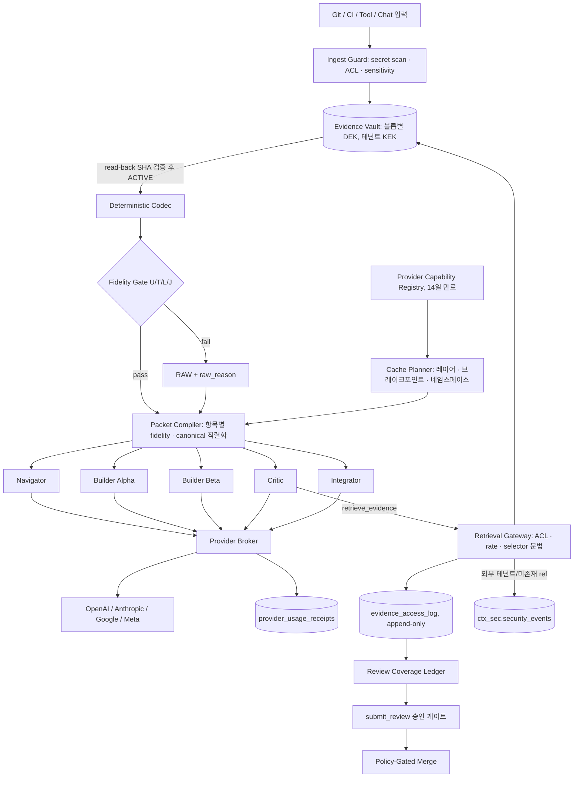

# EvoForge v3.6 — Recoverable Context Mesh 구현 계약

> **상태:** 설계안 · 2026-10-25. 프로덕션 실행·비용 실측 없음. 이 문서는 `legacy/v3.5_contracts/EvoForge_v3.5_Recoverable_Context_Mesh_Technical_Spec.md`를 **대체**한다.
> **실행 가능한 근거:** `contracts/schemas/*`(JSON Schema), `contracts/sql/*`(PostgreSQL 16에서 39개 검사 통과), `reference_impl/*`(코덱·Fidelity Gate·비용 모델, 22개 테스트 통과), `tools/validate_package.py`(문서·계약 정합성). 문서와 실행 산출물이 다르면 **실행 산출물이 우선**하며, 차이는 결함으로 등록한다.
> **식별자:** 모든 열거값·이벤트·도구명은 `contracts/vocabulary.v3.6.json`이 단일 출처다.

## 1. v3.5 대비 핵심 변경

| # | v3.5 | v3.6 | 이유 |
|---|---|---|---|
| 1 | 패킷당 하나의 `strategy`(RAW/STRUCTURAL/…/CACHE_AWARE) | 항목별 `fidelity` + 패킷별 `cache_mode` 두 축으로 분리 | 압축 방식과 캐시 방식은 직교한다. 한 Critic 패킷에 Diff(원문)·테스트(구조)·로그(복원형)가 함께 들어간다. v3.5에선 전략 이름이 문서마다 9가지로 달랐다. |
| 2 | `role` 5종 고정(navigator/builder/critic/integrator/observer) | `seat_id`(1–5) + `function_role`(planner/builder/critic/verifier/integrator/observer) + `candidate_id` | v3.4 토폴로지(HIGH_RISK=Critic 2+Verifier, DAG_PARALLEL=Builder 3)를 표현할 수 없었다. |
| 3 | `critical_assertions: string[]` | 파서가 **원문에서** 추출한 구조화 항목(`kind`, `item_id`, `selector`, `origin`) | 자유 텍스트는 검증할 수 없고, LLM이 만들면 그 자체가 손실 지점이다. |
| 4 | 품질 검사 "(iii) 품질 검사" 미정의 | 형식별 **결정적 불변식** U1–U4, T1–T5, L1–L5, J1–J5(§6) | 게이트가 정의되지 않으면 CR-03/CR-09를 통과시킬 수 없다. |
| 5 | Net Benefit의 기준선 = 캐시 없는 원가 | 기준선 = **같은 공급사 캐시 조건의 RAW(A_RAW) 실측** | OpenAI·Gemini는 캐시가 기본 동작이다. 캐시 없는 기준선은 절감액을 과대 표시한다(예시: 0.14x로 보이지만 실제 0.44x, §10). |
| 6 | 복원 비용 = API GET 비용 | 복원 1회 = **추가 모델 턴 1회**(현재 컨텍스트 전체 재독 + 복원 바이트) | 복원 비용의 대부분은 Vault 읽기가 아니라 추가 턴이다. 예시 조건에서 전체 원문 복원이 6회를 넘으면 압축이 RAW보다 비싸진다. |
| 7 | "Critic은 전체 Diff 원문 확인" (검증 수단 없음) | **Review Coverage Ledger**: 요구 원문의 모든 바이트가 그 리뷰어에게 전달됐는지 접근 로그로 계산, 미달 시 승인 불가 | "확인"을 판정할 수 없으면 불변식이 아니다. |
| 8 | 거부된 열람의 감사 기록 불가(FK·RLS 구조 결함) | FK 없는 append-only `evidence_access_log` + 플랫폼 `security_events` | v3.5 SQL에서 CR-06/07의 감사 INSERT가 실패함을 재현했다. |
| 9 | 삭제(CR-17) 불가 | Tombstone + 블롭별 DEK 파기(crypto-shred), 의존 패킷 REVOKED | v3.5 SQL은 FK 사슬 때문에 DELETE가 실패한다. |
| 10 | Caveman 3.0.0+ Apache-2.0로 기재 | 2026-10-25 기준 main `LICENSING.md`: **엔진 계열 BSL-1.1**, 제3자 대상 호스팅/멀티테넌트 사용은 상용 라이선스 필요 | ADR-036 전제가 틀렸다(§14). |
| 11 | 플랫폼 키 사용 시 테넌트 간 캐시 격리 언급 없음 | 테넌트별 `cache_namespace` 솔트를 L0 맨 앞에 렌더링 | 같은 공급사 조직 안에서 동일 Prefix가 공유되면 타이밍 사이드채널·과금 귀속 문제가 생긴다. |
| 12 | 압축 시점 미정 | **Compress-on-insert, rewrite-in-place 금지**(에폭 경계에서만 재압축) | 이미 보낸 이력을 다시 쓰면 캐시 Prefix가 깨진다(예시: +29%). |

## 2. 두 개의 축

```text
fidelity (항목별)        RAW | STRUCTURAL | RECOVERABLE | REF_ONLY
cache_mode (호출별)      NONE | PROVIDER_IMPLICIT | PROVIDER_EXPLICIT
prefix_layout (호출별)   STABLE_PREFIX | UNORDERED(실험 대조군 전용)
```

- **RAW**: 원문 바이트 그대로. 반드시 `raw_reason`을 기록한다: `POLICY_REQUIRED`(정책상 원문) 또는 폴백 사유(`UNSUPPORTED_TYPE`, `PARSE_FAILED`, `NO_TOKEN_GAIN`, `FIDELITY_FAILED`, `VAULT_UNAVAILABLE`, `NET_COST_WORSE`, `PROFILE_DISABLED`, `USER_OVERRIDE`). v3.5의 PRESERVE·RAW_FALLBACK·FULL은 모두 이 값으로 통합한다. <!-- vocab:allow -->
- **STRUCTURAL**: 뷰의 모든 *내용* 문자열이 원문의 기록된 selector 위치에 있는 값과 바이트(또는 파싱된 값) 단위로 동일하다. 합성 가능한 것은 파서가 만든 라벨·개수·생략 표식뿐이다. 기계적으로 검증 가능하다(T3/T4/J2).
- **RECOVERABLE**: 결정적 템플릿이 만든 변환 텍스트(예: 로그 중복 그룹 `{template, count, first, last}`)를 포함한다. 원문이 Vault에 ACTIVE일 때만 허용된다. **P0에서는 LLM 요약을 RECOVERABLE로 쓰지 않는다.**
- **REF_ONLY**: 뷰 없이 ref만 전달. 역할이 필요하면 `retrieve_evidence`로 가져온다(예: Critic의 Diff 진입점).
- 실험군은 두 축의 조합이다(§11). `PROVIDER_CACHE_ONLY`·`CACHE_AWARE`는 fidelity 값이 아니다. <!-- vocab:allow -->

## 3. 아키텍처



Codec Worker는 공급사 API 키·GitHub 쓰기 권한·외부 네트워크가 없다. Broker만 공급사와 통신한다.

## 4. 입력 형식별 정책

### 4.1 source_kind 기본값

| source_kind | 기본 fidelity | Critic/Verifier에서 | 필수 보존 |
|---|---|---|---|
| `contract.goal` / `contract.policy` / `contract.acceptance` | RAW (`POLICY_REQUIRED`) | RAW | 전문. 스키마·SQL 양쪽에서 강제 |
| `git.diff` | Builder: STRUCTURAL 금지, RAW 또는 REF_ONLY | REF_ONLY 진입 + **전 바이트 커버리지 필수** | 최종 병합 대상 전체 |
| `policy.result` | RAW | RAW, `requires_original` | 전문 |
| `test.junit` / `test.jest` | STRUCTURAL | STRUCTURAL 진입 + `requires_original` | 개수, 모든 실패/에러 케이스, 메시지 원문, 스택 프레임 원문 |
| `log.text` | STRUCTURAL 또는 RECOVERABLE | 동일 | WARN 이상 줄, 시작/종료 N줄, 중복 그룹 개수 보존 |
| `json.api` | STRUCTURAL(등록된 keep rule 있을 때만 배열 절단) | 동일 | 필수 포인터, 규칙 일치 원소 |
| `git.blob` | BALANCED 이상에서 Builder 탐색용 STRUCTURAL(AST) | RAW | 작업 대상 파일은 원문 |
| `html` / `table` / `search` | BALANCED 이상 | — | 출처, 제목 |
| `other` / 미지원 | RAW (`UNSUPPORTED_TYPE`) | RAW | 전문 |

### 4.2 프로필 × fidelity 허용 매트릭스 (`tools/validate_package.py` S10이 강제)

| 프로필 | STRUCTURAL 허용 | RECOVERABLE 허용 | 용도 |
|---|---|---|---|
| SAFE (기본) | test.junit, test.jest, json.api, log.text | log.text | 모든 고객 프로젝트 기본 |
| BALANCED (실험) | + git.blob, html, table, search | log.text, json.api, html, table, search | 테넌트 opt-in + Canary |
| MAXIMUM (연구 전용) | + other | 테스트 보고서 포함 | 고객 실행 금지, Research Plane만 |

모든 프로필에서 contract.*는 RAW, 리뷰어의 git.diff·policy.result는 전 바이트 커버리지가 필요하다.

## 5. 파이프라인 불변식

```text
1 classify → 2 ingest guard(secret/ACL/sensitivity/provider 허용) → 3 Vault 쓰기
→ 4 read-back + SHA-256 재계산 일치 → blob ACTIVE
→ 5 결정적 codec → 6 Fidelity Gate → 7 비용 규칙(§10) → 8 패킷 발행
```

1. **ORIGINAL_STORED**: STRUCTURAL/RECOVERABLE 항목은 blob이 `ACTIVE`(저장 + read-back 검증)일 때만 존재할 수 있다. DB 트리거 `ctx.enforce_item_invariants`가 강제한다.
2. **승인급 증거**: Critic/Verifier 패킷의 `requires_original` 항목은 RAW라도 blob이 ACTIVE여야 한다. Vault 장애 시 Builder 작업은 RAW로 계속할 수 있으나 **승인은 차단**한다(CR-16).
3. **Determinism**: `encode(bytes, codec@version)`은 바이트 단위로 같은 결과를 낸다. 출력이 바뀌면 codec 버전을 올린다. 비결정적 codec은 캐시 Prefix를 매 호출 깨뜨리므로 금지한다(U3).
4. **Compress-on-insert**: 도구 결과는 이력에 들어갈 때 한 번 변환되고 이후 바뀌지 않는다. 이미 보낸 이력을 다시 압축하는 것(rewrite-in-place)은 **명시적 에폭 경계**(예: 컨텍스트 창 80% 초과)에서만 하며, 그 비용(새 cache write)을 receipt로 기록한다.
5. **Trust 상속**: 원문의 trust 등급(`trusted_contract` / `verified_tool_output` / `untrusted_content`)은 뷰에 그대로 상속된다. `trusted_contract`는 contract.*에만 붙는다. untrusted 항목은 L0/L1 레이어에 들어갈 수 없다(S2).
6. **Ref는 권한이 아니다**: ref는 패킷×blob 단위의 128-bit 무작위 grant(`evr_` + Crockford base32 26자)다. 만료·폐기된다. 콘텐츠 해시로 만들지 않는다(Caveman CCR handle은 `ccr_`+SHA-256 앞 16바이트로 콘텐츠 주소형이다 — 멀티테넌트에서는 존재 여부 오라클이 되므로 채택하지 않는다).
7. **ID 형식**: tenant/project/run/task/attempt/packet은 UUID. v3.5 예시의 `tenant-demo` 같은 slug는 SQL `uuid` 컬럼과 맞지 않았다.

## 6. Fidelity Gate — 결정적 불변식

게이트는 codec을 믿지 않는다. **원문을 독립 파서로 다시 읽어** 기대값을 만들고 뷰의 주장과 비교한다. LLM은 관여하지 않는다. 하나라도 실패하면 RAW(`FIDELITY_FAILED`)로 내보내거나, RAW도 허용되지 않으면 패킷을 차단한다. 참조 구현: `reference_impl/fidelity_gate.py`(U·T·J 구현, L은 명세만 있고 P0-4에서 구현).

| ID | 대상 | 조건 |
|---|---|---|
| U1 | 전체 | Vault receipt 존재, read-back 검증됨, SHA-256·크기가 원문과 일치 |
| U2 | 전체 | `tokens(view) ≤ (1 − min_gain) × tokens(raw)`, 기본 `min_gain = 0.2` (CR-05) |
| U3 | 전체 | 같은 입력에 대한 재인코딩이 바이트 단위로 동일 |
| U4 | 전체 | 뷰에 비밀정보 패턴 없음(Ingest Guard 이후 2차 검사) |
| T1 | 테스트 보고서 | tests/failures/errors/skipped 개수가 원문 파싱값과 동일 ("0 failures"로 보이게 만드는 요약 차단) |
| T2 | 테스트 보고서 | 실패·에러 케이스 ID 집합이 원문과 동일, 중복 없음 |
| T3 | 테스트 보고서 | 각 실패의 status/type/message가 원문 값(앞 2KB)과 동일 — 의역 금지 |
| T4 | 테스트 보고서 | 표시된 스택 프레임이 원문 본문의 부분 문자열, 본문이 있으면 프레임이 최소 1개 |
| T5 | 테스트 보고서 | 생략 개수 + 표시 개수 = 전체 개수 |
| L1 | 로그 | 심각도 ≥ WARN인 모든 줄을 원문 그대로 유지하거나, 중복 그룹으로 묶을 때 `Σcount =` 원문 개수 |
| L2 | 로그 | 처음 N줄과 마지막 N줄 유지(기본 20) |
| L3 | 로그 | 생략 구간마다 `lines:S-E` selector 기록 |
| L4 | 로그 | `critical_assertions`에 있는 토큰(실패 테스트명, 에러 코드)이 포함된 줄은 원문 그대로 유지 |
| L5 | 로그 | 타임스탬프 단조성 보존(재정렬 금지) |
| J1 | JSON | 뷰가 유효한 JSON |
| J2 | JSON | 뷰의 모든 leaf가 원문의 같은 JSON Pointer 위치에 같은 값·타입으로 존재 |
| J3 | JSON | 정책상 필수 포인터가 뷰에서 해석 가능(`$kept` 포함) |
| J4 | JSON | 생략 표식 `{"$omitted", "$ref", "$kept"}`의 개수가 실제 생략 원소 수와 같고 배열의 마지막 원소 |
| J5 | JSON | SAFE에서 배열 절단은 **등록된 keep rule**이 있을 때만 허용, 규칙에 맞는 원소는 모두 `$kept`에 존재 |

J5가 필요한 이유: 참조 픽스처에서 keep rule 없이 배열을 앞 5개만 남기면 `state=FAILED`인 주문 3건(13·26·39번)이 조용히 사라지는데 J1–J4는 모두 통과한다. keep rule은 닫힌 술어(원소 안 한 포인터의 값 동등성)이며 표현식 언어가 아니다.

**자동 비활성화:** `(source_kind, codec@version, provider)` 단위로 최근 N=200건 중 게이트 실패율이 2%를 넘거나, 리뷰 이후 "압축으로 누락된 결함"이 1건이라도 확인되면 `ctx.codec_profile_state`를 DISABLED로 바꾸고 `CODEC_PROFILE_DISABLED` 이벤트를 발행한다. 다시 켜려면 Shadow 평가 → 승인이 필요하다(임계값은 제안값).

## 7. 프롬프트 레이아웃과 공급사 캐시

### 7.1 레이어와 직렬화
```text
L0_PLATFORM         [cache_namespace salt] system · tool schema hash 고정
L1_TENANT_CONTRACT  goal · policy · acceptance (RAW, 승인 버전)
L2_ROLE_SCOPE       역할 브리프 · 역할별 고정 범위
L3_TASK_DELTA       이번 턴의 도구 결과 뷰 · 질문 · 예산
```
- `evoforge-canonical/v1` 직렬화: 키 정렬, 고정 구분자, NFC, 줄바꿈 `\n`, 항목 순서 = (layer, segment_index, item_id). **packet_id·issued_at·expires_at·trace_id 같은 휘발성 메타데이터는 프롬프트에 렌더링하지 않는다**(v3.5 스키마는 `created_at`을 패킷 본문에 두고 렌더링 규칙이 없었다).
- 세그먼트마다 `sha256`을 기록한다. 같은 테넌트·역할·계약 버전이면 L0–L2 해시가 같아야 하며, 다르면 캐시 미적중의 원인으로 관측한다.
- 레이어 순서 L0 ≤ L1 ≤ L2 ≤ L3을 지킨다(S1). 손실 뷰는 L2/L3에만 둔다(S9).

### 7.2 테넌트 캐시 격리
- BYOK: 고객 키는 공급사 조직 단위로 격리된다.
- 플랫폼 관리 키: EvoForge 조직 안에서 테넌트 간 Prefix가 겹칠 수 있다. 테넌트별 32바이트 무작위 솔트를 L0 맨 앞에 렌더링해 서로 다른 테넌트의 Prefix가 절대 같아지지 않게 한다. 패킷에는 솔트 값이 아니라 `cache_namespace_id`만 남긴다. OpenAI `prompt_cache_key`는 회계 분리용 보조 수단으로 쓰고 보안 경계로 취급하지 않는다. Anthropic은 가능하면 테넌트(또는 엔터프라이즈 고객)별 workspace를 쓴다.

### 7.3 Capability Registry (2026-10-25 공개 문서 기준 시드, `contracts/registry/provider_capabilities.seed.json`)

| 항목 | OpenAI GPT-5.6+ | OpenAI 이전 모델 | Anthropic 현행 | Gemini 2.5/3.x | Gemini 4 |
|---|---|---|---|---|---|
| 기본 캐시 | 자동 | 자동 | 꺼짐(`cache_control` 필요) | 암묵 자동 | 암묵 자동 |
| 끌 수 있음(A0 가능) | 예: explicit 모드 + 브레이크포인트 없음 | **아니오** | 예 | **아니오** | **아니오** |
| 명시 제어 | `prompt_cache_breakpoint` | 없음 | 블록 `cache_control`, 최대 4개 | cached content(generateContent) | 미지원 |
| 최소 길이 | 1,024 | 설정마다 다름 | 512(현행 모델) | 2,048 / 4,096 | 4,096, 턴당 ≥2,050 추가 |
| 쓰기 배수 | 1.25×(30m) / 2.5×(12h) | 추가 요금 없음 | 1.25×(5m) / 2×(1h) | 가격표 | 가격표 |
| 읽기 배수 | 0.1×(일부 모델 상이) | 가격표 | 0.1×(일부 모델 0.05×/0.025×) | 적중 시만 할인 | 적중 시만 할인 |
| usage 필드 | `input_tokens_details.cached_tokens`, `cache_write_tokens` | `cached_tokens` | `cache_creation_input_tokens`, `cache_read_input_tokens` | `total_cached_tokens` | 동일 |

규칙: 엔트리는 14일 지나면 만료되고(S6), 만료된 엔트리로는 `PROVIDER_EXPLICIT`나 `NONE`을 계획할 수 없다. 단가는 Registry에 넣지 않고 버전이 붙은 별도 가격표로 관리한다. **"모든 공급사에서 캐시를 끈 대조군"은 존재하지 않는다**는 점이 실험 설계를 바꾼다(§11).

## 8. Review Coverage Ledger

1. Critic/Verifier 패킷의 `requires_original` ref마다 커버리지 = 그 리뷰어 `agent_id`에게 `ALLOW`로 전달된 바이트 구간의 합집합(`range_agg`). RAW로 인라인 전달된 항목은 전체 전달로 간주한다. 다른 에이전트에게 전달된 바이트는 셈에 넣지 않는다.
2. `submit_review(verdict=approve)`는 `ctx.assert_review_gate`를 통과해야 한다: 패킷 ISSUED·미만료, 역할 critic/verifier, 비작성자, 패킷 `repo_sha` = 후보 head SHA, 모든 요구 ref 커버리지 100%.
3. **대형 Diff:** 요구 원문 합계가 리뷰어의 `max_safe_context_bytes`를 넘으면 hunk 단위 chunk 리뷰를 한다(`call_purpose=review_chunk`, 모든 chunk가 같은 L0–L2 Prefix를 공유해 캐시 적중) + hunk 색인 전체를 보는 cross-chunk 패스(`review_cross_chunk`) 1회. `max_reviewable_diff_bytes`(제안: 400KB)를 넘으면 PR 분할 또는 인간 리뷰어를 요구한다.
4. **한계를 명시한다:** 바이트 전달은 리뷰의 필요조건이지 충분조건이 아니다. 모델이 실제로 주의를 기울였는지는 증명할 수 없다. 그래서 평가 환경에서 **seeded-defect canary**(알려진 결함을 주입한 후보)로 프로필·모델별 결함 검출률을 측정하고, 그 값이 기준 미달이면 해당 리뷰어 구성을 승인자 풀에서 뺀다(`context_fidelity_probe_score`).

## 9. 복원 계약 (MCP · REST · Folder 공통)

- 도구: `get_task_context(task_id)`, `list_evidence_refs(task_id)`, `retrieve_evidence(request)`, `submit_review(candidate_id, verdict, evidence_refs)`. v3.5의 `retrieve_artifact`/`open_source_evidence`는 `retrieve_evidence`로 통합한다. <!-- vocab:allow -->
- REST: `POST /v1/evidence-refs/{ref}/retrieve`, `GET /v1/context-packets/{packet_id}/review-coverage`. Folder Bridge: `GET_EVIDENCE` 요청 파일 = 같은 JSON 요청 스키마.
- 요청/응답: `contracts/schemas/evidence-retrieval.v1.schema.json`. 호출자 신원은 인증된 채널 세션에서만 가져오고 본문 필드에서 받지 않는다.
- **Selector 문법(닫힌 집합):** `all` · `bytes:S-E`(0부터, 반열림) · `lines:S-E`(1부터, 닫힘) · `json:<RFC 6901 pointer>` · `junit:<suite>::<case>` · `hunk:<path>#<n>` · `file:<path>[#Ls-Le]`. 경로는 선행 `/`, `..` 세그먼트, NUL, 역슬래시를 금지한다. JSONPath·정규식·glob은 금지한다(v3.5 p.32는 "JSON 경로", p.43은 "JSON Pointer"로 서로 달랐다).
- **상태 의미:** 다른 테넌트의 ref나 존재하지 않는 ref는 `not_found`로 응답해 둘을 구별할 수 없게 하고(존재 오라클 차단), 플랫폼 `security_events`에 기록한다. 같은 테넌트에서 ACL이 없으면 `forbidden`. 그 밖에 `expired`, `stale`, `digest_mismatch`(`expected_sha256` 불일치), `rate_limited`(+`retry_after_ms`), `shredded`. 실패 응답에는 content·sha256·크기를 넣지 않는다.
- 멱등성: `request_id`가 같으면 같은 응답, 감사 행은 1개(`UNIQUE(actor_tenant_id, request_id)`).
- 한도: 패킷 `recovery.max_bytes_per_call`(기본 256KB), `max_calls`, 페이지네이션 `next_selector`.

## 10. 비용 모델과 결정 규칙

입력 토큰 환산 단위(ITE, 캐시 없는 입력 단가 = 1):

```text
call_cost = 1.0·uncached + w·cache_write + r·cache_read + m_out·output
session_cost(s) = Σ task_turn + Σ retrieval_turn + Σ review_chunk + compile_cpu + storage + P(rerun|s)·rerun_cost
net_benefit(s) = session_cost(A_RAW)_실측 − session_cost(s)_실측       ← 기준선은 캐시 없는 원가가 아니다
```

`reference_impl/cost_model.py` 예시(가정값: P=8k, 턴당 도구 결과 12k, 압축률 0.3, 10턴, w=1.25, r=0.1, 출력 단가 5배). **실측이 아니라 계산 예시다.**

| arm | ITE | A0 대비 | A_RAW 대비 |
|---|---:|---:|---:|
| A0_RAW_NOCACHE | 797,000 | 1.00x | 3.14x |
| A_RAW (공급사 캐시) | 253,900 | 0.32x | 1.00x |
| C_RECOVERABLE + 캐시, 복원 0회 | 111,100 | 0.14x | 0.44x |
| C_RECOVERABLE + 캐시, 복원 3회 | 191,305 | 0.24x | 0.75x |
| C_RECOVERABLE + 캐시, 복원 10회 | 409,050 | 0.51x | 1.61x |
| C_RECOVERABLE, 캐시 없음 | 335,000 | 0.42x | 1.32x |
| A_RAW + 캐시, 6턴째 이력 재작성 | 326,350 | 0.41x | 1.29x |

읽는 법: (1) 캐시 없는 기준선과 비교하면 절감액이 크게 부풀려진다. (2) 캐시 없이 압축만 하면 캐시만 쓴 RAW보다 비싸다 → **캐시가 먼저, 압축은 그다음**. (3) 이 조건에서는 전체 원문 복원이 6회를 넘으면 압축이 진다 → 복원률이 핵심 지표다. (4) 이력 재작성은 캐시를 깨뜨린다.

**결정 규칙(온라인):**
1. 안전 규칙(§4–§6)이 허용하는 후보만 남긴다.
2. `(tenant, source_kind, function_role, provider/model)` 단위 실측 통계가 n ≥ 30 세션 미만이면 프로필 기본값을 쓴다(SAFE: STRUCTURAL 허용 형식만).
3. n ≥ 30이면 `E[net_benefit] > 0`이고, 품질 비열등성(§11)을 통과한 후보만 선택한다. 그 단위에서 복원률이 손익분기의 70%를 넘으면 다음 패킷부터 RAW(`NET_COST_WORSE`)로 돌린다.
4. 모든 판단은 `CONTEXT_DECISION_MADE` 이벤트에 근거(통계 창, n, 추정치)와 함께 남긴다.

## 11. 실험 설계

| arm | fidelity | cache | 실행 가능 조건 |
|---|---|---|---|
| A0_RAW_NOCACHE | 전부 RAW | NONE | Registry `can_disable=true`인 모델만(Anthropic, OpenAI GPT-5.6+ explicit). 비용 참고용 |
| A_RAW | 전부 RAW | 공급사 기본 | 모든 모델. **주 기준선** |
| B_STRUCTURAL | STRUCTURAL까지 | 공급사 기본 | 모든 모델 |
| C_RECOVERABLE | RECOVERABLE까지 | 공급사 기본 | 프로필 허용 범위 |
| D_RAW_EXPLICIT_CACHE | 전부 RAW | PROVIDER_EXPLICIT | `explicit_supported=true` |
| E_CACHE_AWARE | 손실 뷰는 L3에만 | PROVIDER_EXPLICIT | `explicit_supported=true` |

- 같은 저장소 SHA·봉인 테스트·모델·예산·시드로 짝지은 비교(paired). 작업마다 모든 arm 실행, 최소 3회 반복.
- **품질 비열등성(합격 게이트):** 검증된 수정률 차이의 단측 95% 신뢰하한 > −2%p, seeded-defect 검출률 차이 > −2%p, 핵심 seeded defect 누락 0건, 회귀 유출 0건. 이 margin은 제안값이며 실험 전에 사전 등록한다.
- 비용은 provider_billed receipt만 쓴다. `estimated`는 KPI에서 뺀다(CR-13).
- 시간 10배와 비용 10배를 섞어 쓰지 않는다. 10X는 측정 전까지 목표로만 표기한다.

## 12. 데이터 모델과 이벤트

- SQL: `contracts/sql/context_plane_v3_6_DRAFT.sql` — `evidence_blobs`, `context_packets`, `evidence_refs`(grant), `context_items`, `evidence_access_log`(append-only, FK 없음), `ctx_sec.security_events`, `provider_usage_receipts`(정수 micro-USD), `codec_profile_state`, 함수 `review_coverage` / `assert_review_gate` / `mark_task_packets_stale` / `shred_blob`.
- RLS: 테넌트 **그리고** 프로젝트(`app.tenant_id`, `app.project_ids`). 게이트웨이 역할에는 DELETE 권한이 없다. 컬럼 단위 UPDATE만 허용한다.
- 도메인 이벤트(단일 카탈로그, UI 이벤트는 이것의 투영): `EVIDENCE_INGESTED`, `EVIDENCE_STORED`, `EVIDENCE_STORE_FAILED`, `CONTEXT_DECISION_MADE`, `CONTEXT_FIDELITY_FAILED`, `CONTEXT_FALLBACK_RAW`, `CONTEXT_PACKET_ISSUED`, `CONTEXT_PACKET_BLOCKED`, `CONTEXT_PACKET_STALE`, `EVIDENCE_RETRIEVAL_REQUESTED`, `EVIDENCE_RETRIEVED`, `EVIDENCE_RETRIEVAL_DENIED`, `REVIEW_COVERAGE_UPDATED`, `REVIEW_COVERAGE_COMPLETE`, `PROVIDER_USAGE_RECORDED`, `CODEC_PROFILE_DISABLED`, `EVIDENCE_SHREDDED`. 큐에는 원문 대신 tenant-scoped ref만 싣는다.

## 13. 장애 전략

| 장애 | 동작 |
|---|---|
| Vault 쓰기/read-back 실패 | Builder: RAW(`VAULT_UNAVAILABLE`)로 진행 가능(크기·민감도·창 한도 안에서). Critic/Verifier: 패킷 BLOCKED, 승인 불가 |
| Codec 파싱 실패 / DOCTYPE·ENTITY 포함 XML | RAW(`PARSE_FAILED`), 성공 지표에서 제외 |
| Fidelity Gate 실패 | RAW(`FIDELITY_FAILED`) + 이벤트, 실패율 임계 초과 시 프로필 자동 비활성화 |
| Ref 만료/폐기/shred | `expired`/`shredded`, 그 근거에 의존한 승인은 무효, 재발급 후 재검증 |
| 목표·정책·base SHA 변경 | `mark_task_packets_stale` → STALE, 승인 차단, 새 패킷 발급 |
| 공급사 캐시 미적중 | 정상 실행, receipt로 원인(Prefix 해시 변화·최소 길이 미달·TTL) 기록 |
| 테넌트 경계 위반 시도 | `not_found` 응답 + `security_events` + 비율 초과 시 Incident |
| 압축으로 결함 누락 확인 | 해당 `(source_kind, codec, provider)` DISABLED + 원문 재평가 |

## 14. 공급망·라이선스 (정정)

2026-10-25에 확인한 `JuliusBrussee/caveman` main `LICENSING.md`의 내용:
- **MIT:** `skills/`, `packages/cli/`, `packages/agent/`, TS/Python SDK, `packages/shared/contracts/`, `shared/provider-catalog/`, `mem/js`, `mem/py` 등.
- **BSL-1.1:** `engine/`, `rewriter/`, `browse/`, `proxy/`, `mcp/`, `shrink/`, `mem/` Go 코어, `shared/platform/`, 그리고 `extension/`에 번들된 `engine.wasm`.
- BSL 허용 범위는 내부 평가·로컬 개발·CI·자가 호스팅 1st-party 사용이다. **제3자에게 호스팅·관리형·임베디드 서비스로 제공하려면 상용 라이선스가 필요**하며, 멀티테넌트 컨트롤 플레인도 상용 범위로 명시돼 있다. 각 BSL 버전은 2030-06-21과 배포 4주년 중 이른 날에 Apache-2.0으로 전환된다.
- "Caveman"은 상표다.

결정(ADR-036R): EvoForge는 멀티테넌트 SaaS이므로 엔진 계열 코드를 임베드·호출하지 않는다. 공개 문서만 참고해 **클린룸으로 재구현**하고(구현자는 BSL 디렉터리 소스를 열람하지 않으며 출처를 기록한다), MIT 경로(예: provider catalog)는 커밋 고정 + NOTICE로만 사용한다. 제품 UI·마케팅에 "Caveman" 이름을 쓰지 않는다. 내부 개발 환경에서 CLI를 시험할 때는 기본 텔레메트리를 끈다(`DO_NOT_TRACK=1`). 엔진 상용 라이선스 도입은 사업 결정으로 별도 검토한다. 법률 자문이 아니며 법무 검토가 필요하다.

## 15. 구현 순서 (Claude Code 단계 실행은 `build/CLAUDE_CODE_BUILD_PROMPT_v3.6.md`)

| 단계 | 산출물 | 수용 기준 |
|---|---|---|
| P0-1 | 스키마 + validator CI | `tools/validate_package.py` 통과 |
| P0-2 | SQL 마이그레이션 + RLS | `run_sql_tests.sh` 39개 검사 통과(CR-06/07/17/21 포함) |
| P0-3 | Vault(블롭별 DEK) + Retrieval Gateway + selector 파서 | CR-01, 06, 07, 15, 30, 31 |
| P0-4 | JUnit/Jest · JSON · 로그 결정적 codec + Fidelity Gate | 참조 테스트와 동일 판정 + CR-03, 04, 05, 09, 27 |
| P0-5 | Packet Compiler + canonical 직렬화 + Cache Planner + Registry probe | CR-12, 25, 26, 29 |
| P0-6 | MCP/Folder 도구 + Coverage Ledger + 승인 게이트 | CR-08, 10, 14, 22, 32 |
| P0-7 | Usage receipt 수집 + A/B 하네스(arm A/B/D 먼저) | CR-13, 18, 28 |
| P1 | 로그 RECOVERABLE, AST, HTML/표, E arm, chunk 리뷰 | 비열등성 통과 후 |
