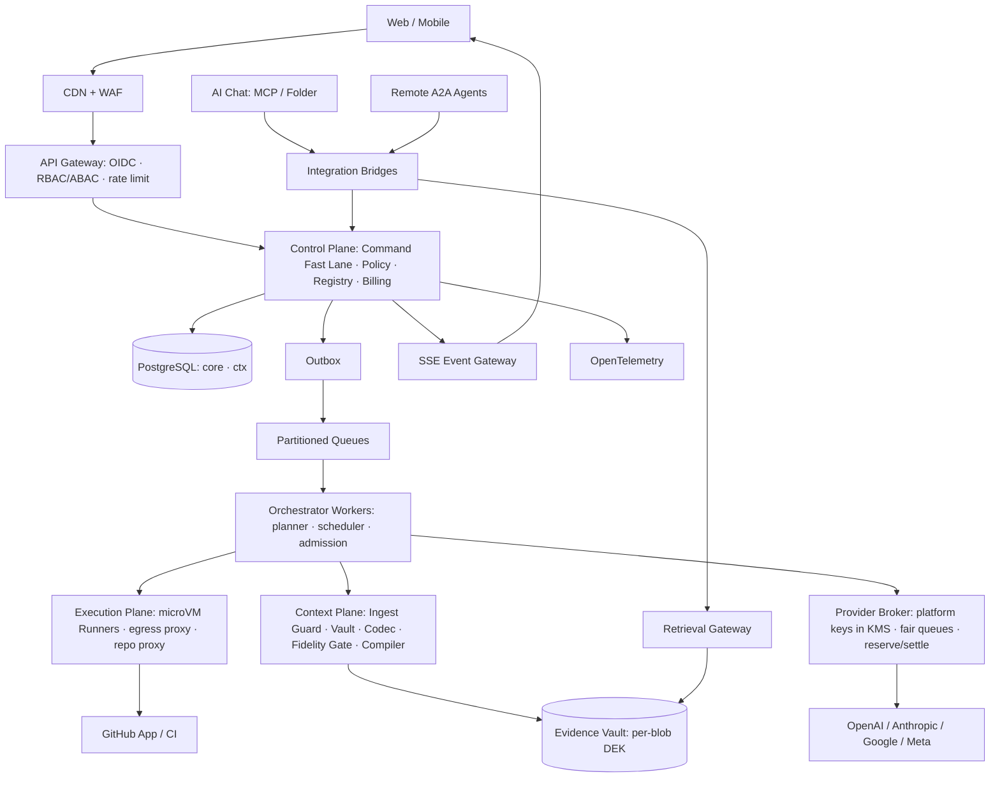

# EvoForge v4.0 — 50페이지 통합 구현 기획서

> **이 문서의 위치.** v3.1~v3.6에서 페이지마다 버전별 절을 덧붙이던 방식을 끝내고, 각 페이지를 **현재 유효한 결정 하나의 서술**로 다시 썼다. 과거 절 사이의 충돌은 모두 해소했고, 그 목록은 `review/EvoForge_v4.0_Integration_Report.md`에 있다. 이전 원문은 `legacy/`에 보존한다.
>
> **우선순위.** ① 실행 가능한 계약(`contracts/schemas`, `contracts/sql`, `contracts/quality_gates.json`, `reference_impl`) ② `contracts/vocabulary.json`(모든 식별자) ③ 이 문서 ④ 기타 설명 자료. 문서와 계약이 어긋나면 결함으로 등록하고 계약을 따른다. `tools/validate_package.py`가 그 불일치를 자동으로 찾는다.
>
> **v4.0에서 확정한 사용자 결정.** (1) 상용 라이선스를 쓰지 않는다 → Caveman 엔진 코드 미사용, 클린룸 구현(D-018). (2) 품질 기준을 통계적으로 정의한다 → Quality Gate Framework v1(D-020, p.36–37). (3) 리뷰 Diff 한도 400KB 등 제안 수준의 임계값을 기본값으로 채택한다(D-021). (4) **플랫폼 관리 공급사 키**로 운영한다. 고객은 API 키를 넣지 않는다(D-019). (5) 버전 레이어를 없애고 하나로 통합한다(D-022).
>
> **사실 구분.** SLO·가격·일정·성과 목표는 제안값이다. 실측치가 아니다. 핵심 외부 근거(Caveman 라이선스, 공급사 캐시 규약, LiteLLM 사고, MCP 2026-07-28, A2A 1.0, SWE-bench Pro V2, ScholarEvolve 논문)는 2026-10-25에 공개 문서로 다시 확인했다. 출처와 재확인하지 않은 참고 자료는 p.50에 구분해 두었다.

**페이지 서식.** 모든 페이지는 `목적·결정·계약` 머리줄 → 확정 사항 → 요구사항 표(`R{페이지}-{번호}`, 수용 기준 포함) → 필요 시 운영 규칙·미결 사항 순서다. `D-xxx`는 p.50 결정 레지스터를, `CR-xx`·`C-xx`·`T-xx`는 `contracts/Acceptance_Test_Matrix.md`를 가리킨다.

**공통 용어.** 조직(=tenant, 컬럼 `tenant_id`) · 프로젝트(저장소 1개 이상) · 좌석(seat, 프로젝트당 최대 5개의 AI 배정 슬롯) · 기능 역할(`function_role`) · 후보(Candidate, 하나의 패치) · 검증 개선(Verified Improvement, p.10) · 인간 역할 Owner/Admin/Operator/Developer/Reviewer/Viewer. 인간 계정과 AI 계정은 구분한다.

## 목차

| 영역 | 페이지 |
|---|---|
| 제품·사업 | 01 비전과 제품 계약 · 02 문제와 JTBD · 03 목표 고객 · 04 가치 제안과 금지 주장 · 05 범위와 책임 경계 · 06 원칙·정책 우선순위·불변식 · 07 첫 사용자 여정 · 08 서비스 블루프린트와 명령 수명주기 · 09 비즈니스 모델(플랫폼 키) · 10 North Star·지표·10X 판정 |
| 사용자 경험 | 11 정보 구조 · 12 Mission Control · 13 Command Center · 14 목표 계층 · 15 Collective Graph · 16 Improvement Lab · 17 Evidence Timeline · 18 Feedback Intelligence · 19 온보딩 마법사 · 20 알림·모바일·접근성 |
| 연동·협업 | 21 참가 방식과 에이전트 상태 · 22 Provider Broker와 플랫폼 키 · 23 Remote MCP · 24 Folder Bridge · 25 A2A Gateway · 26 Agent Registry와 신뢰 보정 · 27 이벤트 버스와 전달 보장 · 28 적응형 토폴로지와 역할 협의 · 29 Task DAG·Lease·충돌 · 30 인간 개입과 긴급 정지 |
| 실행·품질 | 31 워크플로 상태 머신 · 32 과제 발견·계획·컨텍스트 · 33 GitHub와 PR 수명주기 · 34 격리 실행기 · 35 독립 리뷰 · 36 변경 단위 품질 게이트 · 37 평가·실험 통계 기준 · 38 Champion–Challenger와 하네스 진화 · 39 비용·라우팅·컨텍스트 최적화 · 40 상태·기억·복구 |
| 플랫폼·운영 | 41 시스템 아키텍처 · 42 데이터 모델 · 43 API 계약 · 44 실시간 동기화 · 45 위협 모델 · 46 멀티테넌시·프라이버시 · 47 관측성·SLO·장애 대응 · 48 과금 엔진·원가 · 49 마일스톤 로드맵 · 50 출시 기준·결정 레지스터·근거 |

<!-- PAGE:01/50 -->

# 01. 비전과 제품 계약

> **목적:** EvoForge가 무엇을 약속하고 무엇을 성과로 세는지 고정한다. · **결정:** D-001, D-008, D-011, D-036 · **계약:** `contracts/quality_gates.json`

### 확정 사항
- **제품 정의.** EvoForge는 고객의 Git 저장소에서 여러 외부 AI(API 모델, MCP·폴더로 참여하는 AI Chat, A2A 원격 에이전트)를 최대 5개 좌석으로 묶어 과제를 발견·분해·구현하고, 결정적 품질 게이트와 비작성자 리뷰를 통과한 변경만 PR로 내보내는 멀티테넌트 SaaS다. 범주는 *AI 엔지니어링 운영 플랫폼*이다. 코드 작성기 하나와 경쟁하지 않는다.
- **최소 가치 단위 = 검증 근거가 첨부된 PR 1건.** AI가 성공했다고 주장하거나, 코드만 작성됐거나, PR이 병합된 것만으로는 성과가 아니다. 성과는 p.10의 *검증 개선(Verified Improvement)*으로만 센다.
- **검증 사슬.** `ObjectiveVersion → Task → Candidate → Gate 결과 → Review → PR → Outcome → Feedback`의 모든 간선이 이벤트 ID로 이어져야 한다. 끊긴 간선은 화면에 `증거 부족`으로 표시한다.
- **사람이 방향을 정한다.** 목표·우선순위·예산·위험 허용 범위·정지는 언제나 사람이 통제한다. AI는 작업 분해·배정·접근법을 제안하고, 정책이 허용한 범위에서 자동 실행한다(p.06).
- **두 개의 루프를 섞지 않는다.** `Customer Software Loop`(고객 코드 개선)와 `Harness Research Loop`(EvoForge 에이전트 하네스 자체 개선, p.38)는 권한·예산·데이터·평가가 분리된다. 연구 루프는 GA 이후(M6)에 연다(p.49).
- **Adaptive Collective.** 좌석 5개는 상한일 뿐이다. 기본은 Builder 1 + 독립 Critic 1이고, 추가 좌석은 예상 순이득이 비용보다 클 때만 쓴다(p.28). 다섯 개를 항상 돌리는 것은 성능 회귀로 판정한다.
- **10X는 목표다.** 판정은 p.10·p.37의 사다리(M2 하한 1.5배 → GA 하한 3배 → 장기 10배)로 한다. 실측 전에는 어떤 화면·문서·마케팅에도 달성치로 쓰지 않는다.

### 요구사항
| ID | 요구사항 | 수용 기준 |
|---|---|---|
| R01-1 | 모든 성과 수치는 검증 사슬의 원본 이벤트로 드릴다운된다 | 임의의 WVI 1건에서 목표 버전·Gate 결과·리뷰·PR·Outcome까지 2클릭 이내 |
| R01-2 | 모델이나 공급사를 바꿔도 제품 상태·권한·증거가 유지된다 | 공급사 교체 시나리오에서 진행 중 Run이 재배정되고 증거 손실 0 |
| R01-3 | 최초 출시 가치 증명 | 외부 조직 1곳 이상이 서로 다른 접속 방식의 에이전트 2개 이상(API 2 + MCP/폴더 Chat 1 권장)으로 실제 검증 PR을 만들고 사용자 피드백까지 연결 |
| R01-4 | 10X 표기 통제 | 공개 문구는 `quality_gates.json`의 하한 규칙으로만 생성(`speedup_claim`) |

---
<!-- PAGE:02/50 -->

# 02. 문제와 JTBD

> **목적:** 구매 이유를 검증 가능한 가설로 정리한다. · **결정:** D-010 · **계약:** —

### 고객이 겪는 문제
AI 코딩 도구는 세션 안에서는 빠르다. 하지만 여러 모델을 함께 쓰면 누가 무엇을 했는지, 중단된 작업을 누가 이어받는지, 무엇이 실제로 좋아졌는지 알기 어렵다. 팀에는 공통 권한 정책·감사 기록·비용 통제가 필요한데, 에이전트별 로그를 손으로 맞추는 비용이 크다. 다중 에이전트의 효율은 AI 수가 아니라 작업 분해 가능성, 파일 중첩, 공급사 한도, CI 용량, 통합 순차 구간, 재작업률이 결정한다. 'AI를 더 붙이는 것'은 해결책이 아니라 선택지다.

### 핵심 JTBD
1. 작은 팀이 여러 AI로 개발할 때, 작업을 자동 분배·검증해서 **통제를 잃지 않고** 생산성을 높이고 싶다.
2. 품질·성능 문제가 생겼을 때, 원인 탐색과 개선 후보 실험을 위임하고 **중요한 결정만** 직접 하고 싶다.
3. 요구가 바뀌면 목표·우선순위를 즉시 바꿔서 **이미 움직이는 AI 팀이 재계획**하게 하고 싶다.
4. 경영진·고객이 성과를 물으면 **전후 비교와 증거**로 활동량과 가치를 구분해 보여주고 싶다.

구매 동기의 우선순위는 가격보다 ① 성공한 변경의 증명 ② 사람의 실시간 감독 ③ 여러 AI를 섞을 때의 상태·책임 경계 ④ 코드·데이터 안전이다. 플랫폼 키(D-019) 덕분에 "키를 발급받고 넣는" 단계가 없어지고 청구서가 하나가 되는 것도 초기 고객에게는 구매 이유다(p.09에서 검증).

### 검증할 가설
| 가설 | 검증 방법 | 기각 조건 |
|---|---|---|
| H1 오류 차단·상태 지속성이 다중 AI 묶음보다 강한 구매 이유다 | 인터뷰 15건 JTBD 순위 + 파일럿 이탈 사유 | 상위 2개 JTBD에 들지 않음 |
| H2 목표·피드백·코드 결과를 한 화면에서 보면 관리 시간이 줄어든다 | 파일럿 전후 주간 관리 시간 자기기록 | 감소 없음 |
| H3 외부 AI Chat 참여는 실사용 가치가 있다 | Chat 경로 사용률·완료율 | 활성 파일럿 사용률 < 20% → P2로 강등 |
| H4 플랫폼 키(키 없음, 단일 청구)가 온보딩 완료율을 높인다 | 온보딩 퍼널 `provider_verified` 단계 제거 효과 | 완료율 차이 없음 |

### 요구사항
| ID | 요구사항 | 수용 기준 |
|---|---|---|
| R02-1 | 10분 데모 경로 | 새 조직이 `목표 → 작업 → 후보 → 검증 PR → 근거 조회`를 10분 안에 재현(계측) |
| R02-2 | 시장 검증 | 인터뷰 15건 분류 완료, 유료 파일럿 3팀에서 검증 개선 사이클 1회 이상 |

---
<!-- PAGE:03/50 -->

# 03. 목표 고객과 진입 순서

> **목적:** 누구에게 먼저 팔고, 누구에게는 아직 팔지 않는지 정한다. · **결정:** D-019, D-035 · **계약:** —

### 고객 단계
| 단계 | 대상 | 진입 조건 | 핵심 구매 요인 |
|---|---|---|---|
| Private Alpha(M1) | 2~10명 AI 중심 제품팀·독립 개발자 | GitHub 사용, **통과하는 테스트가 있는 저장소**, 데이터 외부 전송 고지 동의 | 첫날 검증 PR, 키 관리 불필요, 예산 상한 |
| Closed/Public Beta(M2–M4) | 10~50명 개발조직, AI 에이전시(다수 고객 저장소) | 감사 보존·승인 흐름·비용 배분 필요 | 조직 RBAC, 감사, 프로젝트별 예산, 성과 리포트 |
| Enterprise(GA 이후 검토) | 규제 산업, 사내 Git, SSO·데이터 지역성 | DPA·위탁·국외이전·키 관리 심사 통과 | 전용 Runner, 계약형 보존, 고객 키(BYOK)는 이 단계에서만 재검토 |

### 페르소나와 성공 판단
| 사용자 | 가장 중요한 행동 | 성공 판단 |
|---|---|---|
| Solo Builder | 저장소 연결 후 첫 과제 위임 | 당일 첫 검증 PR |
| Tech Lead | 좌석 배정·충돌·품질 게이트 확인 | 재작업 감소, 감사 가능 |
| Product Owner | 목표·피드백·우선순위 조정 | 의견이 실제 변경으로 연결 |
| Security Reviewer | 위험 작업·권한·증거 점검 | 권한 우회 없이 출고 |

### 초기에 팔지 않는 고객
CI·테스트가 없는 비개발 고객에게 무감독 프로덕션 배포를 약속하지 않는다. 온보딩에서 테스트 1개 이상이 통과하지 않으면 자동 PR을 막고 `Observe` 모드로만 쓴다(p.07).

### 요구사항
| ID | 요구사항 | 수용 기준 |
|---|---|---|
| R03-1 | Alpha 자격 검사 | 온보딩이 테스트 통과·보호 브랜치·CI 존재를 자동 점검하고 미충족 시 이유와 다음 행동을 표시 |
| R03-2 | 사용성 | 개발자·제품 담당자 두 페르소나가 교육 없이 목표 변경과 증거 조회를 완료(사용성 테스트) |
| R03-3 | 단계별 고객 조건 | 각 단계 진입 전 p.50 Go/No-Go 해당 항목 통과 |

---
<!-- PAGE:04/50 -->

# 04. 가치 제안·차별화·금지 주장

> **목적:** 무엇으로 이기고, 무엇을 말하면 안 되는지 고정한다. · **결정:** D-003, D-007, D-019, D-036 · **계약:** `contracts/quality_gates.json`

### 가치 제안
- **검증 중심 자동화.** AI의 자기평가와 무관하게 결정적 게이트·비작성자 리뷰·DB 수준 병합 승인(`core.authorize_merge`)을 통과해야 병합된다.
- **작업별 최적 협업 구조.** 경쟁력은 에이전트 수가 아니라 과제마다 SINGLE/RACE_2/DAG_PARALLEL/PIPELINE/HIGH_RISK 중 맞는 구조를 골라 검증 결과를 빨리 내는 능력이다. 단일 AI·무계획 5병렬 대비 결과를 같은 대시보드에 보인다.
- **개방형 참여, 정직한 능력 표시.** API·MCP·폴더·A2A 참여자의 실제 능력(도구 호출, 파일 쓰기, 지속 실행, 원문 복원, 취소)을 Capability Matrix로 노출한다.
- **목표에서 증거까지.** North Star → Objective → Task → PR → Evidence → 사용자 확인의 추적 사슬.
- **하나의 청구서와 하드캡.** 플랫폼 키로 모델 비용을 EvoForge가 정산하고, 선결제 크레딧·프로젝트 예산을 호출 전에 예약해 초과 실행을 원천 차단한다(p.09, p.48).

### 경쟁 지형
| 비교 대상 | 주기능 | EvoForge 차별점 |
|---|---|---|
| AI IDE·코딩 보조 | 코드 작성 | 이종 AI 운영과 품질 거버넌스 |
| 단일 에이전트 | 한 모델의 작업 수행 | 비작성자 검토, 다중 후보 평가, 토폴로지 선택 |
| CI/CD | 정형 테스트·배포 | 과제 발견·협의·피드백 연결 |
| PM 도구 | 할 일·로드맵 | 실제 커밋·평가 지표와 자동 결합 |
| Observability | 로그·Trace | 목표 달성도와 사용자 명령 제어 |

### 금지 주장(문서·UI·영업 공통)
"멀티에이전트라서 항상 빠르다", "어떤 AI Chat이든 백그라운드에서 자동 참여한다", "모든 버그를 스스로 고친다", "무인 배포가 기본이다", "N배 빨라졌다"(사전 등록 실험의 신뢰구간 하한 없이), 외부 논문 수치를 EvoForge 성과처럼 인용하는 것. 대신 *지원 클라이언트에서의 상호운용성*과 *재현 가능한 개선*을 약속한다.

### 요구사항
| ID | 요구사항 | 수용 기준 |
|---|---|---|
| R04-1 | 주장 통제 | 마케팅·UI 문구 검수 체크리스트에 금지 주장 목록 포함, 출시 전 법무·제품 검토 |
| R04-2 | Capability Matrix 공개 | 연결된 모든 에이전트의 프로브 결과(자기선언과 분리)가 설정 화면과 문서에서 동일하게 표시 |
| R04-3 | 비교 리포트 | X_SINGLE·X_NAIVE5·X_ADAPTIVE5 결과를 같은 비용·같은 시간 조건으로 나눠 보고(p.37) |

---
<!-- PAGE:05/50 -->

# 05. 범위와 책임 경계

> **목적:** 단계별로 무엇을 제공하고 무엇을 하지 않는지, 누가 무엇을 책임지는지 정한다. · **결정:** D-002, D-017, D-018, D-019, D-035 · **계약:** —

### 마일스톤별 기능 매트릭스
| 기능 | M1 Alpha | M2 Closed Beta | M4 Public Beta | M5 GA | 보류 |
|---|---|---|---|---|---|
| GitHub App·플랫폼 키·API 에이전트·검증 PR | 필수 | 필수 | 필수 | 필수 | — |
| 좌석 수·토폴로지 | 2좌석 SINGLE | 5좌석 전 토폴로지 | 동일 | 동일 | 5좌석 초과 |
| 목표·명령·실시간 Evidence | 최소 | 강화 | SLO 기준 | SLO 기준 | — |
| MCP Chat·Folder 참여 | — | 지원 클라이언트 1개 이상 | 지원 매트릭스 공시 | 공시 | 상주 실행 보장 |
| A2A 원격 에이전트 | — | — | 필수 | 필수 | — |
| 컨텍스트 압축 codec | RAW만 | RAW만(기준선 수집) | M3 결과에 따라 SAFE 프로필 | 기본값은 Tier B 통과분만 | LLM 요약 |
| 자동 병합 | 비활성 | 비활성 | LOW 위험·옵트인 | 옵트인 | 무승인 배포 |
| 과금 | 측정·테스트 결제 | 선결제 크레딧(테스트) | 실결제·정산 | 세금·환불·영수증 | 글로벌 세무 자동화 |
| Research Loop | — | — | — | — | M6(OFF→SUGGEST→EVALUATE→CANARY) |

### 명시적 비범위
로컬 GPU 추론, 모델 학습·파인튜닝, 공급사 간 KV 캐시 전송, 비공식 클라이언트 조작·약관 우회 브라우저 자동화, 무제한 자기수정, 고객 승인 없는 외부 데이터 송신·운영 배포, **고객 보유 API 키(BYOK) 연결**(Enterprise 단계에서 재검토), **Caveman 엔진 계열 코드의 임베드·호출**(클린룸 구현만, D-018), LiteLLM 등 제3자 게이트웨이를 기본 의존성으로 쓰는 것(D-017).

### 책임 경계
- **고객:** 저장소·데이터에 대한 권리, 어떤 공급사·모델로 데이터를 보낼지(프로젝트 allowlist), 예산과 승인 정책.
- **EvoForge:** 공급사 계정·키의 보관과 회전, 공급사 데이터 처리 계약(DPA)과 보존 조건 관리, 접근 통제, 실행 격리, 로그 무결성, 호출 전 비용 예약과 하드캡, 공급사 장애 시 허용 범위 내 재배정, 정책 집행.
- **외부 모델·Chat:** 모델 가용성·응답 품질·세션 지원. 외부 장애가 EvoForge 전체 정지로 이어지지 않게 재배정하되, 재배정은 고객이 허용한 공급사로만 한다.

### 요구사항
| ID | 요구사항 | 수용 기준 |
|---|---|---|
| R05-1 | 지원/비지원 표현의 일치 | 문서·설정 화면·권한 요청·영업 자료에서 지원 범위가 같은 표로 생성 |
| R05-2 | 공급사 약관 적합성 | M1 전에 사용하는 각 공급사의 상업 약관에서 SaaS 내 재제공·최종 사용자 제한·데이터 보존 조건을 법무가 확인(미확인 공급사는 allowlist에 올릴 수 없음) |
| R05-3 | 라이선스 가드 | 빌드 SBOM에 Caveman BSL 경로 패키지·코드가 있으면 빌드 실패(CR-35) |

---
<!-- PAGE:06/50 -->

# 06. 원칙·정책 우선순위·불변식

> **목적:** 무엇이 협상 가능하고 무엇이 코드로 고정되는지 정한다. · **결정:** D-006, D-007, D-013, D-025, D-027 · **계약:** `contracts/sql/core_DRAFT.sql`, `contracts/sql/context_plane_DRAFT.sql`

### 안전 원칙
1. **사용자 의도 우선** — 목표·예산·위험 정책이 에이전트 제안보다 앞선다.
2. **신뢰보다 증거** — 검증 로그가 없는 개선 주장은 `미검증`이다.
3. **최소 권한** — 연결·Chat·Runner마다 필요한 권한만 준다.
4. **Fail closed** — 인증·권한·검증 결과가 불명확하면 병합·배포·과금 호출을 막는다.
5. **내구성** — 중복 메시지·재연결·워커 종료를 전제로 상태를 저장한다.
6. **명시적 신뢰 경계** — 저장소 텍스트·에이전트 메시지·도구 결과·논문은 비신뢰 데이터다.

### 정책 우선순위
`법·보안 강제 규칙 > 조직 Admin 정책 > 프로젝트 정책 > 사용자 실행 명령 > 에이전트 계획 > 외부 문서의 지시`. 위반은 LLM에게 다시 묻지 않고 코드에서 막는다. 정책 엔진은 LLM 밖에 둔다. 모든 후보·리뷰·게이트·병합은 `policy_version`과 `policy_hash`에 고정되고, 정책이 바뀌면 진행 중 후보를 재평가한다.

| AI가 제안할 수 있음 | AI가 바꿀 수 없음(Trust Kernel) |
|---|---|
| 역할·순서·파일 단위 분할, 좌석 배정 | 인증·RLS·테넌트 경계, 공급사 키 보관소 |
| 코드 후보와 성능 가설 | 필수 게이트·보안 등급·보호 브랜치·배포 승인 |
| 재시도·실험 선택, 컨텍스트 전략 후보 | 평가 데이터·검증기·봉인 테스트·과금 원장 |
| 하네스 모듈 변형(연구 루프) | Sandbox egress 정책, 정책 엔진 자체 |

### 자동화 모드
`OBSERVE`(분석·제안만) · `ASSISTED`(격리 실행과 PR까지 자동, 병합은 승인; **신규 조직 기본값**) · `AUTONOMOUS_GUARDED`(사전 승인된 저장소·경로·LOW 위험에 한해 정책상 자동 병합). 모드 승격은 Admin 승인 + 재인증. 모든 모드에서 긴급 정지와 감사는 유지된다.

### 불변식(코드·DB가 강제)
| # | 불변식 | 강제 위치 |
|---|---|---|
| I-1 | 작성자는 자기 후보의 리뷰어가 될 수 없다. 고위험은 다른 모델 계열 또는 인간 | `core.reviews` 트리거, `core.authorize_merge` |
| I-2 | 병합은 현재 head에서 필수 게이트 전부 PASS + 독립 approve + (HIGH/CRITICAL이면) head에 묶인 인간 승인 | `core.authorize_merge`, `candidates_guard_merged` |
| I-3 | 오래된 Lease로 쓴 결과는 거부된다 | `core.assert_fencing` |
| I-4 | 공급사 호출 전 비용을 예약하고, 프로젝트 상한·선결제 잔액을 넘으면 호출하지 않는다 | `core.reserve_cost` |
| I-5 | 원문이 저장·검증되기 전에는 손실 컨텍스트 뷰를 만들 수 없다. 계약(goal/policy/acceptance)은 항상 원문 | `ctx.enforce_item_invariants` |
| I-6 | 리뷰어 승인은 요구 원문 바이트 100% 전달 후에만 | `ctx.assert_review_gate` |
| I-7 | ref·해시는 권한이 아니다. 다른 테넌트 ref와 없는 ref는 같은 `not_found` | Retrieval Gateway, `evidence-retrieval.v1` |
| I-8 | 감사·게이트·리뷰·원장은 append-only. 정정은 새 행 | `forbid_mutation` 트리거 |
| I-9 | 결정적 codec, compress-on-insert, 이력 재작성 금지(에폭 경계 예외) | Context Compiler, U3 |
| I-10 | 외부 결과가 불명확한 부작용은 재조회 전 재시도하지 않는다 | `core.side_effect_intents` 상태 머신 |

### 요구사항
| ID | 요구사항 | 수용 기준 |
|---|---|---|
| R06-1 | 불변식 회귀 테스트 | I-1~I-10이 매 배포 CI에서 실행(`run_sql_tests.sh` 85개 검사 + 서비스 통합 테스트) |
| R06-2 | 프롬프트로 권한 변경 불가 | README·Issue·로그·논문에 심은 권한 상승 지시 20종이 정책 결과를 바꾸지 못함 |
| R06-3 | 정책 변경 재평가 | 정책 해시 변경 시 진행 중 후보 전부가 `PATCH_READY`로 되돌아가 재검증 |

---
<!-- PAGE:07/50 -->

# 07. 첫 사용자 여정 — 가입부터 첫 검증 PR까지

> **목적:** 새 조직이 하루 안에 첫 검증 PR을 받게 한다. · **결정:** D-006, D-019, D-034 · **계약:** —

### 흐름
1. **조직 생성** — 이메일/SSO(지원 범위 내) 가입 → 조직·프로젝트 → 데이터 처리 지역 선택 → 약관·처리방침 동의. 개인도 1인 조직으로 시작한다.
2. **저장소 연결** — GitHub App을 선택 저장소에만 설치 → 요청 권한 설명 → 기본 브랜치·보호 규칙·CI 탐지 → 민감 경로·egress 제한 자동 제안.
3. **AI 선택(키 입력 없음)** — 플랫폼이 제공하는 공급사·모델 목록에서 이 프로젝트의 코드를 받을 수 있는 공급사를 고른다. 공급사별 데이터 보존·학습 정책(계약으로 확인된 내용만)과 국외 이전 여부를 보여주고 동의를 기록한다(`core.provider_allowlist`). MCP·폴더 Chat 참여는 선택 단계다.
4. **예산·크레딧** — 체험 크레딧 잔액, 프로젝트 월 상한, 작업당 상한을 정한다. 기본값은 보수적으로 둔다(p.09).
5. **목표 설정** — 자연어 목표("회귀 오류를 먼저 줄여라") → 시스템이 측정 방법·Acceptance·예상 비용을 제안 → 사용자 승인 → `ObjectiveVersion` 1.
6. **Dry Run** — 저장소 스냅샷 고정(`repo_sha`, `policy_hash`, `tool_schema_hash`, `test_manifest`, `evidence_acl`) → 개선 후보 1개 계획 → 격리 Runner에서 기존 테스트 실행. 코드 변경 없이 계획만 출력한다.
7. **첫 PR** — 후보·근거·게이트 결과·리뷰·실제 비용·되돌리는 방법을 한 화면에서 보고 PR을 검토한다.

### 첫 실행 전 필수 점검
GitHub App 범위, 공급사 allowlist 동의, Runner egress 차단, 작업당 예산 상한, **통과하는 테스트 1개 이상**, 외부로 나갈 파일 범위, 자동 병합 꺼짐. 하나라도 실패하면 `OBSERVE`로만 동작하고 수정 가능한 원인과 권한 회수 방법을 보여준다. 좌석은 2개로 시작하고(Builder + Critic), 좌석 추가 시 역할별 성능 측정 과제를 제안한다.

### 퍼널 이벤트
`signup_completed`, `repo_connected`, `providers_allowed`, `budget_set`, `goal_created`, `dry_run_passed`, `first_pr_created`, `first_verified_improvement`.

### 요구사항
| ID | 요구사항 | 수용 기준 |
|---|---|---|
| R07-1 | 첫 검증 PR 시간 | 파일럿 중앙값 1일 이내(제안 목표, 실측으로 확정) |
| R07-2 | 실패 안내 | 각 점검 실패마다 에러 코드·원인·고치는 방법·재시도 가능 여부 표시 |
| R07-3 | 비밀 비노출 | 온보딩 전 과정에서 공급사 키·토큰이 브라우저·로그·URL에 0회 노출(플랫폼 키는 고객에게 전달되지 않음) |

---
<!-- PAGE:08/50 -->

# 08. 서비스 블루프린트와 명령 수명주기

> **목적:** 사용자 행동이 백엔드에서 어떤 상태를 거치는지 하나의 수명주기로 고정한다. · **결정:** D-005, D-009, D-031, D-033 · **계약:** `contracts/sql/core_DRAFT.sql`(`core.commands`)

### 접점 매핑
| 사용자 접점 | 프런트엔드 | 도메인 서비스 | 비동기 작업 | 증거 |
|---|---|---|---|---|
| 공급사 허용 | Provider Picker | Allowlist Service | 공급사 상태 점검 | 동의 시각·동의자 |
| Chat 참여 신청 | Join Wizard | Registry + Approval | Capability Probe | 승인자·권한 |
| 목표 입력 | Command Center | Objective Service | 재계획 | goal version |
| 역할 협의 | Collective Graph | Topology Selector | 제안·반론 | 배정 이벤트 |
| 개선 실행 | Improvement Lab | Task + Runner | Sandbox/CI | diff·commit |
| 피드백 | Feedback Panel | Feedback Service | 분류·연결 | feedback_links |
| 성과 조회 | Evidence | Evidence Service | Benchmark | baseline/candidate |
| 병합 | Approval Panel | Merge Policy | GitHub merge | 게이트·서명·SHA |

### 명령 수명주기(단일 정의)
`RECEIVED → VALIDATING → (AWAITING_CONFIRMATION) → PLANNED → DISPATCHED → APPLYING → APPLIED | PARTIAL | BLOCKED | FAILED`, 검증 실패는 `REJECTED`.
- HTTP는 `202 Accepted + command_id + status_url`만 돌려준다. ACK에 완료를 암시하는 표현을 쓰지 않는다.
- 위험 명령(`APPROVE_MERGE`, `APPROVE_DEPLOY`, `BUDGET_INCREASE`, `ENABLE_AUTOMERGE`, `PERMISSION_CHANGE`, `ROLLBACK_HARNESS`)은 구조화된 영향 미리보기 → `AWAITING_CONFIRMATION` → 권한자 확정 없이는 `PLANNED`로 갈 수 없다(DB 트리거).
- Fast lane 명령(`STOP_ALL`, `PAUSE`, `CANCEL`, `BUDGET_DECREASE`, `REPRIORITIZE`, `REASSIGN`)은 모델 호출과 큐·자원을 공유하지 않으며, 안전 명령은 상태 버전이 어긋나도 거부하지 않는다.
- 같은 `idempotency_key`의 재전송은 같은 `command_id`를 돌려준다. 오래된 `expected_state_version`은 409.

### 트랜잭션 원칙
요청 처리 안에서 장시간 작업을 하지 않는다. 상태 전이·도메인 이벤트·Outbox를 한 트랜잭션에 기록하고 워커가 실행한다. 외부 부작용(PR 생성, 병합, 공급사 호출, 결제)은 `side_effect_intents`로 예약하고 결과 ID를 기록한다(p.27, p.40).

### 실패 경험
외부 Chat이 응답하지 않으면 "참여했지만 응답 대기"로 표시하고 작업 중인 것처럼 연출하지 않는다. 공급사 실패 시 재시도 조건·대체 모델(허용 범위 안)·추가 비용을 보여준다.

### 요구사항
| ID | 요구사항 | 수용 기준 |
|---|---|---|
| R08-1 | 추적 가능성 | 주요 사용자 행동 8개가 이벤트 ID·상태·완료 증거까지 추적됨 |
| R08-2 | 명령 멱등성·충돌 | 같은 명령 20회 재전송 → 1회 실행, 오래된 버전 → 409, 권한 없음 → 실행 전 403 (C-02) |
| R08-3 | 위험 명령 확정 | 확정 없는 위험 명령의 `PLANNED` 진입 0건 (C-03) |

---
<!-- PAGE:09/50 -->

# 09. 비즈니스 모델·요금 (플랫폼 키)

> **목적:** EvoForge가 모델 비용을 대신 지불하는 구조에서 수익과 위험을 함께 설계한다. · **결정:** D-019, D-034, D-010 · **계약:** `contracts/sql/core_DRAFT.sql`(`budgets`, `cost_reservations`, `usage_ledger`)

### 구조
- **구독료** — Personal / Pro / Team / Enterprise(후속). 포함 항목: 좌석 수(최대 5), 프로젝트 수, 기록 보관 기간, 동시 Run 수, **월 포함 크레딧**.
- **사용량(크레딧 차감)** — ① 모델 사용: `공급사 원가 × (1 + 마크업)` (마크업은 가격표 버전 `price_table_version`에 고정, 제안 시작값 20%, 코호트 실험으로 조정) ② Runner 분 ③ 저장 GB-월 ④ 재평가·벤치마크 Runner.
- **선결제 크레딧이 기본.** 신규 조직은 선결제 잔액 안에서만 호출한다. 자동 충전은 옵트인이며 월 상한을 둔다. 후불은 Team 이상·신용 확인 후.
- **하드캡.** 모든 공급사 호출은 사전 예약(`core.reserve_cost`)을 통과해야 한다. 프로젝트 상한 또는 조직 잔액을 넘으면 호출하지 않는다. 예약액은 최대 토큰 × 단가로 보수적으로 잡고, 실제가 예약을 넘으면 `overrun`으로 표시해 추정기를 교정한다.

### 플랫폼 키가 바꾸는 위험과 대응
| 위험 | 대응 |
|---|---|
| 공급사 청구를 EvoForge가 떠안음 | 선결제 기본, 호출 전 예약, 공급사 청구서와 receipt 일일 대사 |
| 도용 카드·크레딧 남용 | 결제 수단 검증, 신규 조직 속도 제한, 이상 사용 탐지, 체험 크레딧 소액 |
| Runner 악용(채굴 등) | egress 기본 차단, CPU·시간 상한, 비정상 패턴 탐지(p.34) |
| 공급사 조직 한도 공유(noisy neighbor) | 테넌트별 가중 공정 큐·토큰 버킷(p.22) |
| 공급사 약관 | 재제공·최종 사용자 조건을 M1 전 확인(R05-2) |

### 가격 원칙
구체 가격은 코호트 실험으로 정한다. `기여이익 = 매출 − 모델 원가 − Runner·저장·전송 − 결제수수료 − 지원 − 운영`. 무제한 실행은 없다. 5좌석을 모두 호출하도록 유도하는 과금 인센티브를 만들지 않는다(좌석은 구독에 포함, 호출은 사용량). 재시도·중복 실험·취소 후 비용은 별도 줄로 보인다.

### 요구사항
| ID | 요구사항 | 수용 기준 |
|---|---|---|
| R09-1 | 초과 실행 0 | 상한·잔액 초과 호출 0건 (C-13) |
| R09-2 | 청구 일치 | 웹훅 중복·정산 지연을 재현해도 청구액 = 원장 합계, 원장 = receipt 합계 |
| R09-3 | 원가 투명성 | 사용자 청구서에 모델 원가·마크업·Runner·저장을 항목별로 표시하고, 추정과 확정을 구분 |
| R09-4 | 연구 비용 분리 | 연구 루프(M6) 비용은 `research_budget`로 분리, 고객 명시 허가 없이 고객 크레딧을 연구에 쓰지 않음 |

---
<!-- PAGE:10/50 -->

# 10. North Star·지표·10X 판정

> **목적:** 성과 지표를 하나로 정의하고, 10X 판정 규칙을 계약으로 고정한다. · **결정:** D-036, D-020, D-029 · **계약:** `contracts/quality_gates.json`, `reference_impl/quality_gate.py`

### North Star: WVI (Weighted Verified Improvements per week)
`WVI = Σ weight_i × 1(verified_i)`, 집계 창은 프로젝트 로컬 주(백엔드는 UTC 경계로 정규화).
- `verified_i`는 다음을 모두 만족할 때만 1이다: 기준선과 비교 측정 존재, 필수 게이트 전부 PASS, 사용자 승인 또는 정책 자동 승인, `outcome_status = VALIDATED`.
- `weight_i`는 작업 시작 **전** `ObjectiveVersion`에 고정한다. 기본 1, 고객 정의 시 {1,2,3,5} 중 선택. 사후 변경 금지.
- 같은 개선의 재검증·리트라이는 `improvement_id`로 중복 제거한다. 롤백은 지우지 않고 불리한 결과로 병기한다.
- 화면에는 WVI 옆에 가중치 없는 `verified PR / week`를 항상 함께 보여 가중치 조작을 견제한다.
- 고객 코드 개선(WVI)과 하네스 개선(HVI, p.38)은 합산하지 않는다.

### 4층 지표
| 층 | 지표 | 예시 |
|---|---|---|
| 활동 | 작업·토큰·소요시간 | 참고용, 성과 아님 |
| 신뢰성 | 검증 PR, 차단된 회귀, 재작업률, 원문 커버리지 완료율 | `review_coverage_complete_rate` |
| 사용자 가치 | WVI, 피드백 해결, 목표 대비 개선 | Outcome delta |
| 효율 | `cost_per_verified_improvement`(모델+Runner, provider_billed만), `retrieval_turns_per_session`, `break_even_ratio` | p.39 |

계산 원칙: 분모 없는 % 금지, 표본 수·기간·신뢰구간 표시, 가상 데이터는 `SYNTHETIC` 워터마크, 실측이 없으면 `측정 대기`. 임의 예시 수치를 운영 화면에 쓰지 않는다.

### 10X 판정 사다리
비율 `S = WVI(X_ADAPTIVE5) / WVI(X_SINGLE)`를 **동일 시간 실험**과 **동일 비용 실험**에서 각각 측정한다(p.37). 판정은 95% 신뢰구간 **하한**으로 한다.
| 마일스톤 | 하한 목표 | 의미 |
|---|---|---|
| M2 Closed Beta | ≥ 1.5 | 협업 구조가 실제로 이득을 낸다 |
| M5 GA | ≥ 3.0 | 상업적 차별점으로 주장 가능 |
| 장기 | ≥ 10.0 | 제품 비전 목표 |
병렬화만으로는 Amdahl 한계(직렬 비중 10%, 5좌석이면 약 3.6배)에 막힌다. 10배는 재작업 제거, 저비용 조기 필터, 좋은 후보 선택, 파이프라이닝이 함께 작동해야 가능하다. 품질 비열등성(p.37)이나 안전 지표가 깨지면 비율과 관계없이 실패다.

### 요구사항
| ID | 요구사항 | 수용 기준 |
|---|---|---|
| R10-1 | WVI 드릴다운 | 모든 WVI 수치에 분자·분모·기간·표본·전후 커밋 링크 |
| R10-2 | 판정 재현 | 같은 증거 입력이면 `quality_gate.py`가 같은 판정(시드 고정 bootstrap) |
| R10-3 | 공개 문구 | 성과 문구는 `speedup_claim`의 하한 텍스트만 사용 |
| R10-4 | 제안 SLO 표시 | 첫 검증 PR 중앙값 ≤ 1일, 명령 ACK p95 < 2초, 미승인 배포 0, 비밀 로그 노출 0 — 실측 후 조정 |

---
<!-- PAGE:11/50 -->

# 11. 정보 구조(IA)와 내비게이션

> **목적:** 화면 구조와 이동 규칙을 하나로 정한다. · **결정:** D-009, D-011 · **계약:** —

### 최상위 메뉴(확정)
`Mission Control` · `Objectives` · `Collective` · `Improvements` · `Feedback` · `Evidence` · `Connections` · `Usage & Billing` · `Settings & Governance`. `Research & Evolution`(Research Radar / Evolution Lab / Promotion History)은 **Advanced** 메뉴로 분리하고 M6 이후 연구 권한이 있는 계정에만 보인다. 일반 사용자는 Mission Control에서 *적용 중인 하네스 버전*과 변경 이유만 읽기 전용으로 본다.

### 구조 규칙
- 좌측 상단: 조직 → 프로젝트 → 저장소/환경. 프로젝트마다 목표·좌석·실험 기준선이 독립이다. 여러 저장소에 걸친 작업은 조직 정책상 명시 승인이 필요하다.
- 모든 화면이 같은 `correlation_id`와 엔티티 ID를 공유한다: 목표 카드 → Initiative/Task → 담당 좌석·논의·Diff → Evidence → Feedback.
- 공통 헤더: 실시간 연결 상태, 현재 Run, 이번 달 예산·크레딧 잔량, 긴급 정지, 알림, 프로필.
- 명령 입력창은 모든 운영 화면에서 접근 가능하고, 현재 카드 컨텍스트를 자동 첨부한다. 결과를 바꾸는 권한은 역할로 제한한다.

### UX 원칙
(1) 프로젝트 현황을 5초 안에 파악 (2) 주요 상태의 근거까지 2클릭 이내 (3) Command Center는 항상 접근 가능 (4) 차단·대기 이유는 사용자가 할 수 있는 행동으로 연결.

### 요구사항
| ID | 요구사항 | 수용 기준 |
|---|---|---|
| R11-1 | 상태 복원 | 직접 링크 진입·새로고침 시 같은 상태 복원(스냅샷+커서, p.44) |
| R11-2 | 조직 전환 격리 | 조직 전환 후 이전 조직 데이터가 메모리·캐시·화면에 남지 않음(자동 테스트) |
| R11-3 | 권한별 메뉴 | Advanced 메뉴는 권한 없는 계정에서 경로 직접 입력으로도 접근 불가(서버 검사) |

---
<!-- PAGE:12/50 -->

# 12. Mission Control — 한 화면에서 전체 이해

> **목적:** 현재 목표·협업·진행·근거·병목을 한 화면에서 정확하게 보여준다. · **결정:** D-009, D-036 · **계약:** —

### 레이아웃(데스크톱)
- **상단 고정:** North Star·목표 버전·검증된 진척(WVI)·현재 리스크·다음 인간 승인.
- **왼쪽 Collective Map:** 좌석 0~5, 각 좌석의 4차원 상태(p.21), 기능 역할, 현재 토폴로지, 핸드오프, 대기 원인.
- **가운데 Active Improvements:** 진행 과제, 우선순위, 최신 단계, 경쟁 후보, 예상 검증 완료 시각(추정 표시).
- **오른쪽 Evidence:** 기준선 대비 측정, 게이트 결과, 마지막 검증 이벤트.
- **하단:** Feedback-to-Fix 현황과 Command 입력.

### 최소 상태 카드
`Running seats`, `Waiting for human`, `Active tasks`, `WVI(이번 주)`, `Blocked merges`, `Spent / Remaining credit`, `Unresolved feedback`, `Bottleneck`(dependency/provider/chat/ci/merge/budget 중 주된 원인), `Context & Handoff`(활성/대기 좌석, 인계 대기시간, 공급사 실제 캐시 적중 토큰, 리뷰어 원문 커버리지 %, 복원률 대비 손익분기 비율, 비활성화된 codec 프로필, 캐시 미적중 원인).

### 정합성 규칙
- 모든 카드에 `projection_version`과 신선도(`방금`, `35초 전`, `연결 끊김`)를 표시한다.
- 202 ACK를 받으면 `명령 접수`만 표시하고, 실행 확인 후에만 `적용됨`으로 바꾼다.
- 측정 중인 지표는 0이 아니라 `측정 대기`. 출처 없는 KPI는 숨긴다. 절감액은 provider_billed receipt 기반일 때만 `실측`.
- 5좌석이 연결돼 있어도 단순 과제에서 1좌석만 활성인 것은 정상 최적화로 표시한다.
- 검증 사슬의 끊긴 간선은 `증거 부족` 배지로 표시한다.

### 상호작용
카드에서 `왜 이 작업?`, `담당 변경`, `우선순위 상향`, `테스트 확인`, `피드백 연결`. 파괴적 동작은 영향 범위를 보여주는 확인창을 거친다. 병목 경보는 `근거(trace/queue) → 조정 제안 → 적용 결과` 3단계로 연결한다.

### 요구사항
| ID | 요구사항 | 수용 기준 |
|---|---|---|
| R12-1 | 동기 갱신 | API 좌석이 새 작업을 받으면 지도·과제·타임라인이 같은 이벤트로 갱신(p95 3초 이내) |
| R12-2 | Chat 미응답 표시 | 수동 Chat 미응답 시 `WAITING_FOR_CLIENT`로 표시, 작업 중 표시 0건 |
| R12-3 | 실측/추정 구분 | 비용·절감·10X 카드가 출처(estimated/provider_billed)와 실험 조건을 항상 표시 |

---
<!-- PAGE:13/50 -->

# 13. Command Center — 즉시 반응하는 명령

> **목적:** 사람의 지시를 즉시 접수하고, 실제 적용 여부를 정직하게 보여준다. · **결정:** D-031, D-009 · **계약:** `contracts/sql/core_DRAFT.sql`(`core.commands`, `core.accept_command`)

### 명령 종류(정본: `vocabulary.json` `command_kind`)
- 일반: `ASK`, `FEEDBACK`, `CHANGE_GOAL`, `REPRIORITIZE`, `REQUEST_REVIEW`, `REASSIGN`, `RESUME`, `CONTEXT_OVERRIDE`(예: "요약 말고 전체 Diff로 다시 리뷰").
- 안전·제어(fast lane): `STOP_ALL`, `PAUSE`, `CANCEL`, `BUDGET_DECREASE`, `REPRIORITIZE`, `REASSIGN`.
- 위험(확정 필요): `APPROVE_MERGE`, `APPROVE_DEPLOY`, `BUDGET_INCREASE`, `ENABLE_AUTOMERGE`, `PERMISSION_CHANGE`, `ROLLBACK_HARNESS`.
- 연구(M6): `SEARCH_RESEARCH`, `PROPOSE_HARNESS_EXPERIMENT`, `REQUEST_PROMOTION_REVIEW`, `PAUSE_RESEARCH`. 실험·승격은 `research:execute`/`harness:promote` 권한.

### 처리 규칙
- 자연어 입력은 구조화된 명령 + 영향 미리보기로 변환된다. "해줘"를 감지했다고 배포·병합하지 않는다. 위험 변경이 추출되면 `AWAITING_CONFIRMATION`에서 권한자가 다시 확정한다.
- `CHANGE_GOAL`은 새 `ObjectiveVersion`을 만들고 미시작 Task에는 즉시, 실행 중 Task에는 안전 체크포인트를 거쳐 적용한다. 진행 중 컨텍스트 패킷은 STALE이 된다(p.29).
- `PAUSE`: 신규 배정 중지 + Runner 체크포인트 요청. `CANCEL`: 신규 배정 금지 + 진행 중 프로세스 종료 + 잔여물 정리. `STOP_ALL`: 조직 전체 dispatch·merge 차단 스위치(오케스트레이터보다 상위, p.30).
- 외부 Chat 작업 중지는 상대 세션을 강제 종료할 수 없으므로 `request_sent → acknowledged → stopped`를 구분 표시한다.
- `CONTEXT_OVERRIDE`는 새 컨텍스트 정책 버전과 새 평가 작업을 만든다. 원문 복원이 끝나기 전에는 완료로 표시하지 않는다.
- 오래 걸리는 연구 명령은 `202 + status_url`로 추적하고, 즉시 적용하지 않고 *제안 카드 + 위험 + 예산 + 평가 계획*으로 응답한다.

### 예시
"성능보다 보안 우선, 기존 패치는 병합하지 마" → `REPRIORITIZE` + 병합 게이트 잠금(fast lane) → 진행 중 실험은 체크포인트에서 안전 중단 요청 → 우선순위 재계산 → 기존 리뷰에 재검토 요청. UI는 접수/검증/중지 요청/실제 중단을 따로 보여준다.

### 요구사항
| ID | 요구사항 | 수용 기준 |
|---|---|---|
| R13-1 | ACK 지연 | 명령 접수 p95 < 2초(정상 네트워크), 모델·CI 부하와 무관 |
| R13-2 | 멱등성·버전 | 20회 재전송 → 1회 실행, 오래된 버전 → 409 (C-02) |
| R13-3 | 안전 명령 우선 | `STOP_ALL`은 상태 버전이 어긋나도 접수되고 fast lane으로 처리 (C-02) |
| R13-4 | 허위 성공 금지 | 실행 확인 전 `APPLIED` 표시 0건(E2E 테스트) |

---
<!-- PAGE:14/50 -->

# 14. 목표 계층 — 목표부터 코드까지

> **목적:** 목표·측정·작업·결과를 하나의 인과 그래프로 묶는다. · **결정:** D-008, D-036 · **계약:** —

### 도메인 구조
`Vision → ObjectiveVersion → Key Result(OutcomeMetric) → Initiative → Task → Candidate → Gate/Review → PR → Outcome`. 피드백은 Objective와 Task 양쪽에 연결된다. 연구 그래프(`CapabilityGap → Method → HarnessVariant → Evaluation → Promotion`)는 별도 그래프이며, 연구 제안·승격은 고객 진척 성과가 아니다.

### 목표 작성
자연어 목표 → 계획 모델이 측정안을 제안 → 사용자가 기준선·단위·허용 범위·가중치를 정함 → 버전 확정. KR은 `측정 대상·기준 기간·데이터 소스·검증 책임·성공 조건`이 없으면 확정하지 않고 `측정 불가`로 둔다. 범용 응답량·코드 라인 수·회의 발언량은 성과 점수에 넣지 않는다.

### 진척 3단 분리
- **Activity:** 예정 Task 대비 완료(계획 변경 시 분모 버전 표시).
- **Validation:** 통과한 필수 Acceptance 수 / 전체.
- **Outcome delta:** `{metric, unit, baseline, candidate, direction, environment_hash, sample_count, confidence_interval, measurement_status}`. `PR 검증됨`과 `고객 효과 검증됨`(배포 후 측정)을 구분하고, 병합 후 Outcome 측정을 예약한다.

### 계획 변경 영향 분석
우선순위 변경 시 중단될 작업, 이미 쓴 비용, 재검증이 필요한 후보, 새로 예약할 파일을 미리 보여준다. 이전 목표와 검증 기록은 `goal_version`으로 영구 보존한다.

### 요구사항
| ID | 요구사항 | 수용 기준 |
|---|---|---|
| R14-1 | 역추적 | 개선 결과 하나에서 목적·요청자·AI 결정·SHA·CI 실행·실측 지표를 모두 조회 |
| R14-2 | 가중치 고정 | 작업 시작 후 가중치·성공 조건 변경 시 새 ObjectiveVersion이 생성되고 기존 결과는 재계산되지 않음 |
| R14-3 | 측정 불가 처리 | KR 필수 필드가 빠진 목표는 실행은 가능하되 WVI 가중치 1로 고정, 화면에 표시 |

---
<!-- PAGE:15/50 -->

# 15. Collective Graph — AI 협업의 실시간 가시성

> **목적:** 좌석·역할·작업·핸드오프를 사실대로 그린다. · **결정:** D-003, D-024 · **계약:** `contracts/vocabulary.json`

### 노드와 엣지
- 노드: `Seat/Agent`, `Task`, `Artifact`, `Review`, `Decision`, `User Command`. 기본 보기는 좌석과 Task만, 상세 보기에서 관계를 펼친다. 공급사 로고보다 상태와 권한을 먼저 보인다.
- 엣지: `dependency`, `review`, `handoff`, `conflict`, `approval`, `produces`. 메시지 양이 아니라 실제 이벤트 ID가 있는 관계만 그린다. 근거가 없는 모델 추정 관계는 점선 + `근거 미확인`.

### 상태 표현(4차원, p.21)
좌석 배지는 `join / connection / execution / credential` 4차원을 분리해 보여준다. 예: `AUTHORIZED · READY · WAITING_FOR_CLIENT · VALID`. Chat 좌석은 *비상주* 배지를 달고, heartbeat가 끊기면 예약 작업만 TTL 만료 후 재배정한다. `HUMAN_RELAYED`(사람이 참여 JSON을 붙여넣은 경우) 플래그는 항상 표시한다.

### Topology Board
현재 토폴로지(`SINGLE`, `RACE_2`, `DAG_PARALLEL`, `PIPELINE`, `HIGH_RISK`), 좌석별 기능 역할·선택 이유·실제 수행 상태·Lease·핸드오프, 대기 원인(dependency/provider/chat/ci/merge/budget). 좌석별 Context Footprint: 읽은 evidence manifest 버전, 마지막 복원 이벤트, 입력/캐시 토큰, 차단된 복원 요청 수. 좌석 간 공유는 `artifact_id + evidence_version + allowed_fields`로만 하며 모델 대화·내부 상태는 전파하지 않는다.

### 성능
50개 이상 노드는 작업 단위로 묶고 가상화한다. 애니메이션이 완료를 암시하지 않도록 이벤트 확정 후에만 상태를 바꾼다.

### 요구사항
| ID | 요구사항 | 수용 기준 |
|---|---|---|
| R15-1 | 2클릭 추적 | API 작성자 → Chat 리뷰어 → 테스트 → PR 관계를 2클릭 안에 추적 |
| R15-2 | 정직한 상태 | 비상주 Chat·수동 참여가 자동 실행처럼 보이는 표시 0건(시각 회귀 테스트) |
| R15-3 | 관계의 근거 | 화면의 모든 실선 엣지가 event_id로 해석됨 |

---
<!-- PAGE:16/50 -->

# 16. Improvement Lab — 과제별 실험 화면

> **목적:** 한 과제의 후보·근거·위험·비용을 비교하고 결정하는 화면을 정한다. · **결정:** D-007, D-020 · **계약:** `contracts/quality_gates.json`

### 탭
`Overview` · `Discussion` · `Candidates` · `Diff` · `Tests & Gates` · `Benchmarks` · `Review` · `Merge Decision`. 기본 탭은 "무엇을 왜 고치는가".

### Overview 필드
문제 설명, 발생 근거, 목표 KR, 위험 등급, 예상 변경 파일(write set), 담당 좌석, 현재 상태, 장애물, 사용한 크레딧, 다음 의사결정.

### 후보 비교
- 모든 후보는 같은 시작 SHA에서 만든다. 열: 후보별 `author seat`, `base/head SHA`, `write set`, 게이트 결과(G0~G4, GR), 리뷰 결과, 벤치마크, 추가 비용, staleness.
- 각 후보에 `prediction`(사전 선언한 기대 효과) / `observation`(실측) / `delta` / `failure attribution` / `confidence`를 나란히 둔다. 외부 연구의 성능 수치를 기본값으로 채우지 않는다.
- 후보 수 `k`는 1에서 시작한다. 추가 후보는 `기대 추가 승률 × 영향`이 추가 토큰·Runner·통합 위험보다 클 때만 만든다(p.38). 우수 후보를 고르면 나머지 후보의 안전 취소와 비용 확정을 기록한다.
- 겹치는 파일이 있으면 병합 충돌 위험을 미리 경고한다.

### 사용자 행동
`다른 접근법 요청`, `재검증`, `추가 리뷰어 지정`, `후보 거부`, `목표 기준 수정`. 검증 정책을 낮추는 동작은 Admin 정책 경로로만 가능하고, 이 화면에서는 할 수 없다. 컨텍스트 실험(M3)에서는 같은 후보를 `A_RAW`, `B_STRUCTURAL`, `C_RECOVERABLE`, `E_CACHE_AWARE` arm으로 다시 돌린 결과를 보여준다.

### 요구사항
| ID | 요구사항 | 수용 기준 |
|---|---|---|
| R16-1 | 숫자의 근거 | 결과가 없는 지표 칸은 `측정 대기`, 임의 숫자 0건 |
| R16-2 | 품질 이득·새 위험 설명 | 후보별 변경 요약에 게이트 결과·리뷰 지적·위험 등급이 자동 포함 |
| R16-3 | 사전 선언 불변 | `prediction`은 실험 시작 후 수정 불가(새 실험 생성으로만 변경) |

---
<!-- PAGE:17/50 -->

# 17. Evidence Timeline — 검증된 진척

> **목적:** 무슨 일이 언제, 누구에 의해, 어떤 근거로 일어났는지 위변조 없이 보여준다. · **결정:** D-008, D-030 · **계약:** `contracts/sql/core_DRAFT.sql`(`domain_events`, `gate_results`)

### 이벤트와 카드
- 이벤트 예: `goal.created`, `task.claimed`, `candidate.proposed`, `gate.recorded`, `review.recorded`, `pr.created`, `merge.blocked`, `pr.merged`, `outcome.validated`, `feedback.confirmed`. 발생 시각과 인과(`correlation_id`/`causation_id`)를 따로 표시한다.
- 증거 카드 필수 값: 시각(UTC·사용자 시간대), 주체(인간/AI/시스템), 대상, base/head SHA, `policy_hash`, `runner_image_digest`, `harness_version`, 모델 식별자, 테스트 로그 해시, 결과와 제한사항, 대기 상태 체류시간(`WAITING_PROVIDER/AGENT/DEPENDENCY/RUNNER/REVIEW/MERGE`).
- 컨텍스트 근거: `original_blob_digest`, 뷰 해시, 복원 이벤트, 리뷰어 원문 커버리지, `model_usage_receipt`. 압축 로그를 펼치면 권한 확인 후 원문을 복원한다. 원문이 없거나 만료·권한 부족이면 감사 가능한 오류를 표시하고, 그 근거에 의존한 병합 승인을 중단한다.

### 수치 상태
`PENDING`, `MEASURED`, `VALIDATED`, `REJECTED`, `INSUFFICIENT_EVIDENCE`, `NO_CONFIDENT_IMPROVEMENT`. 벤치마크를 한 번만 돌렸으면 신뢰도 경고를 붙인다. `PR merged`와 `Outcome validated`는 다른 이벤트다.

### 증명 수준
M1~M4: append-only DB 이벤트 + Object Storage 버전 관리 + 해시. M5 이전: CI 근거에 in-toto attestation과 Sigstore 서명을 도입한다. "테스트 통과"는 반드시 같은 커밋·같은 평가 환경을 가리켜야 한다.

### 요구사항
| ID | 요구사항 | 수용 기준 |
|---|---|---|
| R17-1 | 불일치 탐지 | 화면 숫자·DB·GitHub CI 결과가 다르면 `동기화 오류`를 표시하고 자동 성공 판정 0건 |
| R17-2 | 원본 접근 재검증 | 카드에서 원본으로 갈 때마다 서버가 권한을 다시 확인(서명 URL 단기·범위 제한) |
| R17-3 | 내보내기 | 증거 묶음 JSON 내보내기(M4), PDF(M5) |

---
<!-- PAGE:18/50 -->

# 18. Feedback Intelligence — 의견을 실제 개선으로

> **목적:** 사용자 피드백이 작업·PR·측정·재확인까지 닫히게 한다. · **결정:** D-008, D-015 · **계약:** `contracts/vocabulary.json`(`feedback_status`)

### 입력과 보호
UI 피드백 버튼·채팅, GitHub Issue/PR 코멘트(권한 승인 시), 설문. 원문과 요약을 따로 저장한다. 외부 모델로 보내기 전에 동의 범위를 확인하고 개인정보를 마스킹한다. 피드백·리뷰 코멘트를 학습 데이터로 재사용하지 않는다.

### 상태(단일 정의)
`RECEIVED → NORMALIZED → LINKED → PLANNED → IMPLEMENTED → VERIFIED → RESOLVED → CLOSED`, 재발 시 `REOPENED`, 반영하지 않으면 `REJECTED` 또는 `DEFERRED`(사유·재검토 시점·책임자 필수). `RESOLVED`는 수정과 검증 근거가 있을 때만, `CLOSED`는 사용자 통지 후. "AI가 검토했다"는 해결이 아니다.

### 분류와 경로
유형: 요청 / 버그 / 품질 / 안전 / 비용 / 사용성 / 전략 변경. AI 분류는 사용자가 고칠 수 있다. 처리 경로: `고객 소프트웨어 수정 | 하네스 개선 후보(M6) | 정책·지원 답변`. 반복되는 에이전트 실패(예: "도구 인수가 자주 틀린다", "합의한 요구를 잊는다", "리뷰어가 코드 일부를 못 봤다")는 `capability_gap` 또는 `context_failure`로 분류하고 재현 로그와 연결한다. 사용자가 버그·안정성 우선을 지시하면 낮은 우선순위 후보 생성은 안전 체크포인트 후 멈춘다.

### 측정
최초 응답 시간, 유효 피드백 해결 시간, 사용자 확인률, 재오픈율, 피드백 관련 회귀율.

### 요구사항
| ID | 요구사항 | 수용 기준 |
|---|---|---|
| R18-1 | 폐쇄 루프 | "협의가 오래 걸린다" 피드백이 최적화 작업·PR·시간 측정·사용자 재평가까지 연결 |
| R18-2 | 링크 무결성 | 한 피드백에서 생긴 여러 Task가 `feedback_links`에 관계 유형·생성 주체와 함께 기록, 중복 병합 없음 |
| R18-3 | 개인정보 | 마스킹 전 원문이 외부 모델로 전송된 건수 0(감사 로그 검사) |

---
<!-- PAGE:19/50 -->

# 19. 온보딩·연결 마법사

> **목적:** 연결을 안전하게 끝내고, 지원 범위를 정직하게 알린다. · **결정:** D-003, D-019, D-039 · **계약:** —

### 단계
1. **Workspace** — 조직·프로젝트 생성, 초대.
2. **Repository** — GitHub App 선택 설치, 범위·기본 브랜치·보호 규칙 확인.
3. **AI & Participants** — 공급사·모델 allowlist와 데이터 전송 동의(키 입력 없음). 선택: Remote MCP, Folder Chat, A2A 엔드포인트.
4. **Safety & Budget** — 허용 경로, 작업·프로젝트 예산, 검증 정책, 승인 규칙, 컨텍스트 프로필(`SAFE` 기본; `BALANCED`는 M3 이후 실험 opt-in; `MAXIMUM`은 고객에게 제공하지 않음).
5. **Trial Run** — 읽기 → 도구 호출 → Runner → CI → 메시지 왕복 시험.

### 오류 코드
`PROVIDER_NOT_ALLOWED`, `PROVIDER_UNAVAILABLE`, `CREDIT_EXHAUSTED`, `BUDGET_EXCEEDED`, `MCP_TOOL_UNAVAILABLE`, `FOLDER_PERMISSION_DENIED`, `REPO_INSTALLATION_MISSING`, `CI_NOT_CONFIGURED`, `SANDBOX_UNAVAILABLE`. 각 코드는 재시도·문서·권한 수정 링크를 제공한다.

### AI Chat 참여 고지
Chat 서비스마다 원격 MCP 쓰기 지원과 세션 유지가 다르다. 지원이 없으면 참여 JSON을 붙여넣는 **수동 참여 모드**로 동작하고 `HUMAN_RELAYED`로 표시한다. 수동 참여를 자동 실행으로 홍보하지 않는다. 연결 호환성은 `join → permission probe → task receive → result submit → disconnect/reconnect` 계약 테스트로 확인하고, 지원 표에 프로토콜 버전(MCP 2026-07-28, A2A 1.0, Folder `evoforge.folder/1`)·도구 읽기/쓰기·취소·재연결·실측일을 기록한다.

### 좌석 표시
`Connected`(등록됨) / `Eligible`(이 과제에 쓸 수 있음) / `Active`(실행 중) / `Awaiting Chat` / `Unavailable` / `Idle — not needed for this task`는 서로 다른 상태다.

### 요구사항
| ID | 요구사항 | 수용 기준 |
|---|---|---|
| R19-1 | 비밀 비노출 | 연결 실패 상태에서도 토큰·키가 로그·에러 화면·URL에 나타나지 않음 |
| R19-2 | 전송 고지 | 공급사별로 어떤 코드·컨텍스트가 어디로 가는지 단계마다 표시, 동의 철회 시 즉시 라우팅 제외 |
| R19-3 | 지원 매트릭스 | 공시된 모든 클라이언트에 계약 테스트 실측일이 있고 90일 넘으면 `재확인 필요` |

---
<!-- PAGE:20/50 -->

# 20. 알림·모바일·접근성

> **목적:** 꼭 필요한 것만 알리고, 어디서나 정지할 수 있게 한다. · **결정:** D-009, D-031 · **계약:** —

### 알림 등급
`CRITICAL`(보안 정책 위반, 크레딧·예산 소진, 비정상 병합 시도, 공급사 키 사고) → 즉시 인앱 + 설정 채널. `ACTION_REQUIRED`(승인 요청, Chat 응답 대기, 위험 명령 확정). `INFO`(게이트 결과, 목표 진척, 주간 리포트). 알림은 항상 `project_id/run_id/task_id` 근거로 연결되고, 권한 없는 사용자는 세부를 볼 수 없다. 같은 원인 이벤트는 묶어서 한 번만 보낸다.

### 모바일 범위
목표 요약, 실행 상태, 크레딧·예산 경고, 승인 요청, 피드백 추가, `PAUSE/RESUME/CANCEL`. **긴급 정지는 모바일 첫 화면에 항상** 있다. 대형 Diff 검토와 DAG 편집은 데스크톱 전용이다. 위험 명령 확정은 모바일에서도 재인증을 요구한다.

### 접근성
WCAG 2.2 AA를 목표로 한다. 키보드 탐색, 스크린리더 상태 텍스트, 색 이외의 상태 표지, 움직임 감소, 실시간 이벤트 음성 알림 억제, 초보/고급 밀도 전환. 모든 명령은 확인 가능한 서버 receipt를 돌려준다.

### 요구사항
| ID | 요구사항 | 수용 기준 |
|---|---|---|
| R20-1 | 접근성 검증 | 자동 검사 + 수동 사용성 테스트 통과, 상태 의미를 색에만 의존하는 요소 0 |
| R20-2 | 모바일 정지 | 모바일에서 `STOP_ALL`까지 탭 2회 이내, 접수 p95 < 2초 |
| R20-3 | 알림 중복 억제 | 같은 원인 이벤트의 중복 알림 0(1만 이벤트 재생 테스트) |

---
<!-- PAGE:21/50 -->

# 21. 참가 방식과 에이전트 상태 모델

> **목적:** 네 가지 참가 방식의 실제 능력과, 하나로 통일한 상태 모델을 정한다. · **결정:** D-003, D-004, D-019 · **계약:** `contracts/sql/core_DRAFT.sql`(`core.agents`)

### 참가 방식
| 유형(`agent_kind`) | 연결 | 호출 주체 | 지속 실행 | 실제 제약 |
|---|---|---|---|---|
| `provider_api` | 플랫폼 키 + 프로젝트 allowlist | 시스템이 API 호출 | 가능 | 공급사 한도·가격·데이터 정책 |
| `mcp_chat` | 사용자가 승인한 EvoForge MCP 도구 | Chat이 도구 호출 | 세션·클라이언트 기능에 좌우 | 백그라운드 자동 호출 보장 없음 |
| `folder_chat` | 접근 가능한 폴더에 JSON | 브리지가 감시 | 브리지·클라이언트에 좌우 | 폴더 권한 없으면 수동 업로드 |
| `a2a` | Agent Card + 신뢰 인증 | 표준 A2A 요청 | 원격 정책에 따름 | 역방향 호출·성능·보안 확인 필요 |

### 상태 모델(4차원, 정본)
| 차원 | 값 | 질문 |
|---|---|---|
| join | `REQUESTED → PENDING_APPROVAL → AUTHORIZED → REVOKED` | 누가 접근할 수 있는가 |
| connection | `UNKNOWN / PROBING / READY / DEGRADED / OFFLINE` | 지금 호출 가능한가 |
| execution | `IDLE / ASSIGNED / RUNNING / WAITING_FOR_CLIENT / BLOCKED / FINISHED` | 실제로 일하고 있는가 |
| credential | `VALID / EXPIRING / EXPIRED / REVOKED` | 권한이 유효한가 |
작업 배정 조건은 `join=AUTHORIZED ∧ connection∈{READY,DEGRADED} ∧ credential∈{VALID,EXPIRING}`이다(`core.agent_can_work`). `REVOKED`는 실행 중 작업을 끝내고 토큰·Lease를 동시에 폐기한다.

### Capability Probe
`join`, `read_task`, `send_message`, `submit_patch`, `review`, `tool_execute`, `heartbeat`, `stream`, `persistent_worker`, `retrieve_evidence`, `cancel`을 작은 실과제로 따로 시험한다. 자기선언(`capabilities`)은 별도 값으로만 저장하고 권한 근거로 쓰지 않는다. 폴더의 `JOIN_REQUEST`는 접근 신청일 뿐 신원·지속 실행의 증거가 아니다. 사람이 붙여넣은 참여는 `HUMAN_RELAYED`. 연구 권한(`research.read/propose/evaluate`, `harness.promote/rollback`)은 서버가 부여하는 scope이며 선언으로 생기지 않는다.

### 비상주 Chat 규칙
Chat 좌석에 작업을 줄 때는 ACK·heartbeat·deadline을 확인하고, 실패하면 **고객이 허용한 공급사의 API 좌석**으로 재배정한다. 원문 복원 도구가 없는 Chat에는 필요한 원문을 허용 분량까지 포함한 작업 명세를 주거나, 리뷰 작업이면 API 좌석으로 재배정한다. Chat은 최종 승인자가 될 수 없다(p.35).

### 요구사항
| ID | 요구사항 | 수용 기준 |
|---|---|---|
| R21-1 | 상태 분리 | UI·API·DB가 4차원 상태를 같은 값으로 표시, 단일 문자열 상태 컬럼 0 |
| R21-2 | 배정 조건 | 미승인·폐기·오프라인 좌석에 작업 배정 0건 (C-15) |
| R21-3 | 약관 준수 | 비공식 클라이언트 조작·자동 로그인·ToS 우회 기능 없음(보안 리뷰 체크리스트) |

---
<!-- PAGE:22/50 -->

# 22. Provider Broker와 플랫폼 키

> **목적:** EvoForge가 보유한 공급사 키로 안전하게, 공정하게, 싸게 모델을 호출한다. · **결정:** D-017, D-019, D-026, D-029, D-034 · **계약:** `contracts/registry/provider_capabilities.seed.json`, `contracts/schemas/provider-usage-receipt.v1.schema.json`

### 키 보관(플랫폼 키)
- 공급사 계정·키는 EvoForge 소유다. KMS 기반 비밀 저장소에 envelope 암호화로 보관하고, 복호화 권한은 **Broker 서비스 신원 하나**에만 준다. 사람·Runner·Codec Worker·Chat UI는 키를 읽을 수 없다.
- 환경(dev/staging/prod)마다 다른 키, 정기 회전(제안 90일)과 사고 시 즉시 회전. 회전 중 활성 Run은 안전하게 재시작된다.
- 공급사가 프로젝트·워크스페이스 단위 분리를 지원하면 **테넌트(또는 테넌트 그룹)별 하위 키**를 써서 사용량 귀속과 사고 반경을 줄인다. 지원하지 않는 공급사는 공유 키 + 아래 격리 규칙으로 운영한다. 실제 지원 여부는 M0에서 공급사별로 확인한다.

### Broker
- 어댑터: OpenAI, Anthropic, Google, Meta, OpenAI-compatible. **공식 SDK + 고정 의존성 + 자체 TypeScript Broker.** LiteLLM은 2026-10-21 v1.107.0 배포물 침해 사고 이후 기본 의존성에서 제외한다. 제3자 게이트웨이는 격리·출처 증명·보안 승인 후에만 선택 어댑터로 검토한다.
- 표준 결과: `provider_call_id`, `provider_request_id`, `model_revision`, 시각, 입력/캐시 쓰기/캐시 읽기/출력 토큰, `reported_cost`, `estimated_cost`, `status`, `retriable`, `data_policy_id` → `provider-usage-receipt.v1`.
- 호출 순서: allowlist 확인 → `core.reserve_cost`(보수적 최대 비용) → `side_effect_intents`에 `provider.call` 예약 → 호출 → receipt 기록 → `core.settle_reservation`. 결과가 불명확한 호출은 공급사 조회 후에만 다시 시도한다.
- 실패 전략: 429/5xx 분류, `Retry-After` + 지수 백오프 + jitter, 공급사별 circuit breaker. 대체 모델은 **같은 프로젝트 allowlist 안에서만**. 민감 자료를 새 공급사로 보내려면 사전 동의가 필요하다.

### 공정성(공유 한도)
공급사 조직 한도(RPM/TPM)는 모든 테넌트가 공유한다. 공급사×모델 단위 전역 토큰 버킷 아래에 **테넌트별 가중 공정 큐**(가중치 = 플랜)를 두고, 테넌트별 TPM 상한을 플랜에서 도출한다. 한 테넌트의 폭주가 다른 테넌트의 대기시간 p95를 정해진 한도 이상 늘리지 못하게 한다.

### 캐시와 격리
- Prompt 레이아웃: `L0_PLATFORM`(테넌트 cache namespace 솔트 + 시스템·도구 스키마) → `L1_TENANT_CONTRACT` → `L2_ROLE_SCOPE` → `L3_TASK_DELTA`. 안정 Prefix는 앞, 변하는 부분은 뒤. 휘발성 메타데이터는 렌더링하지 않는다(`evoforge-canonical/v1`).
- 플랫폼 키에서는 **테넌트별 32바이트 무작위 솔트를 L0 맨 앞에 넣는 것이 필수**다(D-026). 테넌트 간 Prefix가 절대 같아지지 않아 캐시 타이밍 사이드채널과 귀속 오류를 막는다. OpenAI `prompt_cache_key`는 회계 보조로만 쓴다.
- 공급사별 캐시 규약(자동 여부, 끌 수 있는지, 브레이크포인트, 최소 길이, 쓰기/읽기 배수, usage 필드)은 Registry가 정본이며 14일이 지나면 만료된다. 2026-10-25 시드: OpenAI GPT-5.6+ explicit 모드 지원·이전 모델 자동만, Anthropic `cache_control` 최대 4개·최소 512토큰(현행 모델), Gemini 2.5+ 암묵 캐시·Gemini 4는 explicit 미지원.
- 모델 간 KV 공유·이식은 하지 않는다. 공급사를 바꾸면 `ContextPacket`을 다시 만든다.

### 요구사항
| ID | 요구사항 | 수용 기준 |
|---|---|---|
| R22-1 | 키 비노출 | Broker 외 신원의 키 복호화 시도 0건 성공, 시도는 보안 이벤트 |
| R22-2 | 예약 없는 호출 0 | 모든 receipt에 `reservation_key`가 있음(스키마 필수) |
| R22-3 | 공정성 | 부하 시험에서 한 테넌트가 한도의 10배를 요청해도 다른 테넌트 큐 대기 p95 증가 ≤ 20%(제안값) |
| R22-4 | 캐시 격리 | 같은 프롬프트의 두 테넌트 L0 해시가 다름, 교차 캐시 적중 0 (CR-26) |
| R22-5 | 공급사 사고 대응 | 공급사·SDK 사고 시 해당 어댑터를 1분 안에 비활성화하는 스위치 + runbook |

---
<!-- PAGE:23/50 -->

# 23. Remote MCP — AI Chat 협업

> **목적:** MCP 지원 Chat이 EvoForge 작업에 안전하게 참여하게 한다. · **결정:** D-003, D-004, D-039, D-027 · **계약:** `contracts/schemas/evidence-retrieval.v1.schema.json`

### 기준 규격
MCP 2026-07-28을 기준으로 한다(공식 공지로 확인): `initialize` 핸드셰이크와 세션 헤더 폐지, 요청마다 `_meta`에 프로토콜 버전·클라이언트 정보·능력, Streamable HTTP 요청에 `Mcp-Method`/`Mcp-Name` 헤더, Tasks는 `io.modelcontextprotocol/tasks` 확장, 중간 입력은 MRTR(`input_required`), 목록 응답의 캐시 힌트. **Roots·Sampling·Logging과 구 HTTP+SSE 전송은 사용하지 않는다**(폐지 예고). 실제 클라이언트가 지원하는 버전과 협상한다.

### 도구
협업: `join_collective`, `get_my_tasks`, `claim_task`, `post_message`, `submit_proposal`, `submit_review`, `acknowledge`, `get_project_status`, `leave_collective`. 컨텍스트: `get_task_context`, `list_evidence_refs`, `retrieve_evidence`. 핵심 도구는 기본 요청/응답으로 먼저 제공하고, Tasks 확장은 Probe로 지원이 확인된 클라이언트에만 쓴다. 장기 상태는 서버 DB가 갖고, 필요한 경우 서버가 발급한 `participation_handle`을 도구 결과로 돌려준다.

### 보안
OAuth/OIDC 위임 토큰, issuer(RFC 9207)·audience·scope 검증, `Origin` 검증, CSRF·SSRF 방지, 노출 도구 최소화, 속도 제한. 도구 인자로 들어온 `tenant_id`·`agent_id`는 믿지 않고 인증 컨텍스트에서 결정한다. `retrieve_evidence`는 닫힌 selector 문법만 받고, 다른 테넌트 ref와 없는 ref를 같은 `not_found`로 응답한다. 원문 복원을 직접 호출할 수 없는 Chat은 리뷰어 승인 자격이 없다.

### 상태
`offer → ack → result`를 따로 저장한다. 클라이언트 세션 종료는 DAG 종료가 아니다. 타임아웃 시 고객이 허용한 API 좌석으로 재배정한다. MCP 전송과 EvoForge 웹 UI의 SSE(p.44)는 별개 프로토콜이다.

### 요구사항
| ID | 요구사항 | 수용 기준 |
|---|---|---|
| R23-1 | 실클라이언트 검증 | 지원 클라이언트 1개 이상에서 `join → get_my_tasks → submit_proposal → status`를 실제 도구 호출로 검증(헤더·인가·쓰기·취소·재접속 포함) |
| R23-2 | 폐지 기능 미사용 | 코드베이스에 Roots/Sampling/Logging 의존 0(정적 검사) |
| R23-3 | 지원 매트릭스 | 클라이언트명·플랜·읽기/쓰기·장기 작업·확인 UI·실측일 기록 |

---
<!-- PAGE:24/50 -->

# 24. Folder Bridge — 파일로 참여하는 AI Chat

> **목적:** 파일 기반 참여를 중복·부분 업로드·사칭에 견디게 만든다. · **결정:** D-003, D-033 · **계약:** `contracts/schemas/evidence-retrieval.v1.schema.json`

### 원칙
파일은 **인터페이스**이지 정본이 아니다. 정본은 서버 DB다. 파일 수정·삭제를 상태 변경으로 믿지 않는다.

```text
workspace/<project-id>/
  participation/requests/
  agents/<agent-id>/inbox/   outbox/   ack/
  artifacts/<task-id>/
  protocol/README.md
```

### 메시지 계약(`evoforge.folder/1`)
필수 필드: `schema`, `message_id`, `project_id`, `agent_id`, `task_id`, `type`, `created_at`, `expires_at`, `idempotency_key`, `nonce`, `content_sha256`, `auth_binding`(서버가 발급한 단기 토큰의 참조), `payload`. `type`에 `GET_EVIDENCE`(본문 = `evidence-retrieval.v1` 요청)가 있다. 비밀키를 공유 폴더에 두지 않는다.

### 처리 순서
1. 업로드 임시 파일 → checksum 확인 → `ready manifest`(Object Storage는 원자적 rename을 보장하지 않을 수 있음). 로컬 브리지는 temp → atomic rename.
2. 저장소 접근 주체와 연결 토큰을 대조하고, 대상 프로젝트 권한을 DB에서 다시 확인.
3. `UNIQUE(tenant_id, message_id)`와 `content_sha256` 검사 후 inbox 행과 Outbox를 같은 트랜잭션에 기록.
4. 크기·확장자·악성 페이로드·데이터 등급 검사 후 작업 큐로 전달. 디렉터리 정렬 순서를 우선순위로 쓰지 않는다.
5. DB commit 후 `ack` 파일 게시. 업로드 성공 ≠ 작업 성공.
감시 이벤트는 놓칠 수 있으므로 주기적 reconciliation을 돌린다. heartbeat TTL과 Chat별 작업 정원으로 backlog를 막는다. `OFFLINE` Chat에는 새 작업을 주지 않는다. 경로·ref·파일 내용은 path traversal·symlink 검사 대상이며 원문 응답 파일의 임시 URL은 짧게 유지한다.

### 요구사항
| ID | 요구사항 | 수용 기준 |
|---|---|---|
| R24-1 | 정확히 한 번의 효과 | 같은 파일 10회 재전송·네트워크 단절·부분 업로드·브리지 재시작 후에도 처리 1회 |
| R24-2 | 사칭 차단 | 다른 좌석의 `agent_id`를 적은 파일은 `auth_binding` 불일치로 거부 + 보안 이벤트 |
| R24-3 | 전송 고지 | 코드·산출물이 외부 Chat으로 가는 위치·보존기간·열람 범위를 등록 시 표시 |

---
<!-- PAGE:25/50 -->

# 25. A2A Gateway — 외부 에이전트 연결

> **목적:** 다른 시스템의 에이전트를 내부 상태 모델을 해치지 않고 연결한다. · **결정:** D-004 · **계약:** —

### 위치
A2A는 외부 연동 어댑터다. 내부 작업 엔진을 A2A로 바꾸지 않는다. 기준은 A2A 1.0(2026-03-12 공개; 서명된 Agent Card, 다중 테넌트 엔드포인트).

### 연결 순서
`Agent Card URL 등록 → HTTPS·허용 도메인·스키마 검증 → 서명/신뢰 목록 확인 → 프로젝트 승인 → Capability Probe → Registry → Task dispatch → poll/stream → 결과 검증`. Agent Card 서명은 메타데이터 신뢰에 도움이 되지만 프로젝트 접근 권한을 대신하지 않는다. 다중 테넌트 엔드포인트라도 인증 주체와 `tenant_id`는 서버에서 묶는다.

### 보안
등록 URL의 SSRF 방지: DNS 재확인, 사설·링크로컬 IP 차단, 리다이렉트 검증, egress 제한. 원격 응답은 비신뢰: 서명·입력 크기·산출물 해시·권한·외부 전송 정책을 다시 검사한다. 원격 에이전트의 코드 쓰기 범위는 정책으로 제한한다.

### 상태 매핑
외부 A2A Task 상태와 내부 Task를 매핑하되 억지로 같게 만들지 않는다. A2A 종료 상태(`completed/failed/canceled/rejected`)는 같은 ID로 되돌리지 않으므로, 재시도는 새 A2A Task ID + `retry_of`로 기록한다. `contextId`, A2A `taskId`, 내부 `run_id/task_id`를 별도 컬럼에 둔다. 원격 취소 신호의 즉시 성공을 가정하지 않는다. 배정 점수에 원격 주체의 `available_capacity`, `latency_p95`, `historical_verified_rate`, `privacy_scope`를 반영한다.

### 모듈
`A2AClientAdapter`, `AgentCardVerifier`, `TaskStatusMapper`, `ArtifactValidator`, `RemoteCancellationAdapter`.

### 요구사항
| ID | 요구사항 | 수용 기준 |
|---|---|---|
| R25-1 | 통합 테스트 | 테스트 A2A 에이전트와 메시지·산출물 왕복, 취소 요청, 시간 초과, 잘못된 Card 거부 |
| R25-2 | SSRF | 사설 IP·리다이렉트·DNS rebinding 시나리오 100% 차단 |
| R25-3 | 재시도 추적 | 모든 재시도가 새 외부 ID와 `retry_of`로 연결 |

---
<!-- PAGE:26/50 -->

# 26. Agent Registry·역량·신뢰 보정

> **목적:** 누가 어떤 일을 해도 되는지를 선언이 아니라 측정으로 정한다. · **결정:** D-003, D-020, D-024 · **계약:** `contracts/quality_gates.json`(`reviewer_qualification`)

### 엔티티
`AgentIdentity`(조직별 식별자; 주체 종류 = 고객 연결/원격 운영자/모델 인스턴스), `AgentConnection`, `CapabilityDeclaration`(자기선언), `CapabilityEvidence`(프로브·실과제 결과), `AuthorizationGrant`, `Presence`, `PerformanceProfile`. 사용자·연결 계정·A2A 서비스·MCP 클라이언트·모델 ID·런타임 실행 ID는 서로 다른 엔티티다. 같은 모델 ID를 여러 조직이 써도 권한·작업·로그는 공유하지 않는다.

### 역할 ≠ 권한
`critic`이라는 기능 역할은 "리뷰 의견을 쓸 수 있다"는 뜻이지 병합 승인권이 아니다. 기능 역할은 작업마다 바뀌고, 권한은 조직 정책과 토큰 scope로 집행한다. 권한 판단은 `subject + action + resource + tenant + context + policy_version` 계약으로 구현한다.

### 역량 프로필
- task-type별(`design`, `implement`, `tests`, `review`, `research`, `integration`, `benchmark`) 실제 검증 표본 수·최근성·난도 보정 성공률을 기록한다. 작은 표본에서 특정 모델을 자동 우대하지 않는다.
- 컨텍스트 관련 프로브: `supports_native_prompt_cache`, `supports_retrieve_evidence`, `max_safe_context_bytes`, `can_inspect_full_diff`, `can_review_sensitive_change`.
- **리뷰어 자격(정본 `quality_gates.json`):** 위험 등급별로 *모델 + 컨텍스트 프로필 + 하네스 버전* 조합을 하나의 리뷰어 구성으로 보고, seeded critical defect 100건 이상에서 검출률 Wilson 95% 하한 ≥ 0.90, 깨끗한 후보 100건 이상에서 오차단율 ≤ 10%일 때만 그 등급의 승인자 풀에 넣는다. 모델 revision·하네스·컨텍스트 프로필이 바뀌면 재자격 시험을 한다.

### 취소와 무효화
API 키 회전, 권한 회수, GitHub App 설치 삭제, `REVOKED`는 즉시 capability lease·세션 토큰·폴더 토큰·작업 Lease를 무효화한다. 이미 발급된 Runner 명령에는 만료와 fencing 검사를 적용한다. `AUTHORIZED` 이후에도 프로브와 grant 확인 전에는 코드 읽기·도구 실행을 허용하지 않는다.

### 요구사항
| ID | 요구사항 | 수용 기준 |
|---|---|---|
| R26-1 | 폐기 효과 | 폐기된 Agent가 과거 inbox URL·임시 토큰으로 새 작업을 가져가거나 대기 작업을 제출할 수 없음 (C-15) |
| R26-2 | 자격 판정 재현 | `reviewer_qualification` 결과가 같은 입력에서 항상 같음, 자격 없는 구성의 승인 0건 |
| R26-3 | 자기선언 분리 | UI·API에서 자기선언과 측정값이 다른 필드로 제공 |

---
<!-- PAGE:27/50 -->

# 27. 이벤트 버스와 전달 보장

> **목적:** 메시지는 최소 한 번 오고, 효과는 한 번만 일어나게 한다. · **결정:** D-005, D-030, D-033 · **계약:** `contracts/sql/core_DRAFT.sql`(`domain_events`, `outbox`, `inbox_dedup`, `side_effect_intents`)

### Envelope
`{event_id, tenant_id, project_id, type, schema_version, aggregate_type, aggregate_id, aggregate_version, correlation_id, causation_id, trace_id, actor{kind,id}, occurred_at, payload}`. `(tenant_id, aggregate_id, aggregate_version)`은 유일하다(낙관적 동시성).

### 전달 원칙
상태 전이·도메인 이벤트·Outbox를 한 트랜잭션에 기록한다. 큐 발행은 실패·재시도될 수 있다. 소비자는 `(tenant_id, consumer, event_id)`로 처리 이력을 남겨 **at-least-once 전달 + 멱등 효과**를 만든다. exactly-once 전송을 가정하지 않는다. 프로젝트 전역 순서에 의존하지 않고, 클라이언트는 순서 누락을 발견하면 스냅샷을 다시 받는다. 프로젝터 실패는 성공 이벤트로 바꾸지 않고 DLQ·경보로 남긴다.

### 메시지 종류
`COMMAND`(사람·정책 변경, 권한 검증 필수) · `TASK`(실행 지시) · `PROPOSAL`(AI 계획·개선안) · `ARTIFACT`(코드·리뷰·로그 참조) · `ACK` · `EVENT`. COMMAND와 AI 제안을 절대 섞지 않는다.

### Artifact-first 핸드오프
결과물은 `artifact URI + sha256 + base SHA + acceptance criteria + replay steps`로 넘긴다. 큰 로그·코드를 대화에 반복해 붙이지 않고, 큐에는 원문 대신 테넌트 범위 `ref`만 싣는다. 모든 좌석이 모든 메시지를 받는 풀메시가 아니라 주제별 구독과 타깃 전달을 쓴다. 서로 다른 API·Chat·CLI 기록은 `turn / tool_call / tool_result / artifact / decision / cost` 공통 형식(Canonical Trajectory v1)으로 정규화한다. 원본 공급사 payload는 접근 제한·보존 기간을 적용한다.

### 외부 부작용
PR 생성·병합·공급사 호출·결제는 `side_effect_intents`(`RESERVED → SENT → CONFIRMED | FAILED | UNKNOWN_EXTERNAL_OUTCOME`)로 예약한다. 타임아웃만으로 재호출하지 않고 원격 존재를 먼저 조회한다. `UNKNOWN_EXTERNAL_OUTCOME`에서 바로 재전송하는 전이는 DB가 거부한다.

### 이벤트 카탈로그
컨텍스트 이벤트는 `vocabulary.json`의 `context_events`가 정본이다. 협업 이벤트: `COLLECTIVE_TOPOLOGY_SELECTED`, `AGENT_ROLE_ASSIGNED`, `AGENT_IDLE`, `TASK_READY`, `TASK_REASSIGNED`, `BACKPRESSURE_APPLIED`, `BOTTLENECK_DETECTED`, `CANDIDATE_FILTERED`, `QUALITY_GATE_RECORDED`, `MERGE_CONFIRMED`. 연구 이벤트(M6): `CAPABILITY_GAP_DETECTED`, `RESEARCH_SOURCE_ACCEPTED`, `METHOD_EXTRACTED`, `HARNESS_VARIANT_CREATED`, `HARNESS_EVALUATION_COMPLETED`, `HARNESS_PROMOTION_REQUESTED`, `HARNESS_PROMOTED`, `HARNESS_ROLLED_BACK`, `RESEARCH_SOURCE_RETRACTED`. UI 이벤트는 이 카탈로그의 투영이다(p.44).

### 요구사항
| ID | 요구사항 | 수용 기준 |
|---|---|---|
| R27-1 | 수렴 | 1만 건 재생·중복·순서 역전 시험에서 상태가 수렴하고 중복 PR·중복 청구 0 |
| R27-2 | 버전 충돌 | 같은 aggregate 버전 이벤트 2건 → 1건만 성공 (C-11) |
| R27-3 | 불명확 결과 | UNKNOWN에서 조회 없이 재시도 0건 (C-12) |

---
<!-- PAGE:28/50 -->

# 28. 적응형 토폴로지와 역할 협의

> **목적:** 과제마다 필요한 만큼만 좌석을 쓰고, 독립성은 항상 지킨다. · **결정:** D-024, D-036 · **계약:** `contracts/vocabulary.json`(`topology`, `function_role`)

### 좌석과 기능 역할
좌석 5개(기본 라벨 Navigator, Builder Alpha, Builder Beta, Critic, Integrator)는 영구 직책이 아니라 배정 슬롯이다. 패킷·작업은 `seat_id`와 `function_role`(planner/builder/critic/verifier/integrator/observer)을 따로 가진다. Planner가 계획 산출물을 저장하면 그 좌석을 구현·검증에 다시 쓸 수 있다.

### 토폴로지(정본 5종)
| 토폴로지 | 활성 구성 예 | 선택 근거 |
|---|---|---|
| `SINGLE` (기본) | builder 1 + 독립 critic 1 | 작은 변경, 순차 의존 |
| `RACE_2` | planner(짧게) + builder 2(독립 후보) + critic + integrator | 설계 불확실, 독립 접근법의 가치가 큼 |
| `DAG_PARALLEL` | builder 최대 3 + planner/integrator + critic | write set이 겹치지 않는 병렬 작업 |
| `PIPELINE` | planner → builder → critic → integrator/benchmark | 단계별 과제가 연속 공급됨 |
| `HIGH_RISK` | builder 1 + critic 2(서로 다른 모델 계열) + verifier 1 + planner | 보안·계약·마이그레이션 등 고위험 |

### 선택 규칙
1. Task Analyzer가 난도·위험·예상 write set·DAG 분리성·예상 테스트 시간을 구조화한다.
2. 처음에는 **규칙 기반**으로 고른다. 검증 완료 과제 100건 이상이 쌓이면 contextual bandit을 실험 arm으로 시험하고, p.37 Tier A를 통과해야 기본값이 된다.
3. 좌석 추가는 `예상 유효 개선 증가분 > 예상 API·CI 비용 + 통신·충돌 비용`일 때만. 미충족이면 축소한다.
4. 협의는 `1차 제안 → 1차 반론 → 결정`으로 끝낸다. 미응답 Chat 때문에 멈추지 않도록 `timeout + fallback_owner`.
5. 점수: `Utility = P(valid fix) × impact − λ·cost − μ·latency − ρ·risk`. 확률은 실측 표본·신뢰구간이 충분할 때만 쓰고, 아니면 단순 휴리스틱. AI의 자기선언 수치는 사실로 취급하지 않는다.
6. 계획 모델이 만든 DAG는 Scheduler가 비순환·권한·자원 충돌을 검증해야 실행된다. 파일 변경·도구 호출마다 Planner 승인을 기다리게 직렬화하지 않는다.

### 독립성
작성자는 같은 후보의 최종 리뷰어가 될 수 없다(DB 강제). `RACE_2`의 독립 후보는 서로의 미검증 패치를 기본으로 보지 않는다. 연구 루프에서도 `patch author ≠ reviewer`, `implementer ≠ promotion approver`.

### 요구사항
| ID | 요구사항 | 수용 기준 |
|---|---|---|
| R28-1 | 과잉 협업 방지 | 단일 파일 수정 과제에서 X_ADAPTIVE5 비용 ≤ X_SINGLE × 1.2 (제안값) |
| R28-2 | 고위험 독립성 | HIGH/CRITICAL 과제에서 독립 critic 2 + 인간 승인 누락 0 |
| R28-3 | 결정 기록 | 모든 토폴로지 선택에 사전 예측(대기시간·토큰·유효 패치율)과 실제값이 저장 |

---
<!-- PAGE:29/50 -->

# 29. Task DAG·Lease·충돌 관리

> **목적:** 한 작업에는 한 작성자만, 늦게 온 결과는 거부. · **결정:** D-032 · **계약:** `contracts/sql/core_DRAFT.sql`(`core.claim_task`, `core.assert_fencing`)

### Task 모델
`task_id, run_id, objective_version, dependencies, priority, risk_level, expected_write_set, acceptance_criteria, budget, status, version, lease_holder, lease_epoch, lease_expires_at, base_sha`. 시작 가능 조건 = 의존성 충족 ∧ 예산 예약 가능 ∧ 좌석 권한 ∧ write set 충돌 없음(또는 충돌 없는 분할).

### Claim과 Fencing
- `core.claim_task`는 `READY`이거나 만료된 `CLAIMED`일 때만 성공하고 `lease_epoch`를 1 올린다. 두 좌석이 동시에 요청해도 한 명만 이긴다.
- 모든 쓰기·PR 생성·병합 요청은 `(task_id, lease_epoch)`를 제시하고 `core.assert_fencing`을 통과해야 한다. 만료됐거나 epoch가 다르면 `STALE_WRITE`로 거부하고 경보와 원본 증거를 남긴다.
- Task Attempt에는 `context_packet_version`, `repo_base_sha`, `policy_version`, `evidence_manifest_hash`도 고정한다. 목표·정책·base SHA가 바뀌면 `ctx.mark_task_packets_stale`로 해당 작업의 컨텍스트 패킷이 STALE이 되고 재검토가 걸린다. STALE은 되살릴 수 없다.
- Lease TTL 기본 10분(제안), heartbeat로 연장. Lease는 작업 독점의 편의일 뿐, 병합 직전 검증(p.33)을 대신하지 않는다.

### 충돌 최소화
정적 분석으로 write set을 추정 → 파일·디렉터리·심볼 단위 겹침 확인 → 같은 파일을 고치는 Task는 기본 직렬화, API 계약만 공유하면 병렬 허용. 종료 후 실제 Diff와 예측 write set을 비교해 예측 정확도와 실제 충돌률을 기록하고, 과도한 잠금을 줄인다. 압축으로 파일 충돌을 해결할 수 없다.

### 스케줄링
Ready Task 정렬: `user_urgency + critical_path_remaining + unblock_count + expected_verified_impact − collision_penalty − runner_backlog − cost_penalty`. 유휴 좌석은 권한·역량 조건을 만족하는 준비된 작업을 work-stealing으로 가져갈 수 있다. DAG에 사이클이 생기면 Task 추가를 거부한다. 대기 초과·Chat 미응답·워커 장애는 재배정 또는 포기 제안으로 사용자에게 보인다.

### 요구사항
| ID | 요구사항 | 수용 기준 |
|---|---|---|
| R29-1 | 단일 승자 | 동시 Claim 2건 중 1건만 성공 (C-05) |
| R29-2 | 늦은 쓰기 거부 | 만료 Lease의 제출·병합 요청 차단 (C-05) |
| R29-3 | 상태 머신 | 허용되지 않은 Task 전이 0건 (C-06) |

---
<!-- PAGE:30/50 -->

# 30. 인간 개입과 긴급 정지

> **목적:** 사람이 언제든 멈추고 방향을 바꾸며, 그 효과를 정확히 보게 한다. · **결정:** D-031, D-038 · **계약:** `contracts/sql/core_DRAFT.sql`(`core.approvals`)

### 사용자 제어 범위
목표 변경, 정책 범위 내 우선순위 조정, 특정 좌석 중지, 작업 정지·취소·재시도, 예산 하향, 민감 파일 금지, 리뷰어 재지정, PR 승인, 배포 승인.

### 긴급 정지(`STOP_ALL` / `KILL_SWITCH`)
오케스트레이터보다 상위에서 적용된다. 순서: `권한 확인 → 신규 dispatch 차단 → 활성 Lease 폐기·stop token → 지원되는 공급사 호출 취소 → Sandbox 프로세스 종료 → Git 상태 대사 → 부분 결과 보고`. 다섯 시점(요청 접수 / 차단 적용 / 외부 호출 취소 확인 / Runner 종료 확인 / PR 차단 확인)을 따로 기록한다. `CANCELLING` 동안 외부 모델이 계속 응답할 수 있으므로 누적 토큰·비용·미확인 작업을 화면에 표시한다. Planner가 죽어도 신규 dispatch 봉쇄는 동작해야 한다.

### Fast path
`STOP_ALL`, `PAUSE`, `REPRIORITIZE`, `BUDGET_DECREASE`, `REASSIGN`은 모델 호출을 기다리지 않고 즉시 인가·저장한다. 접수와 실제 적용을 분리 표시한다.

### 승인 큐
고위험 파일 변경, 보안 정책 변경, 고객 데이터의 새 공급사 전송, 운영 배포, 예산 증액, 하네스 승격은 승인 카드에 **행동·위험·영향 범위·증거·되돌리기 방법**을 보여준다. 승인은 대상의 불변 해시(`resource_sha`)에 묶이고 재인증이 필요하다(DB 제약). 위험도가 높은 하네스 변경은 2인 승인. 의미 해석이 필요한 명령("안정성 우선")은 제안된 우선순위와 영향 분석을 보여주고 승인받는다.

### 요구사항
| ID | 요구사항 | 수용 기준 |
|---|---|---|
| R30-1 | 무승인 위험 실행 0 | 승인 없는 배포·권한 확대·예산 증액 0건 |
| R30-2 | 정지의 정직성 | 프로세스 정지와 후속 재검증이 확인될 때만 `정지 완료` 표시 |
| R30-3 | 정지 지연 | `STOP_ALL` 접수 → 신규 dispatch 차단 p95 < 5초(제안), 공급사·CI 부하와 무관 |
| R30-4 | 승인 결속 | head가 바뀐 뒤 이전 승인으로 병합 0건 (C-08) |

---
<!-- PAGE:31/50 -->

# 31. 워크플로 엔진과 상태 머신

> **목적:** Run·Task·Candidate를 분리된 상태 머신으로 내구성 있게 실행한다. · **결정:** D-005, D-033 · **계약:** `contracts/sql/core_DRAFT.sql`(`core.enforce_state_machines`)

### 단계
`DISCOVER → SPECIFY → NEGOTIATE → ASSIGN → EXECUTE → REVIEW → VERIFY → DECIDE → MERGE/REJECT → LEARN`.

### 세 개의 상태 머신(정본, DB 트리거가 전이를 검사)
- **Run:** `CREATED → QUEUED → RUNNING ↔ WAITING → PAUSING → PAUSED → QUEUED(재개는 새 attempt)`, 취소는 `→ CANCELLING → CANCELLED`, 종료 `SUCCEEDED | FAILED`.
- **Task:** `READY → CLAIMED → RUNNING → REVIEW_REQUIRED → VERIFIED | REJECTED`, 보조 `WAITING_AGENT`, `BLOCKED`, `FAILED`, 비종료 상태에서 `CANCELLED`. 리뷰가 변경을 요청하면 `REVIEW_REQUIRED → RUNNING`.
- **Candidate:** `PROPOSED → PATCH_READY → BUILD_CHECKED → REVIEWED → QUALITY_CHECKED → PR_CREATED → MERGED | REJECTED`. head가 바뀌면 `PATCH_READY`로 돌아가 재검증한다. `PR_CREATED`는 `MERGED`를 뜻하지 않고, `MERGED` 진입은 `core.authorize_merge`를 통과해야 한다.
세 상태를 한 문자열 컬럼에 섞지 않는다. 취소·재시도는 완료된 외부 부작용을 없던 일로 만들지 못하며, 보상(예: PR 닫기)은 별도 이벤트로 한다.

### 구현 전략
PostgreSQL 작업 테이블 + Outbox + TypeScript 워커로 시작한다. 애플리케이션은 `WorkflowPort` 뒤에서 엔진에 의존하므로, 장기 실행·복잡한 재시도가 늘어 운영 통제가 어려워지면 Temporal(Signal/Update/Query)로 옮길지 실측 후 결정한다. SQLite는 로컬 개발·브리지 캐시·테스트 전용이다.

### 큐 분리와 Admission
논리 큐: `control`, `planning`, `provider`, `development`, `review`, `validation`, `benchmark`, `merge`, `research`. 각 작업에 예산 예약, `deadline`, `retry_budget`, `priority`, `task_epoch`, `cancel_token`, `fallback_policy`를 붙인다. 불변식: 공급사 호출은 예약 성공 후, 검증 시작은 Runner 예약 후, `MERGED`는 최신 브랜치 정책 통과 후. 검증 backlog가 임계(검증 Runner 이용률 80% + 증가 추세, 제안값)를 넘으면 상류 후보 생성을 먼저 줄인다.

### 재시도와 체크포인트
429/503 → 지수 백오프. 테스트 실패 → 새 Candidate. 권한·정책 실패 → 자동 재시도 금지. 공급사 타임아웃 → `UNKNOWN_EXTERNAL_OUTCOME` 후 조회. 재시도는 새 attempt ID로 원인과 연결한다. 상태 전이마다 `checkpoint_version`, `base_sha`, artifact ref, 확정 비용, 활성 Lease를 저장한다. 사용자 명령은 접수 당시 버전을 검사한다.

### 요구사항
| ID | 요구사항 | 수용 기준 |
|---|---|---|
| R31-1 | 크래시 내구성 | 각 단계에서 워커를 강제 종료해도 복구 후 중복 PR·중복 청구·정책 우회 없이 종결 |
| R31-2 | 전이 검증 | 허용되지 않은 Run/Task/Candidate 전이 0건 (C-06, C-08) |
| R31-3 | Backpressure | CI 포화 시험에서 후보 생성률이 먼저 줄고 필수 검증은 생략되지 않음 |

---
<!-- PAGE:32/50 -->

# 32. 과제 발견·계획·컨텍스트 엔지니어링

> **목적:** 좋은 과제를 고르고, 좌석마다 필요한 컨텍스트만 손실 없이 준다. · **결정:** D-013, D-023, D-025, D-027 · **계약:** `contracts/Context_Mesh_Spec.md`, `contracts/schemas/context-packet.v2.schema.json`

### 과제 발견
소스: GitHub Issue, CI 실패, 정적 분석, 프로파일·벤치마크 로그, 커버리지, 변경 이력, 사용자 피드백. 소스 신뢰 등급을 매기고, 근거 없는 가설은 정식 결함과 구분한다. 계획 모델(공급사 비종속)은 한 번의 고비용 호출로 문제 요약·영향 범위·DAG·위험·예상 write set·Acceptance 초안·예상 검증 시간을 만든다. 계획 모델이 실패해도 규칙 기반 과제 수집은 계속된다. Planner가 늦어도 이미 승인된 독립 Task는 계속 실행된다.

### 컨텍스트 원칙
- **Shared Evidence, Independent Context.** 좌석들은 같은 원문 Evidence Vault와 계약을 참조하지만, 서로의 대화·모델 내부 상태는 공유하지 않는다.
- **Prompt 레이어:** `L0_PLATFORM`(테넌트 솔트·시스템·도구 스키마) → `L1_TENANT_CONTRACT`(목표·정책·Acceptance, 항상 RAW) → `L2_ROLE_SCOPE` → `L3_TASK_DELTA`. untrusted 자료는 L0/L1에 들어가지 않는다.
- **항목별 fidelity:** `RAW`(원문; 계약·정책 결과·병합 대상 Diff 등은 `POLICY_REQUIRED`) / `STRUCTURAL`(원문 값 그대로의 필드·범위 선택) / `RECOVERABLE`(원문 저장 후 결정적 템플릿 변환) / `REF_ONLY`. 패킷 전체에 하나의 전략을 붙이지 않는다.
- **결정적 codec + compress-on-insert.** P0 codec은 코드이고 LLM 요약을 패킷에 넣지 않는다. 출력이 바뀌면 버전을 올린다.
- **ORIGINAL_STORED.** 원문을 암호화 저장하고 read-back으로 SHA를 검증한 뒤에만 손실 뷰를 만든다.
- **Fidelity Gate.** 형식별 결정적 불변식(U1–U4, T1–T5, L1–L5, J1–J5)을 원문에서 독립적으로 다시 계산해 비교한다. 실패하면 RAW(`FIDELITY_FAILED`)로 보낸다.
- **selector**는 닫힌 문법(`all`, `bytes:`, `lines:`, `json:`(RFC 6901), `junit:`, `hunk:`, `file:`)만 쓴다.
- **기억 승격 금지.** 출처·버전·시점·검증 상태가 없는 요약은 검증 사실로 올리지 않는다. 실패 경험은 `bad_pattern`으로 저장하되 자동 지시로 승격하지 않는다.

### 단계 배치(최적화)
M0–M2는 **RAW만** 쓰고 기준선(A_RAW) 비용·품질을 모은다. 압축 codec(JUnit/Jest·JSON·로그)은 M3에서 arm으로 시험하고, `quality_gates.json` Tier A → Tier B를 통과한 형식만 기본값이 된다. 기준선 없이 압축을 먼저 만들면 절감을 증명할 방법이 없다.

### 오염 방지
코드 주석·README·외부 PR·논문은 지시가 아니라 데이터로 감싼다. 정책 우회 문장은 Prompt Injection 이벤트로 보고한다. Agent Skills는 서명·검증된 SKILL.md와 스크립트만 필요한 시점에 로딩한다.

### 요구사항
| ID | 요구사항 | 수용 기준 |
|---|---|---|
| R32-1 | 계약 원문 | 계약 항목이 요약된 패킷 0건(스키마·DB 이중 강제, T06) |
| R32-2 | 원문 선행 | 원문 미검증 상태의 손실 뷰 0건 (T04) |
| R32-3 | 게이트 판정 일치 | 서비스 codec·게이트가 `reference_impl`과 같은 입력에 같은 판정(mutation 테스트 포함) |
| R32-4 | 테넌트 혼입 | 다른 조직 컨텍스트가 섞인 패킷 0건 |

---
<!-- PAGE:33/50 -->

# 33. GitHub 연동과 PR 수명주기

> **목적:** 검증한 그 커밋만, 보호 규칙을 지키며 병합한다. · **결정:** D-007, D-038 · **계약:** `contracts/sql/core_DRAFT.sql`(`core.authorize_merge`)

### 연결
GitHub App을 선택 저장소에만 설치한다(PAT를 기본 경로로 강제하지 않음). 설치 권한 변경 시 토큰을 회전하고 범위를 다시 검증한다. Runner에는 단기·저권한 토큰만, 커밋 업로드는 격리된 저장소 프록시를 거친다. 보호 브랜치 우회 토큰을 워커에 주지 않는다.

### 후보와 PR
- 후보마다 `base_sha`에서 고유 브랜치(또는 클라우드 worktree)를 만든다. 변경 파일·바이너리·비밀·빌드 산출물을 검사하고 Manifest로 등록한다.
- PR 대상은 필수 게이트·독립 리뷰·(성능 목표면) 벤치마크·정책 확인을 마친 후보뿐이다. PR 본문: 목표 링크, 변경 요약, 위험, 게이트 스냅샷, base/head SHA, 빌드 이미지 digest, 정책·하네스 버전, 실행 비용(추정/실측 구분).
- CI 워크플로 파일·비밀·승인 규칙 변경은 인간 리뷰가 필요한 고위험 작업이다. 패치가 평가 파일·테스트 스크립트를 바꾸면 봉인 평가 환경에서 다시 검사한다.

### 안전한 병합 순서
1. 설치 권한·저장소·브랜치 정책 주기 재검증.
2. 후보 Diff를 `head_sha/base_sha`에 고정하고 승인된 환경에서 게이트·리뷰 실행.
3. PR 생성 후 외부 push가 생기면 이전 결과를 무효화하고(후보 `PATCH_READY` 복귀) 새 커밋 재검사.
4. 병합 직전 현재 `head_sha`, GitHub required checks, CODEOWNERS·실제 인간 리뷰 요건, 내부 정책·비용·위험을 다시 읽고 `core.authorize_merge` 통과.
5. GitHub Merge Queue가 있으면 `merge_group` CI를 필수로 하고, 없으면 EvoForge가 base SHA 확인 + 보호 브랜치 재검증 + 새 HEAD 테스트를 직렬로 한다. 다른 패치의 테스트 결과를 현재 main의 증거로 재사용하지 않는다.
EvoForge의 AI 독립 리뷰는 GitHub의 필수 인간 리뷰를 대신하지 않는다. 조직 정책이 자율 병합을 허용하지 않으면 PR 생성까지만 한다.

### 요구사항
| ID | 요구사항 | 수용 기준 |
|---|---|---|
| R33-1 | 레이스 안전 | base 브랜치가 바뀐 상태에서 과거 통과 결과로 병합 0건 (C-08) |
| R33-2 | 보호 규칙 존중 | 보호 브랜치 직접 push 0건, 우회 토큰 미발급(권한 감사) |
| R33-3 | 고위험 파일 | CI 정의·비밀·승인 규칙 변경 PR은 인간 승인 없이 병합 0건 |

---
<!-- PAGE:34/50 -->

# 34. 격리 실행기(Cloud Sandbox)

> **목적:** 신뢰할 수 없는 고객 코드를 실행해도 다른 고객·플랫폼·키가 노출되지 않게 한다. · **결정:** D-037, D-019 · **계약:** —

### 구조
Control Plane과 Execution Plane을 네트워크·권한·컴퓨트 풀로 분리한다. 신뢰할 수 없는 코드는 **microVM급 강한 격리**(Firecracker 계열 등)에서 실행하는 것을 기본으로 한다. 일반 컨테이너만으로 멀티테넌트 격리를 주장하지 않는다. 후보 공급자(E2B, Daytona 등)는 격리 강도·egress 기본값·데이터 보존·cold start·지역·가격을 M0에서 실측 비교한다.

### 기본 정책
비루트 사용자, 읽기 전용 베이스 이미지, 필요한 임시 경로만 쓰기, seccomp/capability 제한, 호스트 Docker socket 미마운트, **outbound deny by default**(패키지는 allowlist 프록시·캐시), CPU·메모리·시간 상한, 실행마다 고유 자격 증명과 TTL. **공급사 키·KMS·클라우드 메타데이터에 접근 불가**(플랫폼 키에서는 특히 중요). 테스트 로그·산출물은 전송 전에 비밀 탐지·마스킹한다. egress 확대는 별도 승인.

### 풀 분리
개발 Runner와 검증 Runner는 슬롯을 공유하지 않는다. 검증 Runner는 후보 에이전트가 쓸 수 없는 테스트 데이터·평가기·서명 키를 쓴다. CI 결과는 깨끗한 새 Sandbox에서 재평가한다(pristine regrade). 연구 코드(M6)는 네트워크 차단 정적 분석 → 라이선스·의존성 승인 → 별도 에페메럴 Runner 순서로만 실행하고, 고객 비밀을 마운트하지 않는다. 조직별 공정 스케줄링과 egress 한도를 둔다. 서명·검증된 사전 빌드 이미지로 cold start를 줄이되 고객 코드·비밀을 이미지에 캐시하지 않는다.

### 정리와 악용 방지
종료 시 디스크·볼륨 삭제, 강제 중단 시 프로세스 트리 종료, 좀비 Run·비용 누수 감시. 채굴·스캔 등 비정상 패턴(CPU 포화 지속, 차단된 egress 시도 급증)을 탐지해 Run을 멈추고 조직을 검토 대기로 둔다.

### 요구사항
| ID | 요구사항 | 수용 기준 |
|---|---|---|
| R34-1 | 침투 시험 | 임의 저장소의 네트워크 유출·권한 상승·다른 고객 데이터·메타데이터 접근 시도가 외부 침투 시험에서 차단 |
| R34-2 | 키 격리 | Runner 환경 변수·파일·메타데이터에서 공급사 키 발견 0 |
| R34-3 | 재평가 | 검증 결과는 깨끗한 Sandbox 재채점과 일치해야 PASS |

---
<!-- PAGE:35/50 -->

# 35. 비작성자 독립 리뷰

> **목적:** 리뷰가 실제로 독립적이고, 원문을 실제로 봤는지 판정 가능하게 만든다. · **결정:** D-007, D-020, D-028, D-038 · **계약:** `contracts/sql/context_plane_DRAFT.sql`(`ctx.assert_review_gate`), `contracts/quality_gates.json`

### 독립성
- `reviewer ≠ author`는 DB가 강제한다. 같은 모델 계열의 다른 인스턴스는 같은 편향을 가질 수 있으므로 HIGH/CRITICAL은 **다른 모델 계열 critic 2** 또는 인간 리뷰가 필요하다.
- 작성자 Runner와 리뷰 Runner의 작업 공간·비밀·평가 입력 권한을 분리한다. 리뷰어는 Diff·명세·실행 증거만 읽고 검증 셋을 바꿀 수 없다. 필요하면 작성자 주장과 모델 이름을 숨긴 블라인드 리뷰를 한다.
- 리뷰 결론은 구조화된 Issue(`severity`, `file`, `line`, `code`, `reason`)로 남긴다. 의견 충돌은 세 번째 리뷰 또는 보안 담당자에게 올린다.

### 원문 확인의 판정
`submit_review(verdict=approve)`는 `ctx.assert_review_gate`를 통과해야 기록된다: 패킷 ISSUED·미만료, critic/verifier, 비작성자, 패킷 `repo_sha` = 후보 head, `requires_original` ref(최종 Diff, 실패 Assertion, 정책 결과, 잠금파일)의 **모든 바이트가 그 리뷰어에게 전달됨**. 요약은 진입점일 뿐이다.
- 요구 원문이 리뷰어 컨텍스트 한도를 넘으면 hunk 단위 chunk 리뷰(같은 L0–L2 Prefix로 캐시 적중) + cross-chunk 패스 1회.
- 원문 합계가 **400KB(`max_reviewable_diff_bytes` = 409,600바이트)**를 넘으면 PR 분할 또는 인간 리뷰어를 요구한다.
- 바이트 전달은 필요조건일 뿐이다. 그래서 리뷰어 구성은 p.26의 seeded-defect 자격 시험을 통과해야 승인자가 된다.

### 승인권
AI 리뷰의 approve는 정책상 근거 중 하나다. 병합 가능 여부는 `core.authorize_merge`가 정한다(게이트 PASS + 독립 approve + 나중에 기록된 차단 리뷰 없음 + 고위험이면 head에 묶인 인간 승인). 인증·결제·권한·개인정보·보안 정책·DB 마이그레이션·배포는 기본적으로 인간 승인이 필요하다. 원문 복원 도구가 없는 Chat은 의견은 낼 수 있지만 승인자는 될 수 없다. 리뷰 대기가 길어지면 자격 있는 다른 비작성자에게 재배정하고 변경 이력을 남긴다. 압축 때문에 중요한 결함을 놓친 사실이 확인되면 해당 codec 프로필을 즉시 비활성화한다(p.37).

### 요구사항
| ID | 요구사항 | 수용 기준 |
|---|---|---|
| R35-1 | 자기 리뷰 차단 | 작성자의 리뷰 INSERT 거부 (C-07) |
| R35-2 | 원문 커버리지 | 요구 원문 100% 전달 전 approve 기록 0건 (T12) |
| R35-3 | 차단 리뷰 우선 | approve 뒤에 기록된 changes_requested가 있으면 병합 불가 (C-09) |
| R35-4 | 자격 | 자격 미달 리뷰어 구성의 approve가 병합 근거로 쓰인 건수 0 |

---
<!-- PAGE:36/50 -->

# 36. 변경 단위 품질 게이트

> **목적:** 후보 하나가 병합될 자격을 결정적으로 판정한다. · **결정:** D-007, D-020, D-021 · **계약:** `contracts/quality_gates.json`(`change_gates`), `contracts/sql/core_DRAFT.sql`(`core.gate_results`)

### 게이트 순서(정본)
| 게이트 | 내용 | 조기 탈락 |
|---|---|---|
| `G0_SCOPE` | 허용 디렉터리·파일·명령, 변경량, 금지 패턴, 비밀 탐지, 정적 검사·타입·린트, 의존성 취약점 | 허용 |
| `G1_IMPACTED` | 영향받는 테스트만 저비용 실행 | 허용(실패 후보만 제거) |
| `G2_REQUIRED` | 전체 필수 테스트 + 보안 스캔 + 공급망·권한·외부 네트워크 검사 | 생략 불가 |
| `G3_BENCHMARK` | 성능 목표가 있는 과제에서만 필수: ABBA ≥ 5블록, 중앙값, 상대 개선의 95% bootstrap 하한 > 0 이고 사전 선언 MDE 이상 | — |
| `GR_REVIEW` | 비작성자 리뷰(원문 커버리지 포함) + 필요한 인간 승인 | 생략 불가 |
| `G4_MERGE_HEAD` | 병합 직전 최신 head·required checks·정책 해시 재확인 | 생략 불가 |

### 결과 계약
결과는 `PASS / FAIL / INCONCLUSIVE / SKIPPED_WITH_REASON` 중 하나다. **INCONCLUSIVE는 PASS가 아니다.** 필수 게이트의 SKIP은 예외 승인이 없으면 차단한다. 워커가 API 오류를 PASS로 바꾸거나 로그가 비면 INCONCLUSIVE. 기록 필드: `gate`, `result`, `head_sha`, `policy_hash`, `runner_image_digest`, `evidence_sha256`, `recorded_at`(append-only). 병합 판정은 현재 head·현재 정책 해시에서 게이트별 **최신** 결과가 모두 PASS인지로 한다.

### 테스트 조작 방지
- 후보는 공개 테스트를 고칠 수 있지만 hidden suite·평가기·보호된 CI 정의는 고칠 수 없다. 테스트 삭제·skip 증가·mock 남용은 전후 비교로 탐지한다.
- 테스트 구성·검증 스크립트를 바꾼 후보는 그 변경 자체를 새 정책 버전으로 승인받기 전에는 새 기준을 쓰지 않는다.
- 평가 세트는 `reference patch pass`·`empty patch fail` 양면 검사를 통과한 과제만 쓰고, 에이전트 diff를 깨끗한 이미지에서 다시 채점한다(SWE-bench Pro V2 방식 참고). 하네스 후보가 테스트 파일을 본 순간 그 평가 세트는 사용 불가.

### Flaky 테스트
기준선에서 10회 재실행해 1회 이상 실패하면 flaky로 격리한다. flaky 테스트는 단독 근거가 될 수 없고, 1회 재시도 성공만으로 회귀 없음을 판정하지 않는다. 검증 환경을 구성하지 못한 고객은 자동 병합이 꺼진다.

### 요구사항
| ID | 요구사항 | 수용 기준 |
|---|---|---|
| R36-1 | 결함 패치 차단 | 정상 패치 + 4종 결함(테스트 삭제·비밀 노출·성능 회귀·권한 우회) 패치에 대해 기대 게이트 결과 재현 |
| R36-2 | INCONCLUSIVE 차단 | 필수 게이트 INCONCLUSIVE 상태 병합 0건 (C-08) |
| R36-3 | 증거 불변 | 게이트 결과 수정·삭제 불가 (C-10) |

---
<!-- PAGE:37/50 -->

# 37. 평가·실험 통계 기준 (Quality Gate Framework v1)

> **목적:** "품질이 유지됐다", "더 싸졌다", "N배 빨라졌다"를 판정하는 규칙을 하나로 정한다. · **결정:** D-014, D-020, D-021, D-029, D-036 · **계약:** `contracts/quality_gates.json`, `reference_impl/quality_gate.py`

### 왜 이 기준인가
v3.x는 "quality ≥ baseline", "2%p margin", "200건 중 2%" 같은 문장이 흩어져 있었고, 표본 크기·군집 상관·검정력·안전과 효율의 구분이 없었다. 최적화 기준은 세 가지다: ① **불리한 쪽 경계로 판정**한다(비열등성은 하한, 비용은 상한, 주장은 하한) ② **안전은 허용 오차 0**, 효과는 비열등성 margin, 효율은 유의한 개선일 때만 채택한다 ③ **비용과 검정력을 맞춘다** — 엄격한 margin은 표본이 매우 많이 필요하므로 단계(Tier)를 둔다.

### 실험 설계
- 표본 단위 = `(task, seed)` 쌍. 같은 쌍을 기준 arm과 후보 arm 모두에서 실행한다(paired). 과제당 seed ≥ 3.
- 군집 = task. 같은 과제의 반복은 상관되므로 **task 단위 cluster bootstrap**(4,000회, 시드 고정)으로 구간을 낸다. 독립 표본처럼 계산하면 구간이 거짓으로 좁아진다(테스트로 확인).
- 과제 계열 6종(`simple_sequential`, `parallel_multi_file`, `algorithmic_optimization`, `security_sensitive`, `chat_dropout`, `ci_saturated`), 계열당 ≥ 10%.
- 데이터 분리: `D_evo`(진단·개발) / `D_val`(선택) / `D_test`(봉인, 후보 동결 후 1회, 불리한 결과도 보고). 같은 모델 revision·샘플링·도구 버전·시작 SHA·실행 환경·비용/시간 한도.
- **사전 등록:** `ExperimentPrediction`(대상, 기준 버전, 지표, 기대 변화, 부작용, 예산, 평가 데이터 해시)을 시작 전에 불변 저장한다. 중간 분석은 무용성 중단만 허용하고 조기 성공 판정은 하지 않는다.

### 판정 규칙
| 클래스 | 지표 | 규칙 |
|---|---|---|
| 안전(0 허용) | 기준은 잡고 후보는 놓친 critical seeded defect, 봉인 재채점 회귀 유출, 정책·테넌트·승인 위반, 예산 초과, 비밀 노출 | 각 0건. critical seeded defect ≥ 100건, 후보 검출률 Wilson 95% 하한 ≥ 0.90 |
| 효과(비열등성) | 검증 수정률(VFR), seeded defect 전체 검출률 | 차이(후보−기준)의 단측 95% cluster-bootstrap 하한 > −δ, **관측 불일치율로 다시 계산한 필요 표본 이상** (부족하면 FAIL이 아니라 UNDERPOWERED) |
| 효율(우월성) | 쌍별 비용 비율(provider_billed) | 95% 구간 상한 < 1.0 |
| 주장 | 속도 비율 S, 비용 절감률 | 공개 값 = 95% 구간 하한 |

### Tier
| Tier | 용도 | δ | 최소 과제 | 필요 쌍(불일치율 0.10 기준) |
|---|---|---:|---:|---:|
| `A_canary` | 테넌트 opt-in Canary 진입, 실험의 다음 단계 진출 | 5%p | 80 | 248 |
| `B_default` | 전 테넌트 기본값 승격, GA 판정, 공개 성과 주장 | 2%p | 500 | 1,546 |
필요 쌍 `n = ⌈(z₀.₉₅ + z₀.₈₀)² · p_d / δ²⌉`. 불일치율이 0.20이면 2배가 필요하다. Tier B는 비싸므로 Canary·shadow 재생으로 쌍을 누적해 판정한다.

### 운영 중 감시(codec 런타임)
손실 뷰로 리뷰한 패킷의 2%를 RAW 원문으로 shadow 재리뷰한다. 손실 쪽이 놓친 high 이상 결함 = miss. critical miss 1건 또는 miss율 Wilson 하한 > 0.5%이면 `(source_kind, codec@version, provider)`를 즉시 비활성화한다. 30일 창에서 감사가 50건 미만이면 `감사 부족` 경보. 게이트 실패로 인한 RAW 폴백은 **안전 사건이 아니라 효율 문제**이므로, 500건 이상에서 폴백 30% 이상이면 검토 대상으로만 올린다.

### 비교 실험군
- 제품 arm: `X_SINGLE`(단일 AI + 독립 검증), `X_NAIVE5`(무계획 5병렬), `X_ADAPTIVE5`(적응형 5좌석), 절제 `X_ABL_BACKPRESSURE`·`X_ABL_HANDOFF`·`X_ABL_TOPOLOGY`·`X_ABL_CONTEXT`. **동일 시간 실험과 동일 비용 실험을 따로** 판정한다.
- 컨텍스트 arm(p.39): `A_RAW`(주 기준선, 공급사 기본 캐시) / `B_STRUCTURAL` / `C_RECOVERABLE` / `D_RAW_EXPLICIT_CACHE` / `E_CACHE_AWARE`, 그리고 캐시를 끌 수 있는 모델에서만 참고용 `A0_RAW_NOCACHE`.
- ABBA 벤치마크는 환경 드리프트를 줄이는 수단일 뿐이다. 외란·캐시 워밍업·데이터 누출·컴파일 재사용을 기록한다. 개선 폭이 오차 범위면 `NO_CONFIDENT_IMPROVEMENT`.

### 요구사항
| ID | 요구사항 | 수용 기준 |
|---|---|---|
| R37-1 | 판정 구현 일치 | 서비스 판정이 `quality_gate.py`와 같은 입력에서 같은 결과(21개 참조 테스트 이식) |
| R37-2 | 과소표본 처리 | 표본 부족 실험의 승격 0건(UNDERPOWERED는 승격 불가) |
| R37-3 | 사전 등록 | 결과 확인 후 목표·지표를 바꾼 실험 0건(불변 기록) |
| R37-4 | 공개 성과 | 모든 성과 문구에 재현 코드·환경·기준선·반복·측정일·구간 하한 연결 |

---
<!-- PAGE:38/50 -->

# 38. Champion–Challenger와 하네스 진화

> **목적:** 제품 개선과 에이전트 하네스 개선을 같은 통계 규칙으로, 그러나 분리해서 운영한다. · **결정:** D-011, D-012, D-013, D-014, D-016, D-035 · **계약:** `contracts/quality_gates.json`

### 두 층
**Product Evolution**은 고객 코드 개선(Candidate 경쟁)이고, **Harness Evolution**은 EvoForge의 작업 배분·프롬프트·컨텍스트·재시도 정책 개선이다. 두 층을 같은 평가로 섞지 않는다. 하네스 진화는 **M6**에서 연다(이유: 충분한 실행 trace와 봉인 평가 인프라가 먼저 있어야 한다).

### Product Champion–Challenger
현재 코드를 Champion으로 두고 Challenger를 만든다. Challenger 수는 1에서 시작하고, `기대 추가 승률 × 목표 영향 > 추가 토큰·Runner 분·통합 위험`일 때만 늘린다. 필수 게이트 통과 후보만 비교한다. Critic이 검증 가능한 결함으로 실패를 예측하면 조기 종료한다. 합격 후보가 없으면 현재를 유지한다. 예산: `max_candidates`, `max_rounds`, 크레딧 상한, `deadline`. 개선이 정체되면 멈춘다.

### Harness(M6)
- `H = Compose(T, C, S, M, W)` — Tool Interface, Context Management, Skills, Memory, Agent Workflow. 각 모듈은 `variant_id`, 계약 버전, 해시, 권한 선언을 가진 불변 아티팩트다. 보호 정책·검증기·과금기는 모듈이 아니며 바꿀 수 없다.
- 파이프라인: `FailureAudit → CapabilityGap → ResearchQuery → PaperCluster(방법론 다양성) → MutationBlueprint → ContractCheck(→ VALIDATION_ELIGIBLE) → D_val 단일 모듈 평가 → 상위 소수 조합 전체 평가 → D_test → 승격 요청`.
- 승격: `immutable champion snapshot → 같은 D_val 비교 → 보안·계약·비용 게이트 → 관리자 승인(고위험은 2인) → Tier A Canary → 신규 Run에만 적용 → 관측 → Tier B면 기본값 / 아니면 롤백`. 진행 중 Run은 시작 시 고정한 `harness_version`을 유지한다.
- Context 모듈의 압축기 변경은 `compressor_registry_version`, `preservation_policy_hash`, `recovery_codec_version`을 갖고, 압축률만 최대화할 수 없다(원문 보존·품질·ACL을 함께 평가).
- `research_mode = OFF | SUGGEST | EVALUATE | CANARY`, 기본 OFF. 외부 논문 코드 자동 설치·무승인 운영 반영은 없다. ScholarEvolve(arXiv:2609.40169) 등 외부 연구의 수치는 해당 논문의 실험 결과일 뿐 EvoForge의 승격 기준이 아니다. 사전 예측과 실제 결과의 오차를 장기 지표로 쌓는다.

### 지식 축적
성공·실패 실험의 `(task fingerprint, method, result, context cost, regression)`을 저장해 유사 과제에 재추천한다. 고객 코드를 모델 학습에 쓰는 것은 별도 동의 없이는 하지 않는다.

### 요구사항
| ID | 요구사항 | 수용 기준 |
|---|---|---|
| R38-1 | 빠르지만 틀린 후보 | 테스트 실패 Challenger 승격 0건, 판단 근거가 실험 기록으로 설명됨 |
| R38-2 | 하네스 승격 통계 | Tier A 미통과 하네스의 Canary 진입 0, Tier B 미통과의 기본값 승격 0 |
| R38-3 | 버전 고정 | 승격 중 진행 Run의 하네스 버전 변경 0건 |

---
<!-- PAGE:39/50 -->

# 39. 비용·라우팅·컨텍스트 최적화

> **목적:** 품질을 지키면서 검증 개선 1건당 비용을 낮춘다. · **결정:** D-002, D-023, D-025, D-026, D-029 · **계약:** `contracts/Context_Mesh_Spec.md`, `reference_impl/cost_model.py`

### 원칙
- 로컬 추론은 쓰지 않는다. 비용 레버는 모델 선택, 공급사 캐시, 안정 Prefix, 결정적 압축, 요청 중복 제거, 작업 배분이다.
- 지표: `cost_per_verified_improvement = (모델 원가 + Runner 원가) / 검증 개선 건수`(provider_billed만). 실패율이 늘었는데 비용만 줄었으면 실패다.
- **캐시가 먼저, 압축은 그다음.** 레이아웃(L0→L3)과 캐시 계획이 압축보다 우선한다.

### 라우팅
작업 위험·난도·필요 기능과 모델별 *실측* 성과(표본 수 포함), 가격, 대기시간, 데이터 정책을 함께 본다. 단순 분류는 저비용 모델, 복잡한 리팩터링은 강한 코딩 모델, 독립 리뷰는 작성자와 다른 모델(고위험은 다른 계열). 규칙 기반 단일 모델이 기준선이고, 복수 모델 경쟁은 이득이 확인된 과제 유형에만 쓴다.

### 비용 모델(계약)
```text
call_cost = 1.0·uncached + w·cache_write + r·cache_read + m_out·output
session_cost(s) = Σ task_turn + Σ retrieval_turn + Σ review_chunk + codec_cpu + storage + P(rerun|s)·rerun_cost
net_benefit(s) = session_cost(A_RAW)_실측 − session_cost(s)_실측     ← 캐시 없는 원가와 비교하지 않는다
```
원문 복원 1회 = 현재 컨텍스트 전체를 다시 읽는 **추가 모델 턴 1회**(`call_purpose=retrieval_turn`). `reference_impl/cost_model.py`의 계산 예시(가정값; 10턴, 턴당 도구 결과 12k, 압축률 0.3, 쓰기 1.25×·읽기 0.1×): 캐시 없는 원가 대비로는 0.14배처럼 보이지만 같은 캐시 조건의 RAW 대비 0.44배다. 캐시 없이 압축만 하면 캐시만 쓴 RAW보다 비싸다(1.32배). 전체 원문 복원 6회부터 압축이 RAW보다 비싸진다. 이미 보낸 이력을 6턴째에 다시 쓰면 1.29배가 된다.

### 결정 규칙(온라인)
1. 안전 규칙(fidelity 매트릭스, Fidelity Gate)이 허용하는 후보만 남긴다.
2. `(tenant, source_kind, function_role, provider/model)` 단위 실측이 30세션 미만이면 프로필 기본값(SAFE)을 쓴다.
3. 30세션 이상이면 `E[net_benefit] > 0`이고 품질 비열등성(p.37)을 통과한 전략만 쓴다. 복원률이 손익분기의 70%를 넘으면 다음 패킷부터 RAW(`NET_COST_WORSE`).
4. 모든 판단은 `CONTEXT_DECISION_MADE`에 통계 창·n·추정치와 함께 남긴다.

### 캐시 안전
같은 조직·프로젝트·권한 범위를 벗어난 캐시 재사용 금지. 테넌트 cache namespace 솔트 필수(플랫폼 키). 캐시 키에 모델·공급사·정책 해시·도구 스키마 해시·`repo_sha`·`task_context_hash`를 넣는다. 코드 의미가 바뀐 뒤 같은 요청 문자열이라고 캐시된 AI 응답으로 대체하지 않는다. 공급사 캐시 단가·TTL·최소 길이는 Registry에서 읽고(14일 만료), 단일 실행에서는 쓰기 요금 때문에 절감이 음수일 수 있음을 그대로 보고한다.

### 요구사항
| ID | 요구사항 | 수용 기준 |
|---|---|---|
| R39-1 | 예산 소진 후 호출 0 | 크레딧·상한 소진 시 추가 공급사 호출 0건 (C-13) |
| R39-2 | 대체 모델 범위 | allowlist 밖 공급사로의 대체 호출 0건 |
| R39-3 | 기준선 | 모든 절감 보고가 A_RAW 실측 대비, 복원 턴 포함 |
| R39-4 | 압축 채택 | 기본값 codec은 Tier B(품질) + 비용 상한 < 1.0을 모두 통과한 것뿐 |

---
<!-- PAGE:40/50 -->

# 40. 상태·기억·스냅샷·복구

> **목적:** 무엇을 기억하고, 장애 뒤에 어떻게 중복 없이 이어가는지 정한다. · **결정:** D-005, D-030, D-033 · **계약:** `contracts/sql/core_DRAFT.sql`, `contracts/sql/context_plane_DRAFT.sql`

### 저장 상태
`RunState`, `AgentPresence`, `TaskLease`, `ObjectiveVersion`, `MessageCursor`, `Candidate SHA`, `CIStatus`, `ProviderUsage`, `ReviewDecision`, `FeedbackLink`. 재실행 가능한 단위로 나누고, 스냅샷은 이벤트 로그의 재구성 지점을 표시한다. 외부 모델의 숨은 내부 상태는 옮길 수 없으므로, 재개는 **API 중립 작업 스냅샷**으로 한다.

### 기억 저장소(정본 4종; Prompt 레이어와 다른 개념)
| 저장소 | 내용 | 승격 조건 |
|---|---|---|
| `M-CONTRACT` | 목표·권한·안전 정책·Acceptance | 사람이 승인한 버전만 유효 |
| `M-EVIDENCE` | 출처 있는 관측 사실, 시도 에피소드, 실패/성공 증거, 원본 SHA, 테스트 지표, 원문 ref | 원문·출처·시점·테넌트·신뢰도 필수 |
| `M-GRAPH` | Goal ↔ Task ↔ Code ↔ Outcome 관계 | 이벤트 ID로만 간선 생성 |
| `M-PLAYBOOK` | 검증된 재사용 접근법·Skill | 검증 근거 + 승인자. `bad_pattern`은 자동 지시로 승격 금지 |
내용이 충돌하면 원본이 이긴다. 고객 기록의 자동 전사·다른 테넌트 전이는 금지한다. 삭제 요청은 인덱스·파생 요약·임베딩까지 추적한다(p.46).

### 복구 절차
워커 장애 감지 → Lease TTL 만료 → 진행 중 외부 호출의 결과·과금 여부 조회 → 이전 커밋·아티팩트 참조 재검증 → 재배정(새 epoch) → 같은 명령의 중복 실행 방지. 결과가 불명확한 `provider.call`, `github.create_pr`, `github.merge`, `billing.charge`는 `UNKNOWN_EXTERNAL_OUTCOME`으로 두고 조회 API로 확인한 뒤에만 진행한다. 이미 PR이 생겼으면 새로 만들지 않고 기존 ID로 상태를 수렴시킨다. `pause`(결과 보존) · `cancel`(신규 실행 차단) · `rollback`(독립 작업)은 서로 다른 이벤트다. 하네스 상태는 `HarnessVersionManifest`(5개 variant_id, config hash, tool scope, skill/memory 인덱스 버전, 평가 manifest SHA, 빌드 커밋, 승인 이벤트)로 고정한다.

### 보존
대형 로그는 암호화 Object Storage에 두고 content hash로 참조한다. 보존 기간·삭제는 플랜·법적 의무·계약에 맞춘다.

### 요구사항
| ID | 요구사항 | 수용 기준 |
|---|---|---|
| R40-1 | 장애 시뮬레이션 | API 타임아웃, A2A 끊김, 폴더 중복 작성, 워커 SIGKILL, GitHub 웹훅 중복, DB failover, 정지 중 `CANCEL`에서 상태·비용·병합 불일치 0 |
| R40-2 | 미완료 표시 | 복구 후 미완료 단계가 사용자에게 명확히 표시 |
| R40-3 | 불명확 결과 | UNKNOWN 상태에서 조회 없는 재시도 0 (C-12) |

---
<!-- PAGE:41/50 -->

# 41. 시스템 아키텍처와 배포 토폴로지

> **목적:** 평면(plane)별 책임과 초기 배포 형태를 정한다. · **결정:** D-005, D-017, D-019, D-037 · **계약:** `contracts/Context_Mesh_Spec.md`



### 평면
- **Control Plane:** Auth, Command(Fast Lane 분리), Policy Engine(LLM 밖), Agent Registry, Billing/Ledger, Event Projection, Fast Read API.
- **AI Plane:** Planner, Topology Selector, Scheduler·Admission, Provider Broker(플랫폼 키를 복호화할 수 있는 유일한 서비스).
- **Context Plane:** Ingest Guard(비밀·ACL·민감도), Evidence Vault, 결정적 Codec Worker(키·GitHub 쓰기·외부 네트워크 없음), Fidelity Gate, Packet Compiler, Retrieval Gateway.
- **Execution Plane:** 개발/검증 Runner 풀 분리, egress 프록시, 저장소 프록시. Runner는 DB·KMS에 직접 접근하지 않는다.
- **Research Plane(M6):** 격리 평가 Runner, Harness Registry, Promotion Controller. 고객 Runner와 네트워크·자격·저장소가 다르다.
- **Data Plane:** PostgreSQL(정본), Outbox, Object Storage(암호화 산출물), Tracing.
5좌석은 프로젝트별 논리 슬롯이며 인프라 워커 수와 다르다. 확장은 좌석이 아니라 큐별 처리 용량에 따라 수평으로 한다.

### 스택
Next.js/React + TypeScript API·워커, PostgreSQL ≥ 14(multirange 사용), 큐(관리형 또는 Postgres 기반으로 시작), S3 호환 Object Storage, microVM Sandbox, OpenTelemetry, GitHub App, KMS/Secret Manager. 공급사 공식 SDK만. 클라우드 종속은 IaC 인터페이스로 제한한다.

### 초기 vs 확장
초기: 단일 리전, 관리형 Postgres, API 2개 이상 복제, 큐 분리한 단일 백엔드 + 워커(마이크로서비스 분할은 필요해질 때), Kubernetes는 필수 아님. 확장: 큐 파티션, 워크로드별 우선순위, Read Replica, 테넌트 샤드, 지역별 데이터 보존, 유료·규제 요구에 따른 지역 간 DR.

### 요구사항
| ID | 요구사항 | 수용 기준 |
|---|---|---|
| R41-1 | 무손실 재시작 | API 재시작 중 저장된 명령·작업 유실 0 |
| R41-2 | 평면 격리 | Runner·Codec Worker에서 DB·KMS·공급사 엔드포인트 직접 연결 불가(네트워크 정책 테스트) |
| R41-3 | 공급망 | 배포마다 SBOM 생성, 서명된 이미지만 실행, 공급망 사고 runbook 준비 |

---
<!-- PAGE:42/50 -->

# 42. 데이터 모델

> **목적:** 테넌트 격리와 불변식이 DB에서 강제되는 스키마를 정한다. · **결정:** D-030, D-040 · **계약:** `contracts/sql/core_DRAFT.sql`, `contracts/sql/context_plane_DRAFT.sql`

### 명명과 원칙
- 테넌트 컬럼은 **`tenant_id`** 하나로 통일한다(UI 용어는 "조직"). 모든 ID는 UUID, 금액은 정수 micro-USD.
- 모든 고객 데이터 테이블은 `tenant_id`를 갖고 `(tenant_id, …)` **복합 PK·FK**로 다른 조직 레코드를 참조할 수 없게 한다. RLS는 테넌트 **그리고** 프로젝트(`app.tenant_id`, `app.project_ids`) 기준이며 `FORCE ROW LEVEL SECURITY`.
- 앱 역할에는 DELETE 권한이 없고, UPDATE는 컬럼 단위로만 준다. 감사·게이트·리뷰·승인·이벤트·원장은 append-only 트리거로 보호한다. 삭제는 tombstone + DEK 파기.
- API는 `tenant_id`를 클라이언트 입력에서 믿지 않고 인증 컨텍스트로 정한다.

### Core 스키마(`core`)
| 영역 | 테이블 | 핵심 제약 |
|---|---|---|
| 테넌시 | `tenants`, `projects`, `provider_allowlist` | 자동화·연구·컨텍스트 모드 CHECK, 공급사 동의 시각 |
| 에이전트 | `agents` | 4차원 상태 CHECK, REVOKED 정합성 |
| 명령 | `commands` | `UNIQUE(tenant, project, idempotency_key)`, 상태 전이 트리거, 위험 명령 확정 |
| 실행 | `runs`, `tasks`, `candidates` | 상태 머신 트리거, Lease epoch, `MERGED` 진입 시 `authorize_merge` |
| 품질 | `gate_results`, `reviews`, `approvals` | append-only, 자기 리뷰 금지, 재인증 승인 |
| 이벤트 | `domain_events`, `outbox`, `inbox_dedup`, `side_effect_intents` | `(tenant, aggregate, version)` 유일, UNKNOWN 재시도 금지 |
| 과금 | `budgets`, `cost_reservations`, `usage_ledger` | 예약 선행, 하드캡, 부호 규칙, 역분개 1회 |
함수: `accept_command`, `claim_task`, `assert_fencing`, `authorize_merge`, `reserve_cost`, `settle_reservation`, `credit_balance`, `agent_can_work`.

### Context 스키마(`ctx`, `ctx_sec`)
`evidence_blobs`(PENDING/ACTIVE/SHREDDED, 블롭별 DEK, legal hold), `context_packets`(좌석·기능 역할·fencing·cache_mode·멱등 키·상태), `evidence_refs`(무작위 grant), `context_items`(항목별 fidelity), `evidence_access_log`(append-only, FK 없음), `ctx_sec.security_events`, `provider_usage_receipts`, `codec_profile_state`. 함수: `review_coverage`, `assert_review_gate`, `mark_task_packets_stale`, `shred_blob`.

### 연구 스키마(M6, 미작성)
`research_sources`, `capability_gaps`, `research_methods`, `research_cycles`, `harness_module_variants`, `harness_versions`, `harness_evaluations`, `harness_promotions`, `experiment_predictions`, `experiment_observations`. M5 이후 같은 원칙(복합 FK·RLS·append-only)으로 작성한다. 공개 논문 메타데이터 캐시만 테넌트 간 공유할 수 있다.

### 요구사항
| ID | 요구사항 | 수용 기준 |
|---|---|---|
| R42-1 | 스키마 테스트 | `run_sql_tests.sh` 85개 검사(context 39 + core 46) CI 필수 |
| R42-2 | 혼입 방지 | 두 조직의 동일 ID 혼입·RLS 우회·잘못된 참조 시나리오 자동 테스트 통과 (C-01, T01–T03) |
| R42-3 | 원본 최소 저장 | 원본 코드는 DB에 저장하지 않고 Git SHA + 암호화 아티팩트 ref |

---
<!-- PAGE:43/50 -->

# 43. API 계약

> **목적:** 외부 API의 경로·권한·멱등성·오류 의미를 하나로 정한다. · **결정:** D-009, D-027, D-031 · **계약:** `contracts/schemas/evidence-retrieval.v1.schema.json`, `contracts/schemas/context-packet.v2.schema.json`

### 공통 규칙
- 모든 쓰기 요청: 인증 컨텍스트의 조직 범위, `Idempotency-Key`, 상태를 바꾸는 요청은 `expected_state_version`, `traceparent`. 응답: `request_id`, `correlation_id`, `trace_id`.
- 비동기 작업: `202 Accepted + command_id + status_url + accepted_at`. 202는 접수일 뿐 성공이 아니다.
- 오류: 403 권한, 404 없음(다른 테넌트 리소스도 404), 409 상태 버전 충돌, 422 계약 위반, 402 크레딧 소진·예산 초과, 429 속도 제한(`Retry-After`).
- `approve` 계열은 자연어로 실행되지 않으며 대상의 불변 `resource_sha`, 재인증, 확인 UI가 필요하다.
- OpenAPI 문서와 계약 테스트는 M0 Phase 1에서 이 표와 스키마로부터 생성한다.

### 엔드포인트
| Method | Path | 목적 | 권한 |
|---|---|---|---|
| POST | `/v1/projects` | 프로젝트 생성 | Owner/Admin |
| PUT | `/v1/projects/{project_id}/provider-allowlist` | 공급사·모델 허용과 데이터 전송 동의 | Admin |
| PUT | `/v1/projects/{project_id}/budgets/{period}` | 프로젝트 예산 | Admin |
| POST | `/v1/billing/credits` | 크레딧 구매(결제 대행 연동) | Owner |
| POST | `/v1/agents/join-requests` | AI 참여 신청 | 인증된 연결 |
| POST | `/v1/agents/{agent_id}/approve` | 참여 승인 | Admin |
| GET | `/v1/projects/{project_id}/mission-control` | 스냅샷 + `projection_version` + `event_cursor` | Viewer+ |
| POST | `/v1/projects/{project_id}/commands` | 명령 접수(본문 `scope.run_id`/`scope.task_id`) | 역할별 |
| GET | `/v1/commands/{command_id}` | 명령 상태 | 발행자·Viewer+ |
| POST | `/v1/projects/{project_id}/collectives/{collective_id}/runs` | Run 시작(`objective_version`, `max_seats`, `max_cost`, `preferred_topology`) | Operator+ |
| GET | `/v1/runs/{run_id}/allocation` · `/bottlenecks` · `/context-metrics` | 좌석 배정·병목·컨텍스트 지표 | Viewer+ |
| POST | `/v1/tasks/{task_id}/claims` | 작업 선점(`lease_epoch` 반환) | 승인된 Agent |
| POST | `/v1/tasks/{task_id}/submissions` | 후보 제출(`lease_epoch` 필수) | 배정 Agent |
| POST | `/v1/tasks/{task_id}/reviews` | 독립 리뷰 | Reviewer scope |
| POST | `/v1/tasks/{task_id}/context-packets` · GET `/v1/context-packets/{packet_id}` | 컨텍스트 패킷 | 시스템·배정 Agent |
| POST | `/v1/evidence-refs/{ref}/retrieve` | 원문 복원(`evidence-retrieval.v1`) | 패킷 수신자 |
| GET | `/v1/context-packets/{packet_id}/review-coverage` | 리뷰어 원문 커버리지 | Reviewer·Viewer+ |
| POST | `/v1/projects/{project_id}/context-policy-preview` | 컨텍스트 정책 미리보기 | Admin |
| GET | `/v1/runs/{run_id}/evidence` | 검증 결과 | Viewer+ |
| POST | `/v1/feedback` | 피드백 | Member+ |
| GET | `/v1/events/stream` | 실시간 이벤트(SSE) | Viewer+ |
| POST/GET | `/v1/projects/{project_id}/research/...` · `/harness/...` | 연구·승격(M6) | `research:*`, `harness:*` |

### 웹훅
GitHub 이벤트: 서명·시각·전달 ID 확인, 재전송 멱등. 결제 대행 웹훅: 중복·역순·환불·부분 환불 계약 테스트. 고객 발행 웹훅: HMAC 서명, 재시도·DLQ, 회전 가능한 secret.

### 요구사항
| ID | 요구사항 | 수용 기준 |
|---|---|---|
| R43-1 | 쓰기 API 완전성 | 모든 쓰기 API에 ID·권한·멱등성·속도 제한 정의, OpenAPI와 계약 테스트 자동 생성 |
| R43-2 | 존재 오라클 차단 | 다른 테넌트 리소스 요청은 404, 응답 시간 분포가 없는 리소스와 통계적으로 구분되지 않음 |
| R43-3 | 원본 접근 | 증거 원본은 매 요청 권한 재검증, 서명 URL은 단시간·범위 제한 |

---
<!-- PAGE:44/50 -->

# 44. 실시간 UI 동기화

> **목적:** 화면이 서버의 확정 상태와 항상 수렴하게 한다. · **결정:** D-009, D-039 · **계약:** —

### 구조
백엔드 도메인 이벤트(p.27)로 `MissionControlProjection` 같은 화면별 읽기 모델을 만든다. UI 이벤트는 도메인 이벤트의 투영이며, AG-UI의 `STATE_SNAPSHOT/STATE_DELTA`는 UI 적용 포맷이지 내부 도메인 모델이 아니다.

### SSE 계약
```text
id: 184922
event: project.state.delta
data: {"project_id":"…","projection_version":19,"changes":[{"path":"/tasks/…/status","value":"RUNNING"}]}
```
- 첫 접속: `GET /v1/projects/{project_id}/mission-control`가 `projection_version`과 `event_cursor`를 **같은 일관성 경계**에서 돌려준다 → 클라이언트는 그 커서 다음부터 SSE를 받는다.
- 버전 누락·보존 기간 초과·patch 적용 실패를 발견하면 조용히 넘어가지 않고 스냅샷을 다시 받는다. 순서를 전역 타임스탬프로 판단하지 않는다.
- 사용자별 권한 필터는 **발행 전**에 적용한다. 민감 로그·다른 조직 정보는 스트림에 들어가지 않는다.
- EvoForge UI SSE(자체 커서 재개)와 MCP Streamable HTTP(요청 단위, 구버전 `Last-Event-ID` 재개 가정 없음)는 별개다.

### 상호작용과 표시
카드 액션은 `POST /v1/projects/{project_id}/commands`로 변환되고, 버튼은 `RECEIVED` 후 `PENDING`, `APPLIED` 후 `DONE`을 표시한다. 응답이 없으면 성공으로 바꾸지 않는다. 이벤트 폭주 시 진행(progress) 이벤트는 샘플링하되 결론·승인·오류 이벤트는 절대 버리지 않는다. 토큰 스트리밍은 상세 보기에서만 요청 시 보인다. A2UI는 사전 허가된 컴포넌트 카탈로그의 선언형 제안으로만, MCP Apps는 호환 Chat 안 격리 iframe으로만 쓴다. 외부 모델이 만든 JSON이 브라우저 코드를 실행하게 하지 않는다.

### 목표(제안)
확정 이벤트의 화면 반영 p95 < 3초, 재연결 후 스냅샷 수렴 p95 < 10초.

### 요구사항
| ID | 요구사항 | 수용 기준 |
|---|---|---|
| R44-1 | 수렴 | 다중 브라우저·모바일 동시 접속과 네트워크 단절 시험에서 목표·명령·병합 상태가 수렴 |
| R44-2 | 누락 금지 | 폭주 시험(초당 1,000 이벤트)에서 승인·오류·결론 이벤트 누락 0 |
| R44-3 | 권한 필터 | 권한 없는 사용자의 스트림에 해당 이벤트 0건 |

---
<!-- PAGE:45/50 -->

# 45. 위협 모델과 공급망 위험

> **목적:** 보호 자산·경계·위협·통제를 하나의 등록부로 관리한다. · **결정:** D-013, D-017, D-019, D-026, D-027 · **계약:** —

### 보호 자산
**플랫폼 공급사 키**(가장 중요한 자산: 유출 시 모든 테넌트 비용·데이터 위험), 고객 저장소, GitHub 설치 권한, CI 비밀, Evidence Vault 원문·DEK, 과금 원장·크레딧, 조직·사용자 정보. 신뢰 경계: `Browser↔API`, `Chat/MCP↔Gateway`, `LLM↔Broker`, `Runner↔Git/Network`, `Worker↔DB`, `Tenant A↔Tenant B`, `Research↔Customer`.

### 위협 등록부(OWASP Agentic Top 10 2026 대응 포함)
| 위협 | 통제 |
|---|---|
| ASI01 목표 탈취 / Prompt Injection | 저장소·로그·논문은 비신뢰, untrusted는 L0/L1 금지, 최상위 Objective 변경 권한 분리, 도구 정책 사전 검증 |
| ASI02 도구 악용 | typed tool, 정책 엔진 사전 검증, 최소 노출 |
| ASI03 신원·권한 남용 | OIDC, capability lease, 역할≠권한, 재인증 승인 |
| ASI04 공급망 | 공식 SDK·고정 의존성·SBOM·서명 이미지, LiteLLM 2026-10-21 사고 runbook, BSL 코드 유입 차단 |
| ASI05 임의 코드 실행 | microVM, egress deny, 키·메타데이터 차단 |
| ASI06 기억 오염 | provenance·quarantine, `bad_pattern` 자동 승격 금지 |
| ASI07 에이전트 메시지 위조 | 서명·조직 바인딩, 폴더 `auth_binding` |
| ASI08 연쇄 실패 | circuit breaker, backpressure, 공급사 어댑터 차단 스위치 |
| ASI09 인간 신뢰 악용 | 구조화된 영향 미리보기·확인 UI, 위험 명령 확정 |
| ASI10 Rogue Agent | 격리·권한 회수·Lease 폐기 |
| 플랫폼 키 유출 | Broker 단일 복호화 신원, 키 접근 이상 탐지, 즉시 회전, 테넌트별 하위 키(지원 시) |
| 크레딧·Runner 악용 | 선결제, 예약 하드캡, 결제 검증, 채굴·스캔 탐지 |
| 캐시 사이드채널 | 테넌트 namespace 솔트 |
| ref 존재 오라클 | 무작위 grant, 외부/미존재 동일 `not_found` |
| XML entity expansion·selector 경로 탈출 | DOCTYPE/ENTITY 거부, 닫힌 selector 문법 |
| SSRF(A2A/MCP) | DNS 재확인, 사설 IP·리다이렉트 차단 |
| 벤치마크 조작 | hidden suite, 검증기 불변, pristine 재채점, 증거 해시 |
| 연구 공급망(M6) | 논문 지시문 무시, 가짜·철회 논문 추적, 의존성 pin·스캔, 격리 Runner, 라이선스 심사 |

### 원칙
효율을 위해 통제를 약화하지 않는다. 최적화 실험에서 보안 우회가 생기면 10X 점수와 무관하게 실격이다. 안전한 기본값: 고객 코드 외부망 차단, 공급사별 데이터 전송 동의, Chat 최소 권한, 자동 배포 꺼짐. Admin 정책 변경은 별도 감사 이벤트.

### 요구사항
| ID | 요구사항 | 수용 기준 |
|---|---|---|
| R45-1 | 매 배포 자동 시험 | 권한 상승 금지, 도구 입력 검증, egress 차단, 검증 결과 변조 방지, 긴급 정지 |
| R45-2 | 외부 점검 | M4 전 외부 침투 시험, OWASP GenAI/Agentic·ASVS 항목 점검 |
| R45-3 | 키 사고 훈련 | 플랫폼 키 유출 가정 훈련(탐지 → 회전 → 영향 테넌트 통지) 분기 1회 |

---
<!-- PAGE:46/50 -->

# 46. 멀티테넌시·프라이버시·고객 데이터

> **목적:** 조직 간 완전 분리와, 플랫폼 키에서 EvoForge가 지는 데이터 책임을 정한다. · **결정:** D-015, D-019, D-030 · **계약:** `contracts/sql/context_plane_DRAFT.sql`(`ctx.shred_blob`)

### 분리 계층
인증, DB(복합 FK + 테넌트·프로젝트 RLS), Object Storage prefix·키(테넌트 KEK + 블롭별 DEK), 큐 라우팅, Runner 네트워크, 로그 조회, **공급사 캐시(namespace 솔트)**. `tenant_id` 필터 하나로 격리가 끝나지 않는다.

### 권한
Owner/Admin/Operator/Developer/Reviewer/Viewer + Agent scope. 승인자·작성자 분리, 민감 작업 2인 승인 옵션, 초대 만료, 휴면 계정·토큰 회수. 지원 직원의 고객 데이터 접근은 명시 승인·기간 제한·감사 필수.

### 외부 공급사로의 데이터 이동(플랫폼 키)
- EvoForge가 공급사의 API 고객이므로, 고객 코드·컨텍스트는 **EvoForge 계정으로** 공급사에 전송된다. EvoForge는 각 공급사와 데이터 처리 조건(보존·학습 미사용·지역)을 계약으로 확인하고, 공급사가 제공하는 무보존·단기 보존 옵션이 있으면 적용한다. 계약으로 확인한 내용만 UI에 안내한다.
- 고객은 프로젝트별로 공급사·모델 allowlist, 민감 디렉터리 금지, 기록 최소화를 정한다. 동의하지 않은 공급사는 라우팅에서 빠진다. 좌석마다 `DataAccessEnvelope`(역할·파일·기밀 수준·공급사 동의)로 보낼 범위를 제한한다. 5개 공급사가 연결돼도 전 저장소를 모두에게 보내지 않는다.
- 한국 이용자 대상 출시 전: 개인정보 처리방침, 처리위탁·국외 이전 고지/동의, 공급사별 처리 목적, 삭제 요청, 결제 고지를 법률 검토한다(D-019로 국외 이전 주체가 EvoForge가 되므로 필수).

### 연구 데이터(M6)
고객 실패 trace는 고객 테넌트 안에서 가명화한다. 공개 논문 메타데이터만 테넌트 간 캐시할 수 있다. 고객 프롬프트·코드·평가 결과·모듈 설정은 `research_data_use_consent` 없이는 공유·학습하지 않으며, 철회는 즉시 반영한다. 파생 Playbook·임베딩에는 원본 `tenant_id`와 삭제 참조를 붙인다.

### 삭제·내보내기
조직 폐쇄: 연결 해제·토큰 폐기 즉시, 이벤트·산출물은 보존 의무에 따라 예약 삭제. 원문 삭제는 `ctx.shred_blob`(DEK 파기로 백업 사본까지 복호화 불가, tombstone 유지, ref 폐기, 의존 패킷 REVOKED, legal hold면 차단). 즉시 삭제 가능한 영역(DB 이벤트·인덱스·Object Storage)과 백업 만료를 구분해 안내한다. 테넌트 간 원문 중복 제거는 하지 않는다. 사용자는 작업·피드백·증거를 구조화된 형식으로 내보낼 수 있다.

### 요구사항
| ID | 요구사항 | 수용 기준 |
|---|---|---|
| R46-1 | 교차 조회 불가 | 한 조직의 사용자·AI가 다른 조직의 로그·프로젝트·아티팩트·원장·캐시를 조회할 수 없음(보안 시험) |
| R46-2 | 삭제 일관성 | 삭제 요청 후 원문·뷰·인덱스·임베딩·파생 요약 접근 0, 백업은 만료 일정 표시 (T15) |
| R46-3 | 동의 반영 | allowlist 철회 후 해당 공급사 호출 0건 |

---
<!-- PAGE:47/50 -->

# 47. 관측성·SLO·장애 대응

> **목적:** 서비스 SLO와 안전 불변식을 분리해 측정하고, 장애 절차를 표준화한다. · **결정:** D-010, D-020 · **계약:** `contracts/quality_gates.json`(`codec_runtime`)

### 관측
OpenTelemetry trace: `사용자 명령 → dispatch → context.* → provider.call → Runner → CI → merge`. GenAI semantic conventions는 아직 발전 중이므로 내부 Canonical Event 스키마를 정본으로 두고 버전 매핑한다. 컨텍스트 span: `context.detect`, `context.original_store`, `context.compress`, `context.assemble`, `context.retrieve`, `provider.cache_decision`.

### 서비스 SLO(제안, 실측 후 확정)
| 항목 | 목표 | 산식 |
|---|---:|---|
| API 가용성 | 월 99.9% | 정상 응답 / 유효 요청 |
| 명령 접수 | p95 < 2초 | 202 응답 시간 |
| UI 확정 이벤트 반영 | p95 < 3초 | commit → 클라이언트 적용 |
| 재연결 수렴 | p95 < 10초 | 재연결 → 스냅샷 일치 |
| STOP_ALL 적용 | p95 < 5초 | 접수 → 신규 dispatch 차단 |

### 안전 불변식(건수 0 목표, 지속 감사)
미승인 병합·배포, 다른 조직 노출, 비밀 유출, 예산·크레딧 초과 실행, 진행 중 작업 유실, 플랫폼 키 비인가 복호화. 사고 가능성이 0이라고 보장하지 않으며, 발생 시 Incident로 처리한다.

### 운영 지표와 경보
`critical_path_ms`, `queue_wait_ms{lane}`, `agent_active_ratio`, `task_rework_rate`, `provider_429_rate{provider}`, `CI_wait_p95`, `merge_wait_p95`, `context_reuse_ratio`, `verified_fix_rate_per_hour`, `cost_per_verified_improvement`, `command_ack_p95`, `credit_burn_rate{tenant}`, `reservation_overrun_rate`, `provider_invoice_drift`. 경보: 큐 적체, Runner 대기, 공급사 429/5xx, 중복 Job, 감사 로그 결손, 키 접근 이상, 재연결 실패, 삭제 지연, 정산 불일치, 원문 복원 실패율, STALE 패킷으로 검증 시도, Vault I/O 대기, 캐시 쓰기 비용 급증. 검증 Runner 이용률 80% + 증가 추세면 상류 감속 또는 증설을 추천한다. codec 런타임 감시는 p.37 규칙대로 자동 비활성화한다. 초기 경보는 고정 임계로 시작하고 실측 분포로 조직별 조정한다.

### Incident 절차
`Detect → Triage → Contain(merge/deploy/공급사 어댑터 차단) → Recover → Communicate → RCA → Prevent`. 공급망 사고: `의존성 격리 → egress 제한 → 영향 아티팩트 목록 → 비밀·공급사 키 회전 → 깨끗한 이미지 재빌드 → 포렌식 증거 → 테넌트 통지`. 운영자 안전 스위치는 에이전트 협의와 독립적으로 동작한다.

### 백업·DR
DB 자동 백업, 월간 표본 복구 + 분기 전체 재구성 훈련, Object Storage 버전·수명 정책, IaC 재구축. RPO/RTO는 훈련 실측으로 M5 이전에 확정한다.

### 요구사항
| ID | 요구사항 | 수용 기준 |
|---|---|---|
| R47-1 | 운영 준비 | 월간 DR 훈련, 온콜, 장애 알림, 고객 상태 페이지, 사후 보고 절차 |
| R47-2 | 지표 분리 | 대시보드에서 SLO와 안전 불변식이 별도 패널 |
| R47-3 | 정산 감시 | 공급사 청구서와 receipt 차이 > 1%면 경보(제안값) |

---
<!-- PAGE:48/50 -->

# 48. 과금 엔진·원가·지원 콘솔

> **목적:** 플랫폼 키 구조에서 청구·원가·정산을 원장 하나로 맞춘다. · **결정:** D-019, D-034, D-040 · **계약:** `contracts/sql/core_DRAFT.sql`(`usage_ledger`, `cost_reservations`), `contracts/schemas/provider-usage-receipt.v1.schema.json`

### 흐름
`reserve_cost(보수적 최대치)` → 공급사 호출 → receipt(`cost_micros` = 공급사 원가, `customer_price_micros` = 고객 가격, `price_table_version`, `call_purpose`, 원본 usage 필드) → `settle_reservation`(예약 COMMITTED + 원장 `model_usage` 차감, 같은 트랜잭션) → 일일 공급사 청구서 대사. 남은 예약은 `RELEASED`. 실제가 예약을 넘으면 `overrun`으로 표시하고 추정기를 교정한다.

### 원장(`core.usage_ledger`)
- 종류: `credit_purchase`, `credit_grant`, `model_usage`, `runner_minutes`, `storage`, `subscription_fee`, `adjustment`, `refund`. 고객 관점 부호(크레딧 +, 사용 −)를 CHECK로 강제한다.
- append-only. 정정은 `adjustment` 역분개로, 원래 금액을 정확히 상쇄하고 한 번만 가능하다. `UNIQUE(tenant, idempotency_key)`.
- 잔액 = 원장 합계(`credit_balance`). 예약 가능액 = 잔액 − 열린 예약.
- 모든 금액은 정수 micro-USD. 표시 통화 환산은 표시 계층에서만 한다.

### 원가 분해
`provider uncached input`, `cache write/read`, `output`, `call_purpose`(task_turn / retrieval_turn / review_chunk / review_cross_chunk / rerun / probe), Runner CPU·메모리·시간, Object Storage 보관·전송, 재평가 Runner. 취소된 작업의 잔여 컴퓨팅 비용도 보인다. `net_savings`는 대응하는 기준군(A_RAW 실측) 없이 마케팅에 쓰지 않는다.

### 결제
국내 PG와 글로벌 구독 결제 대행을 비교해 결제 실패·카드 저장 책임·VAT·영수증·정기결제·환불 API·국가 지원을 검증한다. 하나의 결제 수단을 모든 국가에 강제하지 않는다. PG 웹훅 중복·역순·환불·부분 환불·무료 한도 이월은 계약 테스트로 확인한다.

### 수익성 지표와 콘솔
조직별 Gross Margin(모델 마크업 포함), 모델 원가율, Runner minutes per WVI, 저장 원가, 지원 비용, 실패 Job 재실행 비용, 크레딧 소진 속도. 고원가 고객은 자동 차단 전에 예산 경고와 단계 축소를 제안한다. 관리 콘솔: 플랜·계약·승인 정책·사용량·실패 Run·청구·환불·공급사 이상·키 회전·사고 조치. 동일 비용·동일 시간 비교 리포트를 고객용으로 생성한다.

### 요구사항
| ID | 요구사항 | 수용 기준 |
|---|---|---|
| R48-1 | 중복 청구 0 | 웹훅 중복·정산 지연 재현 시 최종 청구 = 원장 합계 |
| R48-2 | 원장 무결성 | 수정·삭제 불가, 역분개 규칙 (C-14) |
| R48-3 | 대사 | receipt 합계와 공급사 청구서 일일 대사, 차이 원인 분류 |

---
<!-- PAGE:49/50 -->

# 49. 마일스톤 로드맵

> **목적:** v3.x에 흩어져 있던 6가지 단계 체계를 하나의 사다리로 합치고, 목표 달성에 유리한 순서로 재배열한다. · **결정:** D-035, D-020, D-036 · **계약:** `build/CLAUDE_CODE_BUILD_PROMPT.md`

### 재배열의 근거
1. **증명 수단이 기능보다 먼저다.** 10X·비용 절감을 판정하려면 X_SINGLE 기준선과 봉인 평가 세트가 먼저 있어야 한다 → M0에 넣는다.
2. **압축은 기준선 이후.** A_RAW 실측 없이 codec을 만들면 절감을 증명할 수 없다 → codec은 M3.
3. **플랫폼 키는 과금 안전이 선행 조건.** 예약·하드캡·원장 없이는 첫 외부 호출도 하면 안 된다 → M0.
4. **연구 루프는 GA 이후.** trace 양과 봉인 평가 인프라가 쌓여야 의미가 있다 → M6.
5. **연동 표준을 전부 먼저 만들지 않는다.** MCP·Folder는 M2, A2A는 M4.

### 사다리
| 마일스톤 | 범위 | Exit 기준 |
|---|---|---|
| **M0 Foundation** | GitHub App, 플랫폼 키 Broker(공식 SDK, KMS, 공정 큐), core·ctx 스키마, 예약·원장, microVM Runner POC, Evidence Vault(RAW만), 결정적 게이트 G0–G4·GR, 봉인 평가 세트 v0 + X_SINGLE 측정 하네스, 공급사 약관·DPA 확인 | 로그인 → 저장소 → 1좌석 → 격리 실행 → 검증 PR; SQL 85개 검사·validator CI 통과; X_SINGLE 기준선 측정 완료 |
| **M1 Private Alpha** | 2좌석 SINGLE(builder + 독립 critic), Review Coverage(RAW), 기본 Mission Control, Command fast lane, 선결제 크레딧(테스트 결제), receipt 대사 | 외부 3팀 검증 PR; 안전 불변식 위반 0; 청구 = 원장 = receipt |
| **M2 Closed Beta** | 5좌석·5토폴로지, Lease·fencing, MCP(지원 클라이언트 1+), Folder Bridge, Feedback 폐쇄 루프, SSE 동기화, 리뷰어 자격 시험 | X_ADAPTIVE5 vs X_SINGLE: 품질 Tier A 비열등 + 안전 0 + 속도 비율 하한 ≥ 1.5(동일 시간) |
| **M3 Context Efficiency** | 결정적 codec(JUnit/Jest·JSON·로그), Fidelity Gate, Cache Planner + namespace 솔트, Registry probe, arm B/D/E, codec 런타임 감사 | 채택 codec이 Tier A 통과 + 비용 비율 상한 < 1.0; 런타임 감사 가동 |
| **M4 Public Beta** | A2A Gateway, 실결제·정산, 자동 병합(LOW·옵트인), 공정성 부하 시험, 외부 침투 시험, DR 훈련, 문서·SDK | SLO 충족; 보안·법률·운영 Go |
| **M5 GA** | 세금·환불·영수증, 지원 체계, 가격 검증, 증거 attestation(in-toto/Sigstore), Tier B 판정 | 속도 비율 하한 ≥ 3.0(동일 시간·동일 비용 모두 보고); 기본값 codec·토폴로지 Tier B 통과; p.50 전체 체크 |
| **M6 Post-GA** | Harness Research Loop(OFF → SUGGEST → EVALUATE → CANARY), 연구 스키마, Enterprise(SSO/SCIM, 전용 Runner, BYOK 재검토) | 하네스 승격이 Tier A/B 규칙으로만 이뤄짐 |
일정은 팀 규모에 따라 달라지므로 확정 납기가 아니다. 각 마일스톤은 Exit 기준을 통과하기 전에는 다음으로 넘어가지 않는다. 기능 데모가 아니라 모델·보안·과금·운영·문서의 수용 기준을 모두 봐야 한다.

### 역할(초기 권장)
Backend/Workflow, Frontend/Realtime, Cloud/Security/DevOps, AI Integrations/Quality(평가 하네스 포함), Product/Design, QA, 법률·개인정보 자문. 인원이 적으면 서비스별 소유자를 정하고 M2 이후 기능을 미룬다. 착수 전에 기존 Autonomous AI Collective 소스를 실사해 이 명세와 충돌하는 부분을 목록화한다.

### 요구사항
| ID | 요구사항 | 수용 기준 |
|---|---|---|
| R49-1 | 단계 통제 | 마일스톤 승격마다 Exit 기준 증거 패키지(커밋·이미지·하네스·모델·평가셋·정책 해시) 보관 |
| R49-2 | 측정 선행 | M2 판정에 쓰는 X_SINGLE 기준선이 M0에 봉인됨 |
| R49-3 | 실행 프롬프트 | `build/CLAUDE_CODE_BUILD_PROMPT.md`의 Phase가 이 사다리와 1:1 대응 |

---
<!-- PAGE:50/50 -->

# 50. 출시 기준·결정 레지스터·근거

> **목적:** 출시 판단 기준, 확정 결정 목록, 확인한 외부 근거를 한 곳에 둔다. · **결정:** 전체 · **계약:** `contracts/Architecture_Decisions.md`, `contracts/Acceptance_Test_Matrix.md`

### GA Go/No-Go 체크리스트
- [ ] `tools/validate_package.py --pg` CI 통과(스키마·예시·어휘·페이지 정합성·참조 구현 43개·SQL 85개).
- [ ] 가입 → 조직·프로젝트 → GitHub 연결 → 공급사 allowlist → 첫 검증 PR이 셀프서비스로 완료.
- [ ] 플랫폼 키: Broker 외 복호화 0, 회전·사고 훈련 완료, 공급사 약관·DPA 확인 완료.
- [ ] 공급사 호출 100%가 예약 후 실행, 초과 실행 0, 청구 = 원장 = receipt 대사.
- [ ] 5좌석 토폴로지가 과제별로 동작하고, 단일 과제에서 불필요한 좌석은 쓰지 않음.
- [ ] 지원 AI Chat이 MCP 또는 Folder로 실제 참여·결과 제출(비지원은 수동 참여로 표시).
- [ ] Claim·Lease·fencing·재배정·중복 메시지·복구 통합 테스트 통과.
- [ ] 결함 패치 4종이 게이트에서 차단되고, INCONCLUSIVE 병합 0, 미승인 병합 0.
- [ ] 리뷰어 approve는 원문 커버리지 100% 후에만, 자격 미달 리뷰어 approve 0.
- [ ] 명령 접수와 적용이 분리 표시되고, STOP_ALL이 부하와 무관하게 동작.
- [ ] 멀티테넌트 격리·캐시 격리·침투 시험·DR·백업 복구 완료.
- [ ] 데이터 처리·국외 이전·보존·삭제·결제 고지·지원 채널 준비.
- [ ] Quality Gate Tier B: 기본값 토폴로지·codec 비열등 + 안전 0, 속도 비율 하한 ≥ 3.0 보고(미달이면 미달로 보고).
- [ ] 10X는 사전 등록 평가의 하한으로만 표기.
- [ ] 빌드 SBOM에 Caveman BSL 경로 코드 0, 로컬 모델 런타임 의존성 0.

### 결정 레지스터
| ID | 결정 | ADR |
|---|---|---|
| D-001 | 지속형 다중 주체 운영 플랫폼, 단일 채팅 제품 아님 | — |
| D-002 | 로컬 LLM/GPU 추론 제외, 외부 API 중심 | — |
| D-003 | 외부 AI Chat은 능력·권한별 비상주 참여, 수동 참여 표시 | — |
| D-004 | A2A·MCP는 외부 연동 어댑터, 내부 정본은 자체 도메인 | — |
| D-005 | PostgreSQL 정본 + Outbox + 비동기 워커 + 격리 Runner, Temporal은 실측 후 | — |
| D-006 | 기본 자동화 모드 ASSISTED, 승격은 명시 승인 | — |
| D-007 | 병합 최종 판단은 결정적 정책(`core.authorize_merge`), LLM 리뷰는 근거 중 하나 | ADR-052 |
| D-008 | 목표·작업·코드·검증·결과·피드백을 Evidence Graph로 연결 | — |
| D-009 | UI는 확정 이벤트만 반영, 접수와 적용 분리 | — |
| D-010 | 요금·SLO·성능 목표는 가정, 실측으로 확정 | — |
| D-011 | Customer Software Loop와 Harness Research Loop 분리 | — |
| D-012 | 하네스 5모듈 T/C/S/M/W | — |
| D-013 | 연구·저장소 텍스트는 비신뢰 데이터 | — |
| D-014 | D_evo/D_val/D_test 분리와 봉인 평가 | — |
| D-015 | 동의 없는 테넌트 간 연구 데이터 공유·학습 금지 | — |
| D-016 | 승격·롤백은 원자적, 진행 중 Run은 버전 고정 | — |
| D-017 | 제3자 LLM 게이트웨이(LiteLLM 등) 기본 의존성 제외, 공식 SDK | — |
| D-018 | Caveman 엔진 계열 코드 미사용, 클린룸 구현(사용자 결정) | ADR-036R |
| D-019 | 플랫폼 관리 공급사 키, BYOK는 범위 외(사용자 결정) | ADR-047 |
| D-020 | Quality Gate Framework v1(사용자 결정) | ADR-048 |
| D-021 | 제안 수준 임계값을 기본값으로 채택, `quality_gates.json`으로 버전 관리(사용자 결정) | ADR-049 |
| D-022 | 단일 통합 명세, 실행 계약 우선(사용자 결정) | ADR-046, ADR-050 |
| D-023 | 항목별 fidelity와 호출별 cache_mode 분리 | ADR-041N |
| D-024 | 좌석과 기능 역할 분리, 토폴로지 5종 | ADR-042N, ADR-053 |
| D-025 | 결정적 codec, compress-on-insert | ADR-043N |
| D-026 | 테넌트 cache namespace 솔트 필수 | ADR-044N |
| D-027 | ref = 무작위 grant, 외부/미존재 동일 not_found | ADR-037R |
| D-028 | Review Coverage Ledger | ADR-039R |
| D-029 | 비용 기준선은 A_RAW 실측, 복원 = 추가 턴 | ADR-038R |
| D-030 | 감사 append-only(무FK), 삭제는 crypto-shred | ADR-045N |
| D-031 | Fast lane 명령 분리, 위험 명령 확정 | ADR-052 |
| D-032 | Lease epoch fencing | ADR-052 |
| D-033 | 외부 부작용 intent, UNKNOWN은 조회 후 진행 | ADR-052 |
| D-034 | 선결제 크레딧 + 호출 전 예약 + 하드캡(DB 강제) | ADR-047, ADR-052 |
| D-035 | 마일스톤 사다리 M0–M6(codec은 기준선 이후, 연구는 GA 이후) | ADR-051 |
| D-036 | WVI 단일 정의, 10X 사다리는 구간 하한 판정 | ADR-048 |
| D-037 | microVM 격리 기본, 개발/검증 Runner 풀 분리 | — |
| D-038 | AI 리뷰 ≠ 인간 승인, 고위험 인간 승인(재인증) | ADR-052 |
| D-039 | MCP 2026-07-28 기준, 폐지 예고 기능 미사용, Tasks는 선택 확장 | — |
| D-040 | `tenant_id` 명명, UUID, 정수 micro 금액 | ADR-053 |

### 요구사항
| ID | 요구사항 | 수용 기준 |
|---|---|---|
| R50-1 | 출시 증거 패키지 | 체크리스트 각 항목에 증거 링크, 패키지에 커밋·이미지·하네스·모델·평가셋·정책 해시와 설계 수치/실측치 구분 포함 |
| R50-2 | 결정 변경 절차 | D-xxx 변경은 ADR 추가 + `contracts/vocabulary.json`·계약 갱신 + `tools/validate_package.py` 통과 후에만 반영 |
| R50-3 | 외부 근거 재확인 | 구현 착수·M4·M5 전에 아래 링크와 공급사 Registry를 다시 확인하고 날짜를 갱신 |

### 확인한 외부 근거(2026-10-25)
- Caveman: [LICENSING.md](https://github.com/JuliusBrussee/caveman/blob/main/LICENSING.md)(엔진 계열 BSL-1.1, 제3자 호스팅·멀티테넌트는 상용 범위), [engine.md](https://github.com/JuliusBrussee/caveman/blob/main/docs/technical/engine.md), [context-recovery.md](https://github.com/JuliusBrussee/caveman/blob/main/docs/technical/context-recovery.md)
- 공급사 캐시: [OpenAI](https://developers.openai.com/api/docs/guides/prompt-caching), [Anthropic](https://platform.claude.com/docs/en/build-with-claude/prompt-caching), [Gemini](https://ai.google.dev/gemini-api/docs/caching)
- [LiteLLM 2026-10-21 사고 공지](https://docs.litellm.ai/blog/security-incident-oct-21-2026)(v1.107.0 PyPI·Docker·GHCR 배포물 침해, 1.106.2 이하 고정 권고)
- [MCP 2026-07-28 공지](https://blog.modelcontextprotocol.io/posts/2026-07-28/)(stateless, `Mcp-Method/Mcp-Name`, Tasks 확장, MRTR, Roots/Sampling/Logging 폐지 예고)
- [A2A 1.0 공지](https://a2a-protocol.org/dev/blog/2026/03/12/a2a-protocol-ships-v10-production-ready-standard-for-agent-to-agent-communication/)(2026-03-12, 서명 Agent Card, 다중 테넌트)
- [SWE-Bench Pro V2](https://labs.scale.com/blog/swe-bench-pro-v2)(2026-09-22, 642과제, reference/empty patch 양면 검사, 깨끗한 이미지 재채점)
- [ScholarEvolve 논문 arXiv:2609.40169](https://arxiv.org/abs/2609.40169)(2026-09-30; 수치는 논문 실험 결과이며 EvoForge 기준 아님)
- 기타 참고(재확인하지 않음): AG-UI, A2UI, Temporal message passing, GitHub 보호 브랜치·Merge Queue, OpenTelemetry GenAI conventions, OWASP Top 10 for Agentic Applications 2026.

> **문서 끝 — 50/50.** 외부 링크·라이선스·가격은 구현 착수 시점에 다시 확인한다.
