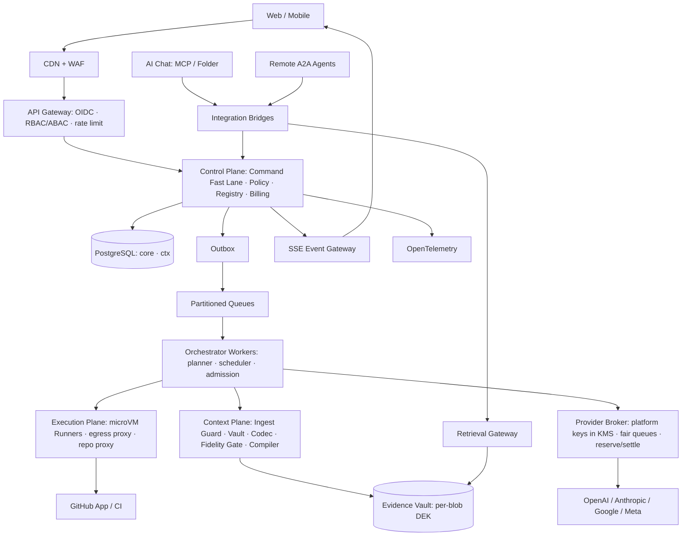

<!-- PAGE:41/50 -->

# 41. 시스템 아키텍처와 배포 토폴로지

> **목적:** 평면(plane)별 책임과 초기 배포 형태를 정한다. · **결정:** D-005, D-017, D-019, D-037 · **계약:** `contracts/Context_Mesh_Spec.md`

### 평면
- **Control Plane:** Auth, Command(Fast Lane 분리), Policy Engine(LLM 밖), Agent Registry, Billing/Ledger, Event Projection, Fast Read API.
- **AI Plane:** Planner, Topology Selector, Scheduler·Admission, Provider Broker(플랫폼 키를 복호화할 수 있는 유일한 서비스).
- **Context Plane:** Ingest Guard(비밀·ACL·민감도), Evidence Vault, 결정적 Codec Worker(키·GitHub 쓰기·외부 네트워크 없음), Fidelity Gate, Packet Compiler, Retrieval Gateway.
- **Execution Plane:** 개발/검증 Runner 풀 분리, egress 프록시, 저장소 프록시. Runner는 DB·KMS에 직접 접근하지 않는다.
- **Research Plane(M6):** 격리 평가 Runner, Harness Registry, Promotion Controller. 고객 Runner와 네트워크·자격·저장소가 다르다.
- **Data Plane:** PostgreSQL(정본), Outbox, Object Storage(암호화 산출물), Tracing.
5좌석은 프로젝트별 논리 슬롯이며 인프라 워커 수와 다르다. 확장은 좌석이 아니라 큐별 처리 용량에 따라 수평으로 한다.

### 스택
Next.js/React + TypeScript API·워커, PostgreSQL ≥ 14(multirange 사용), 큐(관리형 또는 Postgres 기반으로 시작), S3 호환 Object Storage, microVM Sandbox, OpenTelemetry, GitHub App, KMS/Secret Manager. 공급사 공식 SDK만. 클라우드 종속은 IaC 인터페이스로 제한한다.

### 초기 vs 확장
초기: 단일 리전, 관리형 Postgres, API 2개 이상 복제, 큐 분리한 단일 백엔드 + 워커(마이크로서비스 분할은 필요해질 때), Kubernetes는 필수 아님. 확장: 큐 파티션, 워크로드별 우선순위, Read Replica, 테넌트 샤드, 지역별 데이터 보존, 유료·규제 요구에 따른 지역 간 DR.

### 요구사항
| ID | 요구사항 | 수용 기준 |
|---|---|---|
| R41-1 | 무손실 재시작 | API 재시작 중 저장된 명령·작업 유실 0 |
| R41-2 | 평면 격리 | Runner·Codec Worker에서 DB·KMS·공급사 엔드포인트 직접 연결 불가(네트워크 정책 테스트) |
| R41-3 | 공급망 | 배포마다 SBOM 생성, 서명된 이미지만 실행, 공급망 사고 runbook 준비 |

---
